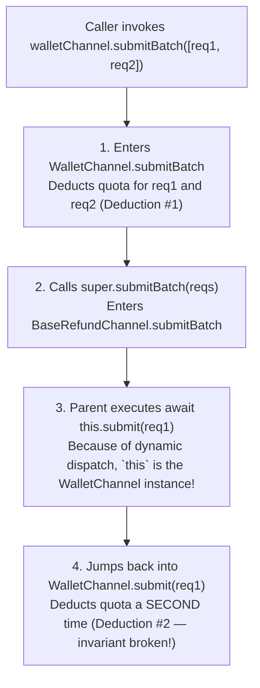
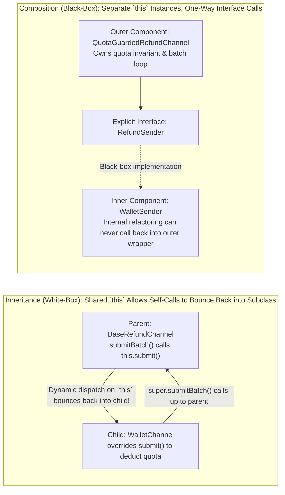

> Note 10 of 10 (Series Finale) in the *Programming Thinking* series. The premise for the series is set out in the [opening essay](/notes/programming-taste-in-the-agent-era/).
>
> The cheaper it gets to generate code, the more valuable engineering judgment becomes. This series is my attempt to dust off classic software design principles, trace each one back to its original paper, and figure out where it still holds up—and where it breaks.

This is the final note in the *Programming Thinking* series.

Throughout the previous nine notes, a recurring practical question has been waiting in the wings: when multiple modules—like our four refund channels—all need to reuse common mechanics such as batch submission, quota checking, or retry policies, what is the safest way to share that code without tangling the modules together?

Traditional object-oriented tutorials reach immediately for **class inheritance**: extract a `BaseRefundChannel` parent class, put the shared methods inside it, and have every channel `extends BaseRefundChannel`.

Yet in 1994, in the opening chapter of *Design Patterns*, the Gang of Four stated their very first design rule to counter that reflex—the **Composite Reuse Principle (CRP)**, better known by its famous maxim: **"Favor object composition over class inheritance."** [1]

Most developers learn that rule as a slogan about flexibility: *"Composition lets you swap behavior at runtime."*

That's true, but it misses the deeper hazard of inheritance. In plain English: **class inheritance is "white-box reuse." Because `this` dynamically dispatches back into subclasses at runtime, a parent class's private self-call structure (`this.someMethod()`) is silently published as an implicit contract that subclasses depend on. A completely valid internal refactoring inside the parent class can shatter a subclass's invariants without a single compiler warning. Object composition ("black-box reuse") is how you keep each module's invariants locked safely inside its own walls** [1][2].

Let's watch a textbook inheritance hierarchy cause a double-deduction bug in our refund subsystem.

---

## How an Innocent Parent Refactoring Corrupted a Subclass's Invariant

Suppose we have a base class `BaseRefundChannel` that provides two public operations: `submit(req)` for a single refund, and `submitBatch(reqs)` for a batch of refunds.

In Version 1 of the base class, both methods call the abstract hook `doSend(req)` directly:

```ts
// Version 1 of BaseRefundChannel: submit and submitBatch both call doSend directly
export abstract class BaseRefundChannel {
  protected abstract doSend(req: RefundRequest): Promise<ChannelReceipt>

  async submit(req: RefundRequest): Promise<ChannelReceipt> {
    return this.doSend(req)
  }

  async submitBatch(reqs: RefundRequest[]): Promise<ChannelReceipt[]> {
    const receipts: ChannelReceipt[] = []
    for (const req of reqs) {
      receipts.push(await this.doSend(req))
    }
    return receipts
  }
}
```

Now an engineer on the wallet team writes `WalletChannel extends BaseRefundChannel`. To enforce Invariant 1 (cumulative refunds must never exceed the order's refundable quota), they override both `submit` and `submitBatch` to deduct the order's remaining quota before delegating to `super`:

```ts
export class WalletChannel extends BaseRefundChannel {
  constructor(private quotaGuard: OrderQuotaGuard) {
    super()
  }

  protected async doSend(req: RefundRequest): Promise<ChannelReceipt> {
    // Credits customer wallet balance...
  }

  // Override single submit: deduct quota once, then call super.submit
  override async submit(req: RefundRequest): Promise<ChannelReceipt> {
    await this.quotaGuard.deductQuota(req.orderId, req.amount)
    return super.submit(req)
  }

  // Override batch submit: deduct quota for each item in batch, then call super.submitBatch
  override async submitBatch(reqs: RefundRequest[]): Promise<ChannelReceipt[]> {
    for (const req of reqs) {
      await this.quotaGuard.deductQuota(req.orderId, req.amount)
    }
    return super.submitBatch(reqs)
  }
}
```

Every unit test for both `BaseRefundChannel` and `WalletChannel` passes 100%.

Three months later, a maintainer tidying up `BaseRefundChannel` notices a tiny duplication: *"Look, `submitBatch` loops and calls `this.doSend(req)`, which is the exact body of `this.submit(req)`! Let's clean that up so `submitBatch` calls `this.submit(req)` instead."*

```ts
// Version 2 of BaseRefundChannel: a seemingly harmless DRY refactoring inside the parent
export abstract class BaseRefundChannel {
  protected abstract doSend(req: RefundRequest): Promise<ChannelReceipt>

  async submit(req: RefundRequest): Promise<ChannelReceipt> {
    return this.doSend(req)
  }

  async submitBatch(reqs: RefundRequest[]): Promise<ChannelReceipt[]> {
    const receipts: ChannelReceipt[] = []
    for (const req of reqs) {
      // Changed this.doSend(req) to this.submit(req)
      receipts.push(await this.submit(req))
    }
    return receipts
  }
}
```

All of `BaseRefundChannel`'s unit tests stay green, and the PR merges.

**That night in production, every batch wallet refund deducts the order's refundable quota twice!**

Trace the call stack to see how the trap snapped shut:



Look at why this bug is so insidious:

1. Did the author of `BaseRefundChannel` write a bug? No—viewed in isolation, having `submitBatch` call `this.submit` is completely reasonable.
2. Did the author of `WalletChannel` write a bug? No—when they wrote it, `super.submitBatch` didn't call `submit`.
3. **The culprit is dynamic dispatch across an inheritance boundary**: whenever a parent method calls `this.anotherMethod()`, `this` resolves at runtime to the subclass. That means **whether a parent class calls its own methods internally is no longer a private implementation detail—it has been published as an unstated contract that can silently break any subclass** [2][3].

---

## Tracing Back to 1994 and 1998: White-Box Reuse and the Fragile Base Class Problem

In computer science, this failure mode is known as **the Fragile Base Class Problem**:

- **In 1994, the Gang of Four (*Design Patterns*, Chapter 1)** contrasted class inheritance (**white-box reuse**) with object composition (**black-box reuse**) [1]. Inheritance is "white-box" because the internals of the parent class are visible to—and entangled with—the subclass. Unless you read the parent class's source code line by line to see which methods call which other methods on `this`, you cannot safely override any method. In the Gang of Four's famous words: **"Inheritance breaks encapsulation."** [1]
- **In 1998, Leonid Mikhajlov and Emil Sekerinski published *"A Study of the Fragile Base Class Problem"* at ECOOP** [2], proving formally that in any language combining inheritance, method overriding, and self-recursion (`this` calls), a base-class modification that is 100% behaviorally equivalent on the base class alone can violate the safety invariants of its subclasses. (Joshua Bloch later popularized this exact mechanism in *Effective Java* Item 18 with his classic `InstrumentedHashSet.addAll()` example [3].)

This also resolves the historical thread we opened in the [opening essay](/notes/programming-taste-in-the-agent-era/) and [Note 5 (Open-Closed Principle)](/notes/open-closed-only-the-guessed-axis/):

- Why did Bertrand Meyer's 1988 version of the Open-Closed Principle rely on **implementation inheritance**, whereas Robert C. Martin's 1996 version replaced it with **abstract interfaces and polymorphic composition**?
- Because between 1988 and 1996, large-scale C++ projects learned the hard way that deep implementation inheritance trees are brittle: changing a concrete base class ripples unpredictable breakage down through every derived class.

---

## Locking Invariants Inside Black Boxes with Object Composition

How do we fix `WalletChannel` using the Composite Reuse Principle?

We replace the `BaseRefundChannel` inheritance hierarchy with two separate, black-box components wired together through an explicit interface [1][3]:

```ts
// 1. Narrow transport interface — no base class, no self-call hierarchy
export interface RefundSender {
  sendSingle(req: RefundRequest): Promise<ChannelReceipt>
}

// 2. Concrete wallet sender: only knows how to execute a single wallet transfer
export class WalletSender implements RefundSender {
  async sendSingle(req: RefundRequest): Promise<ChannelReceipt> {
    // Credits wallet balance...
  }
}

// 3. Composed workflow: owns quota deduction and batching in one black box
export class QuotaGuardedRefundChannel {
  constructor(
    private sender: RefundSender,        // Composed black-box collaborator
    private quotaGuard: OrderQuotaGuard, // Composed black-box collaborator
  ) {}

  async submit(req: RefundRequest): Promise<ChannelReceipt> {
    await this.quotaGuard.deductQuota(req.orderId, req.amount)
    return this.sender.sendSingle(req)
  }

  async submitBatch(reqs: RefundRequest[]): Promise<ChannelReceipt[]> {
    const receipts: ChannelReceipt[] = []
    for (const req of reqs) {
      // Safe! QuotaGuardedRefundChannel owns both submit and submitBatch;
      // WalletSender cannot call back into QuotaGuardedRefundChannel.
      receipts.push(await this.submit(req))
    }
    return receipts
  }
}
```

Compare the two structures visually:



Look at the right-hand side of the diagram:

- `QuotaGuardedRefundChannel` and `WalletSender` are two distinct objects—**they do not share a `this` pointer**.
- No matter how `WalletSender` refactors its private helpers, a call inside `WalletSender` can never bounce back up into `QuotaGuardedRefundChannel.submit()` and trigger a second quota deduction.
- The quota invariant stays sealed inside `QuotaGuardedRefundChannel`, and the transport details stay sealed inside `WalletSender`.

---

## Navigating the Gray Areas: When Is Inheritance Still the Right Tool?

"Favor composition over inheritance" does not mean `extends` is a syntax error. In three well-bounded situations where fragile self-call loops cannot arise, inheritance (or subtyping) remains clean and idiomatic:

1. **Error and Exception Hierarchies**:
   Custom domain errors like `class InsufficientReserveError extends RefundDomainError extends Error` carry structured metadata and rely on prototype-chain matching (`instanceof`), with zero self-call methods to override.
2. **Closed Template Classes That Forbid Overriding Self-Called Methods**:
   As Joshua Bloch notes in *Effective Java* Item 19 (*"Design and document for inheritance or else prohibit it"*), if you do write an abstract base class, **never allow a public overridable method to be called internally by another overridable method** [3]. If `BaseRefundChannel` marks `submit` and `submitBatch` as `final` (non-overridable) and only exposes `protected abstract doSend()`, the fragile base class loop is impossible.
3. **Algebraic Data Types (Discriminated Unions)**:
   In modern TypeScript, Rust, and Kotlin, many hierarchies that 1990s object-oriented code modeled via class inheritance (such as `SettledReceipt` vs. `PendingReceipt`) are better modeled as flat discriminated unions (`type Receipt = SettledReceipt | PendingReceipt`), avoiding class inheritance altogether.

---

## Closing the Series: Seven Diagnostic Questions for the Age of AI

With Note 10, our journey through the *Programming Thinking* series is complete.

Let's return one last time to the question we asked in the [opening essay](/notes/programming-taste-in-the-agent-era/): **when coding agents can generate hundreds of lines of syntactically clean code in seconds, why spend time studying design principles from 1972 to 1996?**

Because as we've seen across these ten notes:

- These principles were never a single deductive pyramid handed down from on high; they are **eight hard-won post-mortem lessons** written by six unrelated groups over twenty-two years to stop specific engineering disasters.
- When you strip away those historical disasters and feed bare slogans to a coding agent, the agent will happily generate 1:1 shadow interfaces for every class, splinter cohesive invariants across tiny files, and build bloated middleman wrappers to hide dots.
- **An agent can execute any single refactoring pattern faster than a human ever will—but deciding *which* principle applies when two of them pull the same code in opposite directions still depends on human judgment about how the business will grow.**

Here is the complete **diagnostic review table** distilling all ten notes in this series. Next time you review a pull request—whether written by a teammate or generated by an agent—skip the textbook slogans and ask the diagnostic questions in the middle column:

| Note & Concept | The Dogmatic Question to Drop | The Diagnostic Question to Ask Instead | When to Stop / Hold Back |
|---|---|---|---|
| **[Note 2 · Cohesion](/notes/what-belongs-in-one-module/)** | *"Do these functions have similar names? Are the files tiny?"* | **"When requirements shift, must these pieces change together? Do they guard the same invariant?"** | Never split two functions that enforce the same invariant (like currency check + addition) just to make files shorter. |
| **[Note 3 · Coupling](/notes/three-invisible-couplings/)** | *"How many `import` lines are at the top of the file?"* | **"How much of Module B's internals must Module A know? If the contract breaks, will the compiler flag it?"** | Never replace an explicit transactional call with an untyped event string or shared mutable map just to delete an `import`. |
| **[Note 4 · Single Responsibility](/notes/single-responsibility-is-an-actor/)** | *"Does this class do only one thing?"* | **"How many distinct stakeholder groups (actors) can demand changes to this module?"** | If three small helpers answer to the exact same Finance actor and change together, keep them in one module. |
| **[Note 5 · Open-Closed](/notes/open-closed-only-the-guessed-axis/)** | *"Can we add features without editing any existing file?"* | **"Along which axis is this code most likely to grow next (new channels vs. new operations)?"** | Don't build speculative extension points before a real axis of change emerges; editing a composition root is normal. |
| **[Note 6 · Liskov Substitution](/notes/liskov-what-the-signature-does-not-check/)** | *"Does the subclass match the interface's type signature?"* | **"When swapped in, does this implementation honor every precondition, postcondition, invariant, and history rule callers rely on?"** | Split optional capabilities into separate interfaces—never stub unsupported methods with `throw` or silent no-ops. |
| **[Note 7 · Dependency Inversion](/notes/dependency-inversion-who-owns-the-interface/)** | *"Did we put an `IXxxService` interface between the classes?"* | **"Who owns the vocabulary of this interface? Would swapping Stripe for an in-memory map change a single line of the interface?"** | Don't invert dependencies toward stable domain primitives (`Money`) or pure functions—import them directly. |
| **[Note 8 · Interface Segregation](/notes/interface-segregation-client-perspective-slice/)** | *"Does every interface have only one method?"* | **"Is this specific caller forced to see methods it never uses—or mutation methods it shouldn't have permission to call?"** | Methods that the same caller role always uses together (like `begin`/`commit`/`rollback`) belong in the same interface. |
| **[Note 9 · Law of Demeter](/notes/law-of-demeter-the-middlemans-dilemma/)** | *"How many dots (`.`) are on this line?"* | **"Am I piercing a behavior object's encapsulation to make decisions for it, or just reading a data structure?"** | When narrow interfaces clash with knowing fewer types, side with narrow interfaces and type composition over pass-through middlemen. |
| **Note 10 · Composite Reuse** | *"Can we deduplicate these two classes with a shared base class?"* | **"Will inheriting from this base class expose my subclass's invariants to the parent's internal `this` self-calls?"** | Reuse cross-cutting mechanics (retries, quota guards, batching) by injecting composed black-box components, not deep class hierarchies. |

Models and tools will keep getting faster every quarter, but the physics of how software rots will not change. May these ten notes serve as a practical compass for keeping your codebase clean in the age of AI.

---

## Series Outline (Complete 10-Part Series)

- Opening · [Rereading Classic Design Principles in the Age of AI](/notes/programming-taste-in-the-agent-era/)
- Cohesion · [The Standard Is What Must Change Together](/notes/what-belongs-in-one-module/)
- Coupling · [Measuring How Much Two Modules Know About Each Other](/notes/three-invisible-couplings/)
- Single Responsibility · [One Responsibility Maps to One Group of Stakeholders](/notes/single-responsibility-is-an-actor/)
- Open-Closed · [First Identify Which Way the Code Will Grow](/notes/open-closed-only-the-guessed-axis/)
- Liskov Substitution · [A Subtype Must Seamlessly Stand In for Its Supertype](/notes/liskov-what-the-signature-does-not-check/)
- Dependency Inversion · [What Inverts Is Who Owns the Interface](/notes/dependency-inversion-who-owns-the-interface/)
- Interface Segregation · [An Interface Is a Slice from the Client's Point of View](/notes/interface-segregation-client-perspective-slice/)
- Law of Demeter · [Balancing Direct Knowledge Against Middleman Bloat](/notes/law-of-demeter-the-middlemans-dilemma/)
- Composite Reuse · Prefer Object Composition to Keep Invariants Private *(this note)*

## References

1. [Erich Gamma, Richard Helm, Ralph Johnson, John Vlissides, *Design Patterns: Elements of Reusable Object-Oriented Software*, Addison-Wesley, 1994](https://dl.acm.org/doi/book/10.5555/186897) — Chapter 1 states *"Favor object composition over class inheritance"* and contrasts white-box reuse with black-box reuse.
2. [Leonid Mikhajlov, Emil Sekerinski, “A Study of the Fragile Base Class Problem”, *ECOOP '98*, Springer LNCS 1445, 1998, 355–382](https://dl.acm.org/doi/10.5555/646155.679700) ([PDF](https://cas.mcmaster.ca/~emil/pubs/fragile/ecoop98.pdf)) — Formal analysis of how valid base-class refactorings break subclass invariants under self-recursion.
3. [Joshua Bloch, *Effective Java* (3rd Edition), Addison-Wesley, 2018](https://www.oreilly.com/library/view/effective-java-3rd/9780134686097/) — Item 18 (*Favor composition over inheritance*) and Item 19 (*Design and document for inheritance or else prohibit it*).
