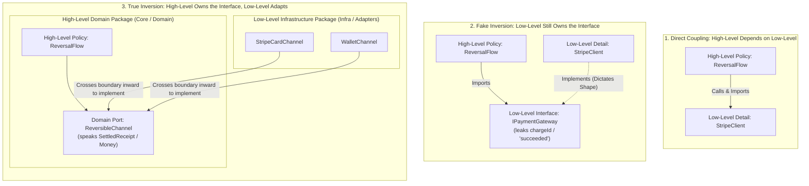

> Note 7 of 10 in the *Programming Thinking* series. The premise for the series is set out in the [opening essay](/notes/programming-taste-in-the-agent-era/).
>
> The cheaper it gets to generate code, the more valuable engineering judgment becomes. This series is my attempt to dust off classic software design principles, trace each one back to its original paper, and figure out where it still holds up—and where it breaks.

At the end of the [previous note](/notes/liskov-what-the-signature-does-not-check/), we extracted a `ReversibleChannel` interface so that refund channels supporting reversals could be swapped in safely. That left one lingering question: **who should define that interface, and which package does it belong in?**

At first glance, the question sounds trivial. Once you've extracted an `interface` and stopped calling `new ConcreteChannel()` inside your business logic, haven't you already satisfied the **Dependency Inversion Principle (DIP)**?

I used to think so—until I worked on codebases where every module was dutifully separated by an interface and wired up through a dependency-injection container, yet swapping out a payment provider or changing a database query still forced edits across half the business layer.

Extracting an interface is not the same thing as inverting a dependency. **If an interface is just traced over the shape of a low-level implementation, the dependency still points in the exact same direction. A dependency only inverts when the high-level business module claims ownership of the interface.**

Let's build that up step by step, starting from the simplest code we've all written.

---

## The Classic Starting Point: Why Not Call the Low-Level Module Directly?

Suppose we are implementing the reversal workflow (`ReversalFlow`) in our refund subsystem. When finance spots an over-refunded card transaction and initiates a reversal to pull the funds back, the most direct code imports the payment gateway client (say, Stripe) right inside `ReversalFlow`:

```ts
// Low-level module: wraps the third-party card gateway SDK
class StripeClient {
  async createRefundReversal(chargeId: string, amountCents: number): Promise<{ id: string; status: string }> {
    // Calls Stripe HTTP API...
    return { id: 'rev_123', status: 'succeeded' }
  }
}

// High-level module: business workflow for reversals
class ReversalFlow {
  private stripe = new StripeClient()

  async execute(orderId: string, chargeId: string, amountCents: number): Promise<void> {
    if (amountCents <= 0) throw new Error('Reversal amount must be positive')
    const res = await this.stripe.createRefundReversal(chargeId, amountCents)
    if (res.status !== 'succeeded') {
      throw new Error(`Reversal failed: ${res.id}`)
    }
  }
}
```

The division of labor here is straightforward: `ReversalFlow` holds the high-level business policy (when a reversal is allowed), while `StripeClient` handles the low-level mechanics (talking to Stripe over HTTPS).

The two problems with this setup are equally obvious:

1. **You can't test the policy without the network**: Running a unit test for `ReversalFlow.execute` fires a live request at Stripe's servers.
2. **The business flow is welded to a single channel**: The day product asks `ReversalFlow` to support wallet-balance reversals too, you discover `this.stripe` and `chargeId` are hardcoded throughout the class.

To fix both problems, almost every developer takes the same next step: extract an interface. And that is right where ninety percent of codebases take a wrong turn.

---

## The Common Trap: "Carbon-Copy" Fake Inversion

Ask a developer (or a coding agent) to "apply Dependency Inversion" to the code above, and you will almost always get this refactoring:

Open `StripeClient`, copy its method signatures verbatim into a new `IStripeClient` (or rename it `IPaymentGateway` to sound generic), and inject it into `ReversalFlow` via the constructor:

```ts
// Extracted by copying StripeClient's method signature verbatim
interface IPaymentGateway {
  createRefundReversal(chargeId: string, amountCents: number): Promise<{ id: string; status: string }>
}

class StripeClient implements IPaymentGateway {
  async createRefundReversal(chargeId: string, amountCents: number) {
    return { id: 'rev_123', status: 'succeeded' }
  }
}

class ReversalFlow {
  // Now injected via constructor
  constructor(private gateway: IPaymentGateway) {}

  async execute(orderId: string, chargeId: string, amountCents: number): Promise<void> {
    const res = await this.gateway.createRefundReversal(chargeId, amountCents)
    if (res.status !== 'succeeded') {
      throw new Error(`Reversal failed: ${res.id}`)
    }
  }
}
```

On the surface, `ReversalFlow` no longer references the concrete `StripeClient` class, and you can pass a mock into the constructor during tests.

**But has the dependency actually been inverted?**

Try plugging in a second channel and see what happens. Suppose we now wire up our internal `WalletLedger`. The wallet ledger doesn't have a Stripe `chargeId` (it tracks internal ledger `entryId`s); it doesn't take raw `amountCents` integers (Invariant 4 of our subsystem requires a currency-safe `Money` value object); and its status strings are `'settled'` and `'pending'`, not Stripe's `'succeeded'`.

Suddenly the disguise falls off. Even though the interface is named `IPaymentGateway`, every inch of it is shaped like Stripe:

- `chargeId` and `amountCents` are Stripe SDK vocabulary;
- `status === 'succeeded'` is a Stripe API string literal;
- Even the return payload structure mirrors Stripe's JSON response.

To accommodate the wallet channel, you have to change `IPaymentGateway`—and the moment you touch `IPaymentGateway`, you have to rewrite `ReversalFlow` right along with it.

**That is fake inversion.** Putting an `interface` between two modules does nothing if the low-level module still dictates the terms of that interface. The high-level business logic is still taking orders from the low-level SDK; you just added a piece of tracing paper between them.

---

## Tracing Back to 1996: What Actually Gets "Inverted"?

To see what real inversion looks like, we have to go back to Robert C. Martin's May 1996 *C++ Report* article, *"The Dependency Inversion Principle"* [1].

Martin was pushing back against a habit ingrained by decades of **Structured Analysis and Design**. In classic top-down decomposition, you start with a high-level function, break it down into mid-level control functions, and break those down into low-level I/O routines (for instance, a `Copy()` routine calling `ReadKeyboard()` and `WritePrinter()`).

In C++, those runtime calls translated directly into `#include` directives: high-level policy modules physically included the header files of low-level implementation modules. That created a perverse engineering dynamic:

- The most valuable, long-lived asset in a codebase is its **high-level policy**—the domain rules that define the business (e.g., *"cumulative refunds cannot exceed the original payment"* or *"reversals must append an offsetting ledger entry"*).
- The most volatile, replaceable part is the **low-level detail**—which database driver, HTTP client, or payment vendor you happen to use this year.
- Yet top-down design forces **the valuable, stable policies to depend directly on the volatile, replaceable details**. When a vendor SDK changes a struct field, the core domain has to be edited and recompiled. And if you ever want to reuse those domain rules in another context, you can't, because they drag an entire tree of low-level drivers behind them.

To break that coupling, Martin stated the principle in two parts [1]:

> A. High-level modules should not depend on low-level modules. Both should depend on abstractions.
>
> B. Abstractions should not depend upon details. Details should depend upon abstractions.

Our `IPaymentGateway` example failed because it followed Part A while violating Part B. Because `chargeId` and `'succeeded'` leaked straight out of Stripe's SDK into the interface definition, **the abstraction itself depended on the detail**.

In *Agile Software Development (PPP)*, Martin sharpened this into a concrete rule of package design: **what inverts is not just the direction of source-code imports, but the ownership of the interface** [2][3].

Comparing the three arrangements side by side makes the shift obvious:



Look closely at Diagram 3:

- At runtime, **control flow** still moves top-down (`ReversalFlow` invokes `StripeCardChannel`).
- At compile time, **source-code dependency** points in the exact opposite direction: the `domain` package contains zero imports pointing at `infra`. Instead, `infra` has to import the interface defined inside `domain` and conform to the domain's terms [3].

---

## Writing True Dependency Inversion in the Refund Subsystem

Now we can answer the question from [Note 6](/notes/liskov-what-the-signature-does-not-check/): `ReversibleChannel` belongs inside the domain package (`domain/refund/`), and its signature must be written purely in the vocabulary of the refund domain.

From `ReversalFlow`'s perspective, Stripe `chargeId`s and minor-unit integer conversions do not exist. What `ReversalFlow` cares about is taking a `SettledReceipt`, a reason, and an idempotency key, and getting back a `ReversalReceipt`:

```ts
// Located in domain/refund/ports.ts — Owned by the high-level domain
export interface ReversibleChannel {
  readonly kind: 'card' | 'wallet'
  reverse(
    originalReceipt: SettledReceipt,
    reason: string,
    idempotencyKey: string,
  ): Promise<ReversalReceipt>
}

// Located in domain/refund/reversal-flow.ts — High-level business policy
export class ReversalFlow {
  constructor(
    private channels: ReadonlyMap<ReversibleChannel['kind'], ReversibleChannel>,
    private ledger: RefundLedgerStore,
  ) {}

  async execute(refundId: string, reason: string, idempotencyKey: string): Promise<ReversalReceipt> {
    const record = await this.ledger.findById(refundId)
    // Invariant 3: Only settled refunds can be reversed, via an appended offsetting entry
    if (record.status !== 'settled') {
      throw new InvalidRefundStateError(refundId, record.status)
    }

    const channel = this.channels.get(record.channel)
    if (!channel) {
      throw new ChannelNotReversibleError(record.channel)
    }

    const reversalReceipt = await channel.reverse(record.receipt, reason, idempotencyKey)
    await this.ledger.appendReversalEntry(refundId, reversalReceipt)
    return reversalReceipt
  }
}
```

Every type in `ReversalFlow`—`SettledReceipt`, `idempotencyKey`, `ReversalReceipt`—is a domain concept.

All the messy translation work—converting `Money` into integer cents, extracting Stripe's external reference, mapping `'succeeded'` onto a domain receipt—gets pushed out to the adapter in the infrastructure layer:

```ts
// Located in infra/channels/stripe-card-channel.ts — Detail depends on abstraction
import type { ReversibleChannel, SettledReceipt, ReversalReceipt } from '../../domain/refund/ports'

export class StripeCardChannel implements ReversibleChannel {
  readonly kind = 'card' as const

  constructor(private stripeSdk: StripeClient) {}

  async reverse(
    originalReceipt: SettledReceipt,
    reason: string,
    idempotencyKey: string,
  ): Promise<ReversalReceipt> {
    // Translate domain concepts into low-level SDK parameters inside the adapter
    const amountCents = originalReceipt.amount.toMinorUnits()
    const res = await this.stripeSdk.createRefundReversal(
      originalReceipt.externalRef,
      amountCents,
      { idempotencyKey, metadata: { reason } },
    )

    // Translate the SDK response back into the domain's contract
    return {
      id: res.id,
      reversedAmount: originalReceipt.amount,
      settledAt: new Date(res.created * 1000),
    }
  }
}
```

Here is a quick litmus test I use during code reviews: **imagine tomorrow we ripped out Stripe and SQL entirely and ran the whole refund system over an in-memory map or a CLI prompt. Would a single identifier in your domain interface need to change?**

- If the interface still mentions `SqlTransaction`, `HttpHeaders`, or `StripeChargeId`, low-level details are still leaking upward.
- If not a single line changes, the domain truly owns its interface.

---

## Navigating the Gray Areas: Three Places Engineers Get Tripped Up

Once the basic mechanics make sense, the real debates in code review almost always happen in three gray areas.

### Gray Area 1: How Do DIP, DI, and IoC Actually Differ?

Dependency Inversion (DIP), Dependency Injection (DI), and Inversion of Control (IoC) get used interchangeably in interviews and blog posts, leading many developers to assume that wiring classes up with a DI container automatically satisfies Dependency Inversion. In reality, they operate at three different levels [3]:

| Concept | Core Question It Answers | Level | Plain-English Summary |
|---|---|---|---|
| **Dependency Inversion (DIP)** | Who defines the interface contract, and which way do imports point? | **Architecture & Module Boundaries** | High-level domain sets the interface contract; low-level infrastructure adapts to it. |
| **Dependency Injection (DI)** | How does an object acquire the collaborator instance it needs? | **Object Wiring Technique** | Pass collaborators in from the outside (e.g., constructor args) instead of calling `new` inside the class. |
| **Inversion of Control (IoC)** | Who controls the timing and orchestration of execution? | **Runtime Control Flow** | Instead of your code calling a library in a loop, the framework runs the loop and invokes your handlers (*"Don't call us, we'll call you"*). |

Holding our earlier steps up against this table makes the distinction concrete:

- In **Step 2 (Fake Inversion)**, we injected `IPaymentGateway` through `ReversalFlow`'s constructor. That **used Dependency Injection (DI)** while **violating Dependency Inversion (DIP)**, because the interface was still dictated by Stripe.
- Conversely, you can wire up `new ReversalFlow(new Map([['card', new StripeCardChannel(sdk)]]), ledger)` by hand in `main.ts` without any IoC container at all—and as long as `ReversibleChannel` is owned by the domain, you have genuine **Dependency Inversion**.

### Gray Area 2: Can the High-Level Interface Ignore Physical Reality?

Once developers internalize *"the high-level module defines the interface it wants,"* it is tempting to swing to the opposite extreme and write wishful interfaces that pretend physical constraints don't exist:

```ts
// Wishful thinking: demanding instant, synchronous settlement from a network gateway
interface IdealRefundChannel {
  reverseInstantly(receipt: SettledReceipt): ReversalReceipt // No Promise, no pending state
}
```

No adapter in the world can make an interbank card network settle synchronously in zero milliseconds.

Owning the interface means filtering out **accidental implementation details**, not denying **essential domain constraints**:

- **Accidental details** (whether a vendor calls a field `charge_id` or `txn_id`, whether amounts are formatted in cents or decimal strings, whether transport uses REST or gRPC) belong strictly inside the adapter.
- **Essential constraints** (moving money across networks is asynchronous, network calls can fail and require an `idempotencyKey`, a refund may land in a `'pending'` state before `'settled'`, manual bank transfers cannot be auto-reversed) are facts of the domain itself. As we saw in [Note 6 (Liskov Substitution)](/notes/liskov-what-the-signature-does-not-check/), if a high-level interface pretends an operation is synchronous and infallible when the underlying reality isn't, adapters are forced to block threads or throw undeclared exceptions—shattering behavioral subtyping.

**True dependency inversion filters out the vendor's dialect, not the laws of physics.**

### Gray Area 3: Should Every Class Have an Interface? (The AI Over-Abstraction Trap)

When we wrote code by hand, the friction of creating extra files kept interface proliferation somewhat in check. With coding agents, telling a model to *"follow SOLID and Dependency Inversion"* will happily generate a 1:1 shadow interface for every single class in your repo in five seconds flat: `IMoney`, `IRefundValidator`, `IDateFormatter`, `IOrderHelper`.

Suddenly you have to jump through three layers of indirection just to read a five-line helper, with zero architectural payoff.

How do you decide which seams deserve Dependency Inversion and which ones should just `import` the concrete class directly?

Alongside DIP, Martin formulated the **Stable Dependencies Principle (SDP): dependencies should point in the direction of stability** [2]. If we plot the modules in our refund subsystem by how often and why they change, the rule for where to invert becomes clear:


Look at the two arrows in the diagram:

1. **When depending on something *more* stable than you (right side)—do not invert; import it directly.**
   Take our `Money` value object (which enforces Invariant 4: currencies cannot be mixed) or a pure discount-allocation function. They have zero I/O, zero third-party dependencies, and almost never change. Having `ReversalFlow` directly `import { Money } from './money'` is completely healthy. Wrapping `Money` in an `IMoney` interface adds noise without buying an ounce of decoupling.
2. **When touching something *less* stable than you across an architectural boundary (left side)—invert without hesitation.**
   Third-party payment SDKs, database schemas, message brokers, and cross-team RPC services change for reasons your domain doesn't control and drag heavy runtime dependencies with them. Defining a domain-owned Port at those boundaries—and forcing the infrastructure layer to write an Adapter pointing inward—is where Dependency Inversion pays for itself ten times over.

---

## Summary: Three Questions for Reviewing Dependency Direction

Next time you (or your coding agent) reach for an `interface` between two modules, pause and ask three questions:

1. **Who owns the vocabulary of this interface?** Look at the method names, parameter types, and return payloads. If you swapped Stripe for an internal wallet or Postgres for an in-memory map, would the interface definition have to change? If yes, the low-level detail still owns the contract.
2. **Does it separate essential domain constraints from accidental vendor quirks?** Does the contract honestly express async settlement, idempotency, and domain failure states while keeping vendor error codes and wire formats locked inside the adapter?
3. **Is the target module actually less stable than the caller?** If the target is a pure, stable domain value object or internal calculation, import it directly. Save your abstraction budget for seams that cross I/O, process, or organizational boundaries.

Once you establish that **the high-level caller owns the interface**, a new problem immediately appears: in a real system, a single underlying resource (like our refund ledger) is often called by **several different high-level modules**—support agents submitting refunds, finance jobs running reconciliation, risk engines querying velocity, and merchant dashboards rendering read-only views. If callers own the interface, what happens when four different callers want four different things from the same module?

That brings us to Note 8: **the Interface Segregation Principle**.

---

## Series Outline

- Opening · [Rereading Classic Design Principles in the Age of AI](/notes/programming-taste-in-the-agent-era/)
- Cohesion · [The Standard Is What Must Change Together](/notes/what-belongs-in-one-module/)
- Coupling · [Measuring How Much Two Modules Know About Each Other](/notes/three-invisible-couplings/)
- Single Responsibility · [One Responsibility Maps to One Group of Stakeholders](/notes/single-responsibility-is-an-actor/)
- Open-Closed · [First Identify Which Way the Code Will Grow](/notes/open-closed-only-the-guessed-axis/)
- Liskov Substitution · [A Subtype Must Seamlessly Stand In for Its Supertype](/notes/liskov-what-the-signature-does-not-check/)
- Dependency Inversion · What Inverts Is Who Owns the Interface *(this note)*
- Interface Segregation · [An Interface Is a Slice from the Client's Point of View](/notes/interface-segregation-client-perspective-slice/)
- Law of Demeter · [Balancing Direct Knowledge Against Middleman Bloat](/notes/law-of-demeter-the-middlemans-dilemma/)
- Composite Reuse · [Prefer Object Composition to Keep Invariants Private](/notes/composite-reuse-inheritance-publishes-invariants/)

## References

1. [Robert C. Martin, “The Dependency Inversion Principle”, *C++ Report*, May 1996](https://web.archive.org/web/20110714224327/http://www.objectmentor.com/resources/articles/dip.pdf) — Contrasts top-down structured decomposition with object-oriented dependency inversion and introduces the two-part definition of DIP.
2. [Robert C. Martin, *Agile Software Development: Principles, Patterns, and Practices*, Prentice Hall, 2002](https://dl.acm.org/doi/book/10.5555/515230) — Chapter 11 formulates interface ownership inversion ("It is the ownership of the interface that is inverted") alongside the Stable Dependencies Principle (SDP).
3. [Martin Fowler, “Inversion of Control Containers and the Dependency Injection pattern”, 2004](https://martinfowler.com/articles/injection.html) — Clarifies the distinction between Inversion of Control (IoC), Dependency Injection (DI), and separated interface patterns.
