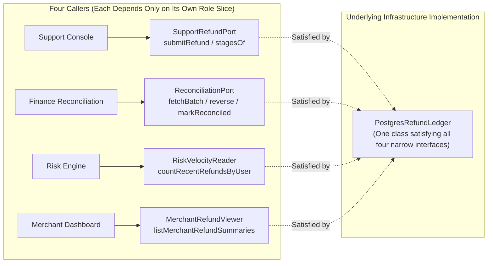

> Note 8 of 10 in the *Programming Thinking* series. The premise for the series is set out in the [opening essay](/notes/programming-taste-in-the-agent-era/).
>
> The cheaper it gets to generate code, the more valuable engineering judgment becomes. This series is my attempt to dust off classic software design principles, trace each one back to its original paper, and figure out where it still holds up—and where it breaks.

In [Note 7 (Dependency Inversion)](/notes/dependency-inversion-who-owns-the-interface/), we established that an interface should be defined and owned by its high-level caller rather than copied from a low-level implementation.

Take one step further and a practical question immediately pops up: **what happens when four completely different high-level callers all talk to the same underlying module? Whose interface is it then?**

In our refund subsystem, the central `RefundLedger` sits in exactly that position. Four distinct clients depend on it (as introduced in the [opening essay](/notes/programming-taste-in-the-agent-era/)):

1. **Support Console**: Support agents submit refunds and inspect a refund's status timeline.
2. **Finance Reconciliation**: Nightly jobs pull unsettled batches, execute reversals, and mark batches reconciled.
3. **Risk Engine**: Real-time checkout checks query a user's refund velocity over the last hour.
4. **Merchant Dashboard**: Merchants view anonymized, read-only refund summaries for their store.

The path of least resistance is to define one comprehensive `RefundLedger` interface containing every method all four clients could ever ask for.

The **Interface Segregation Principle (ISP)** exists to stop that reflex. In plain English: **never serve multiple distinct callers with one giant, all-purpose "fat interface." An interface should be a narrow capability slice cut from the point of view of a specific client—no caller should be forced to depend on methods it does not use** [1].

Let's look at the two immediate headaches a fat interface creates in production code.

---

## Two Real-World Headaches of a "Fat Interface"

Suppose we put every ledger operation into a single `RefundLedger` interface:

```ts
// A "Fat Interface" bundling methods for four different callers
export interface RefundLedger {
  // Used by Support Console
  submitRefund(req: RefundRequest): Promise<ChannelReceipt>
  stagesOf(refundId: string): Promise<RefundStage[]>

  // Used by Finance Reconciliation
  fetchUnreconciledBatch(date: string): Promise<LedgerEntry[]>
  reverseRefund(refundId: string, reason: string, idempotencyKey: string): Promise<ReversalReceipt>
  markBatchReconciled(batchId: string, operatorSignature: string): Promise<void>

  // Used by Risk Engine
  countRecentRefundsByUser(userId: string, windowMinutes: number): Promise<UserRefundVelocity>

  // Used by Merchant Dashboard
  listMerchantRefundSummaries(merchantId: string, page: PageQuery): Promise<MerchantRefundSummary[]>
}
```

Under the hood, a single `PostgresRefundLedger` class implements this interface, and we inject `RefundLedger` into all four client modules.

Here is where that convenience bites back:

### Headache 1: Violating Least Privilege (Giving Read-Only Callers a Launch Button)

Look at the **Risk Engine** and the **Merchant Dashboard**. By business definition, both are strictly **read-only consumers**—neither should ever mutate ledger state or move money.

Yet because both receive the full `RefundLedger` interface, typing `this.ledger.` inside the merchant dashboard's codebase brings up `reverseRefund` and `markBatchReconciled` right in the IDE's autocomplete menu.

As we saw in [Note 3 (Coupling)](/notes/three-invisible-couplings/), handing a read-write interface to a read-only caller downgrades an architectural guarantee into a polite wish (*"please don't call the mutation methods"*). With coding agents generating code from whatever methods are in scope, leaving mutation methods exposed on a read-only caller's interface is an accident waiting to happen.

### Headache 2: Mock Bloat in Unit Tests

The pain shows up even faster when writing unit tests.

Suppose you want to test `RiskInterceptor`, which calls just **one** method on the ledger (`countRecentRefundsByUser`):

```ts
export class RiskInterceptor {
  constructor(private ledger: RefundLedger) {}

  async checkOrderRisk(userId: string, amount: Money): Promise<RiskDecision> {
    const velocity = await this.ledger.countRecentRefundsByUser(userId, 60)
    if (velocity.count >= 5) return { allowed: false, reason: 'frequent_refunds' }
    return { allowed: true }
  }
}
```

When you write `RiskInterceptor.test.ts`, TypeScript requires your test double to satisfy the entire `RefundLedger` interface—forcing you to stub out six completely unrelated methods:

```ts
// Boilerplate tax paid in every RiskInterceptor test because of the fat interface
const fakeLedger: RefundLedger = {
  countRecentRefundsByUser: async () => ({ count: 6, totalAmount: Money.usd(50000) }),

  // RiskInterceptor never touches these 6 methods, yet every test must stub them:
  submitRefund: async () => { throw new Error('not implemented') },
  stagesOf: async () => { throw new Error('not implemented') },
  fetchUnreconciledBatch: async () => { throw new Error('not implemented') },
  reverseRefund: async () => { throw new Error('not implemented') },
  markBatchReconciled: async () => { throw new Error('not implemented') },
  listMerchantRefundSummaries: async () => { throw new Error('not implemented') },
}
```

Worse, next week when the Finance team adds an `auditToken` parameter to `markBatchReconciled`, the Risk team's unit tests fail to compile—even though nothing about risk interception changed!

---

## Tracing Back to 1996: The Xerox Printer One-Hour Recompile

Robert C. Martin formulated the Interface Segregation Principle in his August 1996 *C++ Report* article, *"The Interface Segregation Principle"* [1], based on consulting work he did for **Xerox** on a new multifunction printer system.

The Xerox machine could print, staple, fax, and scan. Early on, the software team created a single central `Job` class that held every method and state field needed by all of those operations.

As the codebase grew, development ground to a halt:

- Nearly every subsystem in the printer took a `Job` reference and therefore `#include`d `Job.h`.
- Whenever an engineer working on the stapling feature changed a method signature inside `Job.h`, every module in the printer—faxing, scanning, UI rendering, billing—had to be recompiled from scratch.
- On mid-1990s workstations, a one-line edit to stapling logic triggered an **hour-long recompile** across the entire codebase [1].

Martin's fix was to invert the way the interface was cut. Instead of one giant `Job` interface representing the whole underlying object, he created narrow interfaces per client role: `StapleJob` for the stapler, `PrintJob` for the print engine, `FaxJob` for the fax subsystem. The underlying implementation class still implemented all of them, but editing `StapleJob` no longer forced `PrintJob` callers to recompile [1].

From that experience came the classic definition of ISP:

> **Clients should not be forced to depend upon interfaces that they do not use.** [1]

Today, fast incremental compilers and dynamic/structural languages have mostly eliminated the "one-hour C++ recompile." Yet the deeper problems of a fat interface—**false coupling between unrelated teams, over-privileged callers, and bloated test doubles**—remain identical.

---

## Slicing by Client Role: Four Narrow Cards Instead of One Giant Menu

To fix `RefundLedger`, we stop asking *"what can the database table do?"* and start asking *"what does each specific caller need?"*—what Martin Fowler calls a **Role Interface** (as opposed to a **Header Interface** that mirrors every public method of a class) [2].



Each client module defines only the narrow slice it actually calls:

```ts
// 1. Owned by the Risk module (domain/risk/ports.ts)
export interface RiskVelocityReader {
  countRecentRefundsByUser(userId: string, windowMinutes: number): Promise<UserRefundVelocity>
}

// 2. Owned by the Merchant module (domain/merchant/ports.ts)
export interface MerchantRefundViewer {
  listMerchantRefundSummaries(merchantId: string, page: PageQuery): Promise<MerchantRefundSummary[]>
}

// 3. Owned by the Support module (domain/support/ports.ts)
export interface SupportRefundPort {
  submitRefund(req: RefundRequest): Promise<ChannelReceipt>
  stagesOf(refundId: string): Promise<RefundStage[]>
}

// 4. Owned by the Finance module (domain/finance/ports.ts)
export interface ReconciliationPort {
  fetchUnreconciledBatch(date: string): Promise<LedgerEntry[]>
  reverseRefund(refundId: string, reason: string, idempotencyKey: string): Promise<ReversalReceipt>
  markBatchReconciled(batchId: string, operatorSignature: string): Promise<void>
}
```

In a structurally typed language like TypeScript, `PostgresRefundLedger` doesn't even need to import all four interfaces if you wire them at the composition root—as long as its methods match the signatures, a single `PostgresRefundLedger` instance can be passed directly into all four callers.

And for data records, TypeScript's built-in `Pick<T, K>` gives you instant interface segregation at the function-parameter level without declaring a new named interface at all:

```ts
// Takes only the two fields needed to verify Invariant 1 — immune to changes elsewhere on Order
function checkRefundCap(order: Pick<Order, 'id' | 'paidAmount'>, requested: Money): boolean {
  return requested.lessThanOrEqual(order.paidAmount)
}
```

Look at what changes immediately:

1. **Compile-time least privilege**: `RiskVelocityReader` and `MerchantRefundViewer` expose zero mutation methods. Neither a new hire nor an AI agent can accidentally trigger a reversal from the merchant dashboard.
2. **One-line test doubles**: Testing `RiskInterceptor` now takes a one-method object literal `{ countRecentRefundsByUser: async () => ... }`.
3. **Blast-radius isolation**: Finance can change `markBatchReconciled` all day without breaking a single build or test in Risk, Support, or Merchant modules.

---

## Navigating the Gray Areas: Three Common Questions on Where to Stop

Slicing fat interfaces is powerful, but pushing it to extremes creates its own set of problems. Here are the three gray areas that come up most often in practice.

### Gray Area 1: Should Every Interface Have Only One Method?

When developers first learn ISP, it is tempting to assume that a 1-method interface is always better than a 3-method interface.

Pushed to that extreme, someone splits a database transaction interface into three single-method interfaces:

```ts
// Over-fragmented: tearing apart operations that are always used together by the same caller
interface TransactionBeginner   { begin(): Promise<Tx> }
interface TransactionCommitter  { commit(tx: Tx): Promise<void> }
interface TransactionRollbacker { rollback(tx: Tx): Promise<void> }
```

That isn't interface segregation—it's interface pulverization.

No caller in the world calls `begin()` without also needing `commit()` and `rollback()`. Because those three methods are **always used together by the exact same client role**, splitting them apart triples constructor noise without decoupling a single client.

**The unit of Interface Segregation is a client role, not a single method.**

- If five methods are always used together by the same caller workflow, keep all five in one cohesive role interface.
- Only split an interface when **different callers use different subsets** of its methods.

### Gray Area 2: How Does Interface Segregation (ISP) Differ from Single Responsibility (SRP)?

Both SRP and ISP result in smaller, more focused units—so how are they different?

They look at the module from **opposite sides of the boundary**:

| Principle | Vantage Point | Core Question | Classic Violation |
|---|---|---|---|
| **Single Responsibility (SRP)** | **Inside the implementation**<br/>(Whose business rules live inside this class?) | Does this module mix rules owned by multiple stakeholder departments? | One `submit()` method computing Finance rounding, Compliance logs, and Support UI strings |
| **Interface Segregation (ISP)** | **Outside from the caller**<br/>(How wide is the surface exposed to this specific client?) | Is this caller forced to see and depend on methods it never calls? | A cohesive `RefundLedgerStore` exposing its full read/write API to a read-only Risk caller |

A class can easily satisfy SRP while violating ISP. For instance, an in-memory `Stack<T>` or our `PostgresRefundLedger` storage engine may be completely cohesive on the inside, yet if you hand its entire public method surface to a caller that only needs to read a count, you violate ISP. **SRP governs how you partition implementations; ISP governs how you partition the views callers see.**

### Gray Area 3: What When One Caller Needs Several Narrow Slices at Once?

This brings us back to the trade-off we previewed in the [opening essay](/notes/programming-taste-in-the-agent-era/).

Suppose `ReversalFlow` genuinely needs three narrow slices—`RefundLookup`, `RefundTimeline`, and `RefundReversal`. If we inject all three separately, `ReversalFlow`'s constructor has to take three arguments:

```ts
class ReversalFlow {
  constructor(
    private lookup: RefundLookup,
    private timeline: RefundTimeline,
    private reversal: RefundReversal,
  ) {}
}
```

Does following ISP mean every complex workflow has to juggle half a dozen constructor parameters?

No. In TypeScript (and most modern type systems), you can keep the atomic slices narrow for simple callers while composing them cleanly for complex callers using **intersection types (`&`) or interface extension**:

```ts
// 1. Atomic slices stay narrow for callers that only need one capability
export interface RefundLookup   { findByOrder(orderId: string): Promise<Refund[]> }
export interface RefundTimeline { stagesOf(refundId: string): Promise<RefundStage[]> }
export interface RefundReversal { reverse(refundId: string, reason: string): Promise<void> }

// 2. ReversalFlow composes the exact slice combination its role requires
export type ReversalLedgerPort = RefundLookup & RefundTimeline & RefundReversal

export class ReversalFlow {
  constructor(private ledger: ReversalLedgerPort) {}
}
```

`ReversalFlow` takes a single `ledger` parameter typed to the exact three capabilities it needs—while `MerchantDashboard` and `RiskInterceptor` remain completely insulated from reversal methods.

---

## Summary: Three Questions to Audit Interface Width

Next time you design or review an interface shared across modules, ask three questions:

1. **Does any caller use only a fraction of the methods on this interface?** Check the call sites: if `RiskInterceptor` calls one method out of eight, extract a narrow role interface for it.
2. **Do unit tests have to stub out `throw new Error('not implemented')` methods?** Every dummy method in a test double is a direct symptom of an interface that is wider than its caller needs.
3. **Can read-only callers see mutation methods on their injected types?** Use narrow role interfaces (or `Pick<T, K>` / `Readonly<T>`) so the compiler enforces least privilege automatically.

Once we slice interfaces cleanly around roles, our objects collaborate through well-defined boundaries. That brings us face-to-face with the next classic tension in object-oriented design: **when Object A holds Object B, and Object B holds Object C, how do we keep callers from chaining `a.getB().getC().doSomething()` across the object graph—without turning Object A into a bloated "middleman" stuffed with pass-through forwarding methods?**

That is the subject of Note 9: **the Law of Demeter**.

---

## Series Outline

- Opening · [Rereading Classic Design Principles in the Age of AI](/notes/programming-taste-in-the-agent-era/)
- Cohesion · [The Standard Is What Must Change Together](/notes/what-belongs-in-one-module/)
- Coupling · [Measuring How Much Two Modules Know About Each Other](/notes/three-invisible-couplings/)
- Single Responsibility · [One Responsibility Maps to One Group of Stakeholders](/notes/single-responsibility-is-an-actor/)
- Open-Closed · [First Identify Which Way the Code Will Grow](/notes/open-closed-only-the-guessed-axis/)
- Liskov Substitution · [A Subtype Must Seamlessly Stand In for Its Supertype](/notes/liskov-what-the-signature-does-not-check/)
- Dependency Inversion · [What Inverts Is Who Owns the Interface](/notes/dependency-inversion-who-owns-the-interface/)
- Interface Segregation · An Interface Is a Slice from the Client's Point of View *(this note)*
- Law of Demeter · [Balancing Direct Knowledge Against Middleman Bloat](/notes/law-of-demeter-the-middlemans-dilemma/)
- Composite Reuse · [Prefer Object Composition to Keep Invariants Private](/notes/composite-reuse-inheritance-publishes-invariants/)

## References

1. [Robert C. Martin, “The Interface Segregation Principle”, *C++ Report*, August 1996](https://web.archive.org/web/20150905081105/http://www.objectmentor.com/resources/articles/isp.pdf) — Introduces ISP through the Xerox printer `Job` class case study.
2. [Martin Fowler, “RoleInterface”, *martinfowler.com*, 2006](https://martinfowler.com/bliki/RoleInterface.html) — Contrasts client-driven Role Interfaces with implementation-driven Header Interfaces.
