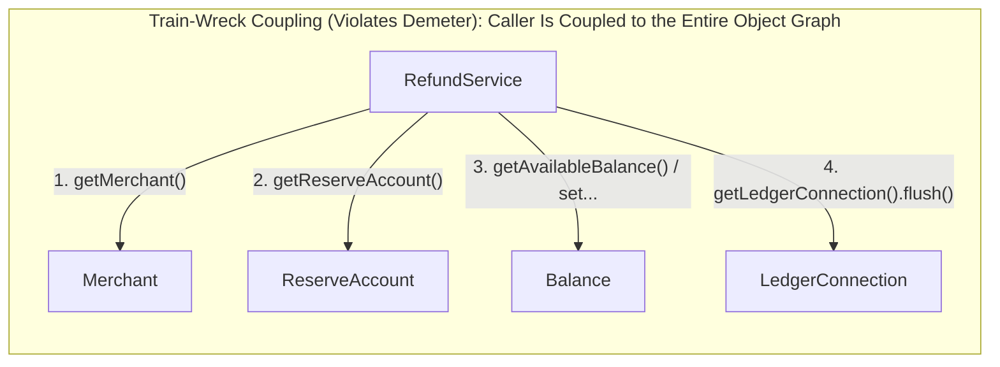
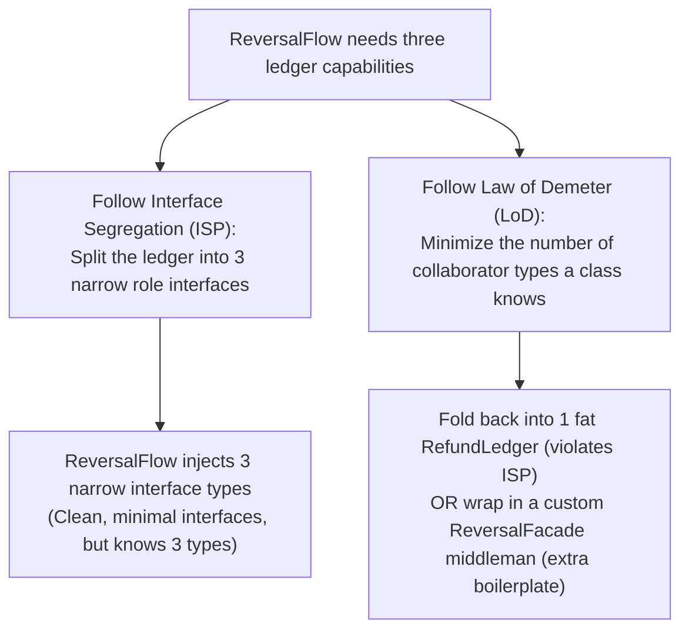

> Note 9 of 10 in the *Programming Thinking* series. The premise for the series is set out in the [opening essay](/notes/programming-taste-in-the-agent-era/).
>
> The cheaper it gets to generate code, the more valuable engineering judgment becomes. This series is my attempt to dust off classic software design principles, trace each one back to its original paper, and figure out where it still holds up—and where it breaks.

Every developer has written—or debugged—a "train wreck" method chain that looks like this:

```ts
const availableCents = order.getCustomer().getWallet().getAccountBalance().getAvailableCents()
```

Writing a line like that feels effortless: you type a dot (`.`), let IDE autocomplete guide you through four object layers, and grab the field you want in five seconds.

Maintaining it is another story. That single line drives a steel spike through `Order`, `Customer`, `Wallet`, and `AccountBalance`. If the wallet team refactors how balances are stored—say, moving wallets into an independent ledger service indexed by `customerId` instead of hanging off the `Customer` object—thirty call sites across the codebase shatter at once.

To stop modules from coupling themselves to the internal object graphs of distant collaborators, a group of researchers in 1987 formulated the **Law of Demeter (LoD)**, also known as the **Principle of Least Knowledge** [1][2].

In plain English: **an object should know as little as possible about the internal structure of other objects. Don't reach through your direct collaborator to rummage around in its pockets, and don't boss its internal parts around—talk only to your immediate friends** [1][2].

Yet among the seven classic design principles, the Law of Demeter is also the one most frequently misapplied—and the one most likely to collide with [Interface Segregation](/notes/interface-segregation-client-perspective-slice/). Apply it mechanically by hiding every dot behind a wrapper method, and you quickly turn your classes into bloated **middlemen** stuffed with pointless pass-through code.

Let's unpack what the Law of Demeter was actually built to prevent, where dot-counting goes wrong, and how to balance direct knowledge against middleman bloat.

---

## How One Innocent Method Chain Locks Three Modules Together

Consider a concrete workflow in our refund subsystem: when a customer refund is issued, we need to debit the merchant's reserve account and flush the entry to the ledger.

Written the hasty way, `RefundService` reaches straight through `Order` and `Merchant` to manipulate the reserve account's internals:

```ts
// Train-wreck coupling: RefundService reaches across three object boundaries
export class RefundService {
  async refundToWallet(order: Order, amount: Money): Promise<void> {
    // 1. Reach through Order → Merchant → ReserveAccount → Balance
    const reserve = order.getMerchant().getReserveAccount()
    if (reserve.getAvailableBalance().lessThan(amount)) {
      throw new InsufficientMerchantReserveError(order.id)
    }

    // 2. Directly mutate deep internal state and flush the connection
    reserve.setAvailableBalance(reserve.getAvailableBalance().subtract(amount))
    await reserve.getLedgerConnection().flush()
  }
}
```

Look at how much `RefundService` knows here:

Its direct input is `Order`. Yet within six lines, it knows that `Order` holds a `Merchant`, that `Merchant` holds a `ReserveAccount`, that `ReserveAccount` stores an `availableBalance` that can be overwritten via `setAvailableBalance()`, and that changes must be persisted by calling `getLedgerConnection().flush()`.



That creates two immediate liabilities:

1. **The internal topology is frozen**: Next month, the accounts team introduces *frozen holds* on merchant reserves, meaning available balance is now calculated dynamically rather than stored as a mutable field. They can't refactor `ReserveAccount` without breaking `RefundService` and every other caller that reached inside it.
2. **Domain invariants leak into callers**: The rule *"never debit below zero, and always record a ledger entry when debiting"* belongs to `ReserveAccount`. Because `RefundService` performed the steps manually, any second caller that debits reserves has to copy-paste the exact same check-subtract-flush ritual.

The fix pairs the Law of Demeter with **Tell, Don't Ask** [3]—instead of interrogating an object's internals to make decisions on its behalf, tell the object what business action you need:

```ts
// Fixed: ReserveAccount encapsulates its own invariant and persistence
export class ReserveAccount {
  async deductForRefund(orderId: string, amount: Money): Promise<ReserveDebitReceipt> {
    if (this.availableBalance.lessThan(amount)) {
      throw new InsufficientMerchantReserveError(orderId)
    }
    this.availableBalance = this.availableBalance.subtract(amount)
    return this.ledger.recordDebit(orderId, amount)
  }
}
```

Now the refund workflow simply calls `await reserveAccount.deductForRefund(order.id, amount)`, and how `ReserveAccount` tracks balances or flushes writes stays locked inside its own module.

---

## Tracing Back to 1987: The Goddess of Agriculture and the Four Allowed Friends

As we noted in the [opening essay](/notes/programming-taste-in-the-agent-era/), no computer scientist named "Demeter" ever existed.

In the autumn of 1987, Ian Holland, Karl Lieberherr, and their colleagues at Northeastern University were working on an object-oriented toolset called the **Demeter Project**—named after the Greek goddess of agriculture to evoke growing software in small, organic increments [1].

To stop deep navigation chains from making their classes brittle, they formulated a style rule and named it after the project, publishing it in *IEEE Software* in 1989 [2].

In its strict original form, the Law of Demeter states that inside a method `M` on object `O`, you may only invoke methods on **four kinds of immediate friends** [2]:

| Allowed "Immediate Friend" | Where It Comes From | Refund System Example |
|---|---|---|
| **1. The object itself (`this`)** | Methods on `O` | `this.validateRequest(req)` |
| **2. Parameters passed into `M`** | Arguments in `M(arg)` | `req.amount` or `channel.submit(req)` |
| **3. Objects instantiated inside `M`** | `const x = new X()` | `const receipt = new SettledReceipt(...); receipt.toSummary()` |
| **4. Direct component fields of `O`** | `this.field` | `this.ledger.record(...)` |

Any object obtained by **calling a method on another object**—such as the `ReserveAccount` returned by `order.getMerchant().getReserveAccount()`—is a **stranger**. Under the Law of Demeter, you are not allowed to call methods on strangers [2].

---

## Navigating the Gray Areas: Three Places Mechanical Rules Go Wrong

If you reduce the Law of Demeter to *"never put two dots on the same line (`a.b().c()`)"*, you will end up fighting your own codebase every day. Three gray areas separate mechanical dot-counting from real engineering judgment.

### Gray Area 1: Counting Dots on Data Structures and Fluent APIs

Many static analysis rules try to enforce the Law of Demeter by counting dots. Under a naive dot-counter, all three of these lines get flagged as violations:

```ts
// 1. Navigating a pure immutable data structure / value object
const currencyCode = refundRequest.amount.currency.code

// 2. Chaining standard collection transformations
const settledIds = refunds.filter((r) => r.status === 'settled').map((r) => r.id)

// 3. Fluent query builders (every method returns the builder itself)
const query = db.selectFrom('refunds').where('status', '=', 'settled').limit(10)
```

Do any of these violate the Law of Demeter? **No.**

As Robert C. Martin pointed out in Chapter 6 of *Clean Code*, you have to distinguish **behavior objects** from **data structures** [4]:

- **Behavior objects** (services, domain entities with state machines, adapters like `StripeCardChannel`) exist to **hide internal state and expose behavior**. Reaching through a behavior object to grab its private collaborators violates encapsulation—and violates Demeter.
- **Data structures** (DTOs, immutable configuration records, value objects like `RefundRequest` and `Money`) exist specifically to **expose their data fields**; they have no hidden behavioral collaborators to protect. Reading `refundRequest.amount.currency` is no different from reading a column off a struct.
- Similarly, chaining `.filter().map()` on an array or calling a fluent builder only ever talks to standard collection types or the builder's own `this` reference—it never pierces a collaborator's encapsulation boundary.

**The Law of Demeter is about coupling across behavioral boundaries, not about how many `.` characters appear on a line.**

### Gray Area 2: Creating a "Middleman" Monster to Placate the Linter

Here is what happens when developers apply the Law of Demeter blindly to silence a linter.

Suppose a support view needs to display the name of a merchant's settlement bank (`refund.getMerchant().getBankProfile().getBankName()`). To avoid chaining getters, a developer adds forwarding methods at every layer:

1. On `Merchant`, they add `getBankName() { return this.bankProfile.getBankName() }`;
2. On `Refund`, they add `getMerchantBankName() { return this.merchant.getBankName() }`.

Repeat that across twenty fields and operations, and `Refund` and `Merchant` turn into bloated shells filled with dozens of one-line pass-through wrappers: `getMerchantBankName()`, `getMerchantBankRoutingNumber()`, `getMerchantTaxId()`, `isMerchantVerified()`...

In *Refactoring*, Martin Fowler names this exact code smell **Middle Man** [5]. When half of a class's methods do nothing but delegate straight to another object, you haven't decoupled anything—every time `BankProfile` changes a method signature, you now have to update the signature in three pass-through files instead of one!

How do you avoid Middle Man bloat without writing train wrecks?

- **For read/display needs**: Don't chain getters through domain entities *or* bloat entities with pass-through getters. Use a dedicated query or projection on the read side that returns a flat `SupportRefundViewDTO`.
- **For write/behavior needs**: Don't forward low-level steps one by one; either expose a cohesive domain operation on the owning aggregate (`reserveAccount.deductForRefund(...)`) or inject the narrow collaborator interface directly into the workflow service that needs it.

### Gray Area 3: When the Law of Demeter Clashes with Interface Segregation

This brings us full circle to the conflict we introduced in the [opening essay](/notes/programming-taste-in-the-agent-era/).

In `ReversalFlow`, the workflow needs three ledger capabilities: `RefundLookup`, `RefundTimeline`, and `RefundReversal`.

Notice how the **Interface Segregation Principle (ISP)** and the **Law of Demeter (LoD)** pull `ReversalFlow` in opposite directions:



- **Interface Segregation** wants narrow interfaces so callers never depend on methods they don't use—which naturally increases the number of distinct interface types a complex workflow touches.
- **The Law of Demeter** wants each class to know about as few distinct collaborator types as possible—which pushes you to bundle those interfaces back into one wide `RefundLedger` (violating ISP) or write a dedicated `ReversalFacade` wrapper class whose only job is forwarding calls.

**There is no free lunch here—only an explicit engineering trade-off:**

- Knowing about two extra narrow TypeScript `interface`s (or combining them at the type level via `type ReversalPort = RefundLookup & RefundTimeline & RefundReversal`, as we did in [Note 8](/notes/interface-segregation-client-perspective-slice/)) costs **zero runtime code** and zero maintenance.
- Writing a concrete middleman wrapper class just to hide two interface names leaves behind **real runtime forwarding methods and tests** that someone has to maintain forever.

When the two principles pull against each other, **side with Interface Segregation and type composition over writing pass-through middleman classes.**

---

## Summary: Three Questions to Apply the Law of Demeter

Whenever you spot a long method chain—or feel tempted to write a one-line wrapper method—ask three questions:

1. **Am I chaining through pure data structures or piercing behavioral objects?** Navigating a value object, DTO, or fluent builder is fine; reaching through service A to grab service B and mutate component C is a bug waiting to happen.
2. **Am I interrogating an object's state to make a decision it should own (*Tell, Don't Ask*)?** If you are pulling three fields out of an object just to compute a value and setter-inject it back in, move that calculation inside the object.
3. **Does this wrapper method encapsulate a real domain rule, or is it just a pass-through middleman?** Never bloat a domain class with dozens of `return this.a.b()` forwarding methods just to hide a dot—inject the narrow role interface where it's needed instead.

Across the first nine notes, we have covered how to organize code inside a module and how to design the interfaces between modules.

One final question remains for the finale of our series: **when four refund channels all need to share common implementation logic—like exponential backoff retries, idempotency locking, and audit logging—why does the classic object-oriented instinct to put that shared code in a `BaseRefundChannel` parent class so often end in disaster?**

That brings us to Note 10: **the Composite Reuse Principle**—and how inheritance quietly publishes your private invariants.

---

## Series Outline

- Opening · [Rereading Classic Design Principles in the Age of AI](/notes/programming-taste-in-the-agent-era/)
- Cohesion · [The Standard Is What Must Change Together](/notes/what-belongs-in-one-module/)
- Coupling · [Measuring How Much Two Modules Know About Each Other](/notes/three-invisible-couplings/)
- Single Responsibility · [One Responsibility Maps to One Group of Stakeholders](/notes/single-responsibility-is-an-actor/)
- Open-Closed · [First Identify Which Way the Code Will Grow](/notes/open-closed-only-the-guessed-axis/)
- Liskov Substitution · [A Subtype Must Seamlessly Stand In for Its Supertype](/notes/liskov-what-the-signature-does-not-check/)
- Dependency Inversion · [What Inverts Is Who Owns the Interface](/notes/dependency-inversion-who-owns-the-interface/)
- Interface Segregation · [An Interface Is a Slice from the Client's Point of View](/notes/interface-segregation-client-perspective-slice/)
- Law of Demeter · Balancing Direct Knowledge Against Middleman Bloat *(this note)*
- Composite Reuse · [Prefer Object Composition to Keep Invariants Private](/notes/composite-reuse-inheritance-publishes-invariants/)

## References

1. [Karl Lieberherr, “Law of Demeter: Principle of Least Knowledge”, Northeastern University](https://www.khoury.northeastern.edu/home/lieber/LoD.html) — History and origin of the Law of Demeter from the 1987 Demeter Project.
2. [Karl J. Lieberherr, Ian M. Holland, “Assuring Good Style for Object-Oriented Programs”, *IEEE Software* 6(5), September 1989, 38–48](https://dl.acm.org/doi/10.1109/52.35588) — Formalizes the four categories of preferred supplier objects and discusses the trade-offs of wrapper methods.
3. [Andy Hunt, Dave Thomas, *The Pragmatic Programmer*, Addison-Wesley, 1999](https://pragprog.com/titles/tpp20/the-pragmatic-programmer-20th-anniversary-edition/) — Articulates the *Tell, Don't Ask* principle alongside the Law of Demeter.
4. [Robert C. Martin, *Clean Code: A Handbook of Agile Software Craftsmanship*, Prentice Hall, 2008](https://dl.acm.org/doi/book/10.5555/1388398) — Chapter 6 distinguishes behavior-hiding objects from data-exposing structures when evaluating method chains.
5. [Martin Fowler, *Refactoring: Improving the Design of Existing Code* (2nd Edition), Addison-Wesley, 2018](https://martinfowler.com/books/refactoring.html) — Contrasts the *Message Chains* smell with the *Middle Man* smell.
