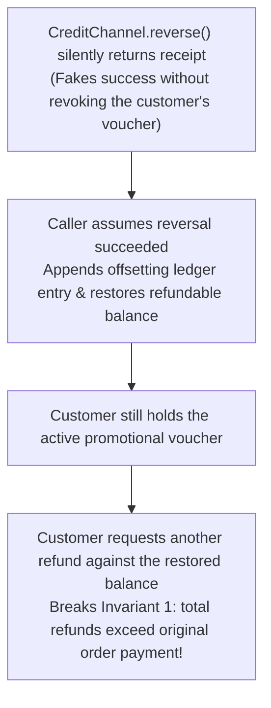
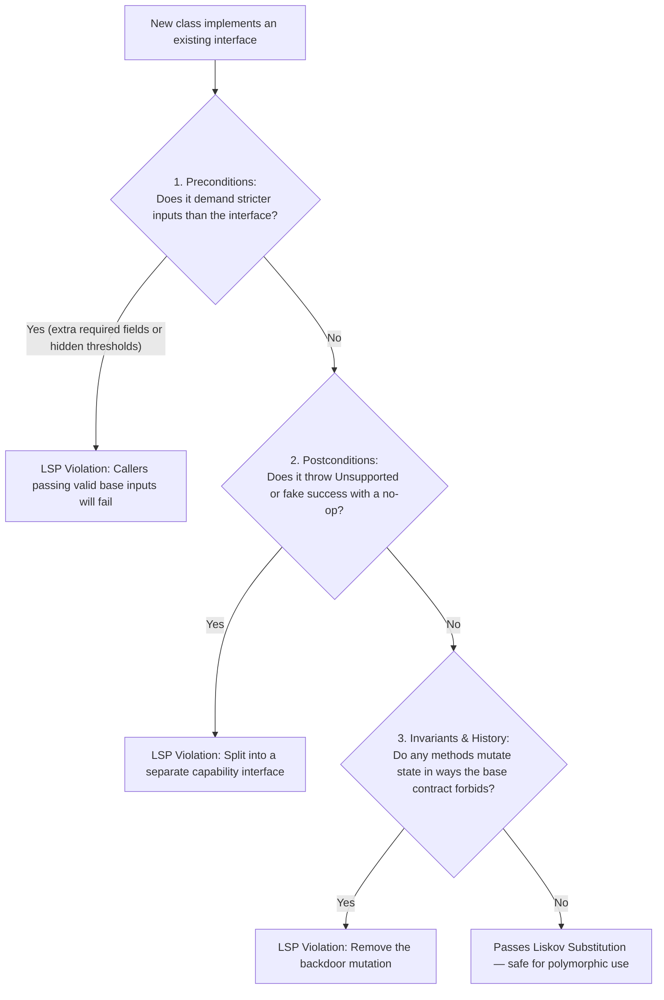

> Note 6 of 10 in the *Programming Thinking* series. The premise for the series is set out in the [opening essay](/notes/programming-taste-in-the-agent-era/).
>
> The cheaper it gets to generate code, the more valuable engineering judgment becomes. This series is my attempt to dust off classic software design principles, trace each one back to its original paper, and figure out where it still holds up—and where it breaks.

Among the five SOLID principles, the **Liskov Substitution Principle (LSP)** has the most academic-sounding name—and in languages with strong static type systems like TypeScript, Rust, or Java, it is the easiest one to underestimate.

Many developers assume the compiler already enforces LSP for them: *"My class says `implements RefundChannel` and builds with zero TypeScript errors—doesn't that guarantee it can substitute for `RefundChannel`?"*

Quite the opposite. **The Liskov Substitution Principle begins right where the compiler's type check ends.**

Why? Because a compiler only checks the first half of a contract—the **signature** (method names, parameter types, return types). Callers, however, write code relying on the second half of the contract—the **behavior** (how state changes after a call, which inputs are accepted, and what invariants hold across fields).

In plain English: **wherever a base type or interface is expected, you must be able to drop in any subtype or implementation without breaking the behavioral assumptions the caller reasonably made—and without forcing the caller to write `if (x instanceof SubType)` to work around surprises.**

Let's start with the famous Rectangle/Square puzzle to see the gap between syntax and behavior, and then watch that exact gap corrupt a real financial ledger in our refund system.

---

## Code That Compiles Cleanly and Fails Instantly

In geometry class, every square is a rectangle.

So when developers first learn object-oriented inheritance, it feels completely natural to model `Square` as a subclass of a mutable `Rectangle`—overriding `setWidth` and `setHeight` so all four sides stay equal:

```ts
class Rectangle {
  protected width = 0
  protected height = 0

  setWidth(w: number): void {
    this.width = w
  }

  setHeight(h: number): void {
    this.height = h
  }

  area(): number {
    return this.width * this.height
  }
}

class Square extends Rectangle {
  setWidth(w: number): void {
    this.width = w
    this.height = w
  }

  setHeight(h: number): void {
    this.width = h
    this.height = h
  }
}
```

TypeScript compiles both classes without a single warning. `Square` is a valid subclass of `Rectangle`, and every method signature matches.

Now look at this function written by a caller who only knows about `Rectangle`:

```ts
function resizeAndCalcArea(rect: Rectangle): number {
  rect.setWidth(10)
  rect.setHeight(4)
  // The caller reasonably assumes: I just set width=10 and height=4, so area is 40
  return rect.area()
}

resizeAndCalcArea(new Rectangle()) // Returns 40 (expected)
resizeAndCalcArea(new Square())    // Returns 16 (broken!)
```

Passing `new Square()` returns `16` because calling `rect.setHeight(4)` silently overwrote the width that the previous line had just set to `10`.

Look at what happened:

- The caller relied on an unstated **behavioral promise** of `Rectangle`: *"Setting the height leaves the width alone."*
- `Square` honored the method signature while breaking the behavioral promise.

Once a subtype breaks the behavioral promise of its supertype, polymorphism collapses. Callers can no longer trust the abstraction and start littering their code with defensive type checks:

```ts
function resizeAndCalcArea(rect: Rectangle): number {
  if (rect instanceof Square) {
    throw new Error('Cannot independently resize width and height on a Square')
  }
  rect.setWidth(10)
  rect.setHeight(4)
  return rect.area()
}
```

Every `if (rect instanceof Square)` is a tombstone for the [Open-Closed Principle](/notes/open-closed-only-the-guessed-axis/).

---

## The Production Version: From Throwing Exceptions to "Faking Success"

Rectangles and squares are a warm-up. Let's look at how the exact same violation hits production in our refund subsystem.

In [Note 5](/notes/open-closed-only-the-guessed-axis/), someone added a `reverse` method directly onto the shared `RefundChannel` interface. Because `CreditChannel` issues promotional store-credit vouchers rather than moving cash, it didn't support reversals—so the developer satisfied the compiler by throwing an exception:

```ts
class CreditChannel implements RefundChannel {
  readonly kind = 'credit' as const

  async submit(req: RefundRequest): Promise<ChannelReceipt> {
    // Issues promotional voucher...
  }

  async reverse(receipt: ChannelReceipt, reason: string): Promise<ChannelReceipt> {
    // Added just to silence the TypeScript compiler
    throw new UnsupportedOperationError('credit channel cannot be reversed')
  }
}
```

Three weeks later, a finance batch job tried to reverse a store-credit refund and crashed with `UnsupportedOperationError`.

In the post-mortem, someone proposed a "quick fix" that happens all the time in real engineering teams: *"Since store credit doesn't move real money anyway, why don't we stop throwing an exception in `CreditChannel.reverse` and just return the original `receipt` as a no-op so the batch job doesn't crash?"*

```ts
// Ten times worse than throwing: faking success
class CreditChannel implements RefundChannel {
  async reverse(receipt: ChannelReceipt, reason: string): Promise<ChannelReceipt> {
    return receipt // Silent no-op!
  }
}
```

The batch crash disappeared—**and silently corrupted the financial ledger.**

Why? Because callers of `RefundChannel.reverse` rely on a clear postcondition: **when `reverse()` resolves normally, the value previously granted to the customer has been revoked, and the order's refundable balance can be restored.**



Compare the two failure modes:

- Throwing `UnsupportedOperationError` violated LSP by refusing to fulfill a method promised on the interface—but at least it failed loudly.
- Returning `receipt` as a silent no-op violated LSP's **postcondition**—lying to the caller that the reversal succeeded and causing the system to violate Invariant 1 (cumulative refunds never exceed the original payment).

**When it comes to Liskov Substitution, faking success is far more destructive than throwing an error.**

---

## Tracing Back to 1987 and 1994: The Four Rules of Behavioral Subtyping

Liskov Substitution takes its name from Turing Award winner Barbara Liskov, who introduced the concept in her 1987 OOPSLA keynote, *"Data Abstraction and Hierarchy"* [1].

She asked a foundational question: **when a programming language lets type `S` extend type `T`, what must be true for `S` to be a genuine behavioral subtype of `T`?**

Her answer: for every object $o_1$ of type $S$, there must exist an object $o_2$ of type $T$ such that for all programs $P$ defined in terms of $T$, the behavior of $P$ is unchanged when $o_1$ is substituted for $o_2$ [1].

In 1994, Liskov and Jeannette Wing published *"A Behavioral Notion of Subtyping"* [2], combining their work with Bertrand Meyer's **Design by Contract** [3] to turn "unchanged behavior" into four concrete rules you can check in a code review:

| Contract Rule | Plain-English Meaning | Refund System Violation Example |
|---|---|---|
| **1. Preconditions cannot be strengthened** | If the base interface accepts any positive amount, a subtype cannot suddenly reject amounts under $100 | `RefundChannel.submit` accepts any `amount > 0`, but `TransferChannel.submit` throws if `amount < 10000` ($100) |
| **2. Postconditions cannot be weakened** | Whatever outcome the base interface promises on return, the subtype must actually deliver | `CreditChannel.reverse` returns a receipt without revoking the credit; or a channel returns `status: 'settled'` with `settledAt: null` |
| **3. Invariants must be preserved** | Any state invariant guaranteed by the base type must remain unbroken by the subtype | A new channel implementation skips the order-cap check, violating Invariant 1 |
| **4. History constraint must hold** | A subtype cannot introduce new methods that mutate state in ways the base contract forbids | Invariant 3 states settled history is append-only, but `CardChannel` adds a custom `rollbackLastStage()` method that pops a stage in place |

Boiled down to one sentence: **accept at least everything the base type accepts, deliver at least everything the base type promises, and never break the base type's state invariants or history rules.**

---

## Navigating the Gray Areas: Three Places Engineers Get Tripped Up

Knowing the four rules is the easy part; applying them to edge cases in real code reviews is where the interesting questions live.

### Gray Area 1: Can `Square` Ever Legitimately Inherit from `Rectangle`?

After seeing the `Rectangle` / `Square` example, many developers conclude that geometry and object-oriented programming are fundamentally incompatible.

As Robert C. Martin pointed out in his 1996 *C++ Report* column on LSP, **the bug wasn't in the geometry—it was in the mutability** [4].

`Square` only broke `Rectangle` because `setWidth` and `setHeight` promised that width and height could be mutated independently. If both classes are **immutable value objects**, `ImmutableSquare` is a completely valid subtype of `ImmutableRectangle`:

```ts
class ImmutableRectangle {
  constructor(
    readonly width: number,
    readonly height: number,
  ) {}

  area(): number {
    return this.width * this.height
  }
}

class ImmutableSquare extends ImmutableRectangle {
  constructor(side: number) {
    super(side, side)
  }
}
```

With no mutators, every property true of `ImmutableRectangle` (`width`, `height`, `area() === width * height`) holds 100% true for `ImmutableSquare`.

**Whether `S` is a valid subtype of `T` never depends on real-world taxonomy alone—it depends entirely on the operations and behavioral promises exposed on `T`.**

### Gray Area 2: Why Doesn't TypeScript's `strict` Mode Catch Narrowed Method Parameters?

Rule 1 says a subtype cannot strengthen preconditions (it cannot demand a narrower parameter type than the interface specifies). Surely TypeScript with `strict: true` catches that automatically?

Not if you declare your interface using method syntax! Look at this code, which compiles cleanly even under TypeScript's `strict: true`:

```ts
interface RefundRequest {
  amount: Money
}

// Narrower subtype: demands an extra required field `bankAccount`
interface BankTransferRequest extends RefundRequest {
  bankAccount: string
}

interface RefundChannel {
  // Declared using method syntax
  submit(req: RefundRequest): Promise<ChannelReceipt>
}

class TransferChannel implements RefundChannel {
  // Danger: TransferChannel demands a narrower input type, yet TypeScript allows it!
  async submit(req: BankTransferRequest): Promise<ChannelReceipt> {
    const acct = req.bankAccount.trim() // Crashes at runtime when passed a standard RefundRequest!
    // ...
  }
}
```

Why did TypeScript let `TransferChannel` strengthen the precondition?

Because for historical reasons (so `Array<Dog>` can be assigned to `Array<Animal>`), TypeScript checks method declarations (`submit(req: ...): ...`) **bivariantly** even when `strictFunctionTypes` is enabled [5]. To force TypeScript to enforce strict contravariant parameter checking on an interface, declare the member using **function property syntax**:

```ts
interface RefundChannel {
  // Function property syntax: strictFunctionTypes now flags narrowed parameters immediately!
  readonly submit: (req: RefundRequest) => Promise<ChannelReceipt>
}
```

Even then, the compiler can only check structural types. If a subtype strengthens a precondition at runtime (`if (req.amount < 10000) throw ...`), only automated contract tests will catch it.

### Gray Area 3: How Do We Lock Behavioral Contracts into Code?

To prevent Liskov violations in production, combine three practical techniques:

#### 1. Encode Field Postconditions as Discriminated Unions

If a settled receipt must always carry a `settledAt` timestamp while a pending receipt does not, don't use nullable fields that allow illegal combinations—make illegal states unrepresentable:

```ts
// Fragile: allows { status: 'settled', settledAt: null } to pass type checking
interface LooseReceipt {
  status: 'settled' | 'pending'
  settledAt: Date | null
}

// Bulletproof: locks the postcondition directly into the type system
export type ChannelReceipt =
  | { status: 'settled'; id: string; settledAt: Date; amount: Money }
  | { status: 'pending'; id: string; amount: Money }
```

#### 2. Split Optional Capabilities into Narrow Interfaces

Never force `CreditChannel` or `TransferChannel` to implement `reverse()` just to throw `UnsupportedOperationError`. Split `ReversibleChannel` out from `RefundChannel` so every implementation registered in `reverseRegistry` genuinely supports reversals:

```ts
export interface RefundChannel {
  readonly kind: ChannelKind
  readonly submit: (req: RefundRequest) => Promise<ChannelReceipt>
}

export interface ReversibleChannel extends RefundChannel {
  readonly reverse: (receipt: SettledReceipt, reason: string) => Promise<ReversalReceipt>
}
```

#### 3. Run a Shared Contract Test Suite Against Every Implementation

For behavioral invariants the type checker cannot see (like idempotency or minimum-amount acceptance), write a reusable **contract test suite** and run it against every class that implements `RefundChannel`:

```ts
// Shared contract test suite: every RefundChannel implementation must pass these checks
export function runRefundChannelContractSuite(createChannel: () => RefundChannel) {
  test('accepts any positive amount down to 1 cent without adding hidden thresholds', async () => {
    const channel = createChannel()
    await expect(channel.submit(makeValidRequest({ amountCents: 1 }))).resolves.toBeDefined()
  })

  test('submitting the same idempotencyKey twice never moves money twice (Invariant 2)', async () => {
    const channel = createChannel()
    const req = makeValidRequest({ idempotencyKey: 'key_001' })
    const first = await channel.submit(req)
    const second = await channel.submit(req)
    expect(second.id).toBe(first.id)
  })
}
```

---

## Summary: Four Questions to Audit Subtype Substitutability

Whenever you (or a coding agent) add a new implementation of an existing interface, walk through this checklist:



1. **Does it tighten input requirements (strengthen preconditions)?** Can it handle every valid input the base interface promises to accept?
2. **Does it water down outputs (weaken postconditions)?** If it doesn't support an operation, split the interface—never stub it out with `throw Unsupported` or a silent no-op return.
3. **Does it preserve domain invariants and append-only history rules?**
4. **Does it pass the shared contract test suite?**

At this point in the series, we have clean, behaviorally honest interfaces like `RefundChannel` and `ReversibleChannel`. That brings us directly to the question [Note 7 (Dependency Inversion)](/notes/dependency-inversion-who-owns-the-interface/) answers: **who owns those interfaces, and how do we keep low-level vendor details from leaking back into them?**

---

## Series Outline

- Opening · [Rereading Classic Design Principles in the Age of AI](/notes/programming-taste-in-the-agent-era/)
- Cohesion · [The Standard Is What Must Change Together](/notes/what-belongs-in-one-module/)
- Coupling · [Measuring How Much Two Modules Know About Each Other](/notes/three-invisible-couplings/)
- Single Responsibility · [One Responsibility Maps to One Group of Stakeholders](/notes/single-responsibility-is-an-actor/)
- Open-Closed · [First Identify Which Way the Code Will Grow](/notes/open-closed-only-the-guessed-axis/)
- Liskov Substitution · A Subtype Must Seamlessly Stand In for Its Supertype *(this note)*
- Dependency Inversion · [What Inverts Is Who Owns the Interface](/notes/dependency-inversion-who-owns-the-interface/)
- Interface Segregation · An interface is a slice taken from the client's point of view
- Law of Demeter · The middleman's dilemma
- Composite Reuse · Inheritance publishes your invariants

## References

1. [Barbara Liskov, “Keynote address — Data Abstraction and Hierarchy”, *OOPSLA '87 Addendum*, *ACM SIGPLAN Notices* 23(5), 1988, 17–34](https://www.cs.tufts.edu/~nr/cs257/archive/barbara-liskov/data-abstraction-and-hierarchy.pdf) — Formulates the substitution property and distinguishes syntactic inheritance from behavioral subtyping.
2. [Barbara Liskov, Jeannette Wing, “A Behavioral Notion of Subtyping”, *ACM TOPLAS* 16(6), 1994, 1811–1841](https://www.cs.cmu.edu/~wing/publications/LiskovWing94.pdf) — Formalizes behavioral subtyping via precondition, postcondition, invariant, and history rules.
3. [Bertrand Meyer, *Object-Oriented Software Construction*, Prentice Hall, 1988](https://dl.acm.org/doi/book/10.5555/534431) — Introduces Design by Contract.
4. [Robert C. Martin, “The Liskov Substitution Principle”, *C++ Report*, March 1996](https://web.archive.org/web/20150905081111/http://www.objectmentor.com/resources/articles/lsp.pdf) — Introduces the Rectangle/Square example and explains how mutability breaks client assumptions.
5. [TypeScript 2.6 Release Notes — Strict Function Types](https://www.typescriptlang.org/docs/handbook/release-notes/typescript-2-6.html) — Explains why method declarations remain bivariant while function property declarations enforce contravariant parameter checking.
