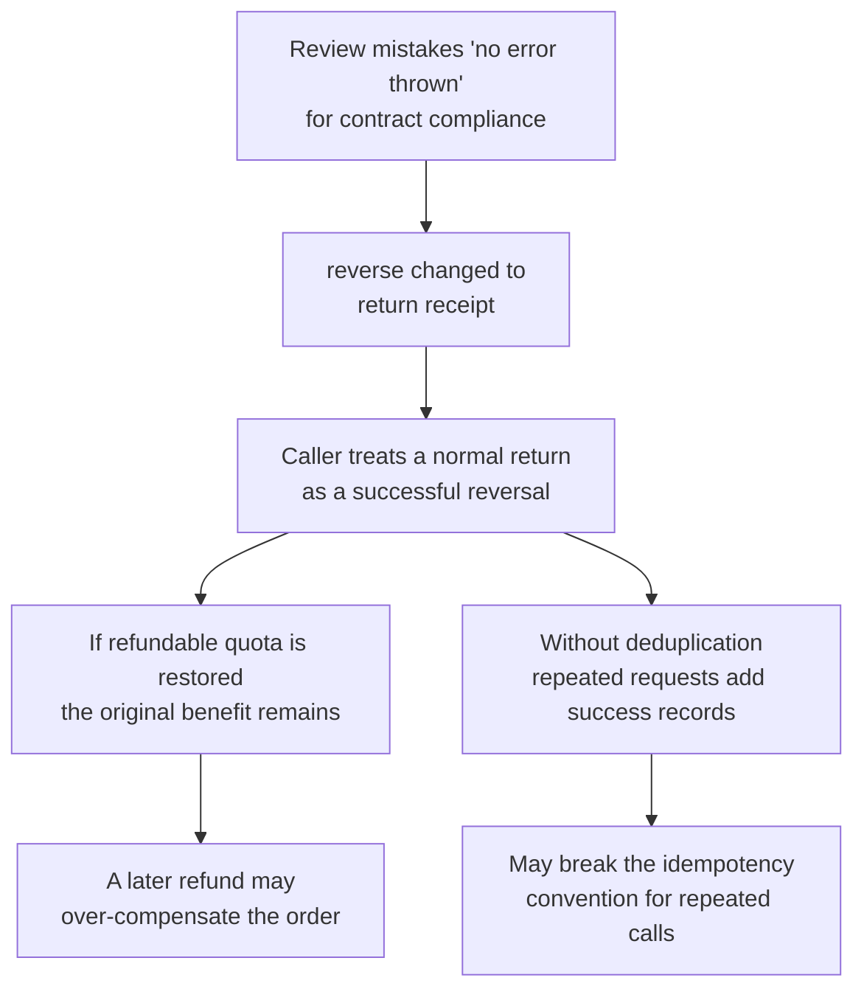
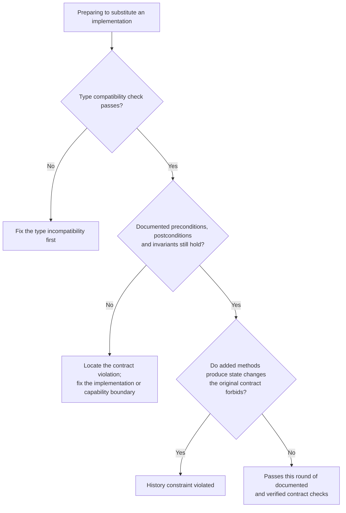

> The sixth of ten notes in the Programming Thinking series. The case the series is built on is in the [opening essay](/notes/programming-taste-in-the-agent-era/).
>
> As AI writes more of our code, the experience and judgement programmers have built up become more valuable. This series is my record of taking these ageing principles back off the shelf and checking their origins, boundaries and failure cases, to see what they can still teach us.

This note covers Liskov substitution: a subtype must seamlessly stand in for its supertype. Wherever a supertype is accepted, substituting a subtype must preserve the behaviour the caller is entitled to expect. Why does that deserve a note of its own? Because the compiler only checks method signatures, while what callers depend on is the behaviour behind them — and that gap is where the incidents happen.

## Code that passes the type check and is still wrong

Start with an example that involves no business logic. `Rectangle` has a width and a height that can be set separately:

```ts
class Rectangle {
  protected width = 0
  protected height = 0

  setWidth(w: number): void {
    this.width = w
  }

  setHeight(h: number): void {
    this.height = h
  }

  area(): number {
    return this.width * this.height
  }
}
```

A square is a kind of rectangle whose four sides must stay equal. Having it extend `Rectangle` and keep the sides in sync looks perfectly natural:

```ts
class Square extends Rectangle {
  setWidth(w: number): void {
    this.width = w
    this.height = w
  }

  setHeight(h: number): void {
    this.width = h
    this.height = h
  }
}
```

Then write a function that uses it. The parameter type is `Rectangle`; it sets the width to 10, the height to 4, and reads the area:

```ts
function stretch(rect: Rectangle): number {
  rect.setWidth(10)
  rect.setHeight(4)
  return rect.area()
}

stretch(new Rectangle()) // 40
stretch(new Square()) // 16
```

Pass a `Rectangle` and you get 40; pass a `Square` and you get 16 — the second call changes the width along with the height. This code passes the strictest type checking: `Square` really is a subclass of `Rectangle`, and the signatures of `setWidth` and `setHeight` match exactly. But the caller's reasoning — set the width, then the height, and the area is width times height — no longer holds once the subclass is swapped in.

**The Liskov Substitution Principle (LSP) says exactly this: wherever a supertype is accepted, substituting a subtype must preserve the behaviour the caller is entitled to expect.** "Seamlessly standing in" sets a higher bar than matching method signatures: every reasonable assumption the caller makes from the supertype must still hold after the subclass takes its place.

Put more precisely: whether a subtype relationship exists between two types is settled by testing it against the callers' programs — substituting objects of the subtype for objects of the supertype must not change the program's behaviour — and an inheritance line on a class diagram counts for nothing. The earliest statement of this idea that this note cites is in a 1987 lecture by Barbara Liskov; "Origins and development" below returns to the source.

## Polymorphism rests on the supertype's promises

Why does this principle need to exist? Because it guards the load-bearing wall of polymorphism in object-oriented code.

Polymorphism means the caller writes only the supertype, and whichever subclass arrives at runtime supplies the implementation. `stretch` takes a `Rectangle`; if tomorrow someone writes a `RoundedRectangle` and passes it in, the function does not change a line. That is the core convenience inheritance gives callers, and it holds only because **everything the caller knows about subclasses comes from promises made by the supertype.**

The promises come in two layers. The first is signatures: what the methods are called, what parameters they take, what they return. The compiler checks this layer line by line. The second is behaviour: how the object's state changes after the call, what patterns the return values follow, when exceptions are thrown. "Width and height can be set independently", which `stretch` relies on, belongs to the second layer. Together the two layers form what this note calls the contract. LSP governs the second layer — **whether the judgements a caller makes from the original contract still hold after another implementation takes its place.**

Signature compatibility is checkable by the compiler; behavioural compatibility is not. Once a subclass can quietly break behavioural promises, polymorphism degrades: callers stop trusting the parameter type and start special-casing each implementation.

```ts
function stretchCarefully(rect: Rectangle): number {
  if (rect instanceof Square) {
    // A square cannot set width and height separately; handle it by one side
    rect.setWidth(4)
    return rect.area()
  }
  rect.setWidth(10)
  rect.setHeight(4)
  return rect.area()
}
```

Every subclass that behaves out of line can add another branch, and the original intent — width 10, height 4 — has become inexpressible for squares. Callers go back to editing their own code for each implementation, the outcome the open-closed principle of [note 5](/notes/open-closed-only-the-guessed-axis/) exists to avoid: meant to be open for extension, but every new implementation forces another edit to the caller.

### The same failure in a real system

Rectangles and squares are a teaching example; the wrong value is all that breaks. When this principle is missing from a real system, the bill lands directly on the accounts.

The series carries one running case (its full backstory is in [note 5](/notes/open-closed-only-the-guessed-axis/); this note does not depend on the details): a refund system processes refunds per channel — bank card, wallet, offline transfer and credit compensation each implement the same `RefundChannel` interface. A refund reversal undoes a refund that has already happened: it must undo the original operation's effect and leave a traceable reverse record.

The trouble began when someone added a `reverse` method to the interface every channel shares. In the third week after launch, finance tried to reverse a credit-compensation refund in the back office; the page waited two seconds and displayed `UnsupportedOperationError`. The caller's code:

```ts
async function reverseRefund(r: Refund, reason: string): Promise<ChannelReceipt> {
  const channel = channels.get(r.channel)!
  return channel.reverse(r.receipt, reason)
}
```

This code passed type checking — `reverse` was declared on the interface, and the return type matched. The unit tests covered cards and wallets without exercising credit compensation, and the review missed the gap between the shared interface and the channels' capabilities. Credit compensation grants benefits without moving money; its implementation has no notion of reversal, so all it can do is throw.

The judgement the caller made from the interface — a channel implementing `RefundChannel` can reverse refunds — stopped holding the moment this implementation was swapped in. It is the engineering edition of the square problem: the signature fits, the behaviour does not, and this time it is a money flow that goes wrong, with the return value intact.

## Origins and development: from a 1987 keynote to SOLID

The original formulation comes from Barbara Liskov. She delivered the keynote "Data Abstraction and Hierarchy" at OOPSLA 1987, and the substitution property was one of its claims. I downloaded the original and read it: the property sits in section 3.3, printed page 25.[1]

Restated in the original's notation: if for every object o1 of type S there is an object o2 of supertype T such that every program defined in terms of T keeps its behaviour when o1 replaces o2, then S is a subtype of T. Note the direction of substitution — objects of the subtype S replace objects of the supertype T, while what gets tested is the caller's program written against T.

In the same section Liskov distinguished behavioural subtyping from the subclass relation a language provides. Inheritance (`extends`) is one way to realise a subtype, but writing `extends` does not make a class behaviourally substitutable; interfaces and polymorphism need the same check. Her own examples are sets versus lists and stacks versus queues: sets drop duplicates, lists keep them; stacks are last-in-first-out, queues first-in-first-out. A caller relying on those rules cannot swap them just because the add and remove methods share a name.[1]

The 1987 formulation gave the direction of judgement, but "keeps its behaviour" was still a single sentence with nothing to check item by item. In 1994 Liskov and Jeannette Wing published "A Behavioral Notion of Subtyping", formalising it as behavioural subtyping: a set of rules you can check one by one.[2] The approach echoes the design by contract Meyer had laid out in *Object-Oriented Software Construction* — treating a method call as making a contract: the caller promises to meet the precondition, the implementation promises to deliver the postcondition.[5]

In engineering terms, behavioural compatibility is usually broken into four constraints:

| Clause | In plain terms | Source |
|---|---|---|
| Precondition | Inputs the parent accepts, the subtype may not reject with extra hurdles | Method rules from design by contract and behavioural subtyping |
| Postcondition | Results the parent promises, the subtype may not water down | Method rules from design by contract and behavioural subtyping |
| Invariant | Constraints the parent places on observable state, the subtype must preserve | Design by contract; Liskov and Wing's formalisation |
| History constraint | Methods added by the subtype must not make state changes the parent forbids | Liskov and Wing's work on behavioural subtyping |

The four interlock; one defect can break a postcondition and an invariant at once. Run the square through them: `setWidth` on the parent promises "changes only the width" (a postcondition), `Square`'s implementation changes the height too, and the invariant of independent width and height falls with it. The most abstract is the history constraint — it only becomes clear together with aliasing, which the fourth grey area unpacks.

In 1996 Robert C. Martin wrote the property up as "The Liskov Substitution Principle" in the *C++ Report*; it later became the L of SOLID. Martin's formulation also starts from the client: subtypes must be substitutable for their base types without altering the correctness of the program — and rectangles and squares figure among his examples. The opening code of this note is adapted from his scenario.[4]

Which exposes a widespread misreading: treating LSP as "the subclass's method signatures must match the parent's". Signature compatibility is something the compiler already checks; taking it as the whole of LSP declares the principle redundant. From 1987 to 1996 the principle was always about behaviour: whether the caller's reasonable expectations survive the substitution.

## Four grey areas

At this point the skeleton is complete: what it is, why it exists, four constraints. But judging real code is never made hard by those sentences; it is made hard at the boundaries between them. The four questions below have each come up repeatedly in real code reviews.

### Can a square inherit from a rectangle?

After the opening example, the reflex answer is "no". Martin's answer is finer: whether a model is valid depends on how clients use it.[4]

If callers only read — after construction they call nothing but `area()` and `getWidth()` — a square is a perfectly good rectangle: a rectangle with four equal sides is a rectangle, and "area equals width times height" holds for it too. The problem is mutability: `setWidth` and `setHeight` imply the promise that "the two sides vary independently", and a square cannot keep it. What violates LSP is the design "implementing a square on a mutable rectangle interface"; the classification "a square is a rectangle" is innocent.

The corroborating move is removing mutability. An immutable square inheriting from an immutable rectangle is unobjectionable:

```ts
class ImmutableRectangle {
  constructor(readonly width: number, readonly height: number) {}

  area(): number {
    return this.width * this.height
  }
}

class ImmutableSquare extends ImmutableRectangle {
  constructor(side: number) {
    super(side, side)
  }
}
```

After construction no method can change state, the promise of independent width and height does not exist, and there is nothing to violate. The same "is-a" classification is harmless in an immutable world and a breach of contract in a mutable one. **The criterion is always the behavioural promise the caller depends on, not conceptual taxonomy.** That is LSP's most counter-intuitive aspect: it appears to be about type relationships but is about the caller's dependencies.

### Is throwing an exception a violation? It depends on what the contract promised

Credit compensation's `reverse` throwing `UnsupportedOperationError` is a pattern that exists all over real code, and the most famous example lives in the JDK: calling `add` on the read-only list returned by `Collections.unmodifiableList` throws `UnsupportedOperationException`. It is the real-world violation most often brought out in LSP discussions.[8]

Whether throwing counts as a violation has no answer outside the contract:

- If `RefundChannel.reverse`'s contract says "every implementation can perform reversals", credit compensation throwing is a breach.
- If the contract states "implementations may decline to support this operation; callers must handle the exception", throwing is compliance — "might not be supported" was part of the caller's reasonable expectations all along.

What hurts is the interface hiding a capability gap inside one signature: the types give callers no way to tell which implementation throws and which does not. That information gap is only closed in "Putting checkable contracts into code".

One fix deserves particular suspicion. A common review suggestion goes: since the error surprises the caller, return the receipt unchanged — credit compensation moves no money anyway:

```ts
class CreditChannel implements RefundChannel {
  async reverse(receipt: ChannelReceipt): Promise<ChannelReceipt> {
    return receipt
  }
}
```

This code revokes no benefit and creates no reverse record; it simply returns normally. The caller reads the normal return as a successful reversal, and the failure moves from a visible two-second error on the page to an invisible data error in the accounts. Throwing at least reported honestly: "I cannot do this." **Faking success violates LSP more seriously than admitting failure**, because the caller's reliance on "returns normally" runs deeper than the reliance on "may throw".

The two risk paths are charted below. Each requires a matching caller behaviour or missing validation before it can occur; `return receipt` alone does not entail any of it:



In the first path the caller restores the refundable quota while the user still holds the original benefit; a later refund can then over-compensate the order. The second path additionally requires reversal records not to be deduplicated per request before repeated calls add multiple success records. Quota and idempotency checks should have blocked both risks all along.

The fix has to deliver the actual semantics of a reversal. A contract that explicitly allows "not supported" may legitimately decline some operations; a contract promising that every qualifying request will be reversed cannot be honoured by an implementation that always declines. Returning the receipt unchanged is no substitute for a real success.

### The compiler checks some of it; the rest you guard yourself

Of the four constraints some are compiler-checkable and some never will be. Knowing where the line is keeps you from overestimating the tool or wasting it.

I had assumed that enabling `strict` was enough to catch "a subclass adding hurdles to its inputs". Comparing method syntax with function-property syntax revealed a distinction worth knowing on its own. Verified with TypeScript 7.0.2, `strict: true`; the receipt fields are filled in so the compile result reflects only parameter compatibility.

```ts
interface RefundRequest {
  amount: Money
}

interface TransferRefundRequest extends RefundRequest {
  bankAccount: string
}

interface RefundChannel {
  submit(req: RefundRequest): Promise<ChannelReceipt>
}

class TransferChannel implements RefundChannel {
  async submit(req: TransferRefundRequest): Promise<ChannelReceipt> {
    return {
      id: req.bankAccount,
      status: 'pending',
      settledAt: null,
      amount: req.amount,
    }
  }
}
```

`TransferRefundRequest` demands a `bankAccount` field beyond the shared request, which an amount-only request cannot satisfy — yet this method implementation still passes. Turn the interface member into a function property and the same parameter narrowing is rejected:

```ts
interface RefundChannelFn {
  submit: (req: RefundRequest) => Promise<ChannelReceipt>
}

const transfer: RefundChannelFn = {
  async submit(req: TransferRefundRequest): Promise<ChannelReceipt> {
    return {
      id: req.bankAccount,
      status: 'pending',
      settledAt: null,
      amount: req.amount,
    }
  },
}
// TS2322: parameter types incompatible
```

TypeScript's release notes describe the difference as an exemption for method and constructor declarations under strict function parameter checking, and explain its relation to generic-container compatibility.[6] It bounds what this static check can do; it does not mean every parameter error is waved through.

Broader behavioural compatibility cannot be handed to a general checker wholesale. Asking a general tool to decide whether an arbitrary method always terminates runs into undecidability.[7] But specific field relationships, particular input constraints and chosen operation sequences can all be secured through types or automated checks. When discussing a tool's powers, state which part it proved and which part remains uncovered.

### An unwritten contract is still a contract

In the examples so far the contract was at least visible: an interface signature, a thrown exception. In real systems many contracts never become any signature at all; they live only in callers' assumptions. They are the hardest to check and the easiest to break in a new implementation.

**Relationships between fields do not enter the type.** The contract for a refund receipt says: a settled receipt must carry a settlement time; a pending receipt carries `null`. The interface lets the two fields vary freely:

```ts
type Money = number

interface ChannelReceipt {
  id: string
  status: 'settled' | 'pending'
  settledAt: Date | null
  amount: Money
}
```

An offline transfer creates a payment instruction that still awaits manual approval; if it returns `status: 'settled'` with `settledAt: null`, each field is legal on its own and the combination is already a breach. Downstream caller code might read:

```ts
const receipt = await channel.submit(req)
if (receipt.status === 'settled') await ledger.settle(refund.id, receipt.settledAt!)
```

The `!` is a non-null assertion: it silences that one type warning but adds no date at runtime, so the ledger function can still receive `null` and either fail validation or record a settlement that never happened. What can be established is that the channel did not honour the receipt guarantee, and the caller's reasoning from the settlement status has lost its footing.

**Input hurdles do not enter the type.** Suppose the submission contract accepts every positively-validated amount. Offline transfers need manual approval and low amounts were meant to take another flow; the implementation instead adds a 100-yuan minimum (`Money` is integer cents; `10000` is 100 yuan):

```ts
async submit(req: RefundRequest): Promise<ChannelReceipt> {
  if (req.amount < 10000) throw new BelowApprovalThresholdError(req.amount)
  // remaining submission logic omitted
}
```

A 50-yuan request that fits the original contract is rejected here. A plain `number` type describes no business threshold; checking method names and parameter types reveals nothing about the caller's and the implementation's differing notions of a legitimate amount.

**Cross-request constraints do not live in the object.** The system must also keep cumulative refunds within what the customer paid for the order. A gift-card channel (added later in the series) that skips this system's quota check and trusts "the gateway will block illegal transactions" leaves a gap: the gateway validates its own account rules and does not know how much this order has already been refunded through other channels. Such constraints exist across requests and channels; the receipt field types prove nothing about them.

**Added methods can break history conventions.** The case also stipulates that refund stage records are append-only; a reversal is expressed as a new reverse record. Bank-card callbacks can arrive out of order, so the implementation adds a remedial method that drops the last stage:

```ts
class CardChannel implements RefundChannel {
  // not on the interface
  rollbackLastStage(refund: Refund): void {
    refund.stages.pop()
  }
}

const card = new CardChannel(/* … */)
const asChannel: RefundChannel = card // one object, two type views

card.rollbackLastStage(refund)
asChannel.stagesOf(refund.id) // a read method on the public interface (not shown above); sees the history after the deletion
```

`card` can call the extra method the implementation provides; `asChannel` can only use the public interface — yet both operate on the same object and the same associated state. After the deletion, code using only the public interface also sees fewer stages. That is the history constraint in the presence of aliasing (two variables referencing the same object), and such shared references are everywhere in JavaScript and TypeScript.[2][3]

The criterion is whether the observable history still conforms to the contract; it cannot be reduced to "any state change in an added method is a violation" — changes the original contract allows remain allowed.

## Inheritance today: favour composition, and inject the pieces

Programmers new to the field will likely arrive here with a question: if inheritance causes this much trouble, does today's code still use it?

The instinct is not far off. "Composition over inheritance" is no fashion either: the 1994 *Design Patterns* book put it among its opening design principles — favour object composition over class inheritance.[9] And inheritance has faults beyond breaking LSP:

- The fragile base class: a subclass's correctness is not in its own hands: the day the parent changes `setWidth`'s internals, every subclass suffers, and the blast site can sit far from the change.
- Inheritance is white-box reuse: overriding a method correctly usually means reading the parent's implementation first — the square broke its contract precisely because it had to know what changing one side affects. A parent's internals should not be required reading for its subclasses.
- Inheritance is fixed at compile time: an object's class is decided at birth; composition can swap a part at runtime, which is exactly what the capability-interface registry below does.

Look around today's codebases: front-end frameworks assemble components by composition, back-end frameworks hand you services from outside, tests replace dependencies by composition. This note's fixes follow the same route — callers depend on the `RefundChannel` abstraction while concrete channels arrive from a registry. Handing dependencies in from outside instead of calling `new` inside the function is known as dependency injection; note seven's dependency inversion takes the idea all the way.

Inheritance has not been sentenced to death, though. Genuine is-a relationships with stable contracts still suit it: custom `Error` subclasses and shared test-fixture base classes are legitimate uses. More importantly, LSP never governed `extends` alone — implementing an interface, or TypeScript's structural typing (assignable as long as the shape fits), must honour the same principle. The criterion stays the sentence it has always been: after your implementation is swapped in, do the judgements callers made from the contract still hold?

## Putting checkable contracts into code

With the grey areas walked, the direction is clear: what can go into types goes into types; what cannot is written down as an explicit contract and watched by automated checks.

### Express receipt state relationships in types

Turn `ChannelReceipt` into a discriminated union so settled and pending receipts each carry the right fields:

```ts
type ChannelReceipt =
  | { status: 'settled'; id: string; settledAt: Date; amount: Money }
  | { status: 'pending'; id: string; amount: Money }
```

Under strict mode, constructing a "settled receipt with a `null` settlement time" fails to compile. After narrowing on `status === 'settled'`, the `settledAt` the caller holds is a `Date` by construction — no non-null assertion. External input still needs runtime validation: `any`, unsafe assertions or unvalidated external data all bypass static guarantees.

### Express reversal support through capability interfaces

Keep the public interface requiring only submission; channels that support reversal implement a separate capability interface, and the registry lists only implementations that truly support it:

```ts
interface RefundChannel {
  readonly kind: ChannelKind
  submit(req: RefundRequest): Promise<ChannelReceipt>
}

interface ReversibleChannel extends RefundChannel {
  reverse(receipt: ChannelReceipt, reason: string): Promise<ChannelReceipt>
}

const reversible = new Map<ChannelKind, ReversibleChannel>([
  ['card', new CardChannel(cardGateway)],
  ['wallet', new WalletChannel(ledger)],
])
```

"Which channels support reversal" moves out of exceptions and into types; callers no longer guess which implementation throws. A dynamic lookup can still come up empty, so runtime checks remain necessary, and "deliberately unsupported" must stay distinguishable from "supposed to support but not configured". This matches the approach in [note 5](/notes/open-closed-only-the-guessed-axis/): settle which capabilities a channel should have, then connect the implementations.

### Run the same contract checks against different implementations

Rules types cannot express are written beside the interface and enforced through implementation checks and tests. Every channel runs the same contract-check requirements with inputs and environments suited to its capabilities: whether requests meeting the common amount conditions are rejected anyway; whether successful receipts match the state convention; whether quota checks stop over-refunding; whether repeating the same reversal satisfies the idempotency convention; whether extra methods delete history the contract promised to keep.

The checks must include the credit-compensation and offline-transfer paths the original tests missed. Channels that explicitly decline reversal have their refusal verified; channels that promise it have the actual revocation and reverse record verified. Passing means the covered scenarios behaved as expected — not that every input and operation sequence satisfies LSP.

## Four questions I ask when reviewing whether an implementation can be substituted

When reviewing a new channel implementation I first find the contract the callers depend on, then work through four questions. Where the contract is not yet explicit, the existing callers and the business requirements have to be sorted out first — "not written down" must not be read as "no promises made".

- Which inputs does the original contract accept? Does the implementation additionally demand amount thresholds, fields or call orders?
- Once preconditions are met, what results may the caller rely on? Does the implementation honour the settlement status, time and amount conventions?
- Which state constraints must hold for the object or the business system? Could other channels or concurrent requests bypass them?
- Which operations does the implementation add? Do any produce observable state changes the original contract forbids?

The three decisions in the diagram attend in turn to type compatibility, the documented state and method contracts, and the history constraint:



This diagram organises a review; it is not an algorithm that proves every behaviour automatically. Each passing result needs a corresponding contract and verification evidence. Unverified behaviour remains a limitation.

## What I changed my mind about

I used to treat Liskov substitution as an inheritance rule, checking whether a subclass changed a base class method's meaning without leaving an explicit contract beside the interface. After reading the original, I start with the reasoning callers make from the type and then check whether another implementation can preserve it.

Applied to this note's examples: squares and rectangles taught me to ask first what behaviour the caller depends on rather than staring at class diagrams; the refund system means putting receipt state relationships into types, separating reversal capability from ordinary submission, and running shared contract checks against the implementations. Unsupported business operations need an explicit expression of that limit; operations promised but left incomplete need an implementation fix. Making a method stop reporting errors cannot answer either question on its own.

The next note discusses dependency inversion. One question remains here: who should define `ReversibleChannel` so it accurately describes the caller's required capability without turning one channel's current implementation details into constraints every caller must accept?

## References

1. [Barbara Liskov, “Keynote address — Data Abstraction and Hierarchy”, OOPSLA '87 Addendum, ACM SIGPLAN Notices 23(5), 1988, 17–34](https://www.cs.tufts.edu/~nr/cs257/archive/barbara-liskov/data-abstraction-and-hierarchy.pdf). The substitution property [S] appears in section 3.3, printed page 25 (PDF page 9). The section distinguishes behavioural subtypes from language subclasses and discusses specifications that allow exceptions.
2. [Barbara Liskov and Jeannette Wing, “A Behavioral Notion of Subtyping”, ACM TOPLAS 16(6), 1994, 1811–1841](https://dl.acm.org/doi/10.1145/197320.197383). Method rules, invariants and history constraints; a [PDF is available from Wing's university](https://www.cs.cmu.edu/~wing/publications/LiskovWing94.pdf). Related technical reports preceded the paper, so the rules' origins should not all be dated to 1994.
3. [Gary T. Leavens and Krishna K. Dhara, “Concepts of Behavioral Subtyping”, in *Foundations of Component-Based Systems*, Cambridge University Press, 2000](https://www.eecs.ucf.edu/~leavens/FoCBS-book/06-leavens-dhara.pdf). Compares definitions of behavioural subtyping and their treatment of aliasing and mutable state.
4. [Robert C. Martin, “The Liskov Substitution Principle”, *C++ Report*, March 1996](https://objectmentor.com/resources/articles/lsp.pdf). Explains model validity through clients and discusses preconditions, postconditions and the relationship between LSP and OCP.
5. [Bertrand Meyer, *Object-Oriented Software Construction*, Prentice Hall, 1988](https://dl.acm.org/doi/book/10.5555/534431). A historical source for design by contract. The original book was not checked directly for this revision; the descriptions here draw on the papers and survey above.
6. [TypeScript 2.6 release notes: strict function types](https://www.typescriptlang.org/docs/handbook/release-notes/typescript-2-6.html). The checking exceptions for method and constructor declarations. This article's examples were separately checked with TypeScript 7.0.2.
7. [Liskov substitution principle — Wikipedia](https://en.wikipedia.org/wiki/Liskov_substitution_principle). Supplementary explanation of general undecidability and the termination example. It is not used as a historical source or as evidence that no contracts can be checked automatically.
8. [Java SE API — Collections.unmodifiableList](https://docs.oracle.com/en/java/javase/21/docs/api/java.base/java/util/Collections.html#unmodifiableList(java.util.List)). Documents that mutating methods on the read-only view throw `UnsupportedOperationException`. Calling it an "LSP violation" is a common characterisation in community discussions, not the JDK's own.
9. [Erich Gamma, Richard Helm, Ralph Johnson and John Vlissides, *Design Patterns: Elements of Reusable Object-Oriented Software*, Addison-Wesley, 1994](https://dl.acm.org/doi/book/10.5555/186897). "Favour object composition" appears among the design principles of the introduction chapter; page numbers were not re-verified for this note, and the principle is stated per that chapter's wording.
