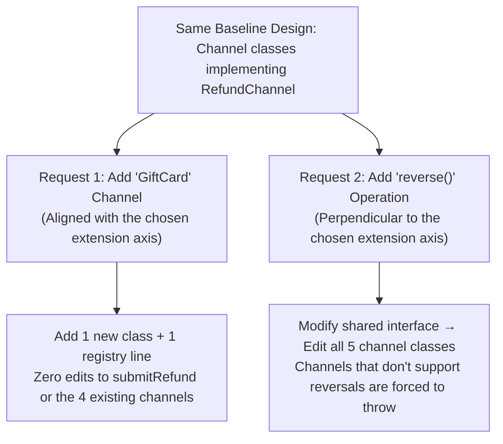
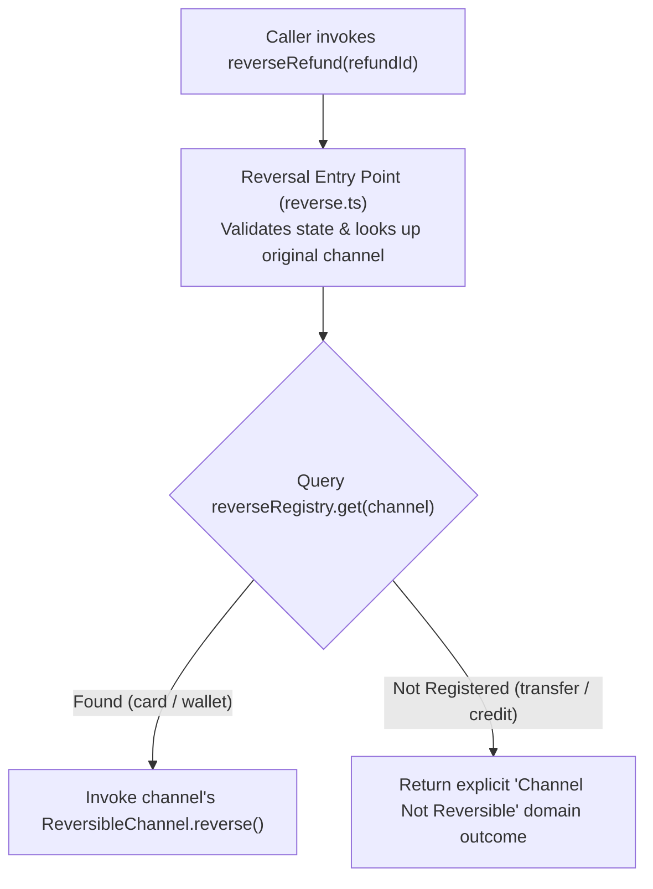

> Note 5 of 10 in the *Programming Thinking* series. The premise for the series is set out in the [opening essay](/notes/programming-taste-in-the-agent-era/).
>
> The cheaper it gets to generate code, the more valuable engineering judgment becomes. This series is my attempt to dust off classic software design principles, trace each one back to its original paper, and figure out where it still holds up—and where it breaks.

The **Open-Closed Principle (OCP)** has the most seductive slogan in software engineering: *"Software entities should be open for extension, but closed for modification."*

Taken at face value, it sounds like a free lunch: whenever product asks for a new feature, we just drop a new file into the repository (*open for extension*) without touching a single line of existing, battle-tested code (*closed for modification*).

Yet anyone who has tried to live by that rule in production eventually hits the same wall: **the exact same architecture that makes Requirement A effortless to add will force you to edit a dozen existing files when Requirement B arrives.**

Why? Because the popular slogan leaves out the most important clause: **a design is only ever open for extension along the specific axis of change you anticipated when you built it.**

In plain English: **no code can be closed against every possible change. If you build a doorway facing east, new requirements heading east walk right in—while requirements heading north have to knock down a wall. Before applying the Open-Closed Principle, you first have to figure out which direction the code is actually going to grow.**

Let's watch this happen on two real feature requests in our refund subsystem.

---

## Same Design, Two Feature Requests: Why Is One Easy and the Other Painful?

In [Note 2 (Cohesion)](/notes/what-belongs-in-one-module/), we refactored a giant `switch (channel)` handler into four focused channel classes (`CardChannel`, `WalletChannel`, `TransferChannel`, `CreditChannel`) behind a shared `RefundChannel` interface:

```ts
// Shared channel contract
export interface RefundChannel {
  readonly kind: ChannelKind
  submit(req: RefundRequest): Promise<ChannelReceipt>
}

// Channel registry
const channels = new Map<ChannelKind, RefundChannel>([
  ['card', new CardChannel(cardGateway)],
  ['wallet', new WalletChannel(walletLedger)],
  ['transfer', new TransferChannel(approvalWorkflow)],
  ['credit', new CreditChannel(couponService)],
])

// High-level submission entry point
export async function submitRefund(req: RefundRequest): Promise<ChannelReceipt> {
  const channel = channels.get(req.channel)
  if (!channel) throw new UnknownChannelError(req.channel)
  return channel.submit(req)
}
```

Three months into production, the product manager puts two new items on the sprint backlog:

1. **Request 1 (Add a new channel)**: Support **Gift Card** refunds.
2. **Request 2 (Add a new operation)**: Support **Refund Reversals** across channels.

Let's compare how our design handles each request.

### Scenario 1: Growing Along the Grain—Adding the Gift Card Channel

Adding gift cards feels like snapping a Lego brick into place:

1. Create a new file `gift-card-channel.ts` implementing `GiftCardChannel implements RefundChannel`;
2. Add `'giftcard'` to `ChannelKind` and register the instance in `channels`.

The whole feature takes half a day. Crucially, **`submitRefund` and the four existing channel classes (`CardChannel`, `WalletChannel`, `TransferChannel`, `CreditChannel`) are not touched at all.** That is textbook Open-Closed.

### Scenario 2: Growing Against the Grain—Adding the Reversal Operation

Now we tackle Request 2: adding a `reverse` operation.

Following the same object-oriented interface pattern, the natural move is to add `reverse` to `RefundChannel`:

```ts
export interface RefundChannel {
  readonly kind: ChannelKind
  submit(req: RefundRequest): Promise<ChannelReceipt>
  // Newly added operation
  reverse(receipt: ChannelReceipt, reason: string): Promise<ChannelReceipt>
}
```

The instant you save that file, TypeScript lights up with compiler errors across the entire repository: **every single existing channel class is now broken until you open it and implement `reverse`.**

Worse still, in our business domain only card and wallet refunds can be reversed—manual bank transfers and promotional store credits don't support reversals. Yet because `reverse` sits on `RefundChannel`, you are forced to open `CreditChannel` and `TransferChannel` and pollute them with dummy methods that exist only to throw:

```ts
// Forced into CreditChannel just to satisfy the widened interface
async reverse(): Promise<ChannelReceipt> {
  throw new UnsupportedOperationError('credit channel does not support reversal')
}
```

Put the two requests side by side:



Why did the exact same architecture shine on Request 1 and buckle on Request 2?

---

## A Two-Dimensional Grid: The Tension Between Rows and Columns

Picture the refund subsystem as a simple two-dimensional grid:

- **Each row is a refund channel** (a data variant);
- **Each column is an operation** (a behavior).

| Channel \ Operation | `submit` | `reverse` | `stagesOf` |
|---|---|---|---|
| **Card** | Card submission | Card reversal | Card status timeline |
| **Wallet** | Wallet credit | Wallet debit reversal | Wallet entry lookup |
| **Manual Transfer** | Payout ticket creation | *Not supported* | Approval workflow status |
| **Store Credit** | Coupon issuance | *Not supported* | Coupon redemption check |

Any code organization you pick is a choice between **slicing the grid by rows** or **slicing the grid by columns**:

### Option A: Slicing by Rows (Classes Implementing an Interface)

Each class (`CardChannel`, `WalletChannel`, etc.) bundles one entire row of the table.

- **Adding a new row (a new channel) is easy**: create one new class containing all the cells for that row without touching existing rows.
- **Adding a new column (a new operation) is hard**: the new column cuts vertically across every row, forcing you to open and edit every existing class.

### Option B: Slicing by Columns (Discriminated Unions + Operation Functions)

What if we flip the organization 90 degrees? We represent channels as a discriminated union of pure data, and put each operation in its own file (`submit.ts`, `reverse.ts`):

```ts
// Data variants: defines the rows
export type RefundRecord =
  | { kind: 'card'; chargeId: string; settledAt: Date }
  | { kind: 'wallet'; entryId: string }
  | { kind: 'transfer'; ticketId: string }
  | { kind: 'credit'; couponId: string }

// Sliced by column: reverse.ts owns the entire 'reverse' column
export async function reverseRefund(record: RefundRecord, reason: string): Promise<ChannelReceipt> {
  switch (record.kind) {
    case 'card':
      return cardGateway.reverse(record.chargeId, reason)
    case 'wallet':
      return walletLedger.reverse(record.entryId, reason)
    case 'transfer':
    case 'credit':
      throw new UnsupportedOperationError(record.kind)
    default:
      // Exhaustiveness check: compiler flags any newly added channel missing a case
      const _exhaustiveCheck: never = record
      return _exhaustiveCheck
  }
}
```

Look at how the trade-off flips completely:

- **Adding a new column (a new operation like `reverseRefund`) is now effortless**: create `reverse.ts` and handle all four channels in one place without touching `submit.ts`.
- **Adding a new row (a new channel like `'giftcard'`) now touches every operation**: adding `| { kind: 'giftcard' }` to `RefundRecord` triggers a compile error at `_exhaustiveCheck: never` inside `submit.ts`, `reverse.ts`, and `stages.ts`, forcing you to add a `case 'giftcard'` branch to every operation file.

| Organization Style | Adding a New Channel (New Row) | Adding a New Operation (New Column) | Best Fit When... |
|---|---|---|---|
| **By Channel (Classes / Row-Sliced)** | **Open for extension** (add 1 new class) | **Requires modifying all N classes** | Operations are stable, but new payment channels/vendors are added frequently |
| **By Operation (Union + Functions / Column-Sliced)** | **Requires modifying all M operations** | **Open for extension** (add 1 new function file) | Channels are fixed, but new operations, reports, and workflows are added frequently |

In 1998, computer scientist Philip Wadler named this fundamental tension **the Expression Problem** [4].

Basic code organization is like a short blanket: **pull it over the rows to keep "adding channels" closed for modification, and "adding operations" sticks out in the cold; pull it over the columns to protect "adding operations," and "adding channels" gets exposed.**

---

## Tracing Back to 1988 and 1996: From Inheritance to "Strategic Closure"

If no design can be closed against every change, what did the authors of the Open-Closed Principle actually mean?

Tracing the primary sources reveals two distinct generations of OCP:

1. **Bertrand Meyer's 1988 Formulation (Extension via Implementation Inheritance)** [1]:
   When Meyer coined the term in *Object-Oriented Software Construction*, he was solving a 1988 compiled-library problem: once a class is compiled and shipped to clients, its source is "closed" so downstream builds don't break; to add fields or behavior, callers subclass it via implementation inheritance ("open").
2. **Robert C. Martin's 1996 Formulation (Extension via Abstract Interfaces)** [2]:
   By the mid-1990s, engineers had learned the hard way that inheriting concrete classes creates fragile base classes (which we'll examine in Note 10). Martin reframed OCP around abstract interfaces: lock the interface contract the client depends on, and extend behavior by swapping polymorphic implementations behind it.

Even more importantly, on page 6 of his 1996 paper, Martin included a section titled **"Strategic Closure"** that almost every textbook summary leaves out [3]:

> *"It should be clear that no significant program can be 100% closed... Since closure cannot be complete, it must be strategic. That is, the designer must choose the kinds of changes against which to close his design. This takes a certain amount of prescience derived from experience."* [3]

**Closure is always a bet.** You look at your domain, bet on which axis is most likely to change, and erect your abstraction barrier facing that direction.

---

## Navigating the Gray Areas: Three Common Engineering Dilemmas

Once you view OCP as a strategic bet on the direction of change, three recurring design dilemmas become much easier to resolve.

### Dilemma 1: What If Both Channels and Operations Keep Growing?

As a payment system matures, you may genuinely need to add new channels *and* new operations—and not every channel will support every operation.

Instead of forcing every operation into a single monolithic `RefundChannel` interface, you can decouple **operation entry points**, **channel adapters**, and **capability registries** (the exact foundation we build on in [Note 6](/notes/liskov-what-the-signature-does-not-check/)):

```ts
// 1. Separate narrow capability interfaces per operation
export interface SubmittableChannel {
  submit(req: RefundRequest): Promise<ChannelReceipt>
}

export interface ReversibleChannel {
  reverse(receipt: SettledReceipt, reason: string): Promise<ReversalReceipt>
}

// 2. Each registry only enrolls channels that genuinely support that capability
const submitRegistry = new Map<ChannelKind, SubmittableChannel>([
  ['card', cardAdapter],
  ['wallet', walletAdapter],
  ['transfer', transferAdapter],
  ['credit', creditAdapter],
])

const reverseRegistry = new Map<ChannelKind, ReversibleChannel>([
  ['card', cardAdapter],
  ['wallet', walletAdapter],
  // transfer and credit are simply not registered here — no fake throw methods needed
])
```



With this capability-registry pattern:

- Adding a `reverse` operation never touches `TransferChannel` or `CreditChannel`;
- Adding a `GiftCardChannel` that initially only supports submission requires implementing `SubmittableChannel` alone, without stubbing out unsupported operations.

### Dilemma 2: Should We Pre-Build Extension Points for Everything on Day One?

With coding agents, generating strategy interfaces, plugin registries, and factory hooks on day one takes seconds. Doing so blindly is a recipe for bloat.

**Every extension point carries a tax**—extra indirection to read, extra types to maintain. Worse, if you guess the axis of change wrong on day one (say, building an elaborate plugin architecture for new channels when the business actually spends the next two years adding new operations to the same two channels), your premature abstraction actively fights every change you make.

Martin's advice in *Agile Software Development* is pragmatic: **don't pay for speculative abstractions up front. Write straightforward code first; when the first real change request arrives (or when your roadmap has a concrete, scheduled integration), abstract along the axis that just proved it needs to move** [5].

### Dilemma 3: Does "Closed for Modification" Mean Touching Any Existing File Is a Failure?

Some teams treat *"never modify an existing file"* as a literal rule.

Even in the cleanest plugin architecture, adding `GiftCardChannel` still requires adding `'giftcard'` to `ChannelKind` and registering the class in your composition root (`composition.ts`). Trying to avoid even that one-line edit leads developers into classpath auto-scanning, reflection magic, or dynamic string loading—trading away compile-time type safety and grep-ability just to avoid a one-line diff in a wiring file.

As Martin clarified in his 2013 essay *"An Open and Closed Case"*, **the goal of OCP is to keep existing business logic from having to be reopened and re-verified when new behaviors are added—not to forbid editing a wiring file** [6]. Updating a type union and a registry at the composition root is normal, healthy maintenance.

---

## Summary: Three Steps to Apply the Open-Closed Principle

Before introducing an interface or refactoring a `switch` statement in the name of OCP, walk through three steps:

1. **Identify the dominant axis of change.** Over the next six months, is this module more likely to gain new data variants/channels (slice by row with interfaces) or new operations over a fixed set of variants (slice by column with discriminated unions and exhaustive `switch`es)?
2. **Never force implementations to stub out unsupported methods.** If adding a method to an interface forces half your implementations to `throw new UnsupportedOperationError()`, split that capability into its own narrow interface and registry.
3. **Wait for a real signal before building an extension point.** Let actual roadmap commitments or the first real change tell you where the hinge belongs.

In Scenario 2 above, we saw what happened when `CreditChannel` was forced to implement `reverse()` by throwing `UnsupportedOperationError`. Even though the code compiled without a single TypeScript error, calling `channel.reverse()` crashed at runtime. Why wasn't the compiler's type check enough to guarantee that a subtype could safely stand in for its supertype?

That brings us to Note 6: **the Liskov Substitution Principle**.

---

## Series Outline

- Opening · [Rereading Classic Design Principles in the Age of AI](/notes/programming-taste-in-the-agent-era/)
- Cohesion · [The Standard Is What Must Change Together](/notes/what-belongs-in-one-module/)
- Coupling · [Measuring How Much Two Modules Know About Each Other](/notes/three-invisible-couplings/)
- Single Responsibility · [One Responsibility Maps to One Group of Stakeholders](/notes/single-responsibility-is-an-actor/)
- Open-Closed · First Identify Which Way the Code Will Grow *(this note)*
- Liskov Substitution · [A Subtype Must Seamlessly Stand In for Its Supertype](/notes/liskov-what-the-signature-does-not-check/)
- Dependency Inversion · [What Inverts Is Who Owns the Interface](/notes/dependency-inversion-who-owns-the-interface/)
- Interface Segregation · An interface is a slice taken from the client's point of view
- Law of Demeter · The middleman's dilemma
- Composite Reuse · Inheritance publishes your invariants

## References

1. [Bertrand Meyer, *Object-Oriented Software Construction*, Prentice Hall, 1988](https://dl.acm.org/doi/book/10.5555/534431) — Origin of the Open-Closed Principle, framed around extending compiled classes via inheritance.
2. [Robert C. Martin, “The Open-Closed Principle”, *C++ Report*, January 1996](https://www.cs.utexas.edu/~downing/papers/OCP-1996.pdf) — Reframes OCP around abstract interfaces and polymorphic substitution.
3. Ibid., p. 6, "Strategic Closure" — Explains why 100% closure is impossible and why designers must strategically choose which changes to close against.
4. [Philip Wadler, “The Expression Problem”, 1998-11-12](https://homepages.inf.ed.ac.uk/wadler/papers/expression/expression.txt) — Formulates the trade-off between adding new data variants (rows) and adding new operations (columns).
5. [Robert C. Martin, *Agile Software Development, Principles, Patterns, and Practices*, Prentice Hall, 2002](https://dl.acm.org/doi/book/10.5555/515230) — Discusses evolving abstractions in response to real changes rather than speculative upfront design.
6. [Robert C. Martin, “An Open and Closed Case”, *The Clean Code Blog*, 2013-03-08](https://blog.cleancoder.com/uncle-bob/2013/03/08/AnOpenAndClosedCase.html) — Clarifies pragmatic boundaries of OCP in real-world codebases.
