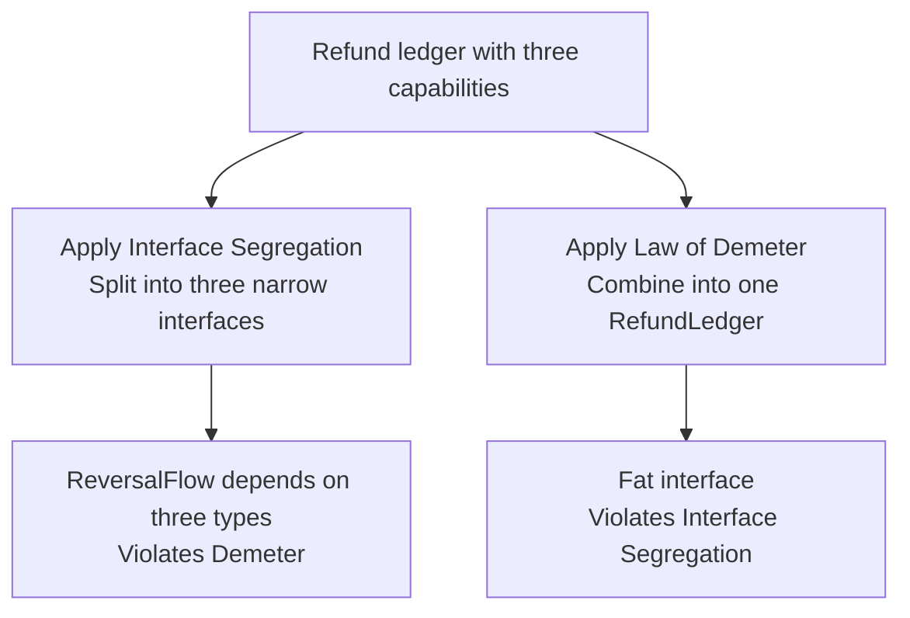

> The cheaper it gets to generate code, the more valuable engineering judgment becomes. This series is my attempt to dust off classic software design principles, trace each one back to its original paper, and figure out where it still holds up—and where it breaks.

Coding agents now write code faster than I do, and most of the time, the output is clean enough that I can't fault it. That forces an uncomfortable question: are decades-old ideas like high cohesion, low coupling, SOLID, and the Law of Demeter still worth spending time on?

I think they are, but the way we learn them has to change.

Most of us learned design principles by memorizing definitions and rules of thumb so we could apply them while typing. Today, applying a rule is the easy part—an agent does it faster and more consistently than I ever could. Tell it to split a class along Interface Segregation lines, and it will. Tell it to refactor for the Law of Demeter, and it will do that too. What the agent cannot do is make the call one step earlier: when two principles pull the same piece of code in opposite directions, which one do you listen to?

You can't answer that by reciting slogans. You have to know what specific mess each principle was invented to clean up. So the approach in this series is historical: trace every principle back to its original paper or book, look at the exact problem the author was fighting at the time, and then hold that up against how we build software today.

## An Accidental Pantheon

Textbooks love to present object-oriented design as a neat pyramid. At the base sit high cohesion and low coupling; resting on top of them are the seven design principles; above those sit the twenty-three Gang of Four patterns; and at the peak sits object-oriented programming itself. Each layer seems to logically derive from the one below it.

When you actually pull the original papers, that pyramid falls apart:

| Concept | Author(s) | Year | Original Source |
|---|---|---|---|
| Cohesion & Coupling | Stevens, Myers, Constantine | 1974 | "Structured Design", *IBM Systems Journal* 13(2) [1] |
| Liskov Substitution (LSP) | Barbara Liskov | 1987 | OOPSLA keynote, "Data Abstraction and Hierarchy" [2] |
| Law of Demeter (LoD) | Ian Holland et al. | 1987 | Northeastern University, the Demeter Project [3] |
| Open-Closed Principle (OCP) | Bertrand Meyer | 1988 | *Object-Oriented Software Construction* [4] |
| Composite Reuse (CRP) | Gang of Four | 1994 | *Design Patterns* |
| Dependency Inversion (DIP) | Robert C. Martin | 1996 | *C++ Report* (collected in 2000 [7]) |
| Interface Segregation (ISP) | Robert C. Martin | 1996 | *C++ Report* (collected in 2000 [7]) |
| Single Responsibility (SRP) | Robert C. Martin | 1990s | *C++ Report*, named and collected in 2000 [7] |

These ideas came from six unrelated groups working across a twenty-two-year span. In 1974, Stevens, Myers, and Constantine were trying to figure out how to divide procedural programs into subroutines, illustrating their points with PL/I and FORTRAN. In 1987, Barbara Liskov was formalizing type hierarchies and behavioral subtyping. That same autumn at Northeastern University, Ian Holland formulated the "Law of Demeter"—named not after a person, but after the Demeter project they were working on (which in turn was named after the Greek goddess of agriculture, to evoke growing software in small increments) [3]. In 1994, the Gang of Four were cataloging recurring object-oriented patterns. And in the mid-1990s, Robert C. Martin was writing columns in *C++ Report* about how to untangle brutal compile-time dependencies in large C++ codebases.

None of these people were contributing chapters to a single grand theory. Each was solving whatever problem was right in front of them. Even the acronym SOLID was retrofitted: Martin wrote the five underlying articles throughout the 1990s, and Michael Feathers suggested rearranging their initials into "SOLID" around 2004 [5]. (Chinese textbooks routinely teach a canon of "Seven Principles," which tacks the Law of Demeter and Composite Reuse onto SOLID—two rules that were never part of it.)

The pyramid is a pedagogical fiction, drawn decades later to make a messy history easier to teach.

## What History Clarifies

Reading these ideas in their original context clears up a lot of confusion that comes from learning them second-hand.

Take cohesion and coupling. The 1974 paper ranked cohesion on a six-point spectrum: coincidental, logical, temporal, communicational, sequential, and functional [1]. Most textbooks today teach seven levels—the extra one, "procedural cohesion," was added later by Yourdon and Constantine, while Myers proposed two more of his own. The fact that the creators themselves kept tweaking the list is a hint that it was never meant to be an exact metric. Years later, a study in the *Software Quality Journal* asked 163 students to classify the cohesion and coupling of modules in a medium-sized Fortran program; their ratings were all over the map [6]. The spectrum is still a great mental checklist, but it's a lens for human judgment, not a caliper.

Or take the most famous maxim of the bunch: "open for extension, closed for modification." Every textbook credits this to Bertrand Meyer in 1988. But if you read what Meyer actually wrote, his definition of "closed" meant a class had been compiled into a library and shipped to other developers; "open" meant callers could subclass that concrete class via **implementation inheritance** to add new fields or behavior. In 1988, that solved a very real build problem: modifying a published class in place forced everyone downstream to recompile and update their code.

Yet when developers talk about the Open-Closed Principle today, they almost always mean "program to an interface and swap implementations via polymorphism." That version comes from Robert C. Martin in the 1990s [4]. Martin framed his essays as restating Meyer, but the mechanism changed completely—from inheriting concrete classes to hiding implementations behind abstract interfaces. We still quote the 1988 slogan and credit Meyer, while practicing a 1990s rewrite. And the distinction matters in practice: an inheritance hierarchy and an abstract interface fail in very different ways when requirements shift (something notes five and ten will dig into).

## When Two Principles Collide

The clearest sign that these principles don't form a unified system is how easily they clash on real code.

Consider a refund reversal workflow, `ReversalFlow`. Suppose our underlying refund ledger supports three capabilities: looking up refunds by order, inspecting a refund's status timeline, and executing a reversal. If we follow the **Interface Segregation Principle** (clients shouldn't depend on methods they don't use), we split the ledger into three narrow interfaces and inject them into `ReversalFlow`:

```ts
interface RefundLookup   { findByOrder(orderId: string): Promise<Refund[]> }
interface RefundTimeline { stagesOf(refundId: string): Promise<Stage[]> }
interface RefundReversal { reverse(refundId: string, reason: string): Promise<void> }

class ReversalFlow {
  constructor(
    private lookup: RefundLookup,
    private timeline: RefundTimeline,
    private reversal: RefundReversal,
  ) {}
}
```

Now look at the exact same class through the **Law of Demeter** (an object should know about as few other types as possible). From Demeter's perspective, `ReversalFlow` is coupled to three separate collaborators. To shrink its surface area, we should fold them into a single `RefundLedger` type:

```ts
class ReversalFlow {
  constructor(private ledger: RefundLedger) {}
}
```

Now `ReversalFlow` only knows about one type, making Demeter happy. But `RefundLedger` has become a fat interface combining lookup, timeline, and reversal—which violates Interface Segregation for every other caller that only needed one of the three.



Neither principle is being misapplied here. They simply pull in opposite directions: narrower interfaces mean more types to wire up; fewer types mean wider interfaces (or extra wrapper classes).

No principle can calculate that trade-off for you. Personally, I almost always side with Interface Segregation in cases like this: declaring an extra TypeScript interface costs almost nothing at runtime, whereas writing facade classes and forwarding methods just to hide collaborator types leaves behind real code you have to maintain. But that's a pragmatic judgment call, not a theorem.

## How Slogans Turn into Dogma

When a principle gets stripped of the historical problem it was meant to solve, it turns into a checkbox for code reviews.

Constantine and his colleagues cared about cohesion and coupling because they wanted to edit one subroutine without breaking three others across the system. Meyer cared about open-closed because recompiling shared libraries in 1988 was painful. Every one of these principles started life as a defense against a concrete engineering headache. As they got condensed into slides, blog posts, and interview prep guides, the headaches were forgotten and only the catchphrases survived.

And catchphrases are dangerously easy to game. To prove code is "compliant," developers preemptively wrap every class in an `IXxxService` interface or splinter cohesive logic into a dozen tiny single-method classes. All that extra indirection rarely cushions the blow when a real product requirement changes; the only thing it actually protects against is a nitpicky comment in a pull request. You end up with the worst of both worlds: code that is just as brittle when requirements shift, and twice as bloated to read today.

This is precisely why going back to the sources matters more in the age of AI, not less.

When we wrote every line by hand, the sheer tedium of typing acted as a natural brake on over-engineering. With an agent, generating ten layers of interfaces and twenty wrapper classes takes a single prompt and five seconds. If you don't know what hazard a principle was actually built to prevent, an agent will happily help you construct a cathedral of pointless abstractions at ten times the speed.

Once you let go of the textbook pyramid, the seven principles become much more useful as **seven diagnostic questions**:

- **Single Responsibility**: Which distinct groups of stakeholders will come asking for changes to this module?
- **Open-Closed**: Along which axis is this code most likely to grow next?
- **Liskov Substitution**: If a caller swaps the base type for this subtype, do all of its unstated assumptions still hold?
- **Interface Segregation & Demeter**: Right now, which hurts more—wide interfaces or chatty object graphs?

None of these questions automatically outranks the others. An agent can execute whichever refactoring you choose in seconds; figuring out which question matters for your codebase is still on you.

## The Running Example for This Series

To keep the rest of this series grounded—and avoid the usual toy examples of `Animal` subclasses and `Shape` hierarchies—all nine follow-up notes build on a single domain: **a payment refund and reconciliation subsystem**. I chose refunds because the domain has hard invariants where bad abstractions cause obvious, expensive bugs.

Four invariants run through the entire series:

1. **Refund cap**: Cumulative refunds for an order can never exceed the amount originally paid.
2. **Idempotency**: Submitting the same refund request twice must never move money twice.
3. **One-way state transitions**: Once a refund settles, its state cannot be rolled back; corrections require appending a new offsetting entry.
4. **Currency isolation**: Amounts in different currencies can never be added or compared directly.

Around these invariants sit four refund channels (original card, wallet balance, manual bank transfer, loyalty points) and four distinct clients (customer support console, finance reconciliation job, risk interception engine, read-only merchant dashboard). That setup naturally creates two competing axes of change—adding a new channel versus adding a new operation—which Note 5 will use to show why no design can be "closed for modification" against everything at once.

### Series Outline

- Opening · Rereading Classic Design Principles in the Age of AI *(this note)*
- Cohesion · [The test is "must change together", not "looks related"](/notes/what-belongs-in-one-module/)
- Coupling · [It measures mutual knowledge, not import counts](/notes/three-invisible-couplings/)
- Single Responsibility · [A responsibility is not a task, it is someone who will ask](/notes/single-responsibility-is-an-actor/)
- Open-Closed · [Which changes should the design accommodate?](/notes/open-closed-only-the-guessed-axis/)
- Liskov Substitution · [A subtype must seamlessly stand in for its supertype](/notes/liskov-what-the-signature-does-not-check/)
- Dependency Inversion · What inverts is who owns the interface
- Interface Segregation · An interface is a slice taken from the client's point of view
- Law of Demeter · The middleman's dilemma
- Composite Reuse · Inheritance publishes your invariants

## References

1. [W. P. Stevens, G. J. Myers, L. L. Constantine, "Structured Design", *IBM Systems Journal* 13(2), 1974, 115–139](https://dl.acm.org/doi/10.1147/sj.132.0115)
2. [Barbara Liskov, "Keynote address — Data Abstraction and Hierarchy", *OOPSLA '87 Addendum*, published in *ACM SIGPLAN Notices* 23(5), 1988, 17–34](https://www.cs.tufts.edu/~nr/cs257/archive/barbara-liskov/data-abstraction-and-hierarchy.pdf)
3. [Karl Lieberherr, "Law of Demeter: Principle of Least Knowledge", Northeastern University](https://www.khoury.northeastern.edu/home/lieber/LoD.html)
4. [Open–closed principle — comparison of Meyer's and Martin's formulations](https://en.wikipedia.org/wiki/Open%E2%80%93closed_principle)
5. [SOLID — origin of the acronym](https://en.wikipedia.org/wiki/SOLID) *(Note: attributing the SOLID acronym to Michael Feathers rests on secondary accounts; neither Feathers nor Martin appears to have published a primary source confirming the exact date.)*
6. [N. Fenton et al., "Difficulties using cohesion and coupling as quality indicators", *Software Quality Journal*](https://link.springer.com/article/10.1007/BF00590439)
7. [Robert C. Martin, "Design Principles and Design Patterns", Object Mentor, 2000 (collects the original *C++ Report* essays on SRP, DIP, and ISP)](https://www.fil.univ-lille.fr/~routier/enseignement/licence/coo/cours/Principles_and_Patterns.pdf)
