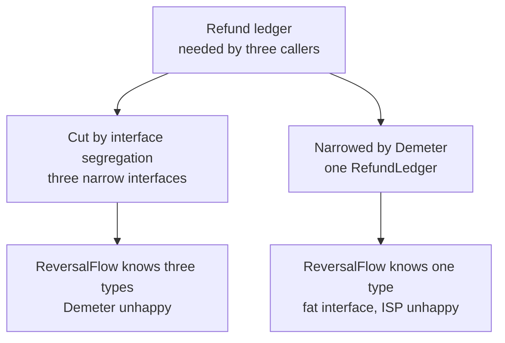

> AI can write more of our code every month, which makes the judgement we have built up worth more, not less. This series is me taking these ageing principles back off the shelf, checking where each one came from, where it holds, and where it breaks. Reviewing the old to understand the new.

Agents write code faster than I do now, and most of the time I cannot fault what they produce. That leaves a question I cannot walk around: high cohesion and low coupling, SOLID, the Law of Demeter. Are design principles from decades ago still worth the hours?

My answer is yes, with a different way of learning them. I used to learn a principle by memorising its slogan and definition, so that I could follow it when I wrote code. Following it is the part an agent already does faster than I do. The part it cannot do for me comes one step earlier: the seven principles give opposite advice about the same piece of code, and which one to follow this time depends on which way the code will grow and who will come asking for changes. Making that call requires knowing what trouble each principle was proposed to solve.

So this series learns them by tracing sources: take each principle back to where it came from, look at the specific problem it faced when it appeared, then hold it against today's code. This opening note sets out where each of the seven came from, and one picture I gave up after checking.

## Where the seven principles came from

Textbooks often draw a pyramid: high cohesion and low coupling at the bottom, the seven design principles in the middle, design patterns above them, object-oriented development on top. Each layer holds up the next, and it looks like a system someone derived.

Checked one by one, this is where they came from:

| Concept | Who | Year | Source |
|---|---|---|---|
| Cohesion and coupling | Stevens, Myers, Constantine | 1974 | "Structured Design", IBM Systems Journal 13(2) [1] |
| Liskov substitution (LSP) | Barbara Liskov | 1987 | OOPSLA keynote, "Data Abstraction and Hierarchy" [2] |
| Law of Demeter (LoD) | Ian Holland | 1987 | Northeastern University, the Demeter project [3] |
| Open-closed (OCP) | Bertrand Meyer | 1988 | "Object-Oriented Software Construction" [4] |
| Composite reuse (CRP) | the Gang of Four | 1994 | "Design Patterns" |
| Dependency inversion (DIP) | Robert C. Martin | 1996 | C++ Report, collected in "Design Principles and Design Patterns" (2000) [7] |
| Interface segregation (ISP) | Robert C. Martin | 1996 | C++ Report, collected in "Design Principles and Design Patterns" (2000) [7] |
| Single responsibility (SRP) | Robert C. Martin | 1990s | C++ Report, collected in "Design Principles and Design Patterns" (2000) [7] |

Six groups of people, with twenty-two years between the earliest and the latest. The 1974 paper is about how to divide a program into modules, and its examples are PL/I procedures and FORTRAN subprograms. Liskov's 1987 talk is about data abstraction and inheritance hierarchies. In 1994 the Gang of Four were cataloguing design solutions that kept recurring. In 1996 Martin was writing in the C++ Report about dependency problems in object-oriented design. Each was answering the question in front of them, and none was adding bricks to a shared system.

The acronym SOLID came later still. Martin wrote the five principles over the course of the 1990s; spelling a word with their initials is generally credited to Michael Feathers around 2004 [5], more than a decade after the earliest of them. The list of seven found in Chinese textbooks has two more than SOLID: the Law of Demeter comes from Northeastern University in 1987 and composite reuse from the Gang of Four in 1994, and neither was ever part of SOLID.

The seven were put side by side by people who came afterwards.

## The cohesion and coupling levels are a judgement scale

The 1974 paper ranks cohesion in six levels, from lowest to highest: coincidental, logical, temporal, communicational, sequential, functional [1]. Textbooks today usually list seven; the extra one, procedural cohesion, was added later by Yourdon and Constantine in their book, and Myers proposed two more of his own. The versions do not agree.

Someone later measured this. A study in the Software Quality Journal asked 163 students to label the cohesion and coupling levels of the modules in one medium-sized Fortran program, and the answers diverged widely [6]. The same code, read by different people, produced different levels.

The table is still useful. What the study shows is its nature: it is a scale that helps a person judge, its reading depends on the reader and on the situation the code is in, and it cannot be used as a measuring instrument.

## The open-closed principle means two different things

The most quoted line among the seven is "open for extension, closed for modification". It is filed under Meyer, with the year 1988.

What Meyer said in 1988 was this: a class can be compiled into a library and used by other classes, and in that sense it is closed; any new class can also take it as a parent and derive new features, and in that sense it is open. The means of achieving this was implementation inheritance: package the class into a library, and let others extend it by inheriting. That answered a problem of its time, when adding a field or a function to a library meant changing every program that depended on it.

In the 1990s Martin restated it as depending on abstract interfaces, with implementations behind the interface and extension through polymorphic substitution. Martin presented this as a restatement of Meyer, but the two give different answers to how openness and closure are achieved: one says inherit from a concrete class, the other says depend on an abstract interface [4].

I used to read the open-closed principle as "program to an interface", and I had always filed that under Meyer. Reading the 1988 formulation showed me that **the version taught today was rewritten in the 1990s, and only the name and the year were carried over from the generation before.**

The difference affects code. In Meyer's version the extension point is an inheritance hierarchy; in Martin's it is an interface. When each kind of extension point fails, and what the failure looks like, are separate matters, which notes five and ten take up in turn.

## The Law of Demeter is named after a project

One smaller thing. The Law of Demeter takes its name from a project; nobody called Demeter proposed it.

Ian Holland proposed it at Northeastern University in the autumn of 1987, while he was on the Demeter project. The team named the rule after the project, and the project was named after the Greek goddess of agriculture, the idea being to grow software in small steps the way crops are grown [3].

On the page Lieberherr keeps on the Northeastern website, the law is one sentence: only talk to your friends.

## Two principles, one piece of code, opposite advice

The most direct evidence that the seven do not form one system is that they conflict.

The interface segregation principle says a client should not depend on interfaces it does not need, so interfaces should be split finely. Cut that way, the three uses of the refund ledger become three interfaces, and the reversal flow `ReversalFlow` has all three injected:

```ts
interface RefundLookup   { findByOrder(orderId: string): Promise<Refund[]> }
interface RefundTimeline { stagesOf(refundId: string): Promise<Stage[]> }
interface RefundReversal { reverse(refundId: string, reason: string): Promise<void> }

class ReversalFlow {
  constructor(
    private lookup: RefundLookup,
    private timeline: RefundTimeline,
    private reversal: RefundReversal,
  ) {}
}
```

The Law of Demeter says an object should know as little as possible about other objects. Seen that way, the `ReversalFlow` above knows three types, which is too many. Fold the three interfaces into one `RefundLedger`:

```ts
class ReversalFlow {
  constructor(private ledger: RefundLedger) {}
}
```

Now `ReversalFlow` knows one type and the Law of Demeter is satisfied. But `RefundLedger` has to offer lookup, timeline and reversal together, which makes it a fat interface, and interface segregation is no longer satisfied.

Neither principle was misapplied. They point in opposite directions. One more narrow interface means one more type, and one fewer type means the interface has to widen. **There is no right answer here, only a trade-off.** One more narrow interface is only one more abstract type, whereas writing forwarding methods to know one type fewer leaves concrete code to maintain, and the former usually costs less than the latter. That trade-off is mine; the principles themselves cannot compute it.

The same code, with each principle pulling its own way:



Both paths comply. The difference is which cost I would rather pay this time.

## The pyramid does not hold; the seven are seven questions

I used to think the seven were stacked in order, with high cohesion and low coupling underneath and design patterns on top, each layer deriving the next. After checking the sources, that structure does not stand: they come from six unrelated groups of people, each solving a problem of their own, spread over twenty-two years, and they give opposite advice about the same code. The pyramid is a story drawn afterwards to make them teachable.

I now use them as seven questions. How many groups of people will come to me when this code changes is the question single responsibility asks. Which way this code will grow is the question open-closed asks. Whether the caller's assumptions still hold once this subtype stands in for its supertype is the question Liskov substitution asks.

No question outranks another. Which one matters more depends on the situation the code is in.

## A principle that loses its source becomes an acceptance criterion

With the sources checked, the next thing to answer is what these years and names are good for when writing code.

Their use is that every principle arrived carrying the specific trouble it was meant to solve. The three authors of 1974 wanted to reduce the complexity of programs, so that a change in one place would not carry errors into another. Meyer in 1988 faced libraries where adding one field forced every dependent program to change. Each principle is one answer to one specific trouble, and none was derived from axioms.

The trouble is what gets lost fastest in transmission. A principle is lifted out of a paper into a slogan, copied from the slogan into a textbook, and from the textbook into a stock phrase of code review. By then only the wording is left. "Open for extension, closed for modification" sounds unanswerable, yet when Meyer wrote it, extension meant inheriting from a class already compiled into a library.

A slogan that has lost its setting becomes an acceptance criterion, and an acceptance criterion can be satisfied by piling up structure. So every seam gets an interface first, every class is split until one method remains, and the review passes point by point. The extra layer of indirection stops none of the changes the code will meet; the only thing it stops is the review comment "this does not seem to follow the principle".

**Code written that way makes two mistakes at once: it does not gain the changeability the principle was meant to protect, and it is heavier than it would have been without the principle.**

## Why tracing sources matters more in the age of AI

Put the sections above together and the opening question can be answered.

An agent can implement any one of the seven faster than I can. Ask it to split something by interface segregation and it will split; ask it to follow the Law of Demeter and it will narrow. Both instructions produce compliant code, and the `ReversalFlow` example shows that compliant code can grow in opposite directions.

What it cannot answer is which one to follow this time. The answer lies in the business: which way this code will grow next, and who will come asking. Neither fits into a general principle, so someone who knows the system has to judge.

Learning by tracing sources trains that judgement. Knowing what a principle was guarding against is what lets me see whether the code in front of me has the same trouble; if it does not, the principle can be left out this time. The faster implementation becomes, the cheaper it is to pile up needless structure by following slogans, and the more this judgement is worth practising.

The nine notes after this one all work the same way: put the principle back where it was born, see what it was guarding against, then bring it back to today's setting and ask whether that defence is still worth maintaining.

## The example this series uses

The code in the nine notes after this one all grows from the same place: a refund and reconciliation subsystem. I picked it because its constraints are hard, with concrete invariants that can be broken, so a principle such as Liskov substitution does not turn into a grammar exercise.

Four invariants, which will keep coming back:

1. Total refunds never exceed what the original order paid
2. Idempotent: resubmitting the same refund does not move money twice
3. States move one way. A settled refund cannot be rolled back, only offset by a new reverse entry
4. One currency. Amounts in different currencies cannot be added

Refunds run through four channels (back to the original card, wallet balance, offline transfer, credit compensation) and four kinds of client (support console, finance reconciliation, risk interception, read-only merchant view). The structure carries two extension axes that work against each other: adding a channel, and adding an operation. Note five uses it to show why the open-closed principle can only be open along one of them.

## The series

- Opening · Tracing Programming Ideas Back to Their Sources in the Age of AI
- Cohesion · [The test is "must change together", not "looks related"](/notes/what-belongs-in-one-module/)
- Coupling · [It measures mutual knowledge, not import counts](/notes/three-invisible-couplings/)
- Single responsibility · [A responsibility is not a task, it is someone who will ask](/notes/single-responsibility-is-an-actor/)
- Open-closed · [Which changes should the design accommodate?](/notes/open-closed-only-the-guessed-axis/)
- Liskov substitution · [A subtype must seamlessly stand in for its supertype](/notes/liskov-what-the-signature-does-not-check/)
- Dependency inversion · What inverts is who owns the interface
- Interface segregation · An interface is a slice taken from the client's point of view
- Law of Demeter · The middleman's dilemma
- Composite reuse · Inheritance publishes your invariants

One note per principle, published as they are written.

## What this opening note concludes

- The seven principles do not form one system. Six groups of people, twenty-two years, unrelated troubles; they were put side by side by people who came afterwards.
- I use them as seven questions, and no question outranks another. Which one to ask depends on which way the code will grow and who will come asking.
- The cohesion and coupling levels are a judgement scale. That 163 people can label the same code with different levels shows the reading depends on context.
- Two principles can give opposite advice about the same code, with neither one misapplied. Interface segregation and the Law of Demeter do that to `ReversalFlow`.
- Every principle was born in a specific setting, and the setting gets lost in transmission. A slogan that has lost its setting becomes an acceptance criterion, and an acceptance criterion can be satisfied by piling up structure.
- An agent can implement any principle faster than I can. What it cannot answer is which one to follow this time, and tracing sources is how I train that judgement.

## References

1. [W. P. Stevens, G. J. Myers, L. L. Constantine, "Structured Design", IBM Systems Journal 13(2), 1974, 115–139](https://dl.acm.org/doi/10.1147/sj.132.0115)
2. [Barbara Liskov, "Keynote address — Data Abstraction and Hierarchy", OOPSLA '87 Addendum, published in ACM SIGPLAN Notices 23(5), 1988, 17–34](https://www.cs.tufts.edu/~nr/cs257/archive/barbara-liskov/data-abstraction-and-hierarchy.pdf)
3. [Karl Lieberherr, "Law of Demeter: Principle of Least Knowledge", Northeastern University](https://www.khoury.northeastern.edu/home/lieber/LoD.html)
4. [Open–closed principle — a comparison of the two formulations](https://en.wikipedia.org/wiki/Open%E2%80%93closed_principle)
5. [SOLID — the origin of the acronym](https://en.wikipedia.org/wiki/SOLID)
6. [Difficulties using cohesion and coupling as quality indicators, Software Quality Journal](https://link.springer.com/article/10.1007/BF00590439)
7. [Robert C. Martin, "Design Principles and Design Patterns", Object Mentor, 2000. The written-up sections for SRP, DIP and ISP are all collected in this compilation; the original C++ Report issues have no stable online link](https://www.fil.univ-lille.fr/~routier/enseignement/licence/coo/cours/Principles_and_Patterns.pdf)

On reference 5: the SOLID acronym is attributed to Michael Feathers, but every source I could find is second-hand citing other second-hand sources, with no confirmation from Feathers or Martin himself. Treat it as the common view rather than an established fact.
