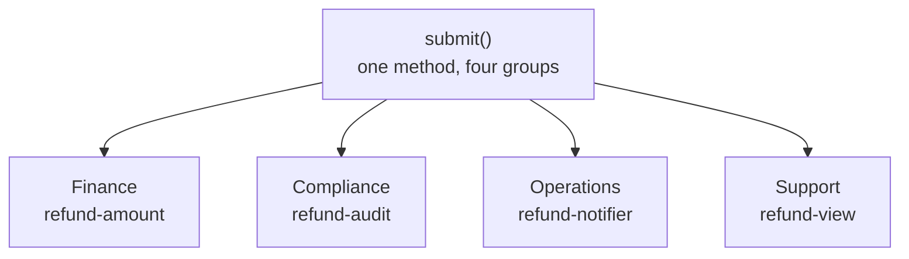
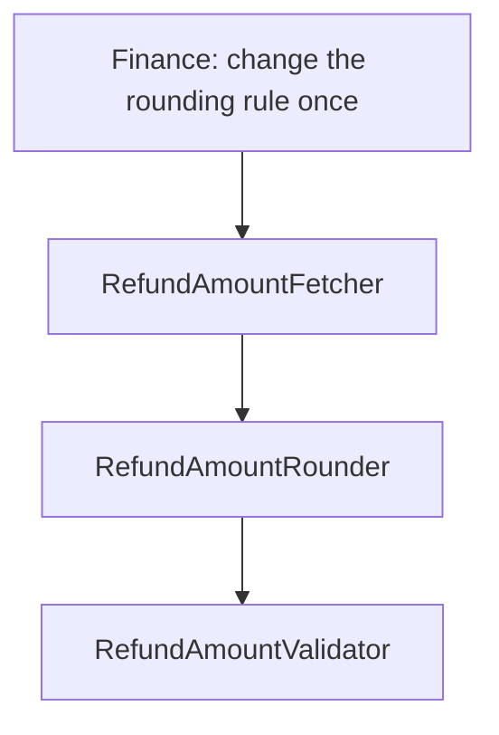

> The fourth of ten notes in the Programming Thinking series. The case the series is built on is in the [opening essay](/notes/programming-taste-in-the-agent-era/).
>
> AI can write more of our code every month, which makes the judgement we have built up worth more, not less. This series is me taking these ageing principles back off the shelf, checking where each one came from, where it holds, and where it breaks. Reviewing the old to understand the new.

The most repeated slogan for single responsibility is "a class should do one thing". The trouble is that "one thing" cannot be decided: how big is a thing, and where does splitting stop? The criterion has to change to people: **a responsibility is someone who will come asking**. Counting the groups of people a piece of code answers to is more reliable than arguing about what counts as one thing. Why does counting people work? Because change arrives from people, and only requests from the same group change together. Start with a real change.

Finance asked for a change: round refund amounts down to the cent, no longer half-up.

The change landed on the rounding line inside `computeAmount`. Two other lines moved with it: the amount recorded in the audit log, and the display string the support console builds. All three take their value from what `computeAmount` returns. On the day it shipped, the support console showed two extra decimal places, and the amount format in the audit log changed too.

Nobody wrote anything wrong in those three places. The trouble was where they lived. This is the code before the change, with injected dependencies and field declarations left out:

```ts
class RefundService {
  async submit(req: RefundRequest): Promise<RefundResult> {
    const amount = this.computeAmount(req)
    await this.ledger.record(req.orderId, amount)
    await this.audit.log(req, amount)
    await this.notify.refunded(req.userId, amount)

    return {
      amount,
      status: 'done',
      display: `Refunded ¥${(amount / 100).toFixed(2)}`,
    }
  }
}
```

**The question single responsibility asks is how many groups of people live in this code, each able to come and ask for a change.** Finance wanted one line changed, and the other two lines belong to compliance and support. With all three in one method, one change walks out of finance's office and into two others.

Using people as the criterion has an upside: it does not depend on you understanding what the code does. It also has a cost, which is that you cannot read the answer off the code. The same code is judged differently depending on who maintains it and which way the business is growing.

## Four groups living in one method

Read each line of the method by who would ask for it to change:

| What the line does | Who asks | When they ask |
|---|---|---|
| `computeAmount` | Finance | Rounding rules, discount splits, or currency conversion change |
| `audit.log` | Compliance | The retained fields change, or a regulator adds one |
| `notify.refunded` | Operations | Wording, channel, or timing moves |
| the `display` line | Support | The console table gains a column, or needs a new field |

The table divides people, not code. All four lines are written in ordinary ways; what differs is whose problem each one answers. The table also does not tell you how many files to cut this into. That depends on where changes come from.

These four groups do not coordinate, and they do not agree on a day to ask. On the day finance changed the rounding rule, compliance had asked for nothing and neither had support. The other two lines moved because they share the return value of `computeAmount`, not because those two departments asked for anything.

Martin has an analogy for this. You take your car to a mechanic to fix a broken electric window. When you pick it up the window works, and the car will not start. He adds one more remark, and that is where the analogy lands: the customer and the manager find that what broke is exactly the part they never asked him to touch, and that is the feeling.

## Martin tied this to people in 2014

A common wording of the principle is that a module should have one, and only one, reason to change. Martin's own words in his 2014 post are `each software module should have one and only one reason to change` [1]. He says module, not class; the more popular "a class should do one thing" is what that sentence turned into as it was passed around.

"Reason" is too thin a word to land on specific code. Does fixing a bug count as a reason? Does a refactoring? Readers asked both, and on 8 May 2014 Martin wrote a post to answer them [1]. The answer is one sentence:

> This principle is about people.

His argument is concrete. Ask who owns the rules of each method. The example is an `Employee` class, with the method names written as in the original Java:

```java
public class Employee {
  public Money calculatePay();
  public void save();
  public String reportHours();
}
```

The pay algorithm belongs to the CFO, the format of the report `reportHours` returns belongs to the COO, and how `save` writes into the enterprise database belongs to the CTO. His test for ownership is blunter: if the rule in a method were written wrongly and the consequences were serious enough, which executive would be fired? A wrong pay algorithm costs the CFO his job, a wrong hours report used for audit costs the COO, and a corrupted database costs the CTO. In a footnote he admits the firing is exaggeration; C-level executives do not usually leave over a small mistake.

That makes the problem with the class clear. When the CTO asks for a change in how `save` writes, `calculatePay` may get broken in passing. The CFO does not care what is inside `save`. He reaches one conclusion: never touch that class again.

The post also has a phrasing that Martin labels "Another wording", and it is easier to use:

> Gather together the things that change for the same reasons. Separate those things that change for different reasons.

He then lists a few corollaries: SQL does not belong in JSP, the module that computes results should not generate HTML, and business rules should not know the database schema. What the three share is that one change in requirements should not disturb another group's code.

### Martin took this over from Parnas

The post does not start with `Employee`. Half of it comes first, and it is about Parnas's 1972 paper "On the Criteria To Be Used in Decomposing Systems into Modules" [3]. Martin cites Parnas's conclusion: the place to cut modules is the set of design decisions likely to change, with each module hiding one such decision, and the flowchart is a poor guide. He then writes that SRP looks consistent with Parnas's formulation.

That remark is worth noting separately. It shows that cutting along people is how Martin, in 2014, supplied an operating method for an older judgement, and the idea can be traced back to Parnas: Parnas says decisions that may change should be hidden, Martin says those decisions come from people. Note 2 used the same paper when discussing cohesion, so both notes trace to one source.

## The cohesion and coupling notes said this too

Martin says so directly in the post: think about it and you will see this is just another way of describing cohesion and coupling.

The previous two notes did the same job. [Note 2](/notes/what-belongs-in-one-module/) asked whether these elements change together, and its anchor is the 1974 cohesion scale [6]. [Note 3](/notes/three-invisible-couplings/) asked how far a change travels along a connection. This note asks the other side of the same question: who is going to ask for the change. Reasons come from people, people ask on their own schedules, so cutting along people gives you cohesion and coupling as a by-product.

This also explains why the principle cannot be judged by counting lines. A four-hundred-line class may serve one group, and a twenty-line class may have three groups watching it. I could not find a source for that contrast; I drew it from the examples above. It is not a measured number, and says only that length and responsibility do not correspond.

## The name might be borrowed

The history of the name deserves its own mention.

Martin consolidated Constantine's coupling and cohesion into one principle in the late 1990s, and gave it its current name at the same time. In the passage that tells this he put in a parenthesis that mentions Bertrand Meyer [2]:

> I have this vague feeling that I stole the name of this principle from Bertrand Meyer, but I have not been able to confirm that.

The tone is "vague feeling" and "have not been able to confirm", not a statement. The thinking behind the principle has a clear lineage; the lineage of the name is something even the person who proposed it cannot pin down.

That matches what the opening essay turned up: seven principles from six unrelated groups of people, arranged into one list by someone later.

The origin of the SOLID acronym is just as vague. It is generally credited to Michael Feathers, around 2004, more than a decade after the earliest of the principles [4]. Everything I can find on this is secondary sources confirming each other, with no first-hand confirmation from him or from Martin, so the opening essay treats it as "generally believed" and this note keeps to that. Keep two sources apart, too: the 2014 post mentions neither the SOLID acronym nor Feathers, and the account of the acronym rests only on that secondary record.

## After cutting along people

Back to the same refund service. After the split each file answers one group's questions; only the function signatures are kept here:

```ts
// finance/refund-amount.ts
export function computeRefundAmount(order: Order, items: RefundItem[]): Money

// compliance/refund-audit.ts
export async function recordAuditTrail(entry: AuditEntry): Promise<void>

// notification/refund-notifier.ts
export async function notifyRefundIssued(user: User, amount: Money): Promise<void>

// support/refund-view.ts
export function renderRefundSummary(refund: Refund): RefundSummary
```

`submit` stays in the orchestrating position. It is written below as the function `submitRefund`, with the request fields adjusted to fit the split, for illustration only. It no longer holds any group's rules and only calls things in order. Its return type has no `display` line either; the string support wants is decided by `renderRefundSummary`:

```ts
async function submitRefund(req: RefundRequest): Promise<RefundResult> {
  const amount = computeRefundAmount(req.order, req.items)

  await ledger.record(req.orderId, amount)
  await recordAuditTrail({ orderId: req.orderId, amount, actor: req.operator })
  await notifyRefundIssued(req.user, amount)

  return { amount, status: 'done' }
}
```

The cut fans out from one method to four files, one per group, in one direction only:



The diagram shows the direction of calls, not the strength of dependency: there are no lines between the four files, which means they do not need to know the others exist. It also does not say whether this split was drawn in the right place. If two of the files always change together, the split was wrong, and only the change history can tell you.

Now when finance changes the rounding rule, the change touches one file, `computeRefundAmount`. When compliance wants a retained field added, it touches `recordAuditTrail`. What the support console looks like is decided by `renderRefundSummary`, which is not even in the submission path.

### What is left in the orchestration layer

`submitRefund` still holds an order of three steps: record the ledger entry, write the audit, send the notification. That order is a business decision, not an arbitrary one. Compliance will usually want the audit written after the ledger entry settles, otherwise you can leave a log line that points to a record that does not exist. If operations' push goes out before the ledger entry, the user may get the notification first and then discover the refund failed.

Who owns that order? Whoever put forward the constraint: audit after ledger is compliance's requirement, notification after ledger is operations'. It belongs neither to finance nor to support, and it still lives in the orchestration layer. So after cutting along people, the code that remains has owners too, only more than one group of them. You can judge a split from here as well: if the orchestration layer contains a line that only one department can explain the reason for, that line is probably in the wrong place.

Incidentally, the orchestration layer does not get thinner and thinner. It takes over the question of what runs first, which was always there but used to be mixed in with the four groups' rules, where you could not see it.

## Where "does one thing" goes wrong

The more widespread version is that a class should do one thing. It sounds clear, but applying it to code starts with a question: what counts as one thing?

Taken to its limit it gives the three classes below. The code is a sketch with only the member names kept:

```ts
class RefundAmountFetcher   { /* reads the raw amount */ }
class RefundAmountRounder   { /* rounds it */ }
class RefundAmountValidator { /* checks it against the cap */ }
```

Three classes, one method each, and tidier than before at a glance. But only one group will ever ask for changes here, and that group is finance. When finance changes the rounding rule, the edit itself lands in `RefundAmountRounder`, but to confirm that validation was not skipped after rounding, you have to read three files along the chain:



The diagram has one chain, and "change one place" still looks like a single line on it. What changed is that the line now crosses three files: whoever edits must first confirm which link they are standing on, then confirm whether the two downstream links will change with it.

This is exactly what the section "Splitting can also break cohesion" in [note 2](/notes/what-belongs-in-one-module/) described: pull apart things that always change together and the cohesion level drops. The criterion is not counting methods, it is counting people.

## Following the slogan to the letter costs double

Put the two versions side by side and the cost is plain.

Before the split, finance changing the rounding rule meant changing one line in one method. After it, the change still lands in the one rounding class, but confirming that validation was not bypassed means reading three files and two calls that did not exist before. The file count went from one to three, and the number of people involved is still one.

**Splitting to the limit by "do one thing" costs double: a change already touched only one place, so the split buys nothing, and it adds two indirect calls.**

This has the same shape as the case the opening essay made. It said principles were born in specific situations, and the situation gets lost in copying; a slogan that has lost its situation turns into an acceptance criterion, and acceptance criteria can be met by piling up structure. Here is what that looks like: the criterion is "a class does one thing", and the cheapest way to pass is to keep splitting until nothing can be split further. The structure is beyond criticism, modifiability has not improved, and the cost of understanding has gone up. The situation was not wrong; what went wrong was using the slogan with the situation removed.

### When a split is not following the slogan blindly

None of this says splitting is wrong. If the same rounding logic is worth separating in another codebase, you can usually point to a specific reason: the parts depend in different directions, handle failure differently, or run at very different rhythms.

Here is an example you can check. If the validation step has to call an API to fetch the cap, it gains a network dependency and its tests need a stub first; rounding is a pure function and its tests need no setup at all. The verification costs of the two differ a great deal, and once they are separate, whoever changes the rounding rule does not need to run a test that needs the network. The reason lies in the scope of verification, which makes it specific.

"A class does one thing" gives you an action you can follow, but it cannot judge whether these two pieces of code should be separated. When you cannot tell, ask one question first: after splitting, who gets to read one file fewer? A split you cannot answer that for can wait.

## When it counts as two people

With the criterion landing on specific people, one problem is unavoidable: are two groups one or two?

Martin's original gives a direction. What he wrote is one person, or more precisely `a single tightly coupled group of people representing a single narrowly defined business function`, a closely working group that maps to a single business function. This criterion is about where change requests come from, and has nothing to do with how many departments the org chart shows.

Finance forks further. Accounting cares which ledger account a refund lands in, and tax cares about invoices and filing. Today the two may change in the same edit; next quarter only the tax side may move. The sentence in the original needs one more step before it can be applied to two specific groups. My own way of asking is: if one side adjusts, does the other follow on the same day? If yes, one group; if not, two.

That question is mine, and I should be clear about how it relates to the original: the original gives the direction of the criterion, and I added a way to apply the direction to one concrete change. It can be wrong, and only judgement can tell.

The accounting and tax fork does not depend on how many people there are. Even if the CFO and COO in Martin's example were one person, accounting rules and operational reports would not become one concern because they sit behind the same desk.

### A fifth group may appear

The refund service above has only four groups, and that is the boundary of this example, not a general rule. Take the same method one step further and another group appears: whoever owns the integration with the payment channel. The bank changes its interface and requires a channel serial number in the refund request. That requirement came from neither finance, compliance, operations nor support.

Run the same test: on the day the channel interface changes, do the other four groups change anything? No, the code near each of them does not need to move. So it counts as its own group, and the line in `submit` that calls the channel adapter (not drawn in the examples above) now has an owner.

This is worth saying because "four" is too easy to remember as a conclusion. In another system you may count three, or six. The `Employee` example has only the CFO, COO and CTO because the three methods he picked happened to match three functions. The number of people has to be counted on the spot; it is not a rule you can memorise in advance.

### What a wrong call costs

A wrong call can go two ways, and the costs are not symmetrical.

Treat two groups as one, and they keep sharing a file: changes still disturb each other, but at least they are in one place, where you can see them. Treat one group as two, and you add a split and a layer of calls, and the extra part answers to no real requirement; it only exists to make a misread criterion hold.

That is where the costs differ, so when the signal is unclear, not splitting is the cheaper side. It is the same direction of warning as ["Splitting can also break cohesion"](/notes/what-belongs-in-one-module/) in note 2, except that the criterion there was whether elements change together, and here it is people.

This judgement can be wrong, and judgement is all there is. The opening essay cited a study in which 163 students labelled cohesion and coupling levels for modules in the same medium-sized Fortran program, and disagreed widely [5]. Single responsibility belongs to the same kind of thing: a judgement scale, not a measuring instrument.

## What I changed my mind about

I used to review code by asking whether a class does one thing, and I often did not believe my own conclusions. A service class with a dozen methods: saying it does one thing is a stretch, and saying it violates the principle feels wrong too.

Asking how many groups of people will come asking is what made the judgement possible. In that `RefundService` there are four groups, so four files. The `RefundAmountFetcher` set has three classes but only finance asking, so putting them together makes more sense.

For the same kind of code, changing the question took the answer from undecidable to decidable. Note 2 worked the same way when it changed its question, and there the new question was whether things change together.

The next note covers the open-closed principle. A new gift-card channel is easy to add, but a reversal operation that every channel must provide means touching every implementation. Why the same design is open to one kind of change and closed to another is the boundary the next note checks.

## References

1. [Robert C. Martin, "The Single Responsibility Principle", Clean Coder Blog, 2014-05-08](https://blog.cleancoder.com/uncle-bob/2014/05/08/SingleReponsibilityPrinciple.html). The slug in the link is spelled `SingleReponsibility`. The sentences `each software module should have one and only one reason to change`, `This principle is about people.`, `Gather together the things that change for the same reasons...` and `a single tightly coupled group of people representing a single narrowly defined business function`, the `Employee` example with the CFO, COO and CTO, the mechanic analogy and where it lands, footnote 1 on exaggeration, and the parenthetical about Bertrand Meyer were all checked against the original, sentence by sentence. The SOLID acronym is not in this post.
2. [Bertrand Meyer, *Object-Oriented Software Construction*, Prentice Hall, 1988](https://dl.acm.org/doi/book/10.5555/534431). Kept as the source of the name mentioned in Martin's aside. I did not check the book directly, and have no evidence that the name appears in Meyer's book.
3. [D. L. Parnas, "On the Criteria To Be Used in Decomposing Systems into Modules", Communications of the ACM 15(12), 1972, 1053–1058](https://dl.acm.org/doi/10.1145/361598.361623). The post opens by discussing this paper, and says SRP agrees with Parnas's formulation. [Note 2](/notes/what-belongs-in-one-module/) used the same source.
4. [SOLID — the origin of the acronym](https://en.wikipedia.org/wiki/SOLID). The acronym is credited to Michael Feathers, around 2004, traceable to Martin's 2018 *Clean Architecture*, p. 58. What I can find is secondary sources confirming each other, with no first-hand confirmation, so it is treated as "generally believed".
5. [Difficulties using cohesion and coupling as quality indicators, *Software Quality Journal*](https://link.springer.com/article/10.1007/BF00590439). The study in which 163 students labelled cohesion and coupling levels and disagreed widely. It is the same entry as reference 6 of the opening essay and the one used in note 2; I have not read the full paper and rely on the record in those two places.
6. [W. P. Stevens, G. J. Myers, L. L. Constantine, "Structured Design", IBM Systems Journal 13(2), 1974, 115–139](https://dl.acm.org/doi/10.1147/sj.132.0115). The source of the cohesion and coupling concepts. Martin says in the 2014 post that he consolidated these two sets of concepts into a principle in the late 1990s; the six-level table in note 2 comes from the same paper.
