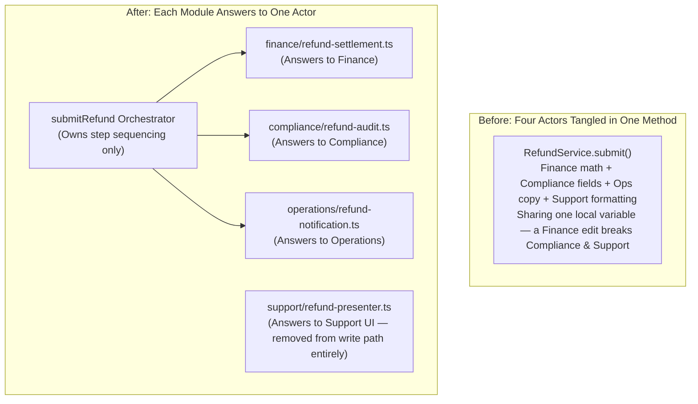

> Note 4 of 10 in the *Programming Thinking* series. The premise for the series is set out in the [opening essay](/notes/programming-taste-in-the-agent-era/).
>
> The cheaper it gets to generate code, the more valuable engineering judgment becomes. This series is my attempt to dust off classic software design principles, trace each one back to its original paper, and figure out where it still holds up—and where it breaks.

Of the five SOLID principles, the **Single Responsibility Principle (SRP)** has the catchiest slogan: *"A class or function should do only one thing."*

Unfortunately, that slogan falls apart the moment you apply it to real production code—because **nobody can agree on how big "one thing" is.**

At a high level, *"processing a refund"* is one thing. Zoom in a step, and *"calculating the refundable amount"* is one thing. Zoom in again, and *"rounding a prorated discount down to the nearest cent"* is one thing. If you take *"do only one thing"* literally, any sensible 30-line function can be shattered into ten 3-line wrapper classes.

The slogan fails because it dropped the subject of the original sentence.

When you go back to Robert C. Martin's own writing on SRP, a "responsibility" is not a low-level action in code—it is **a specific group of people (an actor) who will come asking you to change that code** [1][2].

Stated plainly: **a module should answer to only one business role. Counting how many distinct groups of stakeholders can demand edits to a piece of code is ten times more reliable than arguing over what counts as "one task."**

Let's see how this plays out in a real bug from our refund subsystem.

---

## How a "One-Line Change" Broke Two Other Departments

Look at this seemingly clean `RefundService.submit` method:

```ts
export class RefundService {
  async submit(req: RefundRequest): Promise<RefundResult> {
    // 1. Calculate refundable amount (prorate discounts and round)
    const amountCents = this.computeRefundAmount(req)

    // 2. Record the movement in the financial ledger
    await this.ledger.record(req.orderId, amountCents)

    // 3. Write a compliance audit trail
    await this.audit.log({ orderId: req.orderId, amountCents, operator: req.operator })

    // 4. Send an SMS notification to the customer
    await this.notify.sendSms(req.userId, amountCents)

    // 5. Return formatted summary for the support agent console
    return {
      amountCents,
      status: 'settled',
      displayText: `Refunded $${(amountCents / 100).toFixed(2)}`,
    }
  }
}
```

It's under twenty lines of code and reads cleanly from top to bottom.

One Tuesday, the **Finance** team requests a small rule change: *"When prorating coupon discounts across items leaves a fractional cent, always round down (`Math.floor`) instead of rounding to nearest (`Math.round`)."*

The developer opens `RefundService`, changes `Math.round` to `Math.floor` inside `computeRefundAmount`, sees all unit tests pass, and deploys that afternoon.

The next morning, both **Compliance** and **Customer Support** file urgent bug reports:

- **Compliance** flags that regulatory audit logs are required to record the *contractual pre-rounding entitlement* alongside any adjustment; because `audit.log` shared the return value of `computeRefundAmount`, yesterday's deploy silently shifted thousands of audit records by a cent, triggering a regulatory reconciliation alert.
- **Customer Support** complains that the `displayText` string shown in their ticket sidebar no longer matches the disputed figure customers see on their original invoice breakdown.

Neither Compliance nor Customer Support asked for a change, yet both of their workflows broke on the same afternoon. Why?

Because inside that tidy twenty-line method, **four separate groups of stakeholders were sharing the same room—and the same local variable.**

---

## Counting the People Living Inside One Method

Let's map each line of `RefundService.submit` to the people who have authority to change it:

| Code Line | Stakeholder Group (Actor) | When Do They Come Asking for Changes? |
|---|---|---|
| `computeRefundAmount(req)` | **Finance** | Rounding rules, tax proration, or multi-item discount formulas change |
| `audit.log(...)` | **Legal & Compliance** | Regulators require new retention fields, PII masking, or audit valuation rules |
| `notify.sendSms(...)` | **Operations / Growth** | Notification copy changes, SMS moves to push notifications, or quiet-hour rules change |
| `displayText: ...` | **Customer Support** | Support console UI redesigns or agents need multi-currency display formatting |

Finance, Compliance, Operations, and Support never coordinate their roadmaps. When Finance asks for a rounding tweak on Tuesday, Compliance isn't changing its regulatory schema.

Yet because all four concerns were wired directly onto the same `amountCents` value inside one method, a Finance request walked straight across the hall and broke Compliance and Support.

Martin used a memorable analogy for this exact failure mode: **you take your car to the mechanic to fix a broken electric window; when you pick it up the next day, the window rolls up fine, but the engine won't start** [1]. Nothing destroys trust in software faster than breaking features that nobody asked you to touch.

---

## Tracing Back to 2014: "This Principle Is About People"

For years, developers learned SRP through the phrase: *"A module should have one, and only one, reason to change."*

Because *"reason to change"* sounded vague—does fixing a bug count as a reason? does refactoring?—Martin published a follow-up essay in May 2014 titled *"The Single Responsibility Principle"* [1] that cut straight to the point:

> **This principle is about people.**

To make it concrete, he used a classic `Employee` class:

```java
public class Employee {
  public Money calculatePay();   // Payroll math
  public String reportHours();   // Operations timesheet report
  public void save();            // Database persistence
}
```

At first glance, all three methods belong on `Employee`—after all, they are all about an employee.

Now ask a different question: **if each method has a bug, which executive gets fired?**

- `calculatePay()` is specified by the **CFO's** payroll department;
- `reportHours()` is specified by the **COO's** operations department;
- `save()` is specified by the **CTO's** infrastructure team.

Suppose `calculatePay()` and `reportHours()` share a private helper method `regularHours()` to avoid duplicating code. One day, the COO's team asks a developer to tweak how overtime is counted inside `regularHours()` for an internal utilization report. The developer makes the edit—and unwittingly changes how `calculatePay()` computes paychecks for the entire company, costing the CFO millions [1].

In *Clean Architecture* (2017), Martin replaced *"reason to change"* with the much sharper formulation [2]:

> **A module should be responsible to one, and only one, actor.**

Look at how cleanly this connects back to [Note 2 (Cohesion)](/notes/what-belongs-in-one-module/) and David Parnas's 1972 paper on information hiding [3]:

- **Cohesion** says: keep things that change together in the same module.
- **Single Responsibility** explains *why* things change together: **code changes when people ask for changes—so code that answers to the same group of people changes on the same schedule.**

---

## Slicing the Refund Service by Actor

Once we slice `RefundService` along stakeholder boundaries, each group gets a module that answers only to them:

```ts
// 1. Answers to Finance: finance/refund-settlement.ts
export function computeSettlementAmount(order: Order, items: RefundItem[]): Money

// 2. Answers to Compliance: compliance/refund-audit.ts
export function buildAuditEntry(req: RefundRequest, settlementAmount: Money): AuditRecord

// 3. Answers to Operations: operations/refund-notification.ts
export function buildCustomerNotice(user: User, settlementAmount: Money): NotificationPayload

// 4. Answers to Customer Support: support/refund-presenter.ts
export function formatSupportSummary(record: RefundRecord): SupportViewDTO
```

With each actor's rules isolated in its own module, `submitRefund` becomes a thin **use-case orchestrator**:

```ts
export async function submitRefund(req: RefundRequest): Promise<RefundReceipt> {
  const settlementAmount = computeSettlementAmount(req.order, req.items)
  const receipt = await ledger.record(req.orderId, settlementAmount)

  await auditRepo.save(buildAuditEntry(req, settlementAmount))
  await notifier.send(buildCustomerNotice(req.user, settlementAmount))

  return receipt
}
```

Visually, the dependencies fan out cleanly toward each stakeholder's module without cross-contaminating one another:



Now when Finance changes rounding rules inside `computeSettlementAmount`, Compliance's `buildAuditEntry` still has full access to `req` and `settlementAmount` to record both the contractual amount and the settled amount. And Support's `formatSupportSummary` lives on the read path where it belongs.

---

## Navigating the Gray Areas: Three Places Developers Get Tripped Up

Once you replace *"do one thing"* with *"serve one actor,"* three common arguments in code review resolve themselves.

### Trap 1: Over-Splitting Code That Serves a Single Actor

When developers (or coding agents prompted to "apply SRP") take *"do one thing"* literally, they love taking a cohesive calculation owned by a single department and chopping it into microscopic classes:

```ts
// Over-splintered classes: All three answer to the exact same Finance actor
class RefundBaseFetcher   { /* Step 1: Read original order payment */ }
class RefundProrater      { /* Step 2: Prorate coupon discount across items */ }
class RefundCentRounder   { /* Step 3: Round remainder to integer cents */ }
```

Each class has one five-line method. On a superficial checklist, it looks "SRP-compliant."

Now ask: **who asks for changes to `RefundBaseFetcher`, `RefundProrater`, and `RefundCentRounder`? Only Finance.**

When Finance revises how prorated remainders are rounded, you cannot understand or verify the change without reading all three classes together. Splitting them across three files didn't isolate any competing stakeholders—it just forced the developer to jump across three files to read one formula, while doubling the wiring overhead.


**If three functions answer to the same actor and change for the same business reasons, keeping them together in one module is good SRP—splitting them is just fragmentation.**

### Trap 2: Who Owns the Orchestrator Left Behind?

After extracting Finance, Compliance, and Operations into their own modules, we still have `submitRefund` calling them in sequence: record ledger entry → write audit trail → send customer notification. Who owns that orchestrator?

**The orchestrator answers to the system's workflow sequencing rules.**

*"Never send a 'refund complete' SMS before the ledger write commits"* and *"never write an audit record for a ledger entry that failed"* are cross-cutting transactional invariants.

A simple test tells you whether a line of code belongs in the orchestrator or in an actor's module: **does this line contain domain jargon that only one department cares about?**

- If the orchestrator contains `Math.floor(amount * 0.98)`, that's Finance jargon—push it into `finance/`.
- If the orchestrator contains `` `Refunded $${...}` ``, that's Support UI jargon—push it into `support/`.
- If the orchestrator only coordinates high-level steps and transaction boundaries, it is doing its exact job.

### Trap 3: What Counts as "Two Different Actors" on a Small Team?

On a three-person startup team, one product manager might wear every hat—writing Finance specs in the morning, tweaking Support UI in the afternoon, and drafting SMS copy at night. Does that mean the whole codebase has only one actor?

No. As Martin noted, an actor is **a narrowly defined business function or role**, not a physical badge ID on an org chart [1].

Even if the same person writes the ticket, when they ask to change tax rounding they are acting in the **Finance role**, and when they ask to change a button label they are acting in the **Support UI role**. Those two roles change on independent schedules for independent reasons.

When in doubt whether two sub-groups (say, Accounting and Tax within Finance) count as one actor or two, ask a practical question: **when one side changes its rules, does the other side have to change on the same day?**

- If their rules shift together, treat them as one actor and keep the code together.
- If their rules evolve independently, separate their code—even if the requests come from the same Slack channel.

---

## Summary: Three Questions to Test Single Responsibility

Next time you're deciding whether to split a class or merge tiny files back together, skip *"does it do one thing?"* and ask three questions:

1. **How many distinct stakeholder roles (actors) can demand changes to this code?** If Finance, Compliance, and Support can all force edits to the same function, split their rules apart.
2. **Do the tiny classes I'm about to split actually answer to the same actor?** If only Finance ever touches those three helpers, keep them together in one cohesive module.
3. **Has department-specific logic leaked into the workflow orchestrator?** Keep sequencing in the orchestrator, and push calculation formulas and formatting rules into their respective actor modules.

Isolating modules by actor keeps one department's edits from breaking another's. That brings us to the next challenge: **when a new requirement arrives—like adding a gift-card refund channel or adding a reversal operation across channels—how do we structure code so we can add new behavior without rewriting tested modules? And why can no design ever be closed against *every* kind of change at once?**

That brings us to Note 5: **the Open-Closed Principle**.

---

## Series Outline

- Opening · [Rereading Classic Design Principles in the Age of AI](/notes/programming-taste-in-the-agent-era/)
- Cohesion · [The Standard Is What Must Change Together](/notes/what-belongs-in-one-module/)
- Coupling · [Measuring How Much Two Modules Know About Each Other](/notes/three-invisible-couplings/)
- Single Responsibility · One Responsibility Maps to One Group of Stakeholders *(this note)*
- Open-Closed · [First Identify Which Way the Code Will Grow](/notes/open-closed-only-the-guessed-axis/)
- Liskov Substitution · [A Subtype Must Seamlessly Stand In for Its Supertype](/notes/liskov-what-the-signature-does-not-check/)
- Dependency Inversion · [What Inverts Is Who Owns the Interface](/notes/dependency-inversion-who-owns-the-interface/)
- Interface Segregation · [An Interface Is a Slice from the Client's Point of View](/notes/interface-segregation-client-perspective-slice/)
- Law of Demeter · [Balancing Direct Knowledge Against Middleman Bloat](/notes/law-of-demeter-the-middlemans-dilemma/)
- Composite Reuse · [Prefer Object Composition to Keep Invariants Private](/notes/composite-reuse-inheritance-publishes-invariants/)

## References

1. [Robert C. Martin, "The Single Responsibility Principle", *The Clean Code Blog*, 2014-05-08](https://blog.cleancoder.com/uncle-bob/2014/05/08/SingleReponsibilityPrinciple.html) — Explains *"This principle is about people"* and illustrates actor-based responsibility using the `Employee` class and the CFO, COO, and CTO roles.
2. [Robert C. Martin, *Clean Architecture: A Craftsman's Guide to Software Structure and Design*, Prentice Hall, 2017](https://dl.acm.org/doi/book/10.5555/3175742) — Chapter 7 restates SRP as *"A module should be responsible to one, and only one, actor."*
3. [D. L. Parnas, "On the Criteria To Be Used in Decomposing Systems into Modules", *Communications of the ACM* 15(12), 1972, 1053–1058](https://dl.acm.org/doi/10.1145/361598.361623) — Foundational paper on information hiding cited by Martin as the intellectual precursor to SRP.
