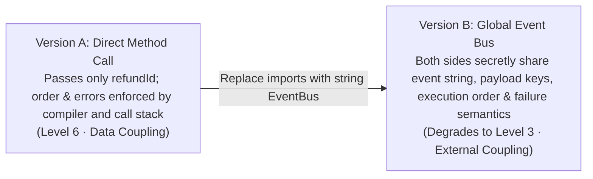
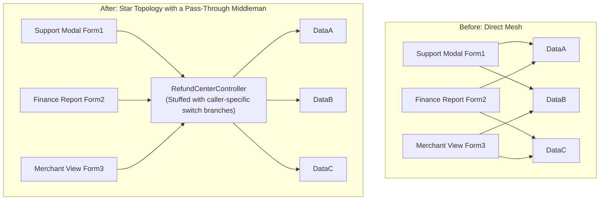

> Note 3 of 10 in the *Programming Thinking* series. The premise for the series is set out in the [opening essay](/notes/programming-taste-in-the-agent-era/).
>
> The cheaper it gets to generate code, the more valuable engineering judgment becomes. This series is my attempt to dust off classic software design principles, trace each one back to its original paper, and figure out where it still holds up—and where it breaks.

In [Note 2](/notes/what-belongs-in-one-module/), we looked inside a single module at **cohesion**: code belongs together when it must change together.

Once each module's internals are sorted out, the focus shifts to the seams *between* modules—**coupling**.

In plain English, **coupling measures how much two modules have to know about each other's secrets in order to work together.**

Think of how two people hand off work in everyday life:

- **Loose coupling** is dropping a sealed box at a shipping counter: you hand over the package and the destination address, take your tracking receipt, and walk away. Whether the courier loads it onto a van or a cargo bike, or which sorting hub it visits first, is none of your business—and if they change their truck route tomorrow, they don't have to call you.
- **Tight coupling** is two cooks sharing a single wok in a cramped kitchen: you have to watch the exact second the other person pours oil, adjusts the flame, or reaches for the salt. If they change one habit, your spatulas collide.

When reviewing code, developers often reach for a convenient proxy for coupling: **counting `import` lines at the top of a file**. Delete two `import`s by routing calls through an event bus or a shared in-memory cache, and it feels like you've "decoupled" the code.

In reality, many "decoupling" refactorings simply take an explicit connection that the compiler could verify and bury it inside an implicit runtime contract that humans have to keep in their heads.

Let's walk from the coupling you can see right in a function signature to the three invisible couplings that hide outside `import` statements.

---

## Coupling in the Function Signature: Backseat-Driving Another Module

Consider a pattern that shows up in almost every codebase:

```ts
// Refund submission entry point with a boolean flag
async function submitRefund(req: RefundRequest, dryRun: boolean): Promise<RefundResult>

// Caller site
const res = await submitRefund(req, true)
```

That innocent-looking `true` at the call site reveals something important: **the caller knows how `submitRefund` is wired on the inside.** It knows `submitRefund` has a calculation phase followed by a side-effecting gateway and ledger phase, and that passing `true` tells the function to skip the second half.

Worse, the return type `RefundResult` now has to serve two contradictory masters. When `dryRun` is `true`, no refund was actually submitted—so what does `RefundResult.status` mean? What goes into `settledAt`? Callers have to mentally decode the return value based on the boolean flag they passed in.

Passing a flag parameter that tells another module which internal branch to take is called **control coupling**.

The fix is to split the two intentions into two explicit operations, each with its own honest return type:

```ts
// Dry-run calculation: takes only what calculation needs, returns a preview
async function previewRefund(req: RefundRequest): Promise<RefundPreview>

// Real submission: executes the refund and records the ledger entry
async function submitRefund(req: RefundRequest): Promise<RefundResult>
```

Now callers state *what* they want (`previewRefund` vs. `submitRefund`) instead of backseat-driving *how* the callee executes its internal branches.

> **A quick distinction**: Not every boolean parameter is control coupling. Calling `formatAmount(money, { showCurrencySymbol: true })` passes a boolean too, but it describes the desired shape of the output data—it doesn't steer the callee through two completely different business workflows. **A parameter only crosses into control coupling when it forces the caller to know about the callee's internal control flow.**

---

## Tracing Back to 1974: The Six-Rung Ladder of Coupling

Like cohesion, **control coupling** comes from Constantine, Stevens, and Myers's 1974 paper *"Structured Design"* [1].

In the original paper, the authors explained that the strength of coupling between two modules depends on three things:

1. **How complicated the interface is** (more parameters and nested structures mean tighter coupling);
2. **Where the connection points** (at the module's public entry point vs. reaching directly into its private internals);
3. **What flows across the connection** (pure data is loosest; control flags are tighter; mutating the other module's internals is tightest).

Later textbooks organized those criteria into a six-level spectrum from tightest (worst) to loosest (best) [1]:

| Level | Name | What Connects the Two Modules? | Refund System Example |
|---|---|---|---|
| **1 (Tightest / Worst)** | **Content** | Module A reaches directly into Module B's private state or implementation | Support console mutating private connection-pool fields inside `WalletChannel` |
| **2** | **Common** | Multiple modules read and write the **same global mutable state** | Reconciliation jobs and risk checks both mutating a shared global `refundCache` map |
| **3** | **External** | Both sides share an external wire format, device protocol, or global event-name convention | Publisher and subscriber coupled via an untyped `'refund.settled'` event string, payload shape, and firing order |
| **4** | **Control** | Module A passes a flag/mode parameter that tells Module B which internal branch to run | `submitRefund(req, dryRun: true)` |
| **5** | **Stamp** | Module B only needs two fields, but Module A passes an entire 50-field domain record | `calculateFee(fullOrder: OrderEntity, fullUser: UserEntity)` |
| **6 (Loosest / Best)** | **Data** | Modules communicate strictly by passing the minimal primitive/value parameters required | `calculateFee(amount: Money, feeRateBps: number): Money` |

Once you hold this table in mind, a lot of fashionable "decoupling" refactorings look very different: **many attempts to reduce `import` counts actually push code *up* the table from Level 6 (Data Coupling) to Level 3 (External Coupling) or Level 2 (Common Coupling).**

---

## Three Invisible Couplings That Hide Outside `import` Statements

Control coupling and stamp coupling are at least visible in function signatures where TypeScript and your IDE can flag them. The couplings that cause the worst production incidents are the ones that **erase `import` lines while leaving a tight runtime dependency behind**.

### Invisible Coupling 1: Replacing Direct Calls with an Untyped Event Bus

Start with a straightforward direct call:

```ts
// Version A: Explicit direct calls (Level 6 · Data Coupling)
class RefundService {
  constructor(
    private ledger: RefundLedger,
    private notifier: RefundNotifier,
  ) {}

  async settle(refundId: string): Promise<void> {
    await this.ledger.markSettled(refundId)
    await this.notifier.sendSettledNotice(refundId)
  }
}
```

Here, `RefundService` imports two collaborators, takes them in its constructor, marks the ledger settled, and sends a notification.

Now suppose someone decides `RefundService` has "too many imports" and refactors it to use an event bus:

```ts
// Version B: Untyped event bus (Drops to Level 3 · External Coupling)
class RefundService {
  constructor(private bus: EventBus) {}

  async settle(refundId: string): Promise<void> {
    await this.bus.emit('refund.settled', { id: refundId })
  }
}
```

Two `import` lines vanished, and the constructor shrank to a single parameter. It *looks* decoupled.

But look at what happened on the 1974 scale:



- In **Version A**, if `markSettled` changes its parameter type, TypeScript fails the build immediately, and "Jump to References" lists every caller. Moreover, the requirement that *"the ledger must be updated before the user is notified"* is guaranteed by the two `await` lines.
- In **Version B**, if a developer renames `{ id: refundId }` to `{ refundId }` in `emit()`, the compiler stays completely silent while the ledger consumer crashes at runtime. Worse, if the notification handler runs before the ledger handler finishes, the customer receives a *"Your refund is complete!"* text message, opens the app, and sees their refund still stuck in `Pending`.

**Deleting two `import` lines didn't remove the business dependency—it just moved the contract out of the type system and into unverified runtime assumptions.**

How do you know when an event bus *is* the right tool? Use a simple test: **temporarily delete the subscriber and ask whether the publisher's operation still counts as succeeded.**

- If deleting the analytics or marketing-points subscriber leaves the refund transaction valid, an asynchronous event is a great fit.
- If deleting the ledger subscriber means the refund settlement itself is broken, the two steps are part of the same transaction—keep the call explicit.

### Invisible Coupling 2: Communicating Through Shared Mutable State

A second way modules couple without importing one another is **shared mutable state (Level 2 · Common Coupling)**:

```ts
// shared-cache.ts — A globally exported mutable Map
export const activeRefundCache = new Map<string, RefundRecord>()
```

Suppose `RiskGuard` and `ReconciliationJob` never import each other, but both import `activeRefundCache`.

Here is how they break each other in production:

1. `RiskGuard` reads order `ord_100` from `activeRefundCache`, sees `status === 'Pending'`, and starts an async velocity check.
2. Ten milliseconds later, `ReconciliationJob` runs in the background and mutates the exact same object reference in place: `record.status = 'Settled'`, clearing its temporary risk metadata field.
3. `RiskGuard`'s async check resumes, reads the mutated field off the shared reference, and crashes—or worse, approves a duplicate refund.

Global text search can tell you which files reference `activeRefundCache`, **but no static tool can tell you which module expects to read before another writes, or which fields are assumed to stay immutable across an `await` boundary.**

To eliminate common coupling, either pass immutable value snapshots or hide the state behind narrow, role-specific interfaces (as we'll see in [Note 7](/notes/dependency-inversion-who-owns-the-interface/) and Note 8).

### Invisible Coupling 3: The "Middleman" Controller That Only Relays Details

Every developer has heard the aphorism: *"All problems in computer science can be solved by another level of indirection."*

When three UI views (`Form1`, `Form2`, `Form3`) call three data services (`DataA`, `DataB`, `DataC`), the dependency graph looks like a tangled mesh. Put a `RefundCenterController` in the middle, and the diagram turns into a tidy star:



The lines on the whiteboard look cleaner. But if `RefundCenterController` is just a giant `switch (callerType)` that forwards every quirk of `DataA`, `DataB`, and `DataC` straight through to `Form1`, `Form2`, and `Form3`, **you haven't reduced coupling—you've just concentrated all of it into a single bottleneck file.**

Now, whenever `Form1` needs a new field or `DataC` changes a query parameter, every developer on the team has to edit `RefundCenterController` at the same time.

**An intermediate layer only reduces coupling if it absorbs change**—meaning you can swap or modify the implementation behind it without touching the callers in front of it. If every change on one side forces a matching edit on the other side, the middleman is just extra ceremony.

---

## Three Practical Rules for Keeping Coupling Under Control

Since counting `import` lines doesn't work, here are three concrete rules that do:

### 1. Pass Only the Data the Callee Needs (Stamp Coupling → Data Coupling)

If a fee-calculation function only needs a `Money` amount and a basis-point rate, don't pass the entire 50-field `Order` entity:

```ts
// Tighter (Level 5 · Stamp Coupling): Callee is coupled to the Order schema, and tests must mock a full Order
function calculateRefundFee(order: Order, channel: ChannelConfig): Money

// Looser (Level 6 · Data Coupling): Self-contained, trivial to test, immune to Order schema changes
function calculateRefundFee(amount: Money, feeRateBps: number): Money
```

Passing narrow values keeps modules ignorant of schemas they don't care about and makes unit tests trivial to write.

### 2. Keep Dependencies Acyclic and Pointing Toward Stability

- **No dependency cycles**: If Module A depends on B, B depends on C, and C depends back on A, the three modules are effectively welded into one—changing any one of them forces you to re-verify all three. Tools like `dependency-cruiser` or `madge` can block circular imports automatically in CI.
- **Point toward stability**: Core domain primitives like `Money` (which enforces Invariant 4: currencies cannot be mixed) are depended on by everyone and depend on nothing. Workflow modules should import `Money`; `Money` must never import a specific refund channel.

### 3. Prefer Compiler-Visible Coupling Over Hidden Runtime Coupling

Rank your module connections by **how much help your tools give you when a contract changes**:

| Connection Mechanism | What Catches a Broken Contract? | Maintenance Risk |
|---|---|---|
| **Explicit function arguments / typed interfaces** | **TypeScript compiler** flags every broken caller immediately at edit time | Lowest (blast radius is 100% visible) |
| **Typed event bus** | Compiler checks event names & payload shapes, but **cannot verify subscriber ordering or failure propagation** | Moderate (good for side effects; dangerous for core state transitions) |
| **Untyped string events** | Compiler is blind; relies on **grep + integration tests** | High (easy to miss consumers during refactoring) |
| **Shared global mutable state** | Even grep cannot reveal **read/write ordering or async race conditions** | Highest (causes Heisenbugs in production) |

In the age of coding agents, this hierarchy matters more than ever: an agent can follow compiler errors across twenty files and fix every broken call site in seconds, but if a contract is hidden inside a shared `Map` or an untyped event string, the agent will miss the downstream breakage just like a human would.

---

## Summary: Three Questions to Audit Module Coupling

Next time you wire two modules together—or review a "decoupling" PR—ask three questions:

1. **Does calling this function require knowing how its internal `if/else` branches are structured?** If a caller is passing `dryRun` or `mode` flags, split the function into separate, intention-revealing operations.
2. **Did this refactoring actually reduce what the two modules need to agree on, or did it just hide an `import` behind a runtime convention?** If the business flow requires step B to succeed for step A to be valid, keep the call explicit.
3. **If the contract between these two modules changes tomorrow, will the compiler list every affected file?** Keep as much of your coupling as possible inside the type system's field of view.

Across Notes 2 and 3, we saw that good module boundaries group code that changes together (cohesion) and minimize what separate modules have to know about one another (coupling). That leads naturally to the next question: **where do those changes actually come from in the first place?**

That brings us to Note 4: **the Single Responsibility Principle**—and why a "responsibility" is not a task, but a group of people who will come asking for changes.

---

## Series Outline

- Opening · [Rereading Classic Design Principles in the Age of AI](/notes/programming-taste-in-the-agent-era/)
- Cohesion · [The Standard Is What Must Change Together](/notes/what-belongs-in-one-module/)
- Coupling · Measuring How Much Two Modules Know About Each Other *(this note)*
- Single Responsibility · [One Responsibility Maps to One Group of Stakeholders](/notes/single-responsibility-is-an-actor/)
- Open-Closed · [First Identify Which Way the Code Will Grow](/notes/open-closed-only-the-guessed-axis/)
- Liskov Substitution · [A Subtype Must Seamlessly Stand In for Its Supertype](/notes/liskov-what-the-signature-does-not-check/)
- Dependency Inversion · [What Inverts Is Who Owns the Interface](/notes/dependency-inversion-who-owns-the-interface/)
- Interface Segregation · [An Interface Is a Slice from the Client's Point of View](/notes/interface-segregation-client-perspective-slice/)
- Law of Demeter · [Balancing Direct Knowledge Against Middleman Bloat](/notes/law-of-demeter-the-middlemans-dilemma/)
- Composite Reuse · [Prefer Object Composition to Keep Invariants Private](/notes/composite-reuse-inheritance-publishes-invariants/)

## References

1. [W. P. Stevens, G. J. Myers, L. L. Constantine, "Structured Design", *IBM Systems Journal* 13(2), 1974, 115–139](https://dl.acm.org/doi/10.1147/sj.132.0115) — Identifies the three factors governing coupling strength (interface complexity, entry-point vs. internal target, data vs. control flow) and establishes the coupling spectrum.
