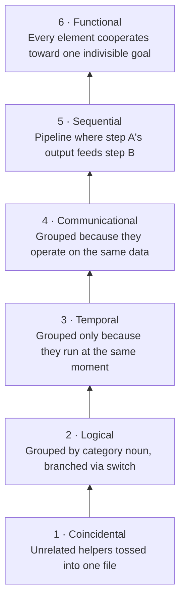
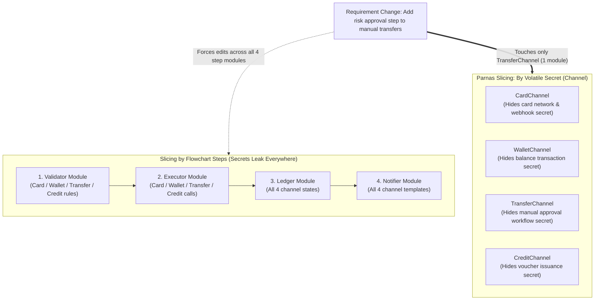

> Note 2 of 10 in the *Programming Thinking* series. The premise for the series is set out in the [opening essay](/notes/programming-taste-in-the-agent-era/).
>
> The cheaper it gets to generate code, the more valuable engineering judgment becomes. This series is my attempt to dust off classic software design principles, trace each one back to its original paper, and figure out where it still holds up—and where it breaks.

Every day we write code, we make the same quiet decision dozens of times: do these functions and types belong in the same file, or should they live in separate modules?

Textbooks have a name for that property—**cohesion**—and a slogan everyone can recite from memory: *"Aim for high cohesion and low coupling."*

Yet the slogan rarely helps when you're staring at a real pull request. Suppose four methods handle four different refund channels, all named `handleXxx` with identical parameter types—does putting them in one class count as high cohesion? Or suppose you split a 20-line function into two 10-line helpers in separate files—did cohesion go up or down?

If you judge cohesion by *"do the names look related?"* or *"are the files small?"*, you will get both questions wrong.

In plain English, **cohesion measures how strongly the pieces inside a module belong together—the real reason they share the same roof.**

Think of a module like a container in your house:

- **Low cohesion** is the kitchen junk drawer: nail clippers, AA batteries, takeout menus, and cough drops tossed together simply because nobody knew where else to put them.
- **High cohesion** is a surgeon's suture kit: needle holder, suture thread, forceps, and tissue scissors. None of the tools look alike, **but take one away and you cannot finish closing the wound—and if the surgical protocol changes, the kit changes as a unit.**

The single reliable test for cohesion is straightforward: **elements belong in the same module when they must change together.**

Let's walk through our refund subsystem from the most obvious violations to the subtle traps that fool experienced engineers and coding agents alike.

---

## The Obvious Anti-Pattern: The "Junk Drawer" Utility Class

Here is a class you can find in almost every production repository:

```ts
// refund-utils.ts
export class RefundUtils {
  // 1. Formats integer cents into a display string for the support UI
  static formatCurrency(amountCents: number, currency: string): string {
    return `${currency} ${(amountCents / 100).toFixed(2)}`
  }

  // 2. Verifies HMAC webhook signatures from payment gateways
  static verifyWebhookSignature(payload: string, signature: string, secret: string): boolean {
    // Calls crypto library to compute HMAC...
    return true
  }

  // 3. Writes compliance audit logs to the database
  static writeAuditLog(refundId: string, operatorId: string, action: string): Promise<void> {
    // Inserts into audit table...
    return Promise.resolve()
  }
}
```

These three methods have nothing to do with one another.

`formatCurrency` serves the presentation layer; `verifyWebhookSignature` belongs to payment gateway transport; `writeAuditLog` answers to compliance. The only reason they sit in the same file is that the author didn't want to think about where they belonged, so they created a catch-all bucket with `Refund` in the name.

Stuffing unrelated helpers into one file carries a very real cost:

1. **Transitive dependency bloat**: A frontend component that only wants `formatCurrency` to render a price string ends up importing `RefundUtils`—and dragging the crypto library and database audit client along with it.
2. **Cognitive noise**: Anyone debugging webhook signature verification has to wade through UI formatting and compliance logging code in the same file.

The fix is obvious: move `formatCurrency` to the UI formatting module (or the `Money` value object), move `verifyWebhookSignature` into the gateway adapter, move `writeAuditLog` into the audit module, and delete `RefundUtils` entirely.

In the literature, this junk drawer is called **coincidental cohesion**—the lowest rung on the ladder. In practice, coincidental cohesion isn't the most dangerous trap, because it's so blatantly messy that any decent code review catches it.

The trap that actually fools experienced developers—and gets praised as "clean code"—looks very different.

---

## The Hidden Trap: Fake Cohesion by Noun ("Logical Cohesion")

Consider this `RefundHandler` class, which dispatches refunds across four channels:

```ts
type ChannelKind = 'card' | 'wallet' | 'transfer' | 'credit'

export class RefundHandler {
  async handle(channel: ChannelKind, req: RefundRequest): Promise<RefundResult> {
    switch (channel) {
      case 'card':
        return this.handleCard(req)
      case 'wallet':
        return this.handleWallet(req)
      case 'transfer':
        return this.handleTransfer(req)
      case 'credit':
        return this.handleCredit(req)
    }
  }

  private async handleCard(req: RefundRequest): Promise<RefundResult> {
    // Calls card network gateway; settles asynchronously via webhook callback
  }

  private async handleWallet(req: RefundRequest): Promise<RefundResult> {
    // Updates internal wallet balance in a local DB transaction; returns in milliseconds
  }

  private async handleTransfer(req: RefundRequest): Promise<RefundResult> {
    // Creates a manual payout ticket and waits days for finance approval
  }

  private async handleCredit(req: RefundRequest): Promise<RefundResult> {
    // Issues a promotional store-credit voucher; moves zero actual money
  }
}
```

At first glance, both human reviewers and coding agents love this class:

- The class name is `RefundHandler`;
- All four private methods share a neat, symmetrical `handleXxx` naming pattern;
- Every method is clearly about "refunds."

Doesn't that look like textbook high cohesion?

**In reality, its cohesion is terrible.**

Grouping these four methods together is like storing **table salt, granulated sugar, baking soda, and laundry detergent** in the same four-compartment spice jar because *"they are all white powders."* It looks tidy on the shelf until you try to cook dinner.

Look at what those four methods actually do under the hood:

- **Card refund**: Crosses the public internet to an external payment gateway, settles asynchronously over hours or days via webhooks, and requires network retry and idempotency handling.
- **Wallet refund**: Runs a synchronous local database transaction in milliseconds.
- **Manual bank transfer**: Enters a multi-day human approval workflow for finance staff.
- **Credit compensation**: Calls the promotions service to issue a coupon without touching the financial ledger at all.

Their **external dependencies, latency profiles, failure modes, retry rules, and reasons to change share nothing in common**. The only thing tying them together is the English word *"refund."*

Watch what happens the moment a real requirement arrives:

1. Risk management asks to add a mandatory supervisor approval token (`approverToken`) before manual bank transfers can be queued.
2. Because all four channels live inside `RefundHandler`, you have to edit `RefundHandler`, widen the signature of `handle(channel, req, approverToken?)` (or pollute `RefundRequest` with a field only `transfer` cares about), and re-test the entire class.
3. Card, wallet, and store-credit refunds didn't change a single business rule, yet they get dragged into the diff and collide with teammates editing card-gateway logic in the same file.

Bundling distinct operations together under a `switch` statement simply because they fall under the same conceptual category is called **logical cohesion**.

While `RefundUtils` is an obvious mess, `RefundHandler` is a **seductive mess**: its symmetrical method names trick our pattern-matching instincts into welding four completely independent evolutionary paths into a single file.

---

## Tracing Back to 1974: The Six-Step Ladder of Cohesion

Where did terms like *coincidental* and *logical* cohesion come from?

They originated in Larry Constantine, Wayne Stevens, and Glenford Myers's landmark 1974 *IBM Systems Journal* paper, *"Structured Design"* [1]. Studying why some software systems absorbed changes cleanly while others rippled bugs across unrelated modules, they ranked module cohesion on a six-step scale from weakest to strongest [1] (Yourdon and Constantine later inserted a seventh level, *procedural cohesion*, in their book, but the underlying spectrum remained the same):

| Level | Name | Why the Elements Are Together | Everyday Analogy | Refund System Example |
|---|---|---|---|---|
| **1 (Lowest)** | **Coincidental** | Pure accident; no meaningful relationship | Kitchen junk drawer | `RefundUtils` (formatting UI strings, verifying HMACs, writing audit logs) |
| **2** | **Logical** | Similar category/noun, selected via a `switch` or flag parameter | Salt, sugar, and detergent in one jar ("white powders") | `RefundHandler` (`switch (channel)` dispatching card, wallet, transfer, and credit) |
| **3** | **Temporal** | Executed at the **same point in time** (e.g., startup or teardown) | Morning routine (turn off alarm, open blinds, boil water, brush teeth) | `bootstrapRefundWorker()` (load config, connect DB, warm FX cache, start metrics server) |
| **4** | **Communicational** | Different operations that read or write the **same data structure** | Medical clinic stations all reading from one patient chart | `summarizeOrderRefunds(order)` (computes remaining refundable balance and builds a support summary from the same `Order` snapshot) |
| **5** | **Sequential** | Assembly-line pipeline: **the output of step A is the input to step B** | Wash vegetables → chop vegetables → stir-fry | `settleCardRefund()` (parse raw gateway webhook → convert currency → append ledger entry) |
| **6 (Highest)** | **Functional** | Every line cooperates to perform **one single, indivisible task** | Surgeon's suture kit | `WalletChannel.submit()` or `Money.add()` (every statement is essential to that one job) |

Plotted as a staircase, the progression looks like this:



The most important takeaway from the 1974 scale is how wide the gap is between **Level 2 (Logical)** and **Level 6 (Functional)**—even though they often look superficially similar in code.

How do you climb from Level 2 (`RefundHandler`) to Level 6? By giving each channel its own focused module (`CardChannel`, `WalletChannel`, `TransferChannel`, `CreditChannel`), each encapsulating its own transport, retry policy, and idempotency rules—just as we saw in [Note 5 (Open-Closed Principle)](/notes/open-closed-only-the-guessed-axis/). Once split that way, adding a supervisor approval token to bank transfers touches `TransferChannel` and nothing else.

---

## Navigating the Gray Areas: Three Common Misconceptions

Once you understand that cohesion is about keeping things that change together in the same place, three counterintuitive traps in real-world codebases become much easier to spot.

### Misconception 1: "Smaller Functions and More Files Automatically Mean Higher Cohesion"

When developers (or coding agents) take *"do one thing"* too literally, their favorite refactoring is chopping a cohesive function into tiny pieces across multiple files.

Consider how our refund subsystem adds two `Money` amounts. In the [opening essay](/notes/programming-taste-in-the-agent-era/), we established Invariant 4: **amounts in different currencies can never be added directly**.

Originally, that rule lived inside a single function:

```ts
// money.ts — Functional Cohesion (Level 6)
export function addMoney(a: Money, b: Money): Money {
  if (a.currency !== b.currency) {
    throw new CurrencyMismatchError(a.currency, b.currency)
  }
  return { amount: a.amount + b.amount, currency: a.currency }
}
```

Now suppose an over-zealous refactoring splits "validation" and "arithmetic" into two separate modules so each function "only does one thing":

```ts
// currency-guard.ts — Only checks currency codes
export function assertSameCurrency(a: Money, b: Money): void {
  if (a.currency !== b.currency) {
    throw new CurrencyMismatchError(a.currency, b.currency)
  }
}

// money-math.ts — Only adds the numbers
export function rawAddMoney(a: Money, b: Money): Money {
  return { amount: a.amount + b.amount, currency: a.currency }
}
```

Each file is now three lines long. Did cohesion improve?

**No—it shattered Level 6 functional cohesion into a fragile two-step ritual.**

Checking that currencies match and adding the amounts are not two separate responsibilities; they are two halves of a single invariant (*"safely add two money values"*):

1. **They always change together**: If the domain ever introduces automatic exchange-rate conversion during addition, both the check and the math have to change in lockstep.
2. **Splitting them breaks the invariant**: When combined in `addMoney`, no caller can accidentally add USD to JPY. Once split, every caller across the codebase has to remember to call `assertSameCurrency` before `rawAddMoney`. Forget once, and 100 JPY + 100 USD silently becomes 200 USD in the ledger.

**More files and smaller functions do not automatically raise cohesion.** Splitting two pieces of code that enforce the same invariant—or that always change together—lowers cohesion and creates coupling.

### Misconception 2: Slicing New Modules Along a Flowchart Instead of Around Secrets

Grading existing code is one thing; drawing module boundaries on a blank whiteboard before code exists is much harder.

When given a new refund specification, most developers instinctively sketch the execution flowchart—*"Step 1: Validate request → Step 2: Execute payout → Step 3: Record ledger entry → Step 4: Send notification"*—and create four folders matching those four steps:

- `refund-validator/`
- `refund-executor/`
- `refund-ledger/`
- `refund-notifier/`

Two years before Constantine published the cohesion scale, David Parnas warned against this exact mistake in his classic 1972 paper, *"On the Criteria To Be Used in Decomposing Systems into Modules"* [2].

Parnas showed that **decomposing a system along a flowchart spreads every volatile design decision across all modules**:

- If you slice by processing step (`Validator` → `Executor` → `Ledger` → `Notifier`), knowledge of how manual bank transfers work leaks into all four folders: `Validator` has to check bank-transfer approval tokens, `Executor` has to create the payout ticket, `Ledger` has to record pending transfer states, and `Notifier` has to email the finance queue.
- Every time the bank-transfer workflow changes, you have to open and coordinate edits across all four modules.

Parnas's alternative—**information hiding**—states that you should first list the **design decisions most likely to change ("secrets")**, and design each module to hide one secret behind a stable interface [2]:



Parnas's 1972 information hiding and Constantine's 1974 functional cohesion are two sides of the same coin: **Parnas tells you where to draw the boundary before you write the code; Constantine tells you how to spot when the boundary is wrong after you write it.** Both ask the same question: *what changes together?*

### Misconception 3: Treating Temporal Cohesion as a Bug or Using the Scale as a Rigid Caliper

After learning the six-level scale, it is tempting to treat anything below Level 6 as a defect that must be refactored away.

Take a worker initialization routine:

```ts
// Level 3: Temporal Cohesion
export async function bootstrapRefundWorker(): Promise<void> {
  await loadChannelSecrets()
  await connectLedgerDatabase()
  await warmUpExchangeRateCache()
  startHealthCheckServer()
}
```

Loading secrets, connecting to Postgres, warming the FX cache, and starting a health-check server have nothing in common except that they all need to happen at startup. On the 1974 scale, that is Level 3 (**temporal cohesion**).

Should you tear `bootstrapRefundWorker` apart? **No.** As long as each step is its own well-factored function (so unit tests can warm the FX cache without booting a database), keeping the startup sequence explicit in one place makes the boot order obvious. Hiding startup order behind scattered event listeners just makes boot failures harder to debug.

As we saw in the [opening essay](/notes/programming-taste-in-the-agent-era/), when researchers asked 163 software engineering students to rate the cohesion of modules in the same Fortran program, their ratings diverged widely [3]. That isn't because the scale is broken—it's because **static source code doesn't tell you which requirements will change next**.

If a system's refund channels never change for five years while its audit and notification steps change every week, slicing by step is actually more cohesive for that team. The six levels are a diagnostic lens for thinking about change propagation, not a mechanical caliper.

---

## Summary: Three Questions to Test Cohesion

Whenever you're deciding whether code belongs in the same module or separate ones, skip the academic jargon and ask three questions:

1. **Are these elements together because they *look* similar, or because they cooperate on the *same* job?** If they only share a noun like `Refund` or `Utils` and branch via a `switch`, split them apart.
2. **When requirements shift, do these pieces have to change at the same time?** If editing function A forces a matching edit in function B to preserve a domain invariant (like currency validation and money addition), keep them in the same module—don't splinter them just to make files shorter.
3. **What volatile secret does this module hide from the rest of the system?** Draw module boundaries around the design decisions most likely to change, not along the boxes of a step-by-step flowchart.

Once each module's internals are cohesive, the next question is how those modules talk to one another: **how do you measure how tightly two modules are bound together—especially when they don't even `import` each other?**

That brings us to Note 3: **Coupling**.

---

## Series Outline

- Opening · [Rereading Classic Design Principles in the Age of AI](/notes/programming-taste-in-the-agent-era/)
- Cohesion · The Standard Is What Must Change Together *(this note)*
- Coupling · [Measuring How Much Two Modules Know About Each Other](/notes/three-invisible-couplings/)
- Single Responsibility · [One Responsibility Maps to One Group of Stakeholders](/notes/single-responsibility-is-an-actor/)
- Open-Closed · [First Identify Which Way the Code Will Grow](/notes/open-closed-only-the-guessed-axis/)
- Liskov Substitution · [A Subtype Must Seamlessly Stand In for Its Supertype](/notes/liskov-what-the-signature-does-not-check/)
- Dependency Inversion · [What Inverts Is Who Owns the Interface](/notes/dependency-inversion-who-owns-the-interface/)
- Interface Segregation · [An Interface Is a Slice from the Client's Point of View](/notes/interface-segregation-client-perspective-slice/)
- Law of Demeter · [Balancing Direct Knowledge Against Middleman Bloat](/notes/law-of-demeter-the-middlemans-dilemma/)
- Composite Reuse · [Prefer Object Composition to Keep Invariants Private](/notes/composite-reuse-inheritance-publishes-invariants/)

## References

1. [W. P. Stevens, G. J. Myers, L. L. Constantine, "Structured Design", *IBM Systems Journal* 13(2), 1974, 115–139](https://dl.acm.org/doi/10.1147/sj.132.0115) — Introduces cohesion and coupling and defines the six-level cohesion spectrum from coincidental to functional.
2. [D. L. Parnas, "On the Criteria To Be Used in Decomposing Systems into Modules", *Communications of the ACM* 15(12), 1972, 1053–1058](https://dl.acm.org/doi/10.1145/361598.361623) ([PDF](https://wstomv.win.tue.nl/edu/2ip30/references/criteria_for_modularization.pdf)) — Contrasts flowchart-based decomposition with information-hiding decomposition around volatile design decisions.
3. [N. Fenton et al., "Difficulties using cohesion and coupling as quality indicators", *Software Quality Journal*, 1993](https://link.springer.com/article/10.1007/BF00590439) — Documents the wide divergence among 163 raters classifying cohesion and coupling on the same Fortran codebase.
