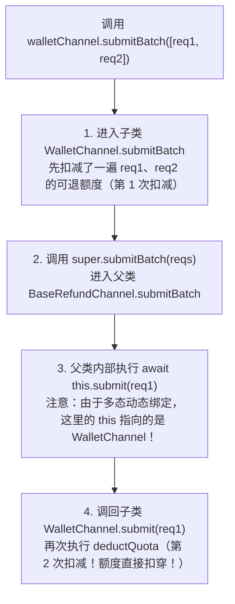
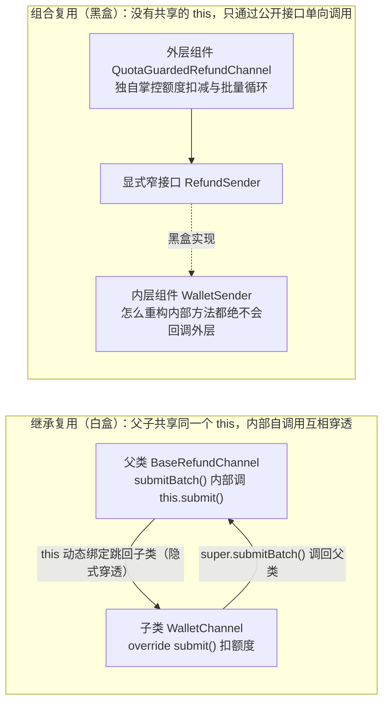

> 《编程思想》系列第 10/10 篇（收官篇）。这一季的立论在[序章](/zh/notes/programming-taste-in-the-agent-era/)。
>
> 代码越是容易生成，人对代码好坏的判断力就越值钱。这个系列是我把那些上了年纪的设计原则重新翻出来，逐条查清它们的出处、适用边界与失效场景的笔记。

这是《编程思想》系列的最后一篇。

在前面的九篇里，我们多次遇到同一个问题：当多个退款渠道（银行卡、钱包、线下转账、积分补偿）都需要共用一套能力——比如记录已处理退款笔数、校验幂等键、或者批量提交退款——怎么写才能既不重复造轮子（DRY），又不把各个渠道绑死在一起？

面向对象教程教给我们的第一招往往是**类继承（Class Inheritance）**：写一个公共的 `BaseRefundChannel` 基类，把通用逻辑放进去，让四个渠道子类去 `extends` 它。

而 1994 年 GoF 在《设计模式》开篇提出的第一条设计原则，就是给这种本能踩刹车——**合成复用原则（Composite Reuse Principle，CRP）**，也就是大家耳熟能详的那句话：**“优先使用对象组合，而不是类继承（Favor object composition over class inheritance）。”**[1]

很多人把这条原则背成了一句口号：“因为单继承不灵活、组合可以在运行时换零件。”

这当然没错，但它还没有触及继承最致命的隐患。用最直白的话讲合成复用原则的精髓：**类继承是一种“白盒复用”——因为动态绑定（`this` 多态调用）的存在，父类肚子里原本属于私密实现细节的“自调用关系”，会被迫暴露成子类赖以生存的公开契约；只要父类改一行内部调用，子类守护的业务不变量就会在毫不知情的情况下崩塌。只有用对象组合（黑盒复用），才能把各自的不变量真正锁在自己的模块里**[1][2]。

我们直接看一次发生在退款基类里的真实双倍记账事故。

---

## 一次“完全合法”的父类重构，如何搞崩子类的账本？

假设我们写了一个退款基类 `BaseRefundChannel`，提供两个方法：单笔提交 `submit(req)` 和批量提交 `submitBatch(reqs)`。

在第一版里，这两个方法是各自独立实现的：

```ts
// 第一版基类：submit 和 submitBatch 各自独立调用底层的 doSend
export abstract class BaseRefundChannel {
  // 子类负责实现具体渠道的底层发送逻辑
  protected abstract doSend(req: RefundRequest): Promise<ChannelReceipt>

  async submit(req: RefundRequest): Promise<ChannelReceipt> {
    return this.doSend(req)
  }

  async submitBatch(reqs: RefundRequest[]): Promise<ChannelReceipt[]> {
    const receipts: ChannelReceipt[] = []
    for (const req of reqs) {
      receipts.push(await this.doSend(req))
    }
    return receipts
  }
}
```

现在，负责钱包渠道的工程师写了一个子类 `WalletChannel extends BaseRefundChannel`。为了守住系统第 1 条铁律（累计退款额绝不超过订单上限），他在子类里覆写（Override）了 `submit` 和 `submitBatch`，在调用 `super` 之前先扣减订单的剩余可退额度 `quota`：

```ts
export class WalletChannel extends BaseRefundChannel {
  constructor(private quotaGuard: OrderQuotaGuard) {
    super()
  }

  protected async doSend(req: RefundRequest): Promise<ChannelReceipt> {
    // 钱包余额入账...
  }

  // 覆写单笔提交：先扣减 1 次额度，再调父类 submit
  override async submit(req: RefundRequest): Promise<ChannelReceipt> {
    await this.quotaGuard.deductQuota(req.orderId, req.amount)
    return super.submit(req)
  }

  // 覆写批量提交：先一次性扣减整批总额度，再调父类 submitBatch
  override async submitBatch(reqs: RefundRequest[]): Promise<ChannelReceipt[]> {
    for (const req of reqs) {
      await this.quotaGuard.deductQuota(req.orderId, req.amount)
    }
    return super.submitBatch(reqs)
  }
}
```

上线的时候，无论是 `BaseRefundChannel` 还是 `WalletChannel`，所有测试全都 100% 绿灯通过。

三个月后，维护基类的工程师打开 `BaseRefundChannel` 一看，皱起了眉头：“你看基类里的 `submitBatch` 循环调 `this.doSend(req)`，跟上面的 `submit(req)` 逻辑重复了！我把它重构得干净一点，让 `submitBatch` 直接循环调用 `this.submit(req)` 吧！”

```ts
// 第二版基类：维护者做了一次看起来“天经地义”的消除重复重构
export abstract class BaseRefundChannel {
  protected abstract doSend(req: RefundRequest): Promise<ChannelReceipt>

  async submit(req: RefundRequest): Promise<ChannelReceipt> {
    return this.doSend(req)
  }

  async submitBatch(reqs: RefundRequest[]): Promise<ChannelReceipt[]> {
    const receipts: ChannelReceipt[] = []
    for (const req of reqs) {
      // 仅仅把 this.doSend(req) 改成了 this.submit(req)
      receipts.push(await this.submit(req))
    }
    return receipts
  }
}
```

基类维护者跑了一遍基类自己的单元测试，全部通过，放心地合入了主干。

**当天晚上，钱包渠道的批量退款全部炸锅：每一笔退款都被双倍扣减了订单可退额度！**

为什么会扣两次？我们顺着调用栈走一遍就全都明白了：



看清这个陷阱有多阴险了吗？

1. 基类的作者改错了吗？没有，单看 `BaseRefundChannel`，让 `submitBatch` 调 `this.submit` 完全合情合理。
2. 子类的作者写错了吗？也没有，他写 `WalletChannel` 的时候，父类的 `submitBatch` 确实没有调 `submit`。
3. **问题的根源在于继承里的动态绑定（Dynamic Dispatch）**：当父类在方法 A 里写下 `this.methodB()` 时，这个 `this` 在运行时指向的是子类实例！父类内部“方法 A 有没有调用方法 B”这个原本属于父类肚子里私密实现的细节，瞬间变成了决定子类生死的公开契约！

---

## 查回 1994 与 1998 年的出处：白盒复用与“脆弱基类问题”

上面这个让无数程序员栽跟头的现象，在计算机科学里有一个正式的名字：**脆弱基类问题（The Fragile Base Class Problem）**。

- **1994 年，GoF 在《Design Patterns》第一章**首次把类继承称为**“白盒复用（White-box Reuse）”**[1]。之所以叫“白盒”，是因为对子类来说，父类的内部实现细节是完全透明、毫无遮拦的——你如果不把父类的源码一行行读透（看清楚父类哪个方法在内部调了哪个方法），你根本不敢随便覆写父类的任何一个方法。用 GoF 的原话来说：**“继承破坏了封装（Inheritance breaks encapsulation）。”**[1]
- **1998 年，Leonid Mikhajlov 与 Emil Sekerinski 在 ECOOP 会议上发表了著名论文《A Study of the Fragile Base Class Problem》**[2]，从形式化角度严格证明了：在允许方法覆写和自调用（Self-recursion / `this` 调用）的面向对象语言里，基类的作者哪怕只做一次完全符合基类自身规格说明的内部重构，也足以破坏未知子类的安全不变量。后来 Joshua Bloch 在《Effective Java》著名的第 18 条（“复合优先于继承”）里，用 `InstrumentedHashSet` 的 `addAll` 调 `add` 案例把这篇论文的结论普及给了全世界工程师[3]。

这也终于解开了我们在[序章](/zh/notes/programming-taste-in-the-agent-era/)和[第 5 篇（开闭原则）](/zh/notes/open-closed-only-the-guessed-axis/)里留下的那个历史悬案：

- 为什么 1988 年 Bertrand Meyer 提倡“靠继承具体父类来实现开闭原则”，到了 1996 年 Robert C. Martin 却把它改写成了“靠抽象接口与多态组合来实现开闭原则”？
- 因为在这八年里，整个软件工业界都领教了“脆弱基类”的苦头：**具体父类的继承树根本承受不住大型系统的演进；一旦父类的内部自调用关系发生变化，整棵继承树上的子类都会跟着陪葬。**

---

## 用对象组合（黑盒复用）把不变量锁进笼子

怎么把刚才那个一触即溃的 `WalletChannel extends BaseRefundChannel` 改造成稳固的结构？

答案就是**合成复用原则（对象组合）**：彻底拆掉 `BaseRefundChannel` 这棵继承树，把“底层渠道发送”和“额度保护 / 批量编排”变成两个通过显式接口组合在一起的独立对象[1][3]：

```ts
// 1. 纯粹的底层渠道发送接口（不包含任何自调用继承链）
export interface RefundSender {
  sendSingle(req: RefundRequest): Promise<ChannelReceipt>
}

// 2. 钱包底层发送实现：只管发请求，不继承任何基类
export class WalletSender implements RefundSender {
  async sendSingle(req: RefundRequest): Promise<ChannelReceipt> {
    // 钱包入账逻辑...
  }
}

// 3. 用组合（Composition）包装额度守卫与批量逻辑（黑盒复用）
export class QuotaGuardedRefundChannel {
  constructor(
    private sender: RefundSender,      // 组合进来的发送器（黑盒）
    private quotaGuard: OrderQuotaGuard, // 组合进来的额度守卫（黑盒）
  ) {}

  async submit(req: RefundRequest): Promise<ChannelReceipt> {
    await this.quotaGuard.deductQuota(req.orderId, req.amount)
    return this.sender.sendSingle(req)
  }

  async submitBatch(reqs: RefundRequest[]): Promise<ChannelReceipt[]> {
    const receipts: ChannelReceipt[] = []
    for (const req of reqs) {
      // 无论这里调 this.submit(req) 还是单独处理，都完全由当前类自己掌控，绝不存在跨层多态背刺！
      receipts.push(await this.submit(req))
    }
    return receipts
  }
}
```

把“继承复用”和“组合复用”放在一张图里对比，就能看清为什么组合不会炸：



看右边那张组合图：

- `QuotaGuardedRefundChannel` 和 `WalletSender` 是两个各自独立的实例，**它们不共享同一个 `this` 指针**；
- `WalletSender` 就算在内部把方法拆成十个、重构一百遍，它也绝对不可能通过 `this` 反向跳回外层的 `QuotaGuardedRefundChannel` 去触发第二次扣额度；
- 每个模块的不变量都被严严实实地关在自己的黑盒子里，对外只公布那纸薄薄的 `interface`。

---

## 走进模糊地带：什么时候继承依然是对的？

讲到这里，很容易产生另一个极端念头：“既然继承这么危险，那编程语言干脆把 `extends` 关键字删掉算了！”

合成复用原则说的是**“优先（Favor）”使用组合**，而不是“一刀切消灭继承”。在下面三种边界清晰、不存在脆弱基类隐患的场景里，继承（或子类型层级）依然非常顺手：

1. **语言级基础设施与错误类型层级（Error Hierarchies）**：
   比如在 TypeScript / JavaScript 里定义自定义业务异常：`class InsufficientReserveError extends RefundDomainError extends Error`。错误类只承载结构化上下文和原型链匹配（供 `instanceof` 捕获分类），不存在复杂的跨层级自调用循环。
2. **彻底封死自调用覆写的受控模板（Template Method with `final`）**：
   如果你确实需要写一个框架基类，那就必须守住一条铁律：**基类里凡是会被其他基类方法内部调用（`this.xxx()`）的公开方法，一律禁止子类覆写（在 Java/C++ 中标为 `final`，在 TypeScript 中只暴露 `protected abstract` 钩子，公开入口方法不留覆写点）**[3]。就像我们第一节开头如果严禁子类 `override submit`、只允许子类实现 `protected abstract doSend`，就不会发生双倍扣款。
3. **代数数据类型（可辨识联合类型 Discriminated Unions）**：
   在现代 TypeScript、Rust 或 Kotlin 里，很多早年需要用“基类 + 子类继承树”表达的领域模型（比如已结算回执 vs 待处理回执），今天直接用 `type Receipt = SettledReceipt | PendingReceipt` 就能表达得既扁平又安全，连类继承的边都不用沾。

---

## 全系列收官总结：在 AI 时代，带着七个问题去审代码

写到这里，《编程思想》系列十篇文章就全部走完了。

回到我们在[序章](/zh/notes/programming-taste-in-the-agent-era/)开头提出的那个问题：**当 AI Agent 能在几秒钟内帮我们写出几百行语法完美、单测全绿的代码时，我们为什么还要花功夫去翻这些诞生于 1972 年到 1996 年之间的老原则？**

因为走完这十篇溯源之旅后，你已经亲眼看到了：

- 这些原则根本不是一座严丝合缝的“公理金字塔”，而是六拨先驱在二十二年间为了对付各自眼前的工程烂摊子，留下的**八份排雷档案**；
- 当你把场景抽掉、只把它们的口号喂给 AI 时，AI 会毫不犹豫地给你造出满屏 1:1 的影子接口、把守护同一个不变量的函数劈成两半、为了消灭点号写出一堆传声筒中间人；
- **AI 最擅长的是“执行某一条原则”，而人类工程师不可替代的价值，是在两条原则把代码往相反方向拽的时候，结合业务演进方向拍板决定“这次听谁的”。**

最后，我把这十篇文章拆解出的核心判据、原始预防的祸害与停手边界，浓缩成下面这张**代码审查随身提问表**。下次当你审阅任何一段代码（无论是人写的还是 Agent 生成的）时，不用再去背那些拗口的英文缩写，直接拿这张表去问它：

| 篇序与概念 | 别再问的教条问题 | 真正该问的诊断问题 | 什么时候该果断停手？ |
|---|---|---|---|
| **[第 2 篇 · 内聚](/zh/notes/what-belongs-in-one-module/)** | “这几个函数名字像不像？文件够不够小？” | **“当需求变化时，这几段代码是不是必须一起改？它们是不是共同守护着同一条业务铁律？”** | 当两段代码共同守护同一个不变量（如币种校验与加法）时，绝不要为了追求小文件而硬拆。 |
| **[第 3 篇 · 耦合](/zh/notes/three-invisible-couplings/)** | “文件头部的 `import` 有几行？” | **“要改这个模块，我得被迫了解对方肚子里多少秘密？如果把契约改坏了，编译器能当场报警吗？”** | 绝不要为了删掉两行 `import`，把强事务的显式调用藏进无类型的字符串事件或全局可变缓存里。 |
| **[第 4 篇 · 单一职责](/zh/notes/single-responsibility-is-an-actor/)** | “这个类是不是只做了一件事？” | **“这段代码背后站着几拨不同诉求的业务角色（Actor）？A 部门改规则会误伤 B 部门吗？”** | 如果几个小函数背后自始至终只有财务同一拨人提需求，把它们合在一起，别拆成碎片类。 |
| **[第 5 篇 · 开闭原则](/zh/notes/open-closed-only-the-guessed-axis/)** | “改需求能不能一行老代码都不动？” | **“接下来半年，这段代码最可能沿着哪条轴变（加渠道还是加操作）？我的大门朝哪边开？”** | 在没看清真实的变化方向前，不要提前堆砌扩展接口；在装配入口改一行注册表完全正常。 |
| **[第 6 篇 · 里氏替换](/zh/notes/liskov-what-the-signature-does-not-check/)** | “子类的方法签名跟父类对上了吗？” | **“换入这个实现后，调用方原本依赖的前置、后置、不变量与历史承诺还算数吗？”** | 不支持的操作就拆成独立能力接口，严禁写 `throw Unsupported` 或静默空跑假装成功。 |
| **[第 7 篇 · 依赖倒置](/zh/notes/dependency-inversion-who-owns-the-interface/)** | “中间加没加 `IXxxService` 接口？” | **“这个接口跟谁姓？把底层从 Stripe 换成内存 Map，接口签名需要改一个字吗？”** | 面对比你更稳定的基础值对象（如 `Money`）和纯函数，直接 `import`，别套毫无意义的影子接口。 |
| **[第 8 篇 · 接口隔离](/zh/notes/interface-segregation-client-perspective-slice/)** | “接口是不是拆成单方法了？” | **“当前这个调用方角色，有没有被迫看到它用不到的方法或越权的写操作入口？”** | 同一个调用方在同一个场景里总是成对使用的方法（如 `begin`/`commit`），必须留在同一个接口里。 |
| **[第 9 篇 · 迪米特法则](/zh/notes/law-of-demeter-the-middlemans-dilemma/)** | “这一行代码里有几个点号（`.`）？” | **“我是在穿透行为对象的封装边界替它做决定，还是在正常读取纯数据结构？”** | 当“少认识一个窄接口”与“写一堆二道贩子转发方法”冲突时，优先选窄接口组合，拒绝造中间人。 |
| **第 10 篇 · 合成复用** | “这俩类有没有公共代码可以抽进父类？” | **“如果用继承复用，父类的内部自调用细节会不会把子类的不变量搞崩？”** | 需要复用重试、幂等、记账等横切逻辑时，把它封装成独立组件注入进来，别搞深层实现继承树。 |

工具和模型会一年比一年快，但软件腐化的物理规律不会变。愿这十篇笔记，能成为你在 AI 时代守住代码品味的一把标尺。

---

## 系列目录（全十篇完结）

- 序 · [在 AI 时代重读编程原则](/zh/notes/programming-taste-in-the-agent-era/)
- 内聚 · [判断标准是修改代码时要一起改](/zh/notes/what-belongs-in-one-module/)
- 耦合 · [衡量的是两个模块互相了解多少](/zh/notes/three-invisible-couplings/)
- 单一职责 · [一个职责对应一拨会来提要求的人](/zh/notes/single-responsibility-is-an-actor/)
- 开闭 · [先判断代码会往哪个方向变](/zh/notes/open-closed-only-the-guessed-axis/)
- 里氏替换 · [子类必须能无缝顶替父类](/zh/notes/liskov-what-the-signature-does-not-check/)
- 依赖倒置 · [倒置的是接口的归属](/zh/notes/dependency-inversion-who-owns-the-interface/)
- 接口隔离 · [接口是客户端视角的切片](/zh/notes/interface-segregation-client-perspective-slice/)
- 迪米特 · [在穿透调用与中间人之间找平衡](/zh/notes/law-of-demeter-the-middlemans-dilemma/)
- 合成复用 · 用对象组合替代类继承来保护不变量（本文）

## 参考资料

1. [Erich Gamma, Richard Helm, Ralph Johnson, John Vlissides, *Design Patterns: Elements of Reusable Object-Oriented Software*, Addison-Wesley, 1994](https://dl.acm.org/doi/book/10.5555/186897) —— 第 1 章提出“优先使用对象组合，而不是类继承”，并对比白盒复用（继承）与黑盒复用（组合）。
2. [Leonid Mikhajlov, Emil Sekerinski, “A Study of the Fragile Base Class Problem”, *ECOOP '98*, Springer LNCS 1445, 1998, 355–382](https://dl.acm.org/doi/10.5555/646155.679700)（[论文 PDF](https://cas.mcmaster.ca/~emil/pubs/fragile/ecoop98.pdf)）—— 形式化剖析脆弱基类问题，证明基类在自调用下的合法内部修改如何破坏子类的不变量。
3. [Joshua Bloch, *Effective Java* (3rd Edition), Addison-Wesley, 2018](https://www.oreilly.com/library/view/effective-java-3rd/9780134686097/) —— Item 18（复合优先于继承）与 Item 19（要么为继承而设计并提供文档说明自调用，要么禁止继承）。
