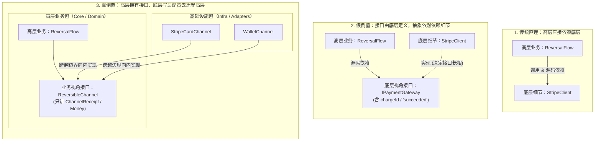

> 《编程思想》系列第 7/10 篇。这一季的立论在[序章](/zh/notes/programming-taste-in-the-agent-era/)。
>
> 代码越是容易生成，人对代码好坏的判断力就越值钱。这个系列是我把那些上了年纪的设计原则重新翻出来，逐条查清它们的出处、适用边界与失效场景的笔记。

[上一篇](/zh/notes/liskov-what-the-signature-does-not-check/)结尾留了一个问题：为了让支持冲正的退款渠道能被安全替换，我们抽出了一个 `ReversibleChannel` 接口；但这个接口到底应该由谁来定义，放在哪个目录里？

很多人的第一反应是：这有什么好问的？只要抽出了 `interface`，不在业务类里直接 `new` 具体实现，不就已经做到**依赖倒置（Dependency Inversion Principle，DIP）**了吗？

我以前也这么以为。直到在项目里见过太多次这样的场景：明明每个模块之间都隔了一层接口，也用了依赖注入框架，可一旦底层换一家支付服务商，或者数据库换一种写法，上层的核心业务代码还是得跟着改上一大片。

加一层接口，远远不等于依赖倒置。**如果接口是照着底层实现的模样描出来的，依赖方向其实一点都没变；只有把接口的定义权和归属权收归高层业务，依赖才算真正倒了过来。**

为了把这件事讲透，我们先从最基础、谁都写过的代码看起，一步步往深处走。

---

## 最经典的起点：为什么不能在业务里直接调底层？

假设我们要写退款子系统里的冲正流程 `ReversalFlow`。当财务发现一笔原路退回银行卡的退款算错了金额，需要发起冲正把多退的钱追回来，最顺手的写法是在 `ReversalFlow` 里直接引入银行卡支付网关（比如 Stripe 的客户端）：

```ts
// 底层模块：封装第三方银行卡网关 SDK
class StripeClient {
  async createRefundReversal(chargeId: string, amountCents: number): Promise<{ id: string; status: string }> {
    // 调用 Stripe HTTP API...
    return { id: 'rev_123', status: 'succeeded' }
  }
}

// 高层模块：冲正业务流程
class ReversalFlow {
  private stripe = new StripeClient()

  async execute(orderId: string, chargeId: string, amountCents: number): Promise<void> {
    if (amountCents <= 0) throw new Error('冲正金额必须大于 0')
    const res = await this.stripe.createRefundReversal(chargeId, amountCents)
    if (res.status !== 'succeeded') {
      throw new Error(`冲正失败: ${res.id}`)
    }
  }
}
```

这段代码很直观：高层业务 `ReversalFlow` 决定“什么条件下允许冲正”，底层模块 `StripeClient` 负责“怎么跟银行卡网关通信”。

但它有两个谁都能看出来的硬伤：

1. **没法脱离外部环境做测试**：只要你想跑一下 `ReversalFlow.execute` 的单元测试，代码就会真的去连 Stripe 的服务器。
2. **业务规则被绑死在单一渠道上**：下个月产品经理说“钱包余额退款也要走同一套冲正流程”，你就会发现 `ReversalFlow` 里写死了 `this.stripe`，连参数名都叫 `chargeId`，根本没法复用。

要解决这两个麻烦，大家都会走第二步：引入接口。但正是在这第二步上，九成以上的代码走上了岔路。

---

## 最普遍的误区：“照猫画虎”的假倒置

很多开发者（包括现在的 Coding Agent）在被要求“按依赖倒置原则重构上面这段代码”时，做法非常标准：

打开 `StripeClient` 的代码，把方法名、参数列表和返回值原封不动地复制出来，在 `StripeClient` 旁边新建一个 `IStripeClient`（或者改个听起来通用一点的名字叫 `IPaymentGateway`），然后通过构造函数注入给 `ReversalFlow`：

```ts
// 照着 StripeClient 的方法签名原样提取出来的接口
interface IPaymentGateway {
  createRefundReversal(chargeId: string, amountCents: number): Promise<{ id: string; status: string }>
}

class StripeClient implements IPaymentGateway {
  async createRefundReversal(chargeId: string, amountCents: number) {
    return { id: 'rev_123', status: 'succeeded' }
  }
}

class ReversalFlow {
  // 改成了构造函数注入接口
  constructor(private gateway: IPaymentGateway) {}

  async execute(orderId: string, chargeId: string, amountCents: number): Promise<void> {
    const res = await this.gateway.createRefundReversal(chargeId, amountCents)
    if (res.status !== 'succeeded') {
      throw new Error(`冲正失败: ${res.id}`)
    }
  }
}
```

表面上看，`ReversalFlow` 不再直接依赖 `StripeClient` 这个具体类了，中间多了一层 `IPaymentGateway` 抽象，单元测试也能塞一个 Mock 对象进去了。

**但这真的是依赖倒置吗？**

试着接一下第二个渠道就知道了。现在我们要把“内部钱包账本（`WalletLedger`）”也接进冲正流程。钱包账本压根没有 Stripe 的 `chargeId`（它认的是内部账本流水号 `entryId`），它的金额也不叫 `amountCents`（为了防止跨币种混算，系统第 4 条铁律要求统一用带币种的 `Money` 对象），它的返回状态也不叫 `'succeeded'`（而是 `'settled'` 或 `'pending'`）。

这时候你尴尬地发现：虽然接口名字叫 `IPaymentGateway`，但它骨子里依然是 `StripeClient` 的形状——

- 参数里的 `chargeId` 和 `amountCents` 是 Stripe SDK 的词汇；
- 返回值里的 `status === 'succeeded'` 是 Stripe API 的字面量；
- 甚至连“一旦失败返回什么字段”都是照着 Stripe 的响应体定的。

为了让钱包渠道也能塞进这个接口，你只能回头去改 `IPaymentGateway` 的定义；而接口一改，`ReversalFlow` 里的调用代码和状态判断逻辑就得跟着全部重写。

**这就是典型的“假倒置”。** 你虽然在高层和底层之间画了一个 `interface`，但这个接口是底层模块按照自己的实现细节定制的，高层模块只是被迫签字接受。底层还是爷，高层还是孙子，依赖的方向压根没有倒过来。

---

## 查回 1996 年的出处：到底什么被“倒置”了？

要弄明白真正的依赖倒置长什么样，得翻回 Robert C. Martin 1996 年在《C++ Report》上发表的那篇《The Dependency Inversion Principle》[1]。

Martin 写这篇文章时，针对的是自 1970 年代以来占统治地位的“结构化分析与设计（Structured Analysis and Design）”。在传统结构化设计里，拆分系统讲究自顶向下（Top-Down Decomposition）：最高层的业务函数调用中层控制函数，中层控制函数再去调用底层的数据库读写或硬件驱动。

在当年 C++ 的编译模型下，这种自顶向下的调用直接对应着 `#include` 头文件的物理依赖：高层业务模块必须 `#include` 底层实现模块的头文件。结果引发了一个极其荒谬的工程困境：

- 一个公司里最值钱、最应该长期稳定的资产，是**高层的业务策略（Policy）**（比如“累计退款不得超过实付额”“冲正必须留存双向流水”）；
- 最容易变、最琐碎的，是**底层的实现细节（Detail）**（比如今天用 MySQL 还是 Postgres，支付走 Stripe 还是 Adyen）。
- 可是在自顶向下的依赖树里，**最核心的高层策略，偏偏直接依赖最不稳定的底层细节**。底层库稍微升个级、改个结构体字段，高层业务模块就得跟着重新编译、跟着改代码；你想把这套核心业务规则搬到另一个项目里复用，却发现它身后拖着一整串根本拆不掉的底层驱动。

为了扭转这种“倒果为因”的局面，Martin 提出了依赖倒置原则的两条经典定义[1]：

> A. High-level modules should not depend on low-level modules. Both should depend on abstractions.
> （高层模块不应该依赖低层模块，两者都应该依赖抽象。）
>
> B. Abstractions should not depend upon details. Details should depend upon abstractions.
> （抽象不应该依赖细节，细节应该依赖抽象。）

我们前面那个 `IPaymentGateway` 之所以是假倒置，正是因为它只做到了上半句（A），却公然违反了下半句（B）——那个接口里的 `chargeId`、`'succeeded'` 全是从 Stripe 这个具体细节里泄漏出来的，**抽象依赖了细节**。

Martin 在后来出版的《敏捷软件开发（PPP）》和《架构整洁之道》里，把这两句话提炼成了一个更容易检查的物理判据：**倒置的不仅是源代码的 `import` 方向，更是接口的所有权（Interface Ownership）**[2][3]。

把上面三种状态画成图，差别一目了然：



看最下面那张“真倒置”的图：

- **运行时控制流（Control Flow）**依然是从上往下走：程序跑起来的时候，还是 `ReversalFlow` 调用了 `StripeCardChannel` 的代码；
- 但**源代码依赖方向（Source Code Dependency）**彻底反过来了：`ReversalFlow` 所在的业务核心包里，连一行指向 `infra` 目录的 `import` 都没有；反而是底层的 `StripeCardChannel` 必须去 `import` 高层业务包里的 `ReversibleChannel` 接口，并老老实实按高层的规矩去实现它[3]。

---

## 在退款系统里写出真正的依赖倒置

现在我们可以回答[第 6 篇](/zh/notes/liskov-what-the-signature-does-not-check/)留下的问题了：`ReversibleChannel` 接口应该由高层冲正业务来定义，并且直接放在业务核心层（比如 `domain/refund/`）里。

站在 `ReversalFlow` 的立场上，它根本不想知道什么叫 Stripe 的 `chargeId`，也不关心金额在某家网关里是用美分整数还是字符串表示。它只需要用纯粹的业务语言声明自己的需求：

```ts
// 位于 domain/refund/ports.ts —— 归高层业务所有
export interface ReversibleChannel {
  readonly kind: 'card' | 'wallet'
  reverse(
    originalReceipt: SettledReceipt,
    reason: string,
    idempotencyKey: string,
  ): Promise<ReversalReceipt>
}

// 位于 domain/refund/reversal-flow.ts —— 高层业务策略
export class ReversalFlow {
  constructor(
    private channels: ReadonlyMap<ReversibleChannel['kind'], ReversibleChannel>,
    private ledger: RefundLedgerStore,
  ) {}

  async execute(refundId: string, reason: string, idempotencyKey: string): Promise<ReversalReceipt> {
    const record = await this.ledger.findById(refundId)
    // 业务铁律 3：只有已结算的退款单才能发起冲正，且只能追加反向记录
    if (record.status !== 'settled') {
      throw new InvalidRefundStateError(refundId, record.status)
    }

    const channel = this.channels.get(record.channel)
    if (!channel) {
      throw new ChannelNotReversibleError(record.channel)
    }

    const reversalReceipt = await channel.reverse(record.receipt, reason, idempotencyKey)
    await this.ledger.appendReversalEntry(refundId, reversalReceipt)
    return reversalReceipt
  }
}
```

注意看 `ReversalFlow` 里的代码：它从头到尾只跟业务概念打交道——已结算回执 `SettledReceipt`、幂等键 `idempotencyKey`、冲正回执 `ReversalReceipt`。

至于 Stripe 需要把 `Money` 换算成美分整数、需要从回执编号里提取 `ch_xxx`、需要把 `'succeeded'` 映射成系统的结算状态，那些脏活累活全部被赶到了基础设施层的适配器里：

```ts
// 位于 infra/channels/stripe-card-channel.ts —— 底层细节依赖高层抽象
import type { ReversibleChannel, SettledReceipt, ReversalReceipt } from '../../domain/refund/ports'

export class StripeCardChannel implements ReversibleChannel {
  readonly kind = 'card' as const

  constructor(private stripeSdk: StripeClient) {}

  async reverse(
    originalReceipt: SettledReceipt,
    reason: string,
    idempotencyKey: string,
  ): Promise<ReversalReceipt> {
    // 在适配器内部把高层业务对象翻译成底层 SDK 认识的参数
    const amountCents = originalReceipt.amount.toMinorUnits()
    const res = await this.stripeSdk.createRefundReversal(
      originalReceipt.externalRef,
      amountCents,
      { idempotencyKey, metadata: { reason } },
    )

    // 再把底层 SDK 的响应翻译回高层业务认识的契约
    return {
      id: res.id,
      reversedAmount: originalReceipt.amount,
      settledAt: new Date(res.created * 1000),
    }
  }
}
```

给出一个最简单的自检办法：**假装明天底层沒有数据库、也没有 Stripe，全部改成内存数组或命令行输入输出，你的高层接口定义需要改一个字吗？**

- 如果接口里还留着 `SqlTransaction`、`HttpHeaders`、`StripeChargeId`，那就没倒置干净，底层细节依然顺着接口签名往里渗；
- 如果一行都不用改，说明这个接口真正归高层业务所有了。

---

## 走进模糊地带：三个最容易踩坑的边界问题

把基本功练扎实之后，真正让人在代码评审里吵起来的，往往是下面三个模糊地带。

### 模糊地带一：DIP、IoC、DI 这三个词到底有什么区别？

这三个词经常在面试和文档里被搅成一团，甚至有人认为“用了 Spring 或 InversifyJS 这类依赖注入容器，就自动实现了依赖倒置”。其实它们完全处于不同的维度：

| 概念 | 回答的核心问题 | 所在层面 | 一句话大白话 |
|---|---|---|---|
| **依赖倒置原则（DIP）** | 接口契约由谁定义、源码依赖往哪指？ | **架构与模块边界设计** | 高层业务定规矩（接口），底层实现去迁就它。 |
| **依赖注入（DI）** | 依赖的实例对象怎么递进类里去？ | **对象装配技巧** | 别在类里面自己 `new`，从构造函数或参数传进来。 |
| **控制反转（IoC）** | 代码执行的先后时机由谁把控？ | **运行时调度机制** | 以前是你写主循环调库函数；现在是框架跑主循环，到点回过头来调你注册的钩子（好莱坞原则：“别打给我们，我们会打给你”）。 |

用前面的例子一对照就清楚了：

- 在“第二步（假倒置）”里，我们把 `IPaymentGateway` 通过构造函数传进了 `ReversalFlow`——这**用了依赖注入（DI）**，却**违反了依赖倒置（DIP）**，因为接口还是底层说了算；
- 反过来，就算你不用任何花哨的 IoC 容器，只在应用启动入口（`main.ts`）手写一行 `new ReversalFlow(new Map([['card', new StripeCardChannel(sdk)]]), ledger)`，只要 `ReversibleChannel` 接口归高层业务所有，它就是彻头彻尾的**依赖倒置**。

### 模糊地带二：高层定义接口，能无视底层的物理限制“瞎许愿”吗？

这是倒置之后最容易犯的另一个极端错误。

既然说“接口归高层业务定义，底层去适配”，那高层业务能不能大笔一挥，定义一个理想化的同步接口：

```ts
// 高层业务的一厢情愿：要求任何渠道都在 10 毫秒内同步返回最终成功状态
interface IdealRefundChannel {
  reverseInstantly(receipt: SettledReceipt): ReversalReceipt // 甚至连 Promise 都不想要
}
```

底层适配器拿到这个接口直接傻眼了：银行卡跨行清算本来就是异步的，网络请求本来就会超时，甚至还要等银行第二天回盘，适配器就算写出花来，也不可能把跨国网络 I/O 变成同步内存调用。

这里必须分清两样东西：**“偶然的实现细节”**与**“本质的物理/领域约束”**。

- **偶然的实现细节**（Stripe 把字段叫 `charge_id` 还是 `transaction_id`、金额用分还是元、底层发的是 REST 还是 gRPC）：这些应该被适配器死死挡在外面，绝不能漏进高层接口。
- **本质的物理与业务约束**（资金操作是异步的、网络调用可能失败需要幂等键 `idempotencyKey`、结算状态可能是 `settled` 也可能是 `pending`、线下人工打款不支持自动冲正）：这些不是某一家 SDK 的怪癖，而是退款这个业务领域客观存在的事实。[第 6 篇（里氏替换）](/zh/notes/liskov-what-the-signature-does-not-check/)讲过，如果高层接口故意忽略这些客观约束，底层实现为了交差，就只能要么在背地里阻塞线程，要么乱抛未声明的异常，最终把里氏替换原则撞得粉碎。

**真正的依赖倒置，是过滤掉底层的“方言”，而不是无视底层的“物理定律”。**

### 模糊地带三：是不是所有类之间都要加接口倒置？（AI 时代的过度抽象病）

在手写代码的年代，多建一个接口文件还得敲几下键盘；到了 AI 时代，你只要在提示词里写一句“请遵循 SOLID 和依赖倒置原则”，Agent 能在五秒钟之内给你项目里的每一个类都配上一顶 `IXxx` 的帽子：`IMoney`、`IRefundValidator`、`IDateFormatter`、`IOrderHelper`……

打开代码库一看，满屏都是只有一个实现类的“1:1 影子接口”，跳进一个方法要按三次“转到实现”才能看到真正的逻辑。这种教条式的倒置，正是[序章](/zh/notes/programming-taste-in-the-agent-era/)里说的“把原则当验收标准，靠堆砌结构过关”。

到底什么时候该用依赖倒置，什么时候直接 `import` 具体类就够了？

Martin 在提出依赖倒置的同时，还配套提出过一条**稳定依赖原则（Stable Dependencies Principle）：依赖应该朝着更稳定的方向指**[2][3]。用这条尺子去量退款系统里的模块，立刻就能分出轻重缓急：


看这张图的左右两端：

1. **面对比你更稳定的内层基础组件（图右侧）——不要倒置，直接依赖**。
   比如负责守护“跨币种不可相加”铁律的 `Money` 值对象，或者纯内存的金额分摊函数。它们没有任何外部 I/O，不依赖任何第三方库，一年到头都不会变一次。`ReversalFlow` 直接 `import { Money } from './money'` 是天经地义的——给 `Money` 抽一个 `IMoney` 接口，除了制造阅读噪音，没有任何工程收益。
2. **面对跨越进程边界、受制于外部变化的基础设施（图左侧）——必须倒置**。
   凡是涉及到数据库读写、第三方支付网关、外部消息队列、跨团队 RPC 调用的地方，都是变化最剧烈、最容易把脏细节传染进业务层的重灾区。在这些边界上，花力气由业务层定义好 Port 接口、让底层去写 Adapter，每一分投入都会在日后换渠道、写测试时成倍赚回来。

---

## 小结：评审依赖方向时的三个问题

下次当你（或你的 Coding Agent）准备在两个模块之间抽接口时，可以先停下来问自己三个问题：

1. **这个接口跟谁姓？** 检查接口的方法名、参数类型和返回值。如果把底层实现从 Stripe 换成内部钱包、从 MySQL 换成内存 Map，这个接口的定义需要跟着改吗？需要改，说明它还是底层细节的提线木偶。
2. **有没有把物理限制和实现怪癖分清楚？** 接口是否用业务语言诚实地表达了异步、幂等和失败可能（本质约束），同时把第三方 SDK 的错误码和字段名（偶然细节）关在了适配器外面？
3. **被依赖的那一方，真的比我更不稳定吗？** 如果对方是一个纯粹、稳定的领域值对象或内部纯函数，直接 `import` 它；把宝贵的抽象预算，留给真正跨越架构边界、面对外部风浪的接缝处。

搞清楚了“接口归高层调用方所有”，紧接着就会撞上下一个问题：在我们的退款系统里，依赖退款账本的高层调用方不止一个——**客服后台要发起退款，财务任务要拉对账单，风控引擎要查异常频率，商家后台只能看脱敏报表**。既然接口由调用方定义，那这四拨不同的调用方凑到一起时，接口又该怎么切？

这就是下一篇**接口隔离原则**要解决的麻烦。

---

## 系列目录

- 序 · [在 AI 时代重读编程原则](/zh/notes/programming-taste-in-the-agent-era/)
- 内聚 · [判断标准是修改代码时要一起改](/zh/notes/what-belongs-in-one-module/)
- 耦合 · [衡量的是两个模块互相了解多少](/zh/notes/three-invisible-couplings/)
- 单一职责 · [一个职责对应一拨会来提要求的人](/zh/notes/single-responsibility-is-an-actor/)
- 开闭 · [先判断代码会往哪个方向变](/zh/notes/open-closed-only-the-guessed-axis/)
- 里氏替换 · [子类必须能无缝顶替父类](/zh/notes/liskov-what-the-signature-does-not-check/)
- 依赖倒置 · 倒置的是接口的归属（本文）
- 接口隔离 · 接口是客户端视角的切片
- 迪米特 · 得墨忒耳与中间人的两难
- 合成复用 · 继承会把不变量公开出去

## 参考资料

1. [Robert C. Martin, “The Dependency Inversion Principle”, *C++ Report*, May 1996](https://web.archive.org/web/20110714224327/http://www.objectmentor.com/resources/articles/dip.pdf) —— 原始论文，对比结构化设计的自顶向下分解与面向对象的依赖倒置，并给出两条核心定义。
2. [Robert C. Martin, *Agile Software Development: Principles, Patterns, and Practices*, Prentice Hall, 2002](https://dl.acm.org/doi/book/10.5555/515230) —— 第 11 章专门讨论接口归属（Ownership Inversion）：“倒置的不仅是依赖关系，还有接口的所有权”，以及稳定依赖原则（SDP）。
3. [Martin Fowler, “Inversion of Control Containers and the Dependency Injection pattern”, 2004](https://martinfowler.com/articles/injection.html) —— 厘清控制反转（IoC）、依赖注入（DI）与接口分离之间的概念边界。
