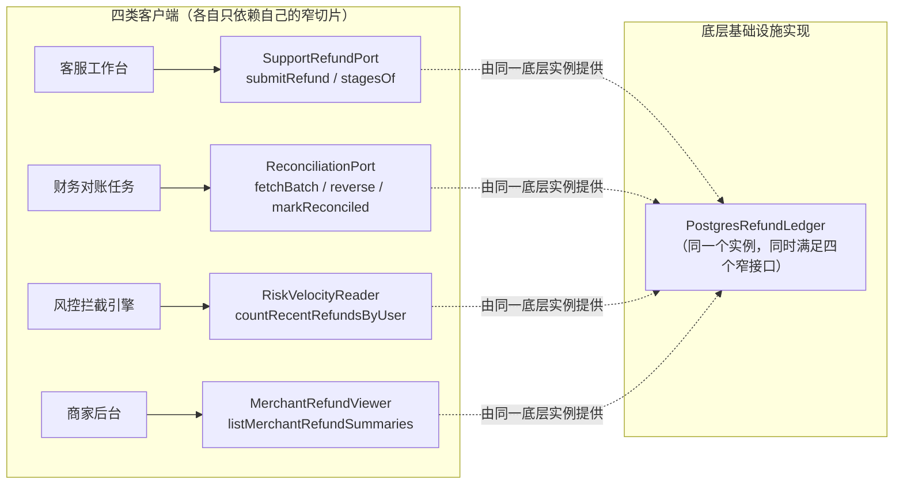

> 《编程思想》系列第 8/10 篇。这一季的立论在[序章](/zh/notes/programming-taste-in-the-agent-era/)。
>
> 代码越是容易生成，人对代码好坏的判断力就越值钱。这个系列是我把那些上了年纪的设计原则重新翻出来，逐条查清它们的出处、适用边界与失效场景的笔记。

[上一篇（依赖倒置）](/zh/notes/dependency-inversion-who-owns-the-interface/)我们得出一个结论：接口不应该照着底层实现去描，而应该归高层的调用方所有。

顺着这个结论往下走半步，马上就会撞上下一个现实问题：**如果同一个底层模块，同时被好几拨不同的高层调用方使用，那这个接口到底听谁的？**

在我们的退款子系统里，核心的退款账本（`RefundLedger`）就面临这样的处境。围绕着它，站着四类诉求截然不同的客户端[序章](/zh/notes/programming-taste-in-the-agent-era/)：

1. **客服工作台（Support Console）**：客服人员需要发起退款、查看某笔退款卡在哪个阶段；
2. **财务对账任务（Finance Reconciliation）**：夜间批处理需要拉取结算批次流水，对不平的账发起冲正；
3. **风控拦截引擎（Risk Engine）**：在交易毫秒级链路里，只需要查询某个用户近 24 小时的退款频次与累计金额；
4. **商家只读后台（Merchant Dashboard）**：商家只能查看自己店铺下已脱敏的退款汇总，绝不允许修改任何资金状态。

最省事的做法，是建一个大而全的 `RefundLedger` 接口，把这四拨人需要的方法全装进去。

而**接口隔离原则（Interface Segregation Principle，ISP）**要告诉我们的核心道理只有一句话：**不要拿一个包罗万象的“胖接口”去伺候所有调用方；接口应该是站在某一个具体客户端视角切出来的最小能力片——客户端不该被迫依赖它根本用不到的方法**[1]。

我们先看看那个“全能胖接口”在真实代码里会闯什么祸。

---

## 全能“胖接口”带来的两个现实痛点

假设我们偷了个懒，把四个客户端需要的所有操作全塞进了同一个 `RefundLedger` 接口里：

```ts
// 一个包揽了所有客户端需求的“胖接口（Fat Interface）”
export interface RefundLedger {
  // 给客服工作台用的
  submitRefund(req: RefundRequest): Promise<ChannelReceipt>
  stagesOf(refundId: string): Promise<RefundStage[]>

  // 给财务对账用的
  fetchUnreconciledBatch(date: string): Promise<LedgerEntry[]>
  reverseRefund(refundId: string, reason: string, idempotencyKey: string): Promise<ReversalReceipt>
  markBatchReconciled(batchId: string, operatorSignature: string): Promise<void>

  // 给风控引擎用的
  countRecentRefundsByUser(userId: string, windowMinutes: number): Promise<UserRefundVelocity>

  // 给商家后台用的
  listMerchantRefundSummaries(merchantId: string, page: PageQuery): Promise<MerchantRefundSummary[]>
}
```

底层只有一个 `PostgresRefundLedger` 类实现了这个接口，然后我们把这个 `RefundLedger` 注入给了客服、财务、风控、商家四个模块。

看起来省了定义多个接口的功夫，但很快就会在两个地方付出代价：

### 痛点一：最小权限失守（只读模块拿到了核武器按钮）

来看**风控拦截引擎**和**商家只读后台**。它们在业务定义上都是绝对的**只读调用方**——风控只管算分拦截，商家只管看报表。

可是因为你把完整的 `RefundLedger` 注入给了它们，当一个新来的程序员（或者一个正在自动补全代码的 AI Agent）在写商家后台代码时，敲下 `this.ledger.`，IDE 的自动补全列表里赫然躺着 `reverseRefund` 和 `markBatchReconciled`！

在[第 3 篇（耦合）](/zh/notes/three-invisible-couplings/)里我们提过：给只读模块塞进带写操作的对象，等于把系统的安全边界降级成了“全靠程序员自觉不调”。在 AI 编程时代，Agent 最擅长的就是顺着上下文里能调通的方法直接走捷径——只要接口上有这个方法，迟早有一天它会在商家模块里被意外调用。

### 痛点二：单元测试里的“假对象（Mock）地狱”

更直接的痛感出现在写单元测试的时候。

假设你正在给**风控拦截引擎**写单元测试。风控逻辑其实只调用了 `countRecentRefundsByUser` 这**一个**方法：

```ts
export class RiskInterceptor {
  constructor(private ledger: RefundLedger) {}

  async checkOrderRisk(userId: string, amount: Money): Promise<RiskDecision> {
    const velocity = await this.ledger.countRecentRefundsByUser(userId, 60)
    if (velocity.count >= 5) return { allowed: false, reason: 'frequent_refunds' }
    return { allowed: true }
  }
}
```

可是在写 `RiskInterceptor.test.ts` 时，因为构造函数要求传入完整的 `RefundLedger`，TypeScript 编译器逼着你在测试里把另外 6 个八竿子打不着的方法也全部写一遍：

```ts
// 风控单测里被迫编写的废话样板代码
const fakeLedger: RefundLedger = {
  countRecentRefundsByUser: async () => ({ count: 6, totalAmount: Money.cny(50000) }),

  // 下面 6 个方法风控压根不用，但为了凑齐胖接口类型，每个测试文件都得陪绑写一遍！
  submitRefund: async () => { throw new Error('not implemented') },
  stagesOf: async () => { throw new Error('not implemented') },
  fetchUnreconciledBatch: async () => { throw new Error('not implemented') },
  reverseRefund: async () => { throw new Error('not implemented') },
  markBatchReconciled: async () => { throw new Error('not implemented') },
  listMerchantRefundSummaries: async () => { throw new Error('not implemented') },
}
```

更冤枉的是：下周**财务团队**要求给 `markBatchReconciled` 多加一个 `auditToken` 参数。风控引擎明明跟财务对账毫无关系，结果因为共用同一个胖接口，风控模块的测试文件也跟着编译报错了！

---

## 查回 1996 年的出处：施乐打印机的“一小时重编译”噩梦

“接口隔离原则”出自 Robert C. Martin 1996 年发表在《C++ Report》上的《The Interface Segregation Principle》[1]。

这篇文章诞生自 Martin 当年给**施乐（Xerox）**研发新一代多功能打印机系统时的真实工程事故。

那台施乐打印机功能非常强大：既能普通打印，又能自动装订（Stapling），还能发传真（Fax）、扫文档。最开始，施乐的软件团队设计了一个核心的 `Job`（任务）大类，把打印、装订、传真、扫描所需的所有状态和方法全塞进了这一个类里。

结果随着代码量增长，整个团队陷入了瘫痪：

- 系统中几乎每一个子模块（哪怕是只管屏幕显示页码的小模块）方法签名里都接收 `Job` 对象，因此都 `#include "Job.h"`；
- 每当“装订模块”的工程师为了修一个小 Bug 改了一行 `Job` 类里跟装订相关的私有方法签名，全系统所有依赖 `Job.h` 的模块（包括传真、扫描、UI、计费）全部被迫重新编译；
- 在九十年代的工作站上，改一行装订代码，要等整整**一个小时**的编译才能跑一次测试[1]。

Martin 给施乐开的药方非常干脆：**把胖 `Job` 类正交切开**。装订模块只依赖 `StapleJob` 接口（里面只有装订相关的方法），打印模块只依赖 `PrintJob` 接口，底层虽然还是同一个任务实现类同时实现这几个窄接口，但装订接口的修改再也不会触发打印和传真模块的重编译了[1]。

他由此写下了接口隔离原则的经典定义：

> **Clients should not be forced to depend upon interfaces that they do not use.**
> （客户端不应该被迫依赖它们用不到的接口。）[1]

到了今天，增量编译和现代语言已经让“编译等一小时”的痛感减弱了不少；但胖接口带来的**耦合传染、权限泄漏与测试替身膨胀**，一点都没有变。

---

## 按客户端角色切片：把一个胖接口切成四张窄卡片

怎么用接口隔离原则改造我们的 `RefundLedger`？

秘诀在于转换视角：**不要站在底层数据库表的角度问“退款账本能干什么”，要站在四个调用方的角度问“我这个角色需要账本替我干什么”**——Martin Fowler 把这种按调用方定义的窄接口称为**角色接口（Role Interface）**，以区别于按实现类定义的**头部接口（Header Interface）**[2]。



看上面这张图：底层的 `PostgresRefundLedger` 依然可以是同一个类（甚至在运行时是同一个连接池实例），但在四个调用方的入口处，原来的大接口被切成了四张职责分明的窄卡片：

```ts
// 1. 风控模块自己定义的窄接口（位于 domain/risk/ports.ts）
export interface RiskVelocityReader {
  countRecentRefundsByUser(userId: string, windowMinutes: number): Promise<UserRefundVelocity>
}

// 2. 商家模块自己定义的窄接口（位于 domain/merchant/ports.ts）
export interface MerchantRefundViewer {
  listMerchantRefundSummaries(merchantId: string, page: PageQuery): Promise<MerchantRefundSummary[]>
}

// 3. 客服模块自己定义的窄接口（位于 domain/support/ports.ts）
export interface SupportRefundPort {
  submitRefund(req: RefundRequest): Promise<ChannelReceipt>
  stagesOf(refundId: string): Promise<RefundStage[]>
}

// 4. 财务对账模块自己定义的窄接口（位于 domain/finance/ports.ts）
export interface ReconciliationPort {
  fetchUnreconciledBatch(date: string): Promise<LedgerEntry[]>
  reverseRefund(refundId: string, reason: string, idempotencyKey: string): Promise<ReversalReceipt>
  markBatchReconciled(batchId: string, operatorSignature: string): Promise<void>
}
```

在 TypeScript 这类采用**结构化类型（Structural Typing / Duck Typing）**的语言里，这种切片甚至不需要底层 `PostgresRefundLedger` 显式写一长串 `implements A, B, C, D`——只要 `PostgresRefundLedger` 具备对应的方法签名，它就能直接传给任何一个窄接口！

甚至对于只接收单个数据对象的函数，你连独立接口都不用建，直接用 TypeScript 内置的 `Pick<T, K>` 就能完成就地切片：

```ts
// 只需要读取订单的 id 和实付金额，绝不暴露订单里的用户隐私字段或改状态方法
function checkRefundCap(order: Pick<Order, 'id' | 'paidAmount'>, requested: Money): boolean {
  return requested.lessThanOrEqual(order.paidAmount)
}
```

看看切完之后得到了什么：

1. **权限物理隔离**：风控模块手里的 `RiskVelocityReader` 和商家模块手里的 `MerchantRefundViewer` 只有查询方法，哪怕 AI Agent 想乱调 `reverseRefund`，在编译期也根本找不到这个入口。
2. **测试极其轻巧**：现在写风控单测，只需要传一个只有一行方法的 `{ countRecentRefundsByUser: async () => ... }`，再也不用陪绑写 6 个 `throw new Error('not implemented')`。
3. **变更互不惊扰**：财务怎么改对账签名，风控、客服、商家的代码和测试连一根毫毛都不会受影响。

---

## 走进模糊地带：三个最容易拿捏不准的边界问题

接口隔离听起来就是“把大接口拆小”，但在实际动手时，有三个问题最容易让人走极端。

### 模糊地带一：接口是不是拆得越碎越好？（“单方法接口”强迫症）

很多人刚学完接口隔离，转头就把“窄接口”理解成了**“每个接口只准有一个方法（Single-Method Interface）”**。

于是客服模块的 `SupportRefundPort` 被进一步拆成了 `RefundSubmitter` 和 `RefundStageQuerier`；数据库事务接口被拆成了 `TransactionBeginner`、`TransactionCommitter` 和 `TransactionRollbacker`：

```ts
// 走火入魔的过度拆分：把原本必须成对使用的内聚操作撕碎了
interface TransactionBeginner   { begin(): Promise<Tx> }
interface TransactionCommitter  { commit(tx: Tx): Promise<void> }
interface TransactionRollbacker { rollback(tx: Tx): Promise<void> }
```

这样拆好吗？非常糟糕！

想一想：天底下有没有任何一个调用方，只开启事务（`begin`），却永远不需要提交（`commit`）或回滚（`rollback`）的？绝对没有！这三个方法在同一个客户端视角下是**100% 绑在一起同时使用**的。把它们拆成三个碎片接口，除了让调用方的构造函数参数膨胀三倍，没有任何一个客户端从中获益。

判断接口切分粒度的黄金准则是：**看调用方（Client），不要数方法个数。**

- 如果两个方法总是被**同一类调用方**在**同一个业务场景**里配合使用（具有高内聚），哪怕一个接口里有 5 个方法，它们也应该待在同一个接口里；
- 只有当一个接口里的方法分别服务于**不同的调用方角色**（有的调用方只用 A 不用 B，有的只用 B 不用 A）时，才需要把 A 和 B 切开。

### 模糊地带二：接口隔离（ISP）和单一职责（SRP）到底有什么区别？

这是一个非常经典的问题：既然两者都在讲“拆分”，它们是不是同一条原则说了两遍？

它们看问题的**立足点（视角）**完全不同：

| 原则 | 立足视角 | 回答的核心问题 | 典型违例表现 |
|---|---|---|---|
| **单一职责（SRP）** | **实现方内部视角**<br/>（模块里面装了谁的逻辑？） | 这个类内部的逻辑，是不是同时服务于多拨会来提改动的业务部门？ | 一个 `RefundService` 方法里既算财务尾差、又拼客服展示文案 |
| **接口隔离（ISP）** | **调用方外部视角**<br/>（给别人递了多宽的名片？） | 就算底层模块内部是高内聚的，它暴露给某个特定调用方的接口是不是塞了对方用不到的方法？ | 底层账本存储本身很内聚，却把读写全套接口原封不动递给了只读的风控调用方 |

看一个例子就能把两者彻底分清：**一个类完全可以满足单一职责（高内聚），却依然违反接口隔离！**

比如底层的 `Stack<T>`（栈数据结构）或者 `RefundLedgerStore`（账本存储引擎），从实现方视角看，它内部的所有方法（写入流水、读取流水、更新对账标记）都紧密围绕同一份账本表工作，内聚度很高；但当它面向外部的“只读商家后台”和“财务写操作后台”时，如果只提供一个大接口，就违反了接口隔离。**SRP 管的是怎么切实现，ISP 管的是怎么切暴露给不同客户的视图。**

### 模糊地带三：接口切细之后，调用方注入的接口变多了怎么办？

回到我们在[序章](/zh/notes/programming-taste-in-the-agent-era/)里埋下的那个伏笔。

当财务冲正流程 `ReversalFlow` 需要同时用到“按订单查退款（`RefundLookup`）”“查状态时间线（`RefundTimeline`）”和“执行冲正（`RefundReversal`）”这三项能力时，如果我们严格按接口隔离切成了三个窄接口，`ReversalFlow` 的构造函数就得接收三个接口参数：

```ts
class ReversalFlow {
  constructor(
    private lookup: RefundLookup,
    private timeline: RefundTimeline,
    private reversal: RefundReversal,
  ) {}
}
```

这时候马上就会有人跳出来指责：“你看，`ReversalFlow` 一下子认识了三个外部接口类型，耦合的接口数变多了！是不是该把它们合回一个大接口？”

其实，在 TypeScript 或现代面向对象语言里，如果一个调用方需要同时组合多个窄切片，你既不需要污染全局的窄接口，也不需要写臃肿的转发类——直接用**接口组合（Interface Composition / Intersection Type）**就能两全其美：

```ts
// 1. 保持各自独立的窄接口，供只需要单一能力的模块（如风控、客服）使用
export interface RefundLookup   { findByOrder(orderId: string): Promise<Refund[]> }
export interface RefundTimeline { stagesOf(refundId: string): Promise<RefundStage[]> }
export interface RefundReversal { reverse(refundId: string, reason: string): Promise<void> }

// 2. ReversalFlow 用交叉类型（或 extends）声明自己需要的组合视图
export type ReversalLedgerPort = RefundLookup & RefundTimeline & RefundReversal

export class ReversalFlow {
  // 构造函数只需注入一个组合后的窄视图，底层直接传入同一个 Ledger 实例即可
  constructor(private ledger: ReversalLedgerPort) {}
}
```

你看，通过 `RefundLookup & RefundTimeline & RefundReversal`，既保住了各个窄接口的纯粹性，又让 `ReversalFlow` 的构造函数干干净净，还依然把商家报表等无关方法挡在了门外。

---

## 小结：审视接口宽度的三个问题

下次当你设计一个模块对外暴露的接口、或者在评审一个多方共用的 Service 时，问自己三个问题：

1. **有没有哪个调用方只用了这个接口里的一小半方法？** 打开这个接口的所有引用处看一眼：如果风控模块只调了 10 个方法里的 1 个，赶紧给风控切一个专属的只读窄接口。
2. **写单元测试造 Mock 时，你是不是被迫写了一堆 `throw new Error('not implemented')`？** 测试替身里的每一个未实现桩方法，都是接口过胖、违反接口隔离原则的最直接报警器。
3. **只读调用方能不能通过手里的接口调到修改状态的方法？** 用角色接口（或 TypeScript 的 `Pick` / `Readonly`）从编译期收回调用方不该拥有的权限。

当我们通过接口隔离把接口切小、按角色分发之后，对象之间的协作网络就会变得更细致。这时候，另一个经典麻烦就会浮出水面：**当对象 A 拿着对象 B、对象 B 里面又装着对象 C 时，我们经常会顺手写出 `a.getB().getC().doSomething()` 这样一长串“穿透调用”；可一旦为了消除穿透调用去写包装方法，又会把类写成满身转发代码的“中间人”。**

这就是下一篇**迪米特法则**要破解的两难困局。

---

## 系列目录

- 序 · [在 AI 时代重读编程原则](/zh/notes/programming-taste-in-the-agent-era/)
- 内聚 · [判断标准是修改代码时要一起改](/zh/notes/what-belongs-in-one-module/)
- 耦合 · [衡量的是两个模块互相了解多少](/zh/notes/three-invisible-couplings/)
- 单一职责 · [一个职责对应一拨会来提要求的人](/zh/notes/single-responsibility-is-an-actor/)
- 开闭 · [先判断代码会往哪个方向变](/zh/notes/open-closed-only-the-guessed-axis/)
- 里氏替换 · [子类必须能无缝顶替父类](/zh/notes/liskov-what-the-signature-does-not-check/)
- 依赖倒置 · [倒置的是接口的归属](/zh/notes/dependency-inversion-who-owns-the-interface/)
- 接口隔离 · 接口是客户端视角的切片（本文）
- 迪米特 · [在穿透调用与中间人之间找平衡](/zh/notes/law-of-demeter-the-middlemans-dilemma/)
- 合成复用 · [用对象组合替代类继承来保护不变量](/zh/notes/composite-reuse-inheritance-publishes-invariants/)

## 参考资料

1. [Robert C. Martin, “The Interface Segregation Principle”, *C++ Report*, August 1996](https://web.archive.org/web/20150905081105/http://www.objectmentor.com/resources/articles/isp.pdf) —— 以施乐（Xerox）打印机系统的 `Job` 胖类为例，首次提出接口隔离原则。
2. [Martin Fowler, “RoleInterface”, *martinfowler.com*, 2006](https://martinfowler.com/bliki/RoleInterface.html) —— 对比按客户端协作角色定义的 Role Interface 与按实现类全部方法提取的 Header Interface。
