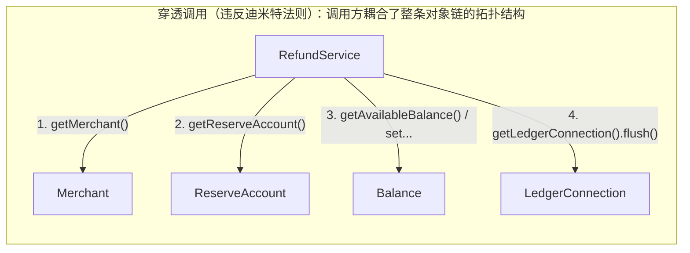
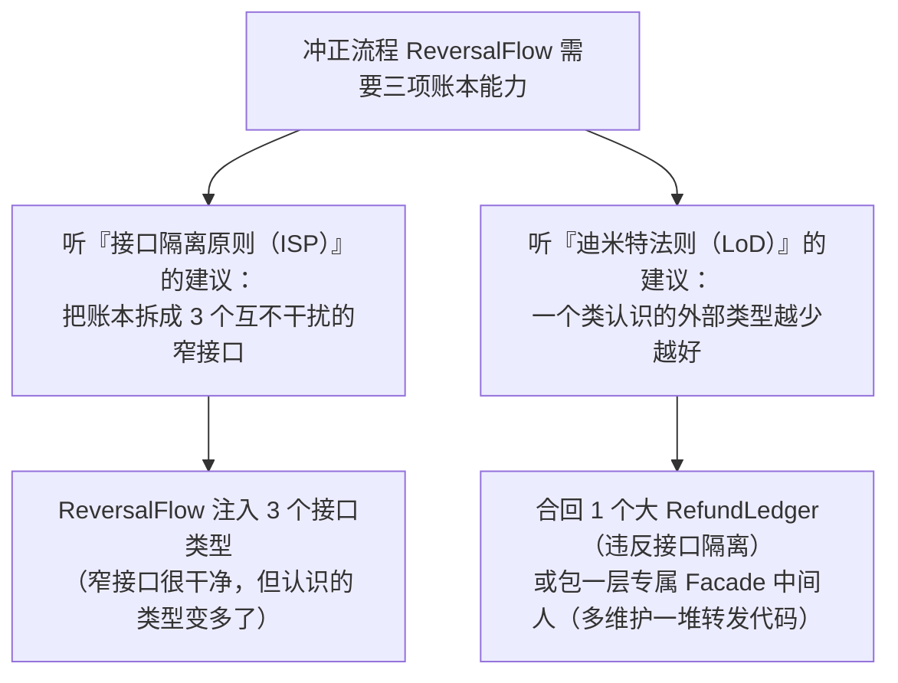

> 《编程思想》系列第 9/10 篇。这一季的立论在[序章](/zh/notes/programming-taste-in-the-agent-era/)。
>
> 代码越是容易生成，人对代码好坏的判断力就越值钱。这个系列是我把那些上了年纪的设计原则重新翻出来，逐条查清它们的出处、适用边界与失效场景的笔记。

写业务代码时，你一定见过（甚至亲手写过）下面这样一气呵成的“火车残骸式（Train Wreck）”链式调用：

```ts
const balance = order.getCustomer().getWallet().getAccountBalance().getAvailableCents()
```

写的时候那叫一个爽——顺着 IDE 的点号（`.`）自动补全一路点下去，五秒钟就能拿到想要的深层字段。

但改代码的时候，这种写法就是一场噩梦：这一行代码像一根钢钎，一口气穿透了 `Order`、`Customer`、`Wallet`、`AccountBalance` 四个对象层级。只要中间任何一层的内部结构稍微改一下（比如用户的钱包改由独立的资产服务按 `customerId` 查询，不再直接挂在 `Customer` 对象底下），全项目几十处写了这串长链条的调用方就会同时爆炸。

为了治住这种“隔山打牛”式的穿透耦合，1987 年诞生了一条著名的设计规则——**迪米特法则（Law of Demeter，LoD）**，也叫**最少知识原则（Principle of Least Knowledge）**[1]。

用最通俗的话讲它的核心：**一个对象应该对其他对象的内部结构保持最少的了解；不要越过你的直接合作者，去翻它口袋里的东西，更不要直接指挥它肚子里的零件干活（只和你的直接朋友说话，不跟陌生人说话）**[1][2]。

但迪米特法则也是七大原则里**最容易被机械误用、最容易跟其他原则打架**的一条：一旦你为了消灭点号去给中间对象加包装方法，很快就会造出满身都是无脑转发代码的“中间人（Middleman）”，甚至直接撞翻我们在[上一篇](/zh/notes/interface-segregation-client-perspective-slice/)刚讲过的接口隔离原则。

我们一步步把它的来历、真正要防的祸害，以及怎么在两难之间算清工程账讲透。

---

## 一行“顺手点出来”的代码，是怎么锁死三个模块的？

来看我们退款子系统里的一个真实场景：当客服发起“退回钱包余额”时，退款提交流程需要扣减商户的待结算备付金，并给买家的钱包加钱。

如果图省事，代码很容易写成下面这样：

```ts
// 糟糕的穿透调用：RefundService 越过 Order 和 Merchant，直接伸手去拧底层资金账户的螺丝
export class RefundService {
  async refundToWallet(order: Order, amount: Money): Promise<void> {
    // 1. 掏出订单里的商户 → 掏出商户的备付金账户 → 掏出可用余额做判断
    const reserve = order.getMerchant().getReserveAccount()
    if (reserve.getAvailableBalance().lessThan(amount)) {
      throw new InsufficientMerchantReserveError(order.id)
    }

    // 2. 直接操作深层对象的内部状态
    reserve.setAvailableBalance(reserve.getAvailableBalance().subtract(amount))
    await reserve.getLedgerConnection().flush()
  }
}
```

看看这段代码干了什么：

`RefundService` 的直接合作者本来只有 `Order`（或者商户资金服务）。但在这短短几行里，`RefundService` 不仅知道 `Order` 里面挂着 `Merchant`，还知道 `Merchant` 里面挂着 `ReserveAccount`，甚至连 `ReserveAccount` 怎么扣减余额、怎么调底层的 `getLedgerConnection().flush()` 刷盘都摸得一清二楚！



这种写法的危害远不止“点号太多不好看”：

1. **内部拓扑结构被彻底锁死**：下个月账户团队重构备付金系统，决定引入“冻结额度（Frozen Balance）”，可用余额不再是一个可以直接 `set` 的字段，而是由总额减去冻结额动态算出来的。结果账户团队惊讶地发现：他们根本改不动自己的 `ReserveAccount`，因为外面的 `RefundService` 正在直接调 `setAvailableBalance` 和 `flush`！
2. **业务规则散落一地**：“扣减备付金前必须检查余额充足，且扣减后必须落盘”原本是备付金账户自己的核心不变量，现在却散落在了外面的 `RefundService` 里。如果另一个理赔模块也要扣备付金，就得把这几行先查后减再 `flush` 的代码原样抄一遍。

怎麼修？用面向对象里与迪米特法则配对的核心动作——**“只下指令，别打听内情（Tell, Don't Ask）”**[3]：

```ts
// 修复后：把“怎么检查余额、怎么扣减、怎么落盘”收归 ReserveAccount（或资金领域服务）内部
export class ReserveAccount {
  async deductForRefund(orderId: string, amount: Money): Promise<ReserveDebitReceipt> {
    if (this.availableBalance.lessThan(amount)) {
      throw new InsufficientMerchantReserveError(orderId)
    }
    this.availableBalance = this.availableBalance.subtract(amount)
    return this.ledger.recordDebit(orderId, amount)
  }
}
```

现在，外面的退款流程不再去掏备付金账户的五脏六腑，而是直接下达一条业务指令：`await reserveAccount.deductForRefund(order.id, amount)`。至于里面怎么算余额、怎么写库，全被关在了 `ReserveAccount` 的黑盒子里。

---

## 查回 1987 年的出处：农业女神与那四条白名单规则

在[序章](/zh/notes/programming-taste-in-the-agent-era/)里我们提过一个冷知识：计算机界从来没有一位姓“迪米特（Demeter）”的科学家。

1987 年秋天，美国东北大学（Northeastern University）的 Ian Holland、Karl Lieberherr 等人正在开发一个名叫 **Demeter** 的自适应面向对象软件项目。项目取名自希腊神话里的**农业女神得墨忒耳（Demeter）**，寓意是希望软件能像种庄稼一样，自下而上、一步步培育生长[1]。

当时他们在往项目里加新功能时，频繁因为对象之间的深层引用链断裂而改崩代码。于是团队总结出了一条限制方法调用范围的硬性语法规则，并以项目名字将其命名为 **Law of Demeter（迪米特法则）**，次年（1988 年）正式发表在《IEEE Software》杂志上[2]。

在原论文里，迪米特法则对“什么才算你的**直接朋友（Immediate Friends）**”给出了四条非常明确的名单。在一个对象 `O` 的任意方法 `M` 内部，你**只允许**调用以下四类对象的方法[2]：

| 允许调用的“直接朋友”类别 | 代码里的位置 | 退款系统里的合法例子 |
|---|---|---|
| **1. 对象自身（`this`）** | `this.xxx()` | `this.validateRequest(req)` |
| **2. 方法自身传入的参数** | `M(arg)` 里的 `arg.xxx()` | `req.amount` 或 `channel.submit(req)` |
| **3. 方法内部自己新创建的对象** | `const x = new X()` 里的 `x.xxx()` | `const receipt = new SettledReceipt(...); receipt.toSummary()` |
| **4. 对象自身直接持有的成员变量** | `this.field.xxx()` | `this.ledger.record(...)` |

凡是不在这四条白名单里的对象——比如**“调用另一个方法拿到的返回值内部再掏出来的对象”**（像前面 `order.getMerchant().getReserveAccount()` 里的 `ReserveAccount`）——统统属于**陌生人（Stranger）**，迪米特法则严禁你直接调它的方法[2]。

---

## 走进模糊地带：三个最容易被教条坑惨的典型误区

如果只背下“不准连着写两个点号（`a.b().c()`）”或者“只准调上面四类朋友”，在实际写代码时立马就会寸步难行。下面三个模糊地带，是区分死背教条和真正懂迪米特法则的分水岭。

### 误区一：把“数点号”当成了迪米特法则（冤枉了纯数据结构与链式 API）

很多静态代码检查插件（Linter）实现迪米特法则的方式非常粗暴：**数一行代码里有几个点号（`.`），超过两个就报错！**

于是下面这三行完全健康的代码全都躺枪了：

```ts
// 情况 1：读取纯数据结构（DTO / 值对象）的嵌套属性
const currencyCode = refundRequest.amount.currency.code

// 情况 2：数组或集合的函数式转换链
const settledIds = refunds.filter((r) => r.status === 'settled').map((r) => r.id)

// 情况 3：Fluent Builder / 查询构建器（每次返回的都是同一个类型自身）
const query = db.selectFrom('refunds').where('status', '=', 'settled').limit(10)
```

这三行代码违反迪米特法则了吗？**完全没有！**

早在 Robert C. Martin 的《代码整洁之道（Clean Code）》第 6 章里，就已经专门澄清过这个误区：你必须严格区分**行为对象（Objects / Services）**与**纯数据结构（Data Structures / Value Objects）**[4]。

- **行为对象**（如 `OrderService`、`ReserveAccount`、`StripeCardChannel`）：存在的意义是**隐藏内部状态、对外提供业务行为**。如果你越过它去调它内部依赖的组件，你就刺穿了它的封装边界，这才是迪米特法则要抓的真凶。
- **纯数据结构**（如 `RefundRequest`、`Money`、JSON 配置项、查询 DTO）：存在的唯一意义就是**把数据字段摊开摆在桌面上给人读**，它本来就没有需要隐藏的私有协作逻辑！访问 `refundRequest.amount.currency`，跟访问数据库一行记录的列没有任何区别。
- 至于数组的 `.filter().map()` 或查询构建器，每一步返回的要么是标准库集合，要么是构建器自身（`this`），根本没有跨越任何陌生的模块边界。

**迪米特法则防的是“穿透行为对象的封装边界”，从来不是防点号（`.`）这个标点符号。**

### 误区二：为了讨好迪米特，造出满身转发代码的“中间人（Middleman）”

这是机械执行迪米特法则最著名的副作用。

假设客服后台需要显示一笔退款单所属商户的结算银行名称。在领域模型里，`Refund` 关联着 `Merchant`，`Merchant` 关联着 `BankProfile`。

如果程序员不敢写 `refund.getMerchant().getBankProfile().getBankName()`，为了表面上“只打一个点号、遵守迪米特法则”，很多人会这么干：

1. 在 `Merchant` 类上加一个纯转发方法：`getBankName() { return this.bankProfile.getBankName() }`；
2. 再在 `Refund` 类上加一个纯转发方法：`getMerchantBankName() { return this.merchant.getBankName() }`。

如果系统里有二十个类似的属性或方法要访问，你的 `Refund` 类和 `Merchant` 类里就会塞满几十个毫无业务逻辑、纯粹做二道贩子的 `getXxx` / `doXxx` 包装方法！

Martin Fowler 在《重构（Refactoring）》里把这种坏味道单独列为一章，起名就叫 **“中间人（Middle Man）”**[5]——当你为了隐藏委托关系而写了一堆纯转发方法，外层类就退化成了一个臃肿的空壳传声筒；底层每加一个方法，中间所有层级的类都得跟着加一行转发代码，维护成本反而翻倍了！

怎么破这个局？

- **如果只是为了展示数据（读操作）**：不要让领域实体一层层转发，直接在查询侧（Query / Read Model）做一次投影（Projection），组装出前端需要的扁平 `SupportRefundViewDTO`；
- **如果是为了执行业务动作（写操作）**：不要转发底层小动作（比如 `order.lockMerchantReserve()`、`order.deductMerchantReserve()`、`order.flushMerchantReserve()`），而是提升抽象层级，让外层对象提供一个真正有业务意义的聚合动作，或者直接把所需的窄接口注入给当前用例服务。

### 误区三：迪米特法则与接口隔离原则的正面冲撞

这就回到了我们在[序章](/zh/notes/programming-taste-in-the-agent-era/)里摆出的那个核心冲突案例。

在冲正流程 `ReversalFlow` 里，我们需要三项能力：查订单退款（`RefundLookup`）、查状态时间线（`RefundTimeline`）、执行冲正（`RefundReversal`）。

这时候，两条设计原则会给出完全相反的指令：



- 按**接口隔离原则**，接口切得越窄，调用方背负的无关方法越少；但切窄的直接后果就是类型变多，调用方需要同时认识好几个窄接口。
- 按**迪米特法则**，一个类认识的外部合作者类型越少越好；但要想少认识类型，要么把接口重新揉成一个胖接口（违反接口隔离），要么专门写一个 `ReversalFacade` 中间人类在底下帮你调那三个接口（凭空多出一层要维护的具体转发代码）。

**这里没有能够同时拿满分的标准答案，只有工程代价的权衡：**

- 多认识两个窄的 TypeScript `interface`（或者像第 8 篇那样用 `type ReversalPort = RefundLookup & RefundTimeline & RefundReversal` 做类型交叉），付出的只是**编译期零成本的类型声明**；
- 而为了表面上少认识两个类型去写一个 `Facade` 转发类，多出来的是**运行时实打实要写、要测、要维护的具体代码**。

因此，在现代强类型语言里，当这两条原则打架时，**优先保住接口隔离（用窄接口与类型组合），绝不要为了拼凑“表面上的最少知识”去写满篇无意义的转发中间人**。

---

## 小结：运用迪米特法则的三个判断

下次当你看到一串长长的点号调用、或者正准备往类里加一个转发方法时，先过一遍这三个问题：

1. **我点下去的这一串，到底是“纯数据结构”还是“行为对象”？** 如果是值对象、DTO 或链式查询构建器，放心点下去；如果是跨越了多个带状态和副作用的业务服务，立刻停手。
2. **我是在“打听完别人的内部状态替它做决定”，还是在“给它下达业务指令”？** 把 `if (a.getB().getStatus() === ...) { a.getB().setX() }` 收拢成 `a.completeAction()`，让状态判断留在拥有那个状态的对象内部（Tell, Don't Ask）。
3. **我为了消除点号而加的这个方法，是真的封装了业务规则，还是纯粹在做二道贩子转发？** 如果一个方法除了 `return this.delegate.foo()` 之外什么都没干，宁可让调用方直接注入所需的窄角色接口，也别把当前类养成臃肿的“中间人”。

到这里，我们已经走完了模块内部（内聚、单一职责）、模块边界与方向（耦合、开闭、里氏替换、依赖倒置、接口隔离、迪米特法则）的全部旅程。

最后还剩下一块拼图：当我们想要在多个模块之间**复用**同一段通用逻辑（比如四个退款渠道都要复用同一套网络重试和幂等锁逻辑）时，为什么老一辈教材推崇的“写一个 `BaseRefundChannel` 父类让大家继承”，在真实工程里往往会演变成一场父子互相背刺的灾难？

这就是本系列的收官之作——第 10 篇**合成复用原则**要揭开的谜底。

---

## 系列目录

- 序 · [在 AI 时代重读编程原则](/zh/notes/programming-taste-in-the-agent-era/)
- 内聚 · [判断标准是修改代码时要一起改](/zh/notes/what-belongs-in-one-module/)
- 耦合 · [衡量的是两个模块互相了解多少](/zh/notes/three-invisible-couplings/)
- 单一职责 · [一个职责对应一拨会来提要求的人](/zh/notes/single-responsibility-is-an-actor/)
- 开闭 · [先判断代码会往哪个方向变](/zh/notes/open-closed-only-the-guessed-axis/)
- 里氏替换 · [子类必须能无缝顶替父类](/zh/notes/liskov-what-the-signature-does-not-check/)
- 依赖倒置 · [倒置的是接口的归属](/zh/notes/dependency-inversion-who-owns-the-interface/)
- 接口隔离 · [接口是客户端视角的切片](/zh/notes/interface-segregation-client-perspective-slice/)
- 迪米特 · 在穿透调用与中间人之间找平衡（本文）
- 合成复用 · [用对象组合替代类继承来保护不变量](/zh/notes/composite-reuse-inheritance-publishes-invariants/)

## 参考资料

1. [Karl Lieberherr, “Law of Demeter: Principle of Least Knowledge”, Northeastern University](https://www.khoury.northeastern.edu/home/lieber/LoD.html) —— 东北大学 Demeter 项目主页，记录迪米特法则在 1987 年秋天的提出背景与命名渊源。
2. [Karl J. Lieberherr, Ian M. Holland, “Assuring Good Style for Object-Oriented Programs”, *IEEE Software* 6(5), September 1989, 38–48](https://dl.acm.org/doi/10.1109/52.35588) —— 正式定义迪米特法则的四类合法方法调用对象（Preferred Supplier Objects），并讨论消除深层结构耦合与包装方法的代价。
3. [Alec Sharp, *Smalltalk by Example: The Developer's Guide*, McGraw-Hill, 1997 / Andy Hunt & Dave Thomas, *The Pragmatic Programmer*, 1999](https://pragprog.com/titles/tpp20/the-pragmatic-programmer-20th-anniversary-edition/) —— 阐述“Tell, Don't Ask（只下指令，不问状态）”原则，作为落实迪米特法则的核心手段。
4. [Robert C. Martin, *Clean Code: A Handbook of Agile Software Craftsmanship*, Prentice Hall, 2008](https://dl.acm.org/doi/book/10.5555/1388398) —— 第 6 章“Objects and Data Structures”明确区分行为对象与纯数据结构在适用迪米特法则时的本质差异。
5. [Martin Fowler, *Refactoring: Improving the Design of Existing Code* (2nd Edition), Addison-Wesley, 2018](https://martinfowler.com/books/refactoring.html) —— 剖析“Message Chains（消息链/火车残骸）”与“Middle Man（中间人）”两种相反的代码坏味道及其双向权衡。
