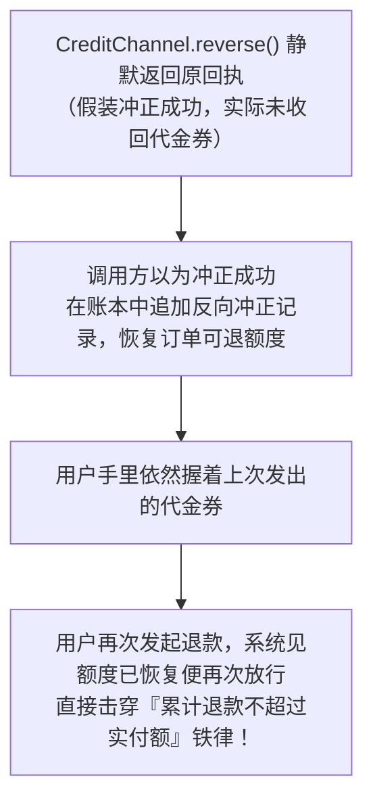
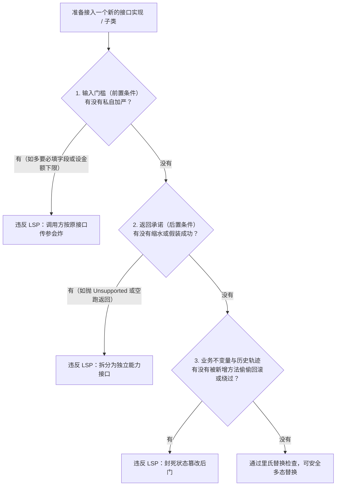

> 《编程思想》系列第 6/10 篇。这一季的立论在[序章](/zh/notes/programming-taste-in-the-agent-era/)。
>
> 代码越是容易生成，人对代码好坏的判断力就越值钱。这个系列是我把那些上了年纪的设计原则重新翻出来，逐条查清它们的出处、适用边界与失效场景的笔记。

在 SOLID 五原则里，**里氏替换原则（Liskov Substitution Principle，LSP）**的名字最拗口，也最容易被低估。

很多人在有了 TypeScript、Java 或 Rust 这类强类型编译器之后，会觉得里氏替换已经用不着人操心了：“只要我的实现类写了 `implements RefundChannel`、参数和返回值类型都没标红，难道还不算能替换吗？”

恰恰相反。**里氏替换原则真正要管的地方，正是从编译器检查通过的那一刻才刚刚开始。**

为什么？因为编译器只负责核对第一层契约——**方法签名（Signature）**：方法叫什么名字、收几个参数、返回什么类型。但调用方在写代码时，心里真正依赖的是第二层契约——**方法背后的行为承诺（Behavior）**：调完之后状态怎么变、哪些前置条件合法、返回值里的字段满足什么规律。

用最直白的话讲里氏替换的精髓：**凡是能放父类型（或接口）的地方，换成它的任何一个子类型（或实现类），调用方原本合理假定的所有行为承诺都必须照常兑现，绝不能逼着调用方写 `if (x instanceof SubType)` 去特殊照顾它。**

我们先从那个流传最广、却经常被讲成文字游戏的“正方形与长方形”看起，再去抓退款系统里的真 Bug。

---

## 一段编译全绿、运行全错的经典代码

小学数学告诉我们：“正方形是一种特殊的长方形。”

于是很多面向对象初学者会顺理成章地写出下面这段代码——先定义一个长方形 `Rectangle`，宽和高可以分别修改；再让正方形 `Square` 继承 `Rectangle`，为了守住正方形“四边相等”的特征，在修改宽或高时顺手把另一条边也一起改了：

```ts
class Rectangle {
  protected width = 0
  protected height = 0

  setWidth(w: number): void {
    this.width = w
  }

  setHeight(h: number): void {
    this.height = h
  }

  area(): number {
    return this.width * this.height
  }
}

class Square extends Rectangle {
  setWidth(w: number): void {
    this.width = w
    this.height = w
  }

  setHeight(h: number): void {
    this.width = h
    this.height = h
  }
}
```

单看这两个类，TypeScript 编译器一句话都不会抱怨：`Square` 确实继承自 `Rectangle`，方法名和参数类型一模一样。

但现在请站在**调用方**的视角，看下面这个只认识 `Rectangle` 的函数：

```ts
function resizeAndCalcArea(rect: Rectangle): number {
  rect.setWidth(10)
  rect.setHeight(4)
  // 调用方无比合理地认为：我刚把宽设为 10、高设为 4，面积必然是 40
  return rect.area()
}

resizeAndCalcArea(new Rectangle()) // 返回 40（正常）
resizeAndCalcArea(new Square())    // 返回 16（当场翻车！）
```

为什么传入 `new Square()` 会算出 `16`？因为当调用方执行第二行 `rect.setHeight(4)` 时，正方形背着调用方偷偷把刚才设好的 `width = 10` 也改成了 `4`！

注意这里发生了什么：

- 调用方看着 `Rectangle` 的接口，心里默认了一条**行为承诺**：“修改高度的时候，宽度不会跟着变。”
- 子类 `Square` 虽然保持了方法签名一致，却在背地里撕毁了这条行为承诺。

一旦允许这种“签名合规、行为违约”的子类混进系统，调用方就再也不敢相信父类型了，只能被迫在业务代码里到处打补丁：

```ts
function resizeAndCalcArea(rect: Rectangle): number {
  if (rect instanceof Square) {
    // 被迫给不守规矩的子类开小灶
    throw new Error('正方形不支持独立拉伸宽高')
  }
  rect.setWidth(10)
  rect.setHeight(4)
  return rect.area()
}
```

看到那个 `if (rect instanceof Square)` 了吗？一旦调用方被迫开始用 `instanceof` 挨个点名验身，[上一篇（开闭原则）](/zh/notes/open-closed-only-the-guessed-axis/)建立起来的多态扩展能力就当场报废了。

---

## 退款系统里的真实翻车：从抛异常到“假装成功”

长方形和正方形只是热身。回到我们的退款系统，看看违反里氏替换在真实生产环境里是怎么搞乱资金账本的。

在[上一篇](/zh/notes/open-closed-only-the-guessed-axis/)里，有人为了省事，在所有退款渠道共用的 `RefundChannel` 接口上直接加了一个 `reverse`（冲正）方法。由于“积分补偿渠道（`CreditChannel`）”在业务上只发代金券、不走资金流，压根没有冲正功能，写代码的人为了应付编译器，在里面塞了一行抛异常：

```ts
class CreditChannel implements RefundChannel {
  readonly kind = 'credit' as const

  async submit(req: RefundRequest): Promise<ChannelReceipt> {
    // 发放补偿代金券...
  }

  async reverse(receipt: ChannelReceipt, reason: string): Promise<ChannelReceipt> {
    // 为了让 TypeScript 编译通过硬塞的实现
    throw new UnsupportedOperationError('credit channel cannot be reversed')
  }
}
```

上线第三周，财务批量冲正脚本跑到了积分补偿单据，直接撞上 `UnsupportedOperationError` 崩溃退出。

在故障复盘会上，有人提出了一个听起来很聪明的“快速修复方案”：*“既然抛异常会把批量脚本搞崩，而积分补偿本来就不涉及真实资金划拨，那我们让 `CreditChannel.reverse` 别报错了，直接原样返回传入的 `receipt` 不就不会崩了吗？”*

```ts
// 比抛异常可怕十倍的“假装成功”实现
class CreditChannel implements RefundChannel {
  async reverse(receipt: ChannelReceipt, reason: string): Promise<ChannelReceipt> {
    return receipt // 不抛错了，静默返回原回执
  }
}
```

这段代码上线后，批量脚本确实再也没报过错——**但公司的账本直接乱套了！**

因为调用方跟 `RefundChannel.reverse` 签下的行为契约是：**“只要 `reverse` 正常返回，就代表原退款发放出去的权益已经被成功收回，订单的剩余可退额度可以加回去了。”**



看清这两次违约的区别了吗？

- 第一次抛 `UnsupportedOperationError`，违反的是**“接口承诺支持冲正，子类却拒绝服务”**——虽然违约，但至少当场掀了桌子报警；
- 第二次改成 `return receipt` 假装成功，违反的是**后置条件（Postcondition）**——它用合规的返回类型欺骗了调用方，直接导致系统第 1 条核心铁律（累计退款绝不超过实付额）被悄无声息地击穿！

**在里氏替换原则面前，假装成功比直接抛异常恶劣十倍。**

---

## 查回 1987 与 1994 年的出处：到底怎么才算“行为兼容”？

里氏替换原则是七大原则里唯一以学者姓氏命名的，源自图灵奖得主 Barbara Liskov 在 1987 年 OOPSLA 大会上的主题演讲《Data Abstraction and Hierarchy》[1]。

她在演讲中提出了一个根本问题：**语言的编译器说 `S extends T` 合法，在数学和工程意义上，`S` 就真的是 `T` 的子类型吗？**

她的回答是：不一定。只有当所有针对父类型 `T` 编写的程序，在把对象换成子类型 `S` 的实例之后，程序的**可观察行为（Observable Behavior）**完全不发生改变，`S` 才配叫 `T` 的子类型[1]。

1994 年，Liskov 与 Jeannette Wing 合作发表了经典论文《A Behavioral Notion of Subtyping》[2]，结合 Bertrand Meyer 的“契约式设计（Design by Contract）”[3]，把抽象的“行为不改变”拆解成了四条可以直接拿来审代码的硬指标：

| 契约维度 | 通俗大白话 | 退款系统里的违约反例 |
|---|---|---|
| **1. 前置条件不能加强**<br/>Preconditions | 父类说“只要是正数金额我就收”，子类绝不能私自加门槛说“低于 100 块我不收” | 接口约定 `amount > 0` 即可提交，但 `TransferChannel.submit` 私自加了 `if (amount < 10000) throw Error('最低 100 元')` |
| **2. 后置条件不能削弱**<br/>Postconditions | 父类承诺“办完事一定给你一张带结算时间的回执”，子类绝不能给一张空壳回执或假装办完 | `CreditChannel.reverse` 什么都没撤销就直接 `return receipt`；或返回 `status: 'settled'` 却把 `settledAt` 填成 `null` |
| **3. 不变量必须保持**<br/>Invariants | 父类死守的家规（状态底线），子类无论怎么折腾都不能打破 | 子类绕过总额度校验直接调网关放款，打破“累计退款不超过原单实付”铁律 |
| **4. 历史约束不能违反**<br/>History Constraint | 父类规定“某个状态一旦落定就只能追加、不能篡改”，子类绝不能自己偷偷加个后门方法去回滚它 | 账本规定已结算记录不可回退（铁律 3），某子类却私自加了一个 `deleteLastStage()` 方法把历史阶段删掉了 |

把这四条浓缩成一句口诀就是：**对输入要更宽容（或一样宽），对产出要更严格（或一样严），父类的家规（不变量与历史轨迹）一条都不能破。**

---

## 走进模糊地带：三个最容易让人犯迷糊的实战问题

记住四条规则不难，难的是下面这三个在真实代码评审里天天吵架的模糊地带。

### 模糊地带一：正方形到底能不能继承长方形？

很多人背完“正方形不能继承长方形”的八股文后，会觉得很委屈：数学课本上明明写着正方形就是长方形的子集，怎么写进代码里就错了？

其实，错的不是数学，而是**可变性（Mutability）**[4]。

在前面的代码里，`Rectangle` 有 `setWidth` 和 `setHeight` 两个修改内部状态的方法——这意味着可变长方形的契约里包含了一条隐含承诺：“宽和高是两个彼此独立的可变状态。”正方形做不到这一点，所以违约了。

但如果我们把 `Rectangle` 和 `Square` 设计成**不可变的值对象（Immutable Value Objects）**呢？

```ts
class ImmutableRectangle {
  constructor(
    readonly width: number,
    readonly height: number,
  ) {}

  area(): number {
    return this.width * this.height
  }
}

class ImmutableSquare extends ImmutableRectangle {
  constructor(side: number) {
    super(side, side)
  }
}
```

在这个不可变的世界里，一旦构造完成，没有任何人能单独调用 `setWidth`。对于所有拿着 `ImmutableRectangle` 去读 `width`、`height` 和 `area()` 的调用方来说，`ImmutableSquare` **100% 满足里氏替换原则**！

这揭示了一个极其深刻的道理：**两个概念之间能不能继承，不取决于现实世界里的名词分类学，而取决于你在接口上承诺了哪些行为（特别是可变行为）。**

### 模糊地带二：为什么开了最严格的 TypeScript，还是拦不住“私自加门槛”？

有人会问：既然第 1 条规则说“子类不能加强前置条件（不能把宽泛的参数类型收窄）”，那为什么有时候子类明明把参数类型收窄了，TypeScript 的 `strict: true` 却没有报错？

来看一段真实能通过 TypeScript `strict` 编译的危险代码：

```ts
interface RefundRequest {
  amount: Money
}

// 子类型请求：多要求了一个必填的 bankAccount 字段
interface BankTransferRequest extends RefundRequest {
  bankAccount: string
}

interface RefundChannel {
  // 注意：这里用的是 method 语法声明
  submit(req: RefundRequest): Promise<ChannelReceipt>
}

class TransferChannel implements RefundChannel {
  // 危险！子类私自要求传入更严格的 BankTransferRequest，但 TS 默认不报错！
  async submit(req: BankTransferRequest): Promise<ChannelReceipt> {
    const cleanAccount = req.bankAccount.trim() // 如果调用方只按父接口传了 RefundRequest，这里当场 Cannot read properties of undefined!
    // ...
  }
}
```

为什么开启了 `strictFunctionTypes`，TypeScript 还是放过了这个明显违反里氏替换的 `submit(req: BankTransferRequest)`？

因为 TypeScript 为了照顾内置 `Array<T>` 等历史类型声明的兼容性，对 `method()` 语法保留了**参数双变（Bivariance）**的后门；只有当你把接口里的方法写成**函数属性语法（Function Property）**时，TypeScript 才会严格执行参数的逆变检查[5]：

```ts
interface RefundChannel {
  // 改成函数属性语法后，strictFunctionTypes 立即生效！
  readonly submit: (req: RefundRequest) => Promise<ChannelReceipt>
}
// 此时 TransferChannel 若再写 submit(req: BankTransferRequest)，编译器会当场报错拦截！
```

即便如此，编译器也只能拦住“多要了一个字段”这种结构化约束；如果子类在函数体第一行写 `if (req.amount < 10000) throw Error()`，任何静态类型检查器都看不出来——这部分契约，只能靠**共享的契约测试套件（Contract Tests）**来守护。

### 模糊地带三：怎么彻底修好“部分渠道不支持冲正”与“字段组合违约”？

既然编译器查不全，我们怎么用工程手段把里氏替换真正落到退款代码里？有三个最管用的抓手：

#### 1. 把隐式的字段关联变成“可辨识联合类型”

如果契约规定“状态为 `'settled'` 时，`settledAt` 一定有值；状态为 `'pending'` 时，`settledAt` 为空”，千万别写成两个独立的可选字段，直接用类型把非法状态组合封死：

```ts
// 糟糕：允许 { status: 'settled', settledAt: null } 这种违约回执混过编译
interface BadReceipt {
  status: 'settled' | 'pending'
  settledAt: Date | null
}

// 严密：用可辨识联合把后置条件直接锁进类型系统
export type ChannelReceipt =
  | { status: 'settled'; id: string; settledAt: Date; amount: Money }
  | { status: 'pending'; id: string; amount: Money }
```

#### 2. 把可选能力拆成独立的接口（拒绝 `UnsupportedOperationError`）

既然线下转账和积分补偿不支持冲正，就不要把 `reverse` 塞进所有渠道共用的 `RefundChannel` 里逼它们抛错。像我们在[第 5 篇](/zh/notes/open-closed-only-the-guessed-axis/)末尾做的那样，拆出专门的 `ReversibleChannel` 接口：

```ts
export interface RefundChannel {
  readonly kind: ChannelKind
  readonly submit: (req: RefundRequest) => Promise<ChannelReceipt>
}

export interface ReversibleChannel extends RefundChannel {
  readonly reverse: (receipt: SettledReceipt, reason: string) => Promise<ReversalReceipt>
}
```

这样一来，凡是能塞进 `ReversibleChannel` 注册表的渠道，100% 都是真刀真枪支持冲正的渠道，调用方拿到 `ReversibleChannel` 时再也不用提心吊胆地防备“不支持该操作”的异常了。

#### 3. 给同一个接口的所有实现跑同一套“契约测试（Contract Test）”

对于类型系统表达不了的行为承诺（比如幂等性、不能私自加金额下限门槛），写一套针对 `RefundChannel` 接口的通用契约测试函数，把四个渠道的实现类轮流塞进去跑一遍：

```ts
// 通用契约测试：任何声称实现了 RefundChannel 的类都必须通过这套体检
export function runRefundChannelContractSuite(createChannel: () => RefundChannel) {
  test('最小合法金额（1 分钱）请求必须被接受，不得私自设门槛拒绝', async () => {
    const channel = createChannel()
    await expect(channel.submit(makeValidRequest({ amountCents: 1 }))).resolves.toBeDefined()
  })

  test('重复提交相同幂等键的请求，不得产生第二次扣款（铁律 2）', async () => {
    const channel = createChannel()
    const req = makeValidRequest({ idempotencyKey: 'key_001' })
    const first = await channel.submit(req)
    const second = await channel.submit(req)
    expect(second.id).toBe(first.id)
  })
}
```

---

## 小结：评审子类与实现类的四个问题

下次当你（或你的 Coding Agent）写了一个新的实现类准备挂进现有的接口体系时，对照这四个问题做一次体检：



1. **它有没有对输入挑三拣四（加强前置条件）？** 父接口允许的合法参数，它能不能全都正常接住？
2. **它有没有在结果上糊弄事（削弱后置条件）？** 如果它根本不支持某个方法，赶紧把那个方法拆成独立的能力接口，千万别写 `throw Unsupported` 或者假装成功返回空壳结果。
3. **它有没有打破父类型守护的业务底线（不变量与历史约束）？**
4. **它跑过公共的契约测试套件了吗？** 编译器管不到的行为契约，交给自动化契约测试去盯紧。

到现在为止，我们已经给退款渠道提取出了语义干净的 `RefundChannel` 和 `ReversibleChannel` 接口。但还有一个关键问题悬在半空：**这些接口到底应该由谁来定义、放在哪个包里？为什么很多项目明明抽了接口，底层 SDK 一升级，高层业务还是跟着改？**

这就是[下一篇（依赖倒置原则）](/zh/notes/dependency-inversion-who-owns-the-interface/)要解决的核心问题。

---

## 系列目录

- 序 · [在 AI 时代重读编程原则](/zh/notes/programming-taste-in-the-agent-era/)
- 内聚 · [判断标准是修改代码时要一起改](/zh/notes/what-belongs-in-one-module/)
- 耦合 · [衡量的是两个模块互相了解多少](/zh/notes/three-invisible-couplings/)
- 单一职责 · [一个职责对应一拨会来提要求的人](/zh/notes/single-responsibility-is-an-actor/)
- 开闭 · [先判断代码会往哪个方向变](/zh/notes/open-closed-only-the-guessed-axis/)
- 里氏替换 · 子类必须能无缝顶替父类（本文）
- 依赖倒置 · [倒置的是接口的归属](/zh/notes/dependency-inversion-who-owns-the-interface/)
- 接口隔离 · [接口是客户端视角的切片](/zh/notes/interface-segregation-client-perspective-slice/)
- 迪米特 · [在穿透调用与中间人之间找平衡](/zh/notes/law-of-demeter-the-middlemans-dilemma/)
- 合成复用 · [用对象组合替代类继承来保护不变量](/zh/notes/composite-reuse-inheritance-publishes-invariants/)

## 参考资料

1. [Barbara Liskov, “Keynote address — Data Abstraction and Hierarchy”, *OOPSLA '87 Addendum*, *ACM SIGPLAN Notices* 23(5), 1988, 17–34](https://www.cs.tufts.edu/~nr/cs257/archive/barbara-liskov/data-abstraction-and-hierarchy.pdf) —— 替换性质（Substitution Property）的原始出处，区分语法继承与行为子类型。
2. [Barbara Liskov, Jeannette Wing, “A Behavioral Notion of Subtyping”, *ACM TOPLAS* 16(6), 1994, 1811–1841](https://www.cs.cmu.edu/~wing/publications/LiskovWing94.pdf) —— 将行为子类型形式化为前置条件、后置条件、不变量与历史约束（History Constraint）四项准则。
3. [Bertrand Meyer, *Object-Oriented Software Construction*, Prentice Hall, 1988](https://dl.acm.org/doi/book/10.5555/534431) —— 契约式设计（Design by Contract）的经典阐述。
4. [Robert C. Martin, “The Liskov Substitution Principle”, *C++ Report*, March 1996](https://web.archive.org/web/20150905081111/http://www.objectmentor.com/resources/articles/lsp.pdf) —— 引入长方形与正方形案例，阐述可变性如何破坏调用方对基类的行为假设。
5. [TypeScript 2.6 Release Notes — Strict Function Types](https://www.typescriptlang.org/docs/handbook/release-notes/typescript-2-6.html) —— 说明方法声明语法（Method syntax）与函数属性语法（Function property syntax）在逆变参数检查上的差异。
