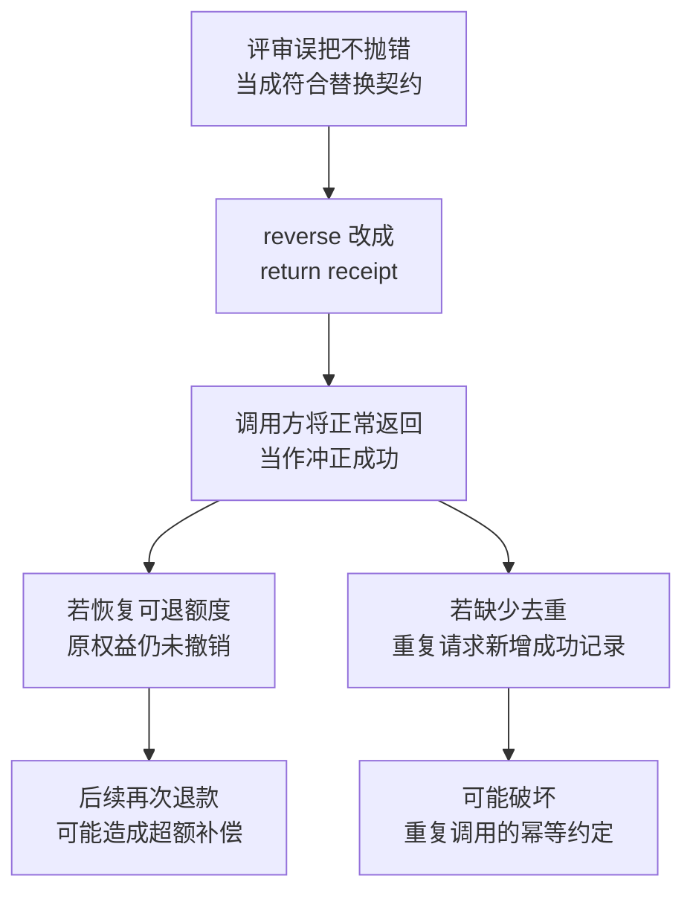
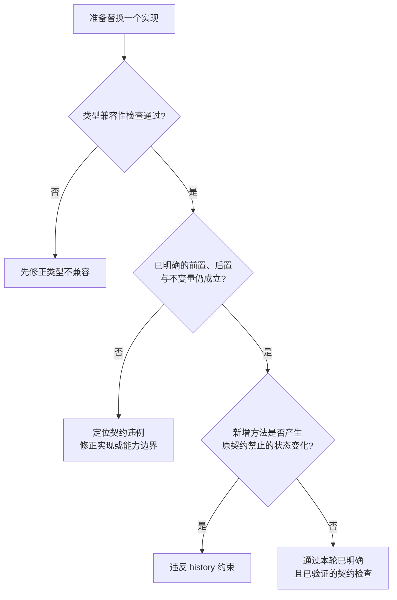

> 《编程思想》系列第 6/10 篇。这一季的立论在[序章](/zh/notes/programming-taste-in-the-agent-era/)。
>
> AI 能替我们写的代码越来越多，程序员自己攒下的经验和底层判断因此更值钱。这个系列是我把这些上了年纪的原则重新翻出来，一条条查它们的出处、边界和失效场景的记录。温故而知新。

这一篇讲里氏替换：子类必须能无缝顶替父类。凡是接受父类型的地方，换成子类型，程序必须还能保持调用方预期的行为。它为什么值得单独一篇？因为编译器只核对方法签名，而调用方依赖的是签名背后的行为——这道缝隙正是事故发生的地方。

## 一段通过类型检查的错误代码

先看一个不涉及任何业务的例子。`Rectangle` 是长方形，宽和高可以分别设置：

```ts
class Rectangle {
  protected width = 0
  protected height = 0

  setWidth(w: number): void {
    this.width = w
  }

  setHeight(h: number): void {
    this.height = h
  }

  area(): number {
    return this.width * this.height
  }
}
```

正方形是一种长方形，只是四条边必须相等。让它继承 `Rectangle`，在设置任何一条边时同步另一条边，看起来顺理成章：

```ts
class Square extends Rectangle {
  setWidth(w: number): void {
    this.width = w
    this.height = w
  }

  setHeight(h: number): void {
    this.width = h
    this.height = h
  }
}
```

再写一个使用它的函数。参数类型是 `Rectangle`，它先把宽设成 10，再把高设成 4，然后读取面积：

```ts
function stretch(rect: Rectangle): number {
  rect.setWidth(10)
  rect.setHeight(4)
  return rect.area()
}

stretch(new Rectangle()) // 40
stretch(new Square()) // 16
```

传入 `Rectangle` 得到 40，传入 `Square` 得到 16——第二次调用把高度设成 4 时，正方形把宽度一起改了。这段代码能通过最严格的类型检查：`Square` 确实是 `Rectangle` 的子类，`setWidth` 和 `setHeight` 的签名也完全一致。但调用方“先设宽、再设高，面积等于宽乘高”的推理，在换入子类之后不再成立。

**里氏替换原则（Liskov Substitution Principle，LSP）说的就是这件事：凡是接受父类型的地方，换成子类型，程序必须还能保持调用方预期的行为。**“无缝顶替”的标准高于方法签名对得上：调用方依据父类型作出的一切合理假设，换入子类之后都要依然成立。

换成更准确的说法：判断两个类型之间有没有子类型关系，靠的是拿调用方的程序来检验：用子类型的对象替换父类型的对象，程序的行为不能因此改变，类图上有没有继承线无关紧要。这条判断最早的表述见于 Barbara Liskov 1987 年的一次学术演讲，“原委与发展”一节会回到原文。

## 多态的前提是父类型的承诺

为什么需要这么一条原则？因为它守着面向对象中多态的命门。

多态（polymorphism）指调用方只写父类型，运行时传入哪个子类，就执行哪个子类的实现。`stretch` 的参数是 `Rectangle`，明天有人新写一个 `RoundedRectangle` 传进来，这个函数一行都不用改。这是继承体系送给调用方的核心便利，而它成立的前提是：**调用方对子类的全部了解，都来自父类型作出的承诺。**

承诺分两层。第一层是签名：方法叫什么名字、接受什么参数、返回什么类型。这一层编译器逐条核对。第二层是行为：调用之后对象的状态会怎么变、返回值满足什么规律、什么时候抛异常。`stretch` 依赖的“宽高可以独立设置”属于第二层。这两层承诺合起来，就是后文反复出现的“契约”（contract）。里氏替换管的正是契约的第二层——**换入另一个实现之后，调用方依据原契约作出的判断是否仍然成立。**

签名一致编译器能查，行为一致编译器查不了。一旦子类可以悄悄违反行为承诺，多态就开始退化：调用方不再相信参数类型，转而对每个实现做特判。

```ts
function stretchCarefully(rect: Rectangle): number {
  if (rect instanceof Square) {
    // 正方形没法分开设置宽高，只能按一条边处理
    rect.setWidth(4)
    return rect.area()
  }
  rect.setWidth(10)
  rect.setHeight(4)
  return rect.area()
}
```

每新增一个行为不合群的子类，这样的分支就可能多一个；“宽 10 高 4”这个本来的意图，在正方形上已经无法表达。调用方重新开始为每一个实现修改自己的代码——这正是[第 5 篇](/zh/notes/open-closed-only-the-guessed-axis/)讲的开闭原则想避免的局面：本想对扩展开放，结果每多一个实现，调用方就得跟着改一次。

### 真实系统里的版本

长方形和正方形是教学例子，错了只是返回值不对。这条原则在真实系统里缺席时，代价会直接落到资金账目上。

本系列用一个退款系统做贯穿案例（完整的来龙去脉在[第 5 篇](/zh/notes/open-closed-only-the-guessed-axis/)，本篇不依赖其细节）：系统按渠道处理退款，银行卡、钱包、线下转账和积分补偿各自实现同一个 `RefundChannel` 接口。“退款冲正”指撤销一笔已经发生的退款，要求真正撤销原操作的效果，并留下可追溯的反向记录。

问题出在有人把 `reverse`（冲正）方法加进了所有渠道共用的接口。上线第三个星期，财务在后台对一笔积分补偿执行冲正，页面等待两秒后显示 `UnsupportedOperationError`。调用方的代码是：

```ts
async function reverseRefund(r: Refund, reason: string): Promise<ChannelReceipt> {
  const channel = channels.get(r.channel)!
  return channel.reverse(r.receipt, reason)
}
```

这段代码通过了类型检查——`reverse` 在接口里声明过，返回类型也匹配。单元测试只覆盖了银行卡和钱包，没有跑过积分补偿；评审也没有识别出公共接口与渠道能力之间的缺口。积分补偿发放的是权益、不直接转出资金，它的实现没有“冲正”这个能力，于是只能抛异常。

调用方依据接口作出的判断——“实现了 `RefundChannel` 的渠道就能冲正”——在换入这个实现后不再成立。这就是正方形问题的工程版：签名对了，行为不对，只是这次出问题的落在资金流程上，返回值倒是正常的。

## 原委与发展：从 1987 年的讲台到 SOLID

这条原则的原始表述来自 Barbara Liskov。她在 1987 年的 OOPSLA 学术会议上做了主题演讲《Data Abstraction and Hierarchy》，替换性质是其中一个论点。我下载原文读过：它位于论文第 3.3 节、印刷页第 25 页。[1]

用原文的符号转述：对于类型 S 的每个对象 o1，如果总能找到超类型 T 的一个对象 o2，使得所有按 T 定义的程序在用 o1 替换 o2 之后保持相应行为，那么 S 可以作为 T 的子类型。注意替换的方向——用子类型（S）的对象替换父类型（T）的对象，检验的却是按父类型写下的调用方程序。

Liskov 在同一节区分了行为上的子类型关系和语言提供的子类关系。继承（`extends`）是实现子类型的一种手段，但一个类写了 `extends`，并不足以说明它在行为上可替换；通过接口实现多态，同样需要这项检查。她用的例子是集合与列表、栈与队列：集合不保留重复元素，列表保留；栈后进先出，队列先进先出。调用方若依赖这些规律，就不能仅凭同名的添加、移除方法把它们互换。[1]

1987 年的表述给了判断方向，但“保持相应行为”还是一句话，没法逐条核对。1994 年，Liskov 和 Jeannette Wing 发表《A Behavioral Notion of Subtyping》，把它形式化为行为子类型（behavioral subtyping）：一套可以逐条检查的规则。[2] 这套思路与 Meyer 在《Object-Oriented Software Construction》中提出的契约式设计（design by contract）相互呼应——把方法调用看作订立契约：调用方答应满足前置条件，实现答应兑现后置条件。[5]

工程上通常把“行为兼容”拆成四类约束：

| 条款 | 通俗解释 | 出处 |
|---|---|---|
| 前置条件 | 父类接受的输入，子类不能额外设卡拒绝 | 契约式设计与行为子类型中的方法规则 |
| 后置条件 | 父类承诺兑现的结果，子类不能打折 | 契约式设计与行为子类型中的方法规则 |
| 不变量 | 父类对可观察状态的约束，子类必须保持 | 契约式设计；Liskov 与 Wing 的形式化研究 |
| history 约束 | 子类新增的方法，也不能做出父类禁止的状态变化 | Liskov 与 Wing 对行为子类型的研究 |

四条相互关联，同一个错误可能同时破坏后置条件和不变量。用正方形过一遍：`setWidth` 在父类里的承诺是“只改变宽度”（后置条件），`Square` 的实现连高度一起改了，“宽高独立”这条不变量随之失效。最抽象的是 history 约束——它要配合“别名”现象才能讲清，第四个模糊地带会专门展开。

1996 年，Robert C. Martin 在《C++ Report》上撰文，以“里氏替换原则”为题把这条性质写成文章。它后来成为 SOLID 五原则中的 L。Martin 的表述同样从客户端出发：子类型必须能替换它们的基类型，而不改变程序的正确性；他讨论的例子里恰好就有长方形与正方形——本篇开头的代码正是按他的场景改写的。[4]

由此也看得见一个流传极广的误读：把里氏替换当成“子类的方法签名要和父类一致”。签名一致是编译器已经会查的事，拿它当 LSP 的全部，等于宣布这条原则没有存在的必要。从 1987 到 1996，这条原则讲的一直是行为：调用方的合理预期，在替换之后是否仍然成立。

## 四个模糊地带

到这里，原则的骨架已经完整：是什么、为什么、四类约束。但拿它判断真实代码时，费脑子的是约束边界上的模糊地带，这几句话本身倒不难。下面四个问题，每一个都在真实的代码评审里反复出现过。

### 正方形能不能继承长方形

看了开头的例子，第一反应通常是“不能”。但 Martin 给过更细的答案：模型是否有效，要放到客户端的使用方式中判断。[4]

如果调用方只读不写——构造之后只调 `area()` 和 `getWidth()`——正方形就是一个完全合格的长方形：四边相等的长方形仍是长方形，“面积等于宽乘高”对它同样成立。问题出在可变性上：`setWidth` 和 `setHeight` 暗含“两条边可以独立变化”的承诺，而正方形做不到。违反 LSP 的是“在可变的长方形接口上实现正方形”这个设计，“正方形是长方形”这个分类本身没有错。

佐证是把可变性拿掉。不可变的正方形继承不可变的长方形，毫无问题：

```ts
class ImmutableRectangle {
  constructor(readonly width: number, readonly height: number) {}

  area(): number {
    return this.width * this.height
  }
}

class ImmutableSquare extends ImmutableRectangle {
  constructor(side: number) {
    super(side, side)
  }
}
```

构造完成后没有任何方法能修改状态，“宽高独立变化”的承诺不存在，自然无从违反。同一个“是一种”的分类，在不可变的世界里无害，在可变的世界里违约。**判断的依据始终是调用方依赖的行为承诺，不是概念上的分类学。**这也是里氏替换最反直觉的地方：它看起来在讲类型关系，实际在讲调用方的依赖。

### 抛异常算不算违约，取决于契约承诺了什么

积分补偿的 `reverse` 抛 `UnsupportedOperationError`，这个写法在真实世界里大量存在，最著名的例子在 JDK 里：`Collections.unmodifiableList` 返回的只读列表，调用 `add` 会抛 `UnsupportedOperationException`。它是讨论 LSP 时最常被搬出来的真实违例。[8]

“抛异常算不算违反里氏替换”没有脱离契约的答案：

- 如果 `RefundChannel.reverse` 的契约是“所有实现都能执行冲正”，那么积分补偿抛异常就是违约；
- 如果契约写明“允许部分实现不支持此操作，调用方需要处理该异常”，那么抛异常就是履约——调用方的合理预期里本来就包含“可能不支持”。

问题不出在抛异常这个动作，而出在接口把能力差异藏进了同一个签名：调用方从类型上无从分辨哪个实现会抛、哪个不会。这个信息缺口要到“把能检查的契约落进代码”一节才补上。

这里要警惕一个更危险的修法。评审会上常见的提议是：既然抛错让调用方意外，那就改成返回原样的回执——积分补偿反正不产生资金流动：

```ts
class CreditChannel implements RefundChannel {
  async reverse(receipt: ChannelReceipt): Promise<ChannelReceipt> {
    return receipt
  }
}
```

这段代码没有撤销任何权益，也没有创建反向记录，只是让方法正常返回。调用方把“正常返回”当作“冲正成功”，失败就从页面上可见的两秒报错，变成账目里不可见的数据错误。抛异常至少诚实地报告了“我做不到”；**假装成功比承认失败更严重地违反 LSP**，因为调用方对“正常返回”的依赖，比对“可能抛错”的依赖深得多。

两条风险路径如下图。每条路径都需要相应的调用方行为或校验缺失才会发生，不能只由 `return receipt` 推出全部结果：



第一条路径中，调用方恢复了可退额度，而用户仍持有原有权益；如果后续再次退款，就可能造成超过订单应有范围的补偿。第二条路径还要求冲正记录没有按同一请求去重，重复调用才会新增多条成功记录。额度与幂等检查本来都应当阻断这些风险。

修正方案需要兑现冲正的实际语义。一个明确允许返回“不支持”的契约，可以合法地拒绝某些操作；承诺了所有合格请求都能冲正的契约，实现就不能一律拒绝。原样返回回执，代替不了真正的成功。

### 编译器能查一部分，查不了的部分要自己守

四类约束里，有些编译器能查，有些永远查不了。值得知道边界在哪，既不高估工具，也不浪费工具。

我原本以为开启 `strict` 已足以拦住“子类给输入加门槛”的问题。对方法语法和函数属性语法做对比后，发现它们有一个需要单独注意的区别。以下在 TypeScript 7.0.2、`strict: true` 下验证；示例补全了回执字段，让编译结果只反映参数兼容性。

```ts
interface RefundRequest {
  amount: Money
}

interface TransferRefundRequest extends RefundRequest {
  bankAccount: string
}

interface RefundChannel {
  submit(req: RefundRequest): Promise<ChannelReceipt>
}

class TransferChannel implements RefundChannel {
  async submit(req: TransferRefundRequest): Promise<ChannelReceipt> {
    return {
      id: req.bankAccount,
      status: 'pending',
      settledAt: null,
      amount: req.amount,
    }
  }
}
```

`TransferRefundRequest` 比公共请求多要求一个 `bankAccount` 字段，只带金额的请求满足不了它，但这个方法实现照样通过检查。把接口成员改成函数属性后，同样的参数收窄会被拒绝：

```ts
interface RefundChannelFn {
  submit: (req: RefundRequest) => Promise<ChannelReceipt>
}

const transfer: RefundChannelFn = {
  async submit(req: TransferRefundRequest): Promise<ChannelReceipt> {
    return {
      id: req.bankAccount,
      status: 'pending',
      settledAt: null,
      amount: req.amount,
    }
  },
}
// TS2322: 参数类型不兼容
```

TypeScript 的发布说明把这一差异描述为方法与构造器声明在严格函数参数检查中的例外，并说明其与泛型容器兼容性的关系。[6] 它限定了这项静态检查的能力，不代表所有参数错误都会被放过。

更广泛的行为兼容性，无法交给通用检查器完整判定。要求通用工具判断任意方法是否必然终止，会撞上不可判定性问题。[7] 但具体的字段关系、部分输入约束、选定的操作序列，都可以通过类型或自动化检查获得保障。讨论工具能力时，要说清它证明了哪一部分、哪些仍未覆盖。

### 没写下来的契约，同样是契约

前面几个例子，契约多少还看得见：接口签名、抛出的异常。真实系统里大量契约没有落成任何签名，只存在于调用方的假设中。它们最难查，也最容易在新实现里碎掉。

**字段之间的关系不进类型。** 提交退款返回的回执，契约规定：已结算的回执必须有结算时间，待处理的回执结算时间为 `null`。接口定义却允许两个字段自由组合：

```ts
type Money = number

interface ChannelReceipt {
  id: string
  status: 'settled' | 'pending'
  settledAt: Date | null
  amount: Money
}
```

线下转账生成付款指令后还要等人工审批，如果此时返回 `status: 'settled'` 而 `settledAt: null`——两个字段单独看都合法，组合起来已经违约。调用方的下游代码可能这么写：

```ts
const receipt = await channel.submit(req)
if (receipt.status === 'settled') await ledger.settle(refund.id, receipt.settledAt!)
```

那个 `!` 是非空断言：它关掉这一处的类型警告，但不会在运行时补上日期，账本函数仍可能收到 `null`，进而校验失败或错误地记录结算。能够确认的是，渠道没有兑现回执保证，调用方依据结算状态作出的推理失去了可靠依据。

**输入门槛不进类型。** 假定提交接口的契约接受所有通过校验的正金额请求。线下转账要人工审批，低金额本应走另一条流程，实现却直接加了 100 元的最低金额（`Money` 用整数分表示，`10000` 即 100 元）：

```ts
async submit(req: RefundRequest): Promise<ChannelReceipt> {
  if (req.amount < 10000) throw new BelowApprovalThresholdError(req.amount)
  // 其余提交逻辑省略
}
```

一笔符合原契约的 50 元请求在这里被拒绝。普通的 `number` 类型不描述这项业务门槛；检查方法名和参数类型，发现不了调用方与实现对“合法金额”的理解差异。

**跨请求的约束不在对象里。** 系统还要保证累计退款不超过订单实付。后来接入的礼品卡渠道若省去本系统的额度检查、只信“网关会挡住不合法的交易”，就留下缺口：网关验证的是它自己的账户规则，不知道这张订单在其他渠道已经退过多少。这类约束跨请求、跨渠道存在，回执字段的类型证明不了它。

**新增方法可能破坏历史约定。** 本例还约定退款阶段记录只能追加，冲正通过新的反向记录表达。银行卡异步回调可能乱序，实现于是增加了一个删除末尾阶段的补救方法：

```ts
class CardChannel implements RefundChannel {
  // 接口上没有这个方法
  rollbackLastStage(refund: Refund): void {
    refund.stages.pop()
  }
}

const card = new CardChannel(/* … */)
const asChannel: RefundChannel = card // 同一个对象，两个类型视角

card.rollbackLastStage(refund)
asChannel.stagesOf(refund.id) // 公共接口上的读取方法（前文未列出），读到删除后的历史
```

`card` 能调用实现额外提供的方法，`asChannel` 只能用公共接口，但两者操作的是同一个对象和同一份关联状态。删除发生后，只使用公共接口的代码也会看到阶段变少。这就是 history 约束配合“别名”（aliasing，两个变量引用同一个对象）时的样子，JavaScript 和 TypeScript 里这种共享引用随处可见。[2][3]

判断依据是可观察的历史是否仍符合契约，不能简化成“新增方法一旦修改状态就违规”——原契约允许的修改仍然可以进行。

## 继承的处境：多用组合，少用继承

读到这里的编程新人多半会冒出一个问题：继承这么容易闯祸，今天的代码还该用它吗？

这个直觉不算离谱。“组合优于继承”（composition over inheritance）也不是新潮观点：1994 年的《设计模式》就把它写进了开篇的设计原则——优先使用对象组合，而不是类继承。[9] 继承的毛病也不止违反里氏替换一条：

- 脆弱基类（fragile base class）：子类的正确性不掌握在自己手里：父类哪天改了 `setWidth` 的内部实现，所有子类跟着遭殃，而且挨炸的位置和父类改动相隔很远。
- 继承是白盒复用：想正确覆写一个方法，往往得先读懂父类的实现——正方形之所以违约，正是因为它必须知道改一条边会影响什么。父类的实现细节本不该是子类的必读材料。
- 继承在编译期定死：一个对象生下来是什么类就是什么类；组合可以在运行期换掉某个零件，下文的能力接口注册表正是这么做的。

看看今天的代码库：前端框架用组合拼组件，后端框架让你从外部注入服务，测试里用组合替换依赖。本文退款系统的修正方案也是同一路数——调用方依赖 `RefundChannel` 这个抽象，具体渠道从注册表传入。把依赖的对象从外部交进来、而不是在函数里自己 `new`，这个做法叫依赖注入（dependency injection）；第 7 篇的依赖倒置会把这条思路展开讲。

不过继承并没有被判死刑。真正的“是一种”关系、契约又稳定的场景，它仍然好用：自定义的 `Error` 子类、测试夹具的公共基类都是正当用法。更要紧的是，里氏替换从来不只管 `extends`——实现一个接口、TypeScript 的结构化类型（只要形状对得上就能赋值），同样要守这条原则。判据始终是那一句：调用方依据契约作出的判断，换入你的实现之后，是否仍然成立。

## 把能检查的契约落进代码

模糊地带走完，方向也清楚了：能进类型的进类型，进不了类型的写成明确契约，并让自动化检查盯着。

### 用类型表达回执状态之间的关系

把 `ChannelReceipt` 改成可辨识联合，让已结算和待处理分别拥有合适的字段：

```ts
type ChannelReceipt =
  | { status: 'settled'; id: string; settledAt: Date; amount: Money }
  | { status: 'pending'; id: string; amount: Money }
```

严格模式下，按这个定义构造“已结算但结算时间为 `null`”的对象会直接报错；调用方判断 `status === 'settled'` 之后，拿到的 `settledAt` 天然是 `Date`，不需要非空断言。外部输入仍需运行时验证——`any`、不安全的断言或未校验的外部数据都能绕开静态保证。

### 用能力接口表达哪些渠道支持冲正

保留只要求提交能力的公共接口，让支持冲正的渠道单独实现能力接口，注册表只列出真正支持冲正的实现：

```ts
interface RefundChannel {
  readonly kind: ChannelKind
  submit(req: RefundRequest): Promise<ChannelReceipt>
}

interface ReversibleChannel extends RefundChannel {
  reverse(receipt: ChannelReceipt, reason: string): Promise<ChannelReceipt>
}

const reversible = new Map<ChannelKind, ReversibleChannel>([
  ['card', new CardChannel(cardGateway)],
  ['wallet', new WalletChannel(ledger)],
])
```

“哪些渠道支持冲正”从异常里挪进了类型，调用方不用再猜哪个实现会抛。动态查表仍可能找不到实现，所以运行时检查不能省；业务上明确不支持、与本应支持却漏了配置，也要区分开。这与[第 5 篇](/zh/notes/open-closed-only-the-guessed-axis/)的方案一致：先确认渠道应当具备哪些能力，再连接对应实现。

### 让不同实现跑同一组契约检查

类型表达不了的规则，写在接口旁边，落实到实现校验与测试。各渠道使用同一份契约检查要求，按各自能力准备输入和环境：符合公共金额条件的请求是否被额外拒绝；成功回执是否符合状态约定；额度检查能否阻止超退；同一冲正请求重复执行是否符合幂等约定；实现额外提供的方法是否会删除承诺保留的历史。

检查要包含原先漏测的积分补偿和线下转账路径。明确不支持冲正的渠道验证其拒绝行为，承诺支持的渠道验证实际撤销效果与反向记录。这些测试通过，只说明已覆盖的场景符合预期，不能证明所有输入和操作序列都满足里氏替换。

## 评审一个实现能否替换，我检查四个问题

评审一个新的渠道实现时，我先找到调用方依赖的契约，再沿四个问题检查。契约尚不明确时，需要先厘清已有调用方与业务需求——不能把“没有写下来”理解成“没有任何承诺”。

- 原契约接受哪些输入？实现是否额外要求了金额门槛、字段或调用顺序？
- 满足前置条件后，调用方可以依赖哪些结果？实现是否兑现了结算状态、时间和金额的约定？
- 对象或业务系统有哪些必须保持的状态约束？通过其他渠道或并发请求，是否可能绕过它们？
- 实现新增了哪些操作？这些操作是否会产生原契约禁止的可观察状态变化？

图中的三个判断依次关注类型兼容性、已明确的状态与方法契约、历史约束：



这张图用于组织评审，不是能自动证明所有行为的判定算法。图中每个“通过”都应有对应的契约和验证依据；尚未验证的部分应当保留为限制。

## 我改了什么判断

我以前把里氏替换当成关于继承的规矩，检查子类有没有改掉父类的方法语义，接口旁边却没有留下明确的约定。读过原文之后，我会先看调用方依据这个类型作出了什么判断，再检查另一个实现能否维持这些判断。

落到本文的例子：正方形与长方形教会我先问调用方依赖什么行为，而不只是看类图；退款系统则意味着把回执状态关系写进类型，把冲正能力与普通提交能力分开，并为各个实现运行同一组契约检查。遇到不支持的业务操作时，需要明确表达限制；遇到承诺支持却没有完成的操作时，需要修复实现。让方法“不再报错”，无法独自回答这两个问题。

下一篇讨论依赖倒置。这里先留下一个具体问题：`ReversibleChannel` 应当由谁定义，才能准确表达调用方需要的能力，而不是把某个渠道当前的实现细节变成所有调用方都要接受的约束？

## 参考资料

1. [Barbara Liskov, “Keynote address — Data Abstraction and Hierarchy”, OOPSLA '87 Addendum, ACM SIGPLAN Notices 23(5), 1988, 17–34](https://www.cs.tufts.edu/~nr/cs257/archive/barbara-liskov/data-abstraction-and-hierarchy.pdf) —— 替换性质 [S] 位于第 3.3 节、印刷页第 25 页（PDF 第 9 页）；该节区分行为子类型与语言中的子类，并讨论允许异常的规范。
2. [Barbara Liskov, Jeannette Wing, “A Behavioral Notion of Subtyping”, ACM TOPLAS 16(6), 1994, 1811–1841](https://dl.acm.org/doi/10.1145/197320.197383) —— 方法规则、不变量和历史约束；可读取 [作者所在学校保存的 PDF](https://www.cs.cmu.edu/~wing/publications/LiskovWing94.pdf)。相关工作有先行技术报告，不将所有规则的出现时间简化为 1994 年。
3. [Gary T. Leavens, Krishna K. Dhara, “Concepts of Behavioral Subtyping”, in *Foundations of Component-Based Systems*, Cambridge University Press, 2000](https://www.eecs.ucf.edu/~leavens/FoCBS-book/06-leavens-dhara.pdf) —— 比较行为子类型定义及对别名、可变状态的处理。
4. [Robert C. Martin, “The Liskov Substitution Principle”, *C++ Report*, March 1996](https://objectmentor.com/resources/articles/lsp.pdf) —— 从客户端解释模型的有效性，并讨论前置、后置条件以及 LSP 与 OCP 的联系。
5. [Bertrand Meyer, *Object-Oriented Software Construction*, Prentice Hall, 1988](https://dl.acm.org/doi/book/10.5555/534431) —— 契约式设计的历史出处；本次未直接核对原书，各规则的本文表述参照上述论文与综述。
6. [TypeScript 2.6 发布说明：strict function types](https://www.typescriptlang.org/docs/handbook/release-notes/typescript-2-6.html) —— 方法与构造器声明的检查例外。本文代码另在 TypeScript 7.0.2 下验证。
7. [Liskov substitution principle — Wikipedia](https://en.wikipedia.org/wiki/Liskov_substitution_principle) —— 一般不可判定性及终止性例子的辅助说明，不作为历史来源或“无法自动检查任何契约”的依据。
8. [Java SE API — Collections.unmodifiableList](https://docs.oracle.com/en/java/javase/21/docs/api/java.base/java/util/Collections.html#unmodifiableList(java.util.List)) —— 只读视图的修改方法抛 `UnsupportedOperationException` 的文档出处；“LSP 违例”的定性是社区讨论的常见说法，不是 JDK 自己的说法。
9. [Erich Gamma, Richard Helm, Ralph Johnson, John Vlissides, *Design Patterns: Elements of Reusable Object-Oriented Software*, Addison-Wesley, 1994](https://dl.acm.org/doi/book/10.5555/186897) —— “优先使用对象组合”位于引言章的设计原则清单；本次未逐页核对页码，原则表述以引言章原文为准。
