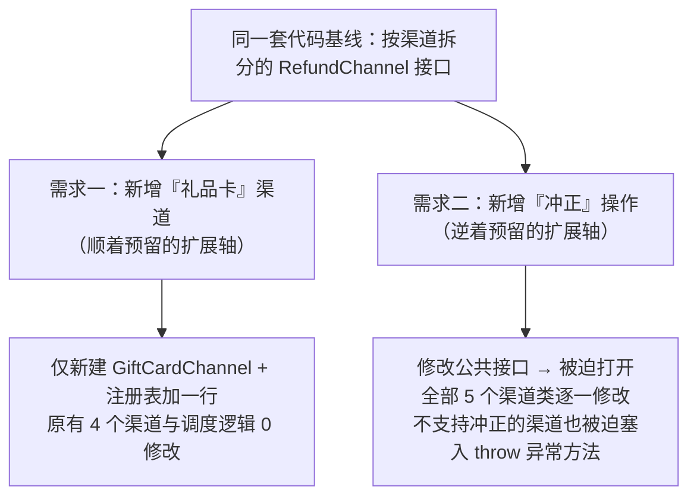
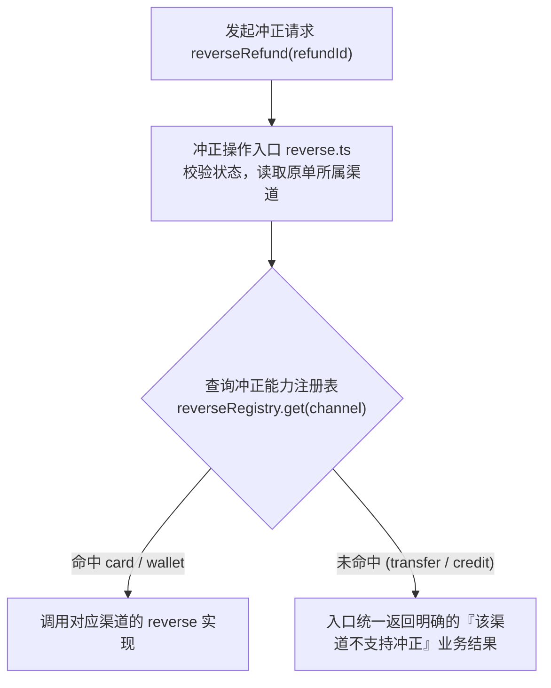

> 《编程思想》系列第 5/10 篇。这一季的立论在[序章](/zh/notes/programming-taste-in-the-agent-era/)。
>
> 代码越是容易生成，人对代码好坏的判断力就越值钱。这个系列是我把那些上了年纪的设计原则重新翻出来，逐条查清它们的出处、适用边界与失效场景的笔记。

**开闭原则（Open-Closed Principle，OCP）**大概是软件工程里听起来最美好的一句口号：“软件实体应该对扩展开放，对修改封闭。”

字面意思很诱人：以后每当产品经理提新需求，我们只需要新建一个文件写新代码（对扩展开放），原有的老代码一行都不用动（对修改封闭）。既不会改出回归 Bug，又不用重跑老模块的测试。

但只要你在真实项目里试着追求过这种“绝对不改老代码”的境界，就会发现一个残酷的现实：**同一套设计，面对 A 类新需求时确实如丝般顺滑，可一旦碰上 B 类新需求，瞬间就会变成一场要改遍全系统的灾难。**

为什么会这样？因为“对扩展开放、对修改封闭”这句话被省掉了一个最关键的前提：**它永远只对你在设计时押中的那一条变化方向成立**。

用大白话讲开闭原则的精髓：**没有任何代码能对所有变化都封闭；你把代码的大门朝东开，往东走的新需求就能直接进门，而往北走的新需求就只能拆墙。所以用开闭原则之前，第一步永远是先判断代码接下来最可能往哪个方向变。**

我们直接拿退款子系统里的两次真实需求变更来算这笔账。

---

## 同一份设计，为什么接新渠道很顺、加新操作却很痛？

在[第 2 篇（内聚）](/zh/notes/what-belongs-in-one-module/)里，为了消除那个塞满 `switch (channel)` 的大泥球，我们按退款渠道把代码拆成了四个独立的类（银行卡 `CardChannel`、钱包 `WalletChannel`、线下转账 `TransferChannel`、积分补偿 `CreditChannel`），统一实现 `RefundChannel` 接口：

```ts
// 公共渠道接口
export interface RefundChannel {
  readonly kind: ChannelKind
  submit(req: RefundRequest): Promise<ChannelReceipt>
}

// 渠道注册表
const channels = new Map<ChannelKind, RefundChannel>([
  ['card', new CardChannel(cardGateway)],
  ['wallet', new WalletChannel(walletLedger)],
  ['transfer', new TransferChannel(approvalWorkflow)],
  ['credit', new CreditChannel(couponService)],
])

// 退款提交流程（高层调用方）
export async function submitRefund(req: RefundRequest): Promise<ChannelReceipt> {
  const channel = channels.get(req.channel)
  if (!channel) throw new UnknownChannelError(req.channel)
  return channel.submit(req)
}
```

这套结构上线跑了三个月，产品经理在同一个迭代里提了两个新需求：

1. **需求一（新增一种渠道）**：接入“礼品卡（GiftCard）”退款渠道；
2. **需求二（新增一种操作）**：为现有的退款渠道增加“冲正（Reverse）”操作。

我们来看看这套代码面对这两个需求时的表现差了多少。

### 场景一：顺着预设方向长——新增“礼品卡”渠道

接入礼品卡渠道轻松得像搭积木：

1. 新建一个文件 `gift-card-channel.ts`，写一个 `GiftCardChannel implements RefundChannel`；
2. 在 `ChannelKind` 类型和 `channels` 注册表里加一行 `'giftcard'`。

整个过程只花了半天。最关键的是：**原有的 `submitRefund` 调度函数，以及银行卡、钱包、转账、积分那四个老渠道的代码，一行都没有碰！** 这就是教科书里标准的“对扩展开放，对修改封闭”。

### 场景二：逆着预设方向长——给渠道增加“冲正”操作

紧接着我们开始做第二个需求：增加“冲正”操作。

照着刚才面向对象接口的路子，最直接的想法就是在 `RefundChannel` 接口上加一个 `reverse` 方法：

```ts
export interface RefundChannel {
  readonly kind: ChannelKind
  submit(req: RefundRequest): Promise<ChannelReceipt>
  // 新增的操作
  reverse(receipt: ChannelReceipt, reason: string): Promise<ChannelReceipt>
}
```

刚把这一行保存，TypeScript 编译器立刻在全项目报出了五处红线：**所有实现了 `RefundChannel` 的四个老渠道类（外加刚写的礼品卡类），全部编译失败！**

你不得不挨个打开每一个老渠道的文件去补写 `reverse` 方法。更尴尬的是：在业务上，只有“银行卡”和“钱包”支持自动冲正，“线下转账”和“积分补偿”压根不支持冲正！但因为接口逼着每个类都得交作业，你只能在不该改动的 `CreditChannel` 里硬塞一段抛异常的废话：

```ts
// 被迫在积分补偿渠道里补写的废方法
async reverse(): Promise<ChannelReceipt> {
  throw new UnsupportedOperationError('credit channel does not support reversal')
}
```

把两次需求的改动范围放在一张图里对比，反差非常强烈：



为什么同一套“符合设计原则”的代码，接礼品卡时是模范生，接冲正操作时却全线破防？

---

## 一张二维表看懂本质：行扩展与列扩展的天然张力

要彻底想通这件事，只需要把我们的退款系统画成一张二维表格：

- **每一行（Row）代表一种渠道**（数据变体）；
- **每一列（Column）代表一种操作**（行为函数）。

| 渠道 \ 操作 | 提交退款（`submit`） | 发起冲正（`reverse`） | 查询进度（`stagesOf`） |
|---|---|---|---|
| **银行卡（Card）** | 银行卡提交逻辑 | 银行卡冲正逻辑 | 银行卡进度查询 |
| **钱包（Wallet）** | 钱包提交逻辑 | 钱包冲正逻辑 | 钱包进度查询 |
| **线下转账（Transfer）** | 转账工单逻辑 | *不支持* | 转账审批进度 |
| **积分补偿（Credit）** | 发券逻辑 | *不支持* | 券核销状态 |

现在看我们写代码的两种基本组织方式，其实就是**按行切**还是**按列切**的选择：

### 切法 A：按“行”组织代码（面向对象多态接口）

每个渠道建一个类（`CardChannel`、`WalletChannel`……），把这个渠道所有的操作（`submit`、`reverse`、`stagesOf`）全都装进这一个类里。

- **加一行（新增礼品卡渠道）极省事**：直接新建一个 `GiftCardChannel` 类，把这一行的格子填满就行，完全不碰上面四行；
- **加一列（新增 `reverse` 操作）极痛苦**：因为新的一列纵向切穿了所有行，你必须打开现有的每一个渠道类，挨个往里面塞新方法。

### 切法 B：按“列”组织代码（可辨识联合类型 + 独立操作函数）

如果我们反过来，按“列”来写代码呢？把渠道定义成纯数据的可辨识联合类型（Discriminated Union），每一种操作单独写一个函数文件（`submit.ts`、`reverse.ts`）：

```ts
// 纯数据变体：定义有哪些渠道
export type RefundRecord =
  | { kind: 'card'; chargeId: string; settledAt: Date }
  | { kind: 'wallet'; entryId: string }
  | { kind: 'transfer'; ticketId: string }
  | { kind: 'credit'; couponId: string }

// 按列组织：reverse.ts 集中处理所有渠道的冲正分派
export async function reverseRefund(record: RefundRecord, reason: string): Promise<ChannelReceipt> {
  switch (record.kind) {
    case 'card':
      return cardGateway.reverse(record.chargeId, reason)
    case 'wallet':
      return walletLedger.reverse(record.entryId, reason)
    case 'transfer':
    case 'credit':
      throw new UnsupportedOperationError(record.kind)
    default:
      // 穷尽性检查：如果未来新增了渠道却漏写了分支，编译器在此报错
      const _exhaustiveCheck: never = record
      return _exhaustiveCheck
  }
}
```

看看换成“按列切”之后，命运是怎么反转的：

- **加一列（新增 `reverseRefund` 操作）极省事**：直接新建一个 `reverse.ts` 文件，把四个渠道怎么响应冲正写在这个函数里，原有的 `submit.ts` 连看都不用看一眼！
- **加一行（新增礼品卡渠道）极痛苦**：一旦往 `RefundRecord` 联合类型里加上 `| { kind: 'giftcard' }`，全项目所有写了 `switch (record.kind)` 的操作函数（`submit.ts`、`reverse.ts`、`stages.ts`……）全都会在 `_exhaustiveCheck: never` 处编译报错，逼着你挨个文件去补 `case 'giftcard'` 分支。

| 代码组织方式 | 新增一种渠道（加一行） | 新增一种操作（加一列） | 适合的业务演进特征 |
|---|---|---|---|
| **按渠道建类（按行切）** | **对扩展开放**（只新建一个渠道类） | **需修改所有类**（改接口并动遍 N 个实现） | 动作固定，但经常接入新支付渠道/新供应商 |
| **按操作写函数（按列切）** | **需修改所有函数**（动遍 M 个操作里的 `switch`） | **对扩展开放**（只新建一个操作函数文件） | 渠道固定（就那三四种），但经常新增业务动作与报表玩法 |

计算机科学家 Philip Wadler 在 1998 年给这种两难起了一个著名的名字：**表达式问题（The Expression Problem）**[4]。

它揭示了一个朴素的工程真相：**基础的代码组织方式就像一张毛毯，你横着盖住了“新增渠道”，脚底下的“新增操作”就会露出来；你竖着盖住了“新增操作”，旁边的“新增渠道”就会露出来。**

---

## 查回 1988 与 1996 年的源头：从“继承扩展”到“战略性封闭”

既然不存在全方位的免修改扩展，那当年提出开闭原则的人是怎么说的？

查回历史文献，开闭原则其实经历过两代截然不同的含义：

1. **1988 年 Bertrand Meyer 的第一代版本（靠实现继承扩展）**[1]：
   Meyer 在《Object-Oriented Software Construction》里提出“开闭原则”时，解决的是当年编译型语言发布静态库的痛点。他的意思是：一个类编译进库交付之后就是“封闭”的，不能再改源码；如果别人想加字段或改行为，就写一个子类去 `extends` 这个具体类（“开放”）。
2. **1996 年 Robert C. Martin 的第二代版本（靠抽象接口与多态替换扩展）**[2]：
   到了九十年代，大家发现随便继承具体父类很容易搞崩系统（我们在第 6 篇和第 10 篇会详细拆解）。于是 Martin 重写了开闭原则的内涵：在调用方和实现之间立一层抽象接口，固定住接口（对修改封闭），通过替换接口后面的不同实现类来扩展行为（对扩展开放）。

更重要的是，Martin 在 1996 年那篇论文的第 6 页专门写了一节，标题就叫 **《战略性封闭（Strategic Closure）》**[3]，原话非常清醒：

> “应该说清楚的是，没有任何有意义的程序能够做到 100% 封闭……既然封闭不可能完全彻底，就必须有策略地去封闭（Strategic）。设计师必须挑选出他决定要对其封闭的那些变化种类，猜出最有可能发生的那类变化，然后构造抽象来隔绝那类变化。”[3]

遗憾的是，这段最关键的“战略性放弃与猜测”在后来的教材传抄里被删光了，只剩下了前半句听起来像永动机一样的“对扩展开放，对修改封闭”。

---

## 走进模糊地带：三个最常见的工程纠结

弄明白了开闭原则是一场“押注变化方向的赌局”，我们再来看日常写代码时最常遇到的三个现实问题。

### 纠结一：如果我的系统既要经常加渠道、又要经常加操作，怎么办？

当系统度过了早期阶段，确实可能遇到“渠道在涨，操作也在涨”的局面。而且像前面的例子那样，并非所有渠道都支持所有操作（比如积分补偿不支持冲正）。

这时候，我们可以把“按行切”和“按列切”组合起来，采用**独立渠道适配器 + 独立操作入口 + 按能力注册表（Capability Registry）**的架构（这也是第 6 篇里氏替换会继续沿用的方案）：

```ts
// 1. 基础提交接口与可选的冲正能力接口分开
export interface SubmittableChannel {
  submit(req: RefundRequest): Promise<ChannelReceipt>
}

export interface ReversibleChannel {
  reverse(receipt: SettledReceipt, reason: string): Promise<ReversalReceipt>
}

// 2. 各自的注册表只登记真正具备该能力的渠道
const submitRegistry = new Map<ChannelKind, SubmittableChannel>([
  ['card', cardAdapter],
  ['wallet', walletAdapter],
  ['transfer', transferAdapter],
  ['credit', creditAdapter],
])

const reverseRegistry = new Map<ChannelKind, ReversibleChannel>([
  ['card', cardAdapter],
  ['wallet', walletAdapter],
  // transfer 和 credit 压根不进这张表，无需编写抛异常的假方法
])
```



这样一来：

- 新增“冲正”操作时，`TransferChannel` 和 `CreditChannel` 根本不用打开修改，也不用塞报错方法；
- 新增“礼品卡”渠道时，先实现 `SubmittableChannel` 注册进提交表即可；等下个月礼品卡也支持冲正了，再给它加上 `ReversibleChannel` 实现并登记进冲正表。

### 纠结二：是不是为了符合开闭原则，写第一版代码时就要把所有接口和扩展点全留好？

在 AI 时代，让 Agent 提前给你预留十个策略接口、八个插件钩子不费吹灰之力。但这往往是一场灾难。

**预留扩展点是有维护税的。** 每多一层抽象接口，读代码的人就多一层跳转。更糟糕的是，如果你在写第一版代码时**押错了变化方向**——比如你大费周章按“渠道多态”搭好了架子，结果上线后三年里一个新渠道都没接，反而是每个月都在加新操作——那你提前修好的那座抽象防御工事，不仅没挡住敌人，反而成了你自己每次改代码时都得翻过去的绊脚石。

Martin 在《敏捷软件开发》里给过一条非常务实的建议：**不要替虚构的未来提前买单；先用最简单直接的代码把功能写出来，密切盯住第一次真正发生的需求变化（或者产品路线图里已经板上钉钉的接入计划），再顺着那个真实的变化方向提取抽象**[5]。

### 纠结三：“对修改封闭”是不是意味着改一行老文件就算破戒？

有些团队把“不改已有文件”当成了教条。

哪怕在最理想的扩展设计里，当你新增一个 `GiftCardChannel` 时，你也至少得去修改 `ChannelKind` 类型声明和 `composition.ts` 装配注册表。为了连这一行注册代码都不改，有人会引入复杂的运行时类扫描、装饰器反射甚至动态脚本加载——结果为了省掉改一行配置，换来了编译期类型检查失明和启动报错。

Martin 在 2013 年专门写文章澄清过：**开闭原则的目的是防止“牵一发而动全身的连锁修改”，而不是禁止人类打开旧文件**[6]。在装配入口（Composition Root）里加一行清晰、受类型检查保护的注册代码，完全是健康且正常的修改。

---

## 小结：运用开闭原则的三个步骤

下次当你准备设计一个模块或引入一层扩展接口时，按下面三步走：

1. **先问“接下来半年，这里最可能往哪个方向长？”** 是频繁增加同构的新渠道/新供应商（按行切，用接口多态），还是在固定几个类型上频繁增加新动作（按列切，用联合类型 + 穷尽性 `switch`）？
2. **检查扩展点有没有强迫不支持的实现“交白卷”？** 如果一个公共接口逼着部分实现类去写 `throw new UnsupportedOperationError()`，说明接口切得太宽了，把可选能力拆成独立的能力接口与注册表。
3. **在没看清变化规律前，先写最直白的代码。** 抽象是为了挡住已经看清方向的真实变化，而不是为了赌一个虚无缥缈的未来。

在拆解“冲正”操作时，我们看到了那个为了凑齐接口签名而硬塞进 `CreditChannel` 的 `throw new UnsupportedOperationError()`。为什么明明 TypeScript 类型检查完全通过，这种实现却会在运行时把调用方坑惨？一个子类或实现类到底要满足什么条件，才配真正替换掉父类型？

这就是下一篇**里氏替换原则**要深挖的核心主题。

---

## 系列目录

- 序 · [在 AI 时代重读编程原则](/zh/notes/programming-taste-in-the-agent-era/)
- 内聚 · [判断标准是修改代码时要一起改](/zh/notes/what-belongs-in-one-module/)
- 耦合 · [衡量的是两个模块互相了解多少](/zh/notes/three-invisible-couplings/)
- 单一职责 · [一个职责对应一拨会来提要求的人](/zh/notes/single-responsibility-is-an-actor/)
- 开闭 · 先判断代码会往哪个方向变（本文）
- 里氏替换 · [子类必须能无缝顶替父类](/zh/notes/liskov-what-the-signature-does-not-check/)
- 依赖倒置 · [倒置的是接口的归属](/zh/notes/dependency-inversion-who-owns-the-interface/)
- 接口隔离 · 接口是客户端视角的切片
- 迪米特 · 得墨忒耳与中间人的两难
- 合成复用 · 继承会把不变量公开出去

## 参考资料

1. [Bertrand Meyer, *Object-Oriented Software Construction*, Prentice Hall, 1988](https://dl.acm.org/doi/book/10.5555/534431) —— 开闭原则的原始出处，提出通过实现继承扩展已编译模块。
2. [Robert C. Martin, “The Open-Closed Principle”, *C++ Report*, January 1996](https://www.cs.utexas.edu/~downing/papers/OCP-1996.pdf) —— 将开闭原则重述为面向抽象接口与多态替换。
3. 同上，第 6 页 “Strategic Closure” 一节 —— 明确指出没有任何有意义的程序能对所有变化 100% 封闭，设计者必须有策略地选择封闭方向。
4. [Philip Wadler, “The Expression Problem”, 1998-11-12](https://homepages.inf.ed.ac.uk/wadler/papers/expression/expression.txt) —— 阐述数据类型扩展（按行）与操作函数扩展（按列）之间的结构性张力。
5. [Robert C. Martin, *Agile Software Development, Principles, Patterns, and Practices*, Prentice Hall, 2002](https://dl.acm.org/doi/book/10.5555/515230) —— 讨论如何根据真实发生的变化提炼抽象，避免过早过度工程。
6. [Robert C. Martin, “An Open and Closed Case”, *The Clean Code Blog*, 2013-03-08](https://blog.cleancoder.com/uncle-bob/2013/03/08/AnOpenAndClosedCase.html) —— 澄清开闭原则旨在隔离变更波及范围，而非教条式地禁止修改任何已有源码文件。
