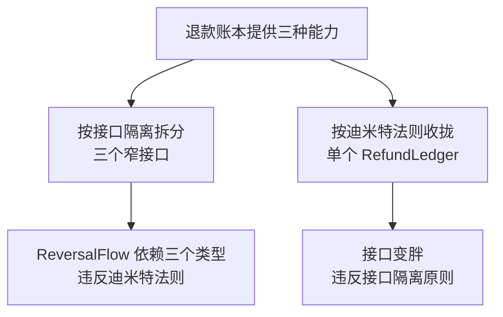

> 代码越是容易生成，人对代码好坏的判断力就越值钱。这个系列是我把那些上了年纪的设计原则重新翻出来，逐条查清它们的出处、适用边界与失效场景的笔记。

现在 Agent 写代码比我快，生成出来的东西绝大多数时候也挑不出什么硬伤。这就逼出了一个绕不开的问题：高内聚低耦合、SOLID、迪米特法则——这些诞生于几十年前的设计原则，今天还值不值得花时间去学？

我的看法是还得学，但学法得彻底换掉。

过去学设计原则，多半是背定义、记口诀，为了自己敲代码时能照着套。但“照着套”这件事，Agent 已经比人做得快而且标准。你让它“按接口隔离原则拆一下”，它几秒钟就能拆好；让它“遵守迪米特法则”，它立马能把调用链收窄。它真正替不了你的，是在动手之前做选择：当两条原则在同一段代码上给出相反的建议时，这次到底听谁的？

要拿这个主意，光背口诀没用，得知道每条原则当年究竟是为了对付什么麻烦才被提出来的。所以我在这个系列里采取的办法是溯源——把每条原则查回最初的论文或书里，看它在诞生那一刻面对的具体困境，再拿回来比对今天的代码。

## 拼凑出来的“七大原则”

国内教材和面试题里很喜欢画一座金字塔：底座是高内聚低耦合，往上是七大设计原则，再往上是二十三种设计模式，塔尖是面向对象开发。一层垫着一层，看着像是一套严密推导出来的公理体系。

但如果顺着文献一条条往回翻，会发现完全不是这么回事：

| 概念 | 提出者 | 年份 | 原始出处 |
|---|---|---|---|
| 内聚与耦合 | Stevens、Myers、Constantine | 1974 | 《Structured Design》，IBM Systems Journal 13(2)[1] |
| 里氏替换（LSP） | Barbara Liskov | 1987 | OOPSLA 主题演讲《Data Abstraction and Hierarchy》[2] |
| 迪米特法则（LoD） | Ian Holland 等 | 1987 | 美国东北大学 Demeter 项目[3] |
| 开闭原则（OCP） | Bertrand Meyer | 1988 | 《Object-Oriented Software Construction》[4] |
| 合成复用（CRP） | GoF 四人 | 1994 | 《Design Patterns》 |
| 依赖倒置（DIP） | Robert C. Martin | 1996 | 《C++ Report》（后收录于 2000 年论文集[7]） |
| 接口隔离（ISP） | Robert C. Martin | 1996 | 《C++ Report》（后收录于 2000 年论文集[7]） |
| 单一职责（SRP） | Robert C. Martin | 1990s | 《C++ Report》，2000 年定名并收入论文集[7] |

这八个概念出自六拨人，最早和最晚之间隔了整整二十二年。1974 年 Constantine 他们在讨论怎么把过程式程序切成子模块，文章里举的例子还是 PL/I 和 FORTRAN；1987 年 Liskov 在探讨数据抽象和子类型继承的数学性质；同年秋天，东北大学的 Ian Holland 在 Demeter 项目组里提出“只和你的直接朋友说话”，因为整个项目取名自希腊农业女神得墨忒耳（寓意像种庄稼一样一步步培育软件），这条规则才跟着叫“迪米特法则”——压根没有哪位学者姓 Demeter[3]；到了 1994 年，GoF 在归纳常见的面向对象设计套路；而 1996 年的 Robert C. Martin 则在《C++ Report》专栏里诊断大型 C++ 项目的编译依赖顽疾。

这些人当时各干各的，谁也没打算给同一套理论大厦添砖加瓦。至于 SOLID 这个响亮的缩写，则是 Martin 在九十年代陆续写出五篇文章之后，由 Michael Feathers 在 2004 年左右攒出来的首字母缩略词[5]。中文技术圈常说的“七大原则”，又在 SOLID 之外硬塞进了东北大学的迪米特法则和 GoF 的合成复用原则。

换句话说，从来就没有什么先天存在的金字塔，那只是后人为了编教材、讲课省事，把不同年代的经验之谈装进了同一个篮子里。

## 查回源头才能看清的几件事

一旦把这些概念放回原本的历史语境，很多以前死记硬背时觉得别扭的地方就通了。

先说内聚和耦合。1974 年的原论文把内聚排成六档：偶然、逻辑、时间、通信、顺序、功能[1]。现在教材里常讲的七档（多出一档“过程内聚”），是 Yourdon 和 Constantine 后来在书里补上的，Myers 自己还另提出过两档。光看这些不同版本的分类，就能感觉到它并不是一把精确的尺子。后来《Software Quality Journal》发表过一项实验：让 163 名软件工程专业的学生给同一个中型 Fortran 程序里的模块标注内聚和耦合等级，结果打分五花八门[6]。这并不意味着内聚和耦合没用，而是说明那张等级表本质上是一份辅助思考的参考坐标——同一个模块归在哪一档，取决于阅读者怎么理解业务上下文，没法当成游标卡尺来使。

再看最常被挂在嘴边的开闭原则：“对扩展开放，对修改封闭”。几乎所有资料都把这句话算在 Bertrand Meyer 1988 年那本书头上。但去读 Meyer 的原文就会发现，他所谓的“封闭”，是指一个类编译进库之后就可以交付给别人用；他所谓的“开放”，是指别人拿这个类当父类，通过**实现继承**派生出新子类来加功能。这在 1988 年非常实在：那时候只要往已发布的库里加个字段或改个函数，所有依赖方的代码就得跟着改、重新编译。

然而今天我们讲开闭原则，脑子里想的都是“面向抽象接口编程，靠多态替换实现”。这套说法其实是 Robert C. Martin 在九十年代重新诠释的版本[4]。Martin 虽然自称是在引述 Meyer，但两人给出的解法完全不同：Meyer 靠继承具体类，Martin 靠切分抽象接口。我们今天嘴上念着 1988 年的口号，手里写的却是九十年代末的做法。分清这两代含义不只是为了考据——继承树和抽象接口作为扩展点，腐化时的症状和失效边界完全不同（后面的第五篇和第十篇会分别展开）。

## 当两条原则在同一段代码上打架

既然这些原则不是从同一套公理推出来的，它们在具体代码上打架就一点也不奇怪。

拿退款系统里的冲正流程 `ReversalFlow` 来说。假设退款账本对外提供三种能力：按订单查退款、查某笔退款的状态时间线、发起冲正。如果严格照着**接口隔离原则**（客户端不应该被迫依赖它用不到的方法）来写，就应该把账本拆成三个窄接口，再注入给需要全部三种能力的 `ReversalFlow`：

```ts
interface RefundLookup   { findByOrder(orderId: string): Promise<Refund[]> }
interface RefundTimeline { stagesOf(refundId: string): Promise<Stage[]> }
interface RefundReversal { reverse(refundId: string, reason: string): Promise<void> }

class ReversalFlow {
  constructor(
    private lookup: RefundLookup,
    private timeline: RefundTimeline,
    private reversal: RefundReversal,
  ) {}
}
```

这时候如果换用**迪米特法则**（一个对象应当对其他对象保持最少的了解）来审视，`ReversalFlow` 的构造函数一口气认识了三个外部类型，耦合面变宽了。按迪米特法则的要求，应该把它们收拢成一个 `RefundLedger`：

```ts
class ReversalFlow {
  constructor(private ledger: RefundLedger) {}
}
```

这么一改，`ReversalFlow` 只认识一个类型了，迪米特法则满意了；但 `RefundLedger` 又把查询、时间线和冲正揉成了一个胖接口，其他只需要查订单的模块也得面对这个大接口，接口隔离原则又不干了。



在这个例子里，两条原则都没有被误用，但它们确实在把代码往相反的方向拽：想把接口切细，类的依赖项就会变多；想减少认识的类型，接口就得变胖。

遇到这种地方，靠背原则是算不出答案的。我自己的选择通常是偏向接口隔离：多认识两个窄接口，付出的只是一点类型声明的成本；而为了迎合迪米特法则去包一层门面或写一堆转发方法，多出来的都是日后要维护的实打实的代码。但这只是基于当前代价做的取舍，换个场景结论可能就反过来。

## 脱离语境的口号，最容易变成教条

把原则的前世今生捋了一遍之后，最大的感触是：**原则一旦丢掉了它诞生时的具体问题，就会退化成代码评审里的教条。**

1974 年讲内聚耦合，是为了防止改一处代码把 Bug 传到八竿子打不着的模块；1988 年 Meyer 讲开闭，是为了不再动不动重编整个依赖库。每一条原则背后原本都有一个让人头疼的工程痛点。可在几十年的传抄里，痛点被筛掉了，只剩下一句朗朗上口的标语。

标语是最容易拿来当验收标准的。为了在评审时证明自己“符合原则”，有人会在每一个类前面先机械地垫一层 `IXxxService` 接口，或者把好端端的逻辑拆得七零八落。多出来的那些间接层，挡不住任何一次真正的业务变更，唯一挡住的只是别人挑刺时那句“你这不符合某某原则”。代码既没换来预期的灵活性，反而比直接写平铺直叙的逻辑更臃肿。

这也是为什么到了 AI 时代，我觉得更有必要做一次溯源。

以前手写代码慢，过度设计至少还受限于敲键盘的体力；现在让 Agent 给你套十层接口、拆二十个类，不过是一句话的事。如果写代码的人自己心里没谱，不知道一条原则到底在防什么，AI 就能以十倍的速度帮你在项目里堆满合规却毫无用处的抽象。

撕掉那张虚构的“金字塔”之后，我现在更愿意把这七条原则当成审查代码时的**七个提问角度**：

- **单一职责**问的是：将来会有哪几拨不同诉求的人要求改这段代码？
- **开闭原则**问的是：这段代码接下来最可能往哪个方向长？
- **里氏替换**问的是：子类顶替父类之后，调用方原本默认的前提还算数吗？
- **接口隔离**与**迪米特法则**问的则是：接口的颗粒度和调用方的认知负担，眼下哪头更痛？

这些问题没有高低先后之分。Agent 能替你把任何一个方向的改造瞬间写完，但到底该问哪一个问题、往哪边下刀，还得由懂业务的你来拍板。

## 关于本系列的业务样本与目录

为了不让后面的讨论变成猫狗继承、形状画图的语法游戏，接下来九篇文章的代码都会围绕同一个业务展开：**交易系统里的退款与对账子系统**。挑这个领域是因为它的业务约束足够硬，一旦破坏了不变量，代价一眼就能看出来。

整个子系统有四条铁律，后面的文章会反复用到：

1. **金额上限**：同一订单的累计退款金额绝不能超过实付金额。
2. **幂等性**：同一笔退款请求重复提交，绝不能引发第二次资金划拨。
3. **状态单向流动**：已结算的退款单不可回退，纠错只能追加一笔反向冲正记录。
4. **币种隔离**：不同币种的金额绝不能直接相加或混算。

在这个子系统里，退款有四种渠道（原路退卡、退钱包余额、线下打款、积分补偿），同时对接四类调用方（客服工作台、财务对账、风控拦截、商家只读报表）。这套结构天然存在两条互相拉扯的扩展方向：要么新增退款渠道，要么新增业务操作。后面的第五篇就会拿它来演示，为什么开闭原则永远只能向其中一个方向敞开。

### 系列目录

- 序 · 在 AI 时代重读编程原则（本文）
- 内聚 · [判据是「必须一起改」，不是「看起来相关」](/zh/notes/what-belongs-in-one-module/)
- 耦合 · [量的是互相了解多少，不是 import 有几行](/zh/notes/three-invisible-couplings/)
- 单一职责 · [职责不是一件事，是一个会来提要求的人](/zh/notes/single-responsibility-is-an-actor/)
- 开闭 · [先判断代码会往哪里变](/zh/notes/open-closed-only-the-guessed-axis/)
- 里氏替换 · [子类必须能无缝顶替父类](/zh/notes/liskov-what-the-signature-does-not-check/)
- 依赖倒置 · [倒置的是接口的归属](/zh/notes/dependency-inversion-who-owns-the-interface/)
- 接口隔离 · 接口是客户端视角的切片
- 迪米特 · 得墨忒耳与中间人的两难
- 合成复用 · 继承会把不变量公开出去

## 参考资料

1. [W. P. Stevens, G. J. Myers, L. L. Constantine, "Structured Design", IBM Systems Journal 13(2), 1974, 115–139](https://dl.acm.org/doi/10.1147/sj.132.0115)
2. [Barbara Liskov, "Keynote address — Data Abstraction and Hierarchy", OOPSLA '87 Addendum，收录于 ACM SIGPLAN Notices 23(5), 1988, 17–34](https://www.cs.tufts.edu/~nr/cs257/archive/barbara-liskov/data-abstraction-and-hierarchy.pdf)
3. [Karl Lieberherr, "Law of Demeter: Principle of Least Knowledge", Northeastern University](https://www.khoury.northeastern.edu/home/lieber/LoD.html)
4. [Open–closed principle — 两代表述的对照](https://en.wikipedia.org/wiki/Open%E2%80%93closed_principle)
5. [SOLID — 缩写的来历](https://en.wikipedia.org/wiki/SOLID)（注：把五个首字母拼成 SOLID 一般归功于 Michael Feathers，但目前能查到的均为二手引述，未见其本人或 Martin 的一手文字确认。）
6. [Difficulties using cohesion and coupling as quality indicators, Software Quality Journal](https://link.springer.com/article/10.1007/BF00590439)
7. [Robert C. Martin, "Design Principles and Design Patterns", Object Mentor, 2000（SRP、DIP、ISP 的成文稿均收录于此汇编；《C++ Report》原刊已无稳定的在线源）](https://www.fil.univ-lille.fr/~routier/enseignement/licence/coo/cours/Principles_and_Patterns.pdf)
