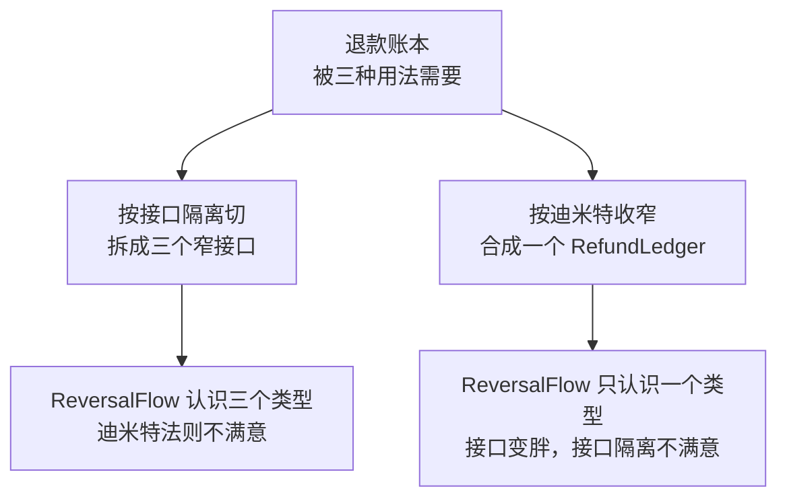

> AI 能替我们写的代码越来越多，程序员自己攒下的经验和底层判断因此更值钱。这个系列是我把这些上了年纪的原则重新翻出来，一条条查它们的出处、边界和失效场景的记录。温故而知新。

现在 agent 写代码比我快，写出来的东西大部分时候挑不出毛病。于是有一个问题绕不过去：高内聚低耦合、SOLID、迪米特法则，这些几十年前的设计原则，还值不值得花时间学。

我的回答是值得，但学法要换。以前学原则是背口号、记定义，目的是自己写代码时照着做。照着做这件事，agent 已经做得比我快。它替不了我的是另一步：七条原则会在同一段代码上给出相反的建议，这次听哪一条，要看这段代码接下来往哪个方向长、谁会来提要求。要做这个判断，得知道每条原则当初是为了解决什么麻烦提出来的。

所以这个系列的学法是溯源：把每条原则查回它的出处，看它诞生时面对的具体问题，再拿回来对照今天的代码。这篇序章先交代七条原则各自的来历，以及查完之后我放弃的一张图。

## 七条原则的出处

教材里常见的画法是一座金字塔：底层是高内聚低耦合，中间是七条设计原则，上面是设计模式，顶上是面向对象开发。一层撑着一层，看着像一套推导出来的体系。

逐条查下来，它们是这么来的：

| 概念 | 提出者 | 年份 | 出处 |
|---|---|---|---|
| 内聚与耦合 | Stevens、Myers、Constantine | 1974 | 《Structured Design》，IBM Systems Journal 13(2)[1] |
| 里氏替换 LSP | Barbara Liskov | 1987 | OOPSLA keynote《Data Abstraction and Hierarchy》[2] |
| 迪米特法则 LoD | Ian Holland | 1987 | Northeastern University，Demeter 项目[3] |
| 开闭原则 OCP | Bertrand Meyer | 1988 | 《Object-Oriented Software Construction》[4] |
| 合成复用 CRP | GoF 四人 | 1994 | 《Design Patterns》 |
| 依赖倒置 DIP | Robert C. Martin | 1996 | C++ Report（成文稿见 2000 年汇编本[7]） |
| 接口隔离 ISP | Robert C. Martin | 1996 | C++ Report（成文稿见 2000 年汇编本[7]） |
| 单一职责 SRP | Robert C. Martin | 1990s | C++ Report，2000 年收进《Design Principles and Design Patterns》[7] |

六拨人，最早和最晚之间隔着二十二年。1974 年那篇文章讨论的是怎么把程序切成模块，举的例子是 PL/I 过程和 FORTRAN 子程序；1987 年 Liskov 的演讲题目是数据抽象与继承层级；1994 年 GoF 在整理反复出现的设计方案；1996 年 Martin 在 C++ Report 上写的是面向对象设计里的依赖问题。他们各自在回答自己手上的问题，没有谁在给同一套体系添砖。

SOLID 这个缩写出现得更晚。五条原则是 Martin 在 1990 年代陆续写出来的，把首字母拼成一个词一般认为是 Michael Feathers 大约 2004 年做的事[5]，比最早的几条晚了十几年。中文教材里那张「七大原则」的并列表，比 SOLID 又多出两条：迪米特法则来自 1987 年的东北大学，合成复用来自 1994 年的 GoF，这两条从来不在 SOLID 里。

这七条被摆在一起，是后人整理的结果。

## 内聚和耦合的等级是判断量表

1974 年那篇文章给内聚排了六档，从低到高是偶然、逻辑、时间、通信、顺序、功能[1]。今天教材上常见的是七档，多出来的「过程内聚」是 Yourdon 和 Constantine 后来在书里补的，Myers 另外还加过两档。几个版本并不一致。

后来有人做过一次测量。《Software Quality Journal》上的一项研究让 163 名学生给同一个中等规模 Fortran 程序里的模块标注内聚和耦合等级，结果分歧很大[6]。同一段代码，不同的人读出来的等级不一样。

等级表仍然有用。这项研究说明的是它的性质：它是一张帮人做判断的量表，读数依赖读的人和代码所处的场景，不能当成测量仪器来用。

## 开闭原则有两代含义

七条里最常被引用的一句是「对扩展开放，对修改封闭」。这句话挂在 Meyer 名下，年份写 1988。

Meyer 1988 年说的是：一个类可以被编译进库、被别的类使用，这时它是「封闭」的；同时任何新类都可以拿它当父类、派生出新特性，这时它是「开放」的。做到开闭的手段是实现继承，把类打包进库，别人靠继承来扩展。这在当年是有针对性的：那时候往库里加字段或者加函数，依赖这个库的程序全都得改。

1990 年代 Martin 重新表述了它，改成依赖抽象接口，实现放在接口后面，靠多态替换来扩展。Martin 说自己是在转述 Meyer，但两个人对「怎么做到开闭」的回答不一样：一个说继承具体类，一个说依赖抽象接口[4]。

我原本把开闭原则理解成「面向接口编程」，并且一直把它记在 Meyer 名下。读了 1988 年的表述才发现，**今天教的那套是 1990 年代改的，只是名字和年份还沿用着上一代。**

这个区别会影响写代码。Meyer 的版本里，扩展点是继承层级；Martin 的版本里，扩展点是接口。两种扩展点在什么时候失效、失效时是什么样子，是两回事，第五篇和第十篇会分别处理。

## 迪米特法则得名于一个项目

还有一件小事。迪米特法则的名字来自一个项目，没有哪位提出者姓 Demeter。

它 1987 年秋天由 Ian Holland 在东北大学提出，当时他在 Demeter 项目组里。项目组用项目名给这条规则命名，而项目名取自希腊农业女神，用意是「像种庄稼一样让软件一小步一小步长出来」[3]。

在 Lieberherr 放在东北大学网站的那个页面上，这条法则只有一句话：只和你的朋友说话。

## 两条原则会在同一段代码上给出相反的建议

说这七条算不上一套体系，最直接的证据是它们会互相冲突。

接口隔离原则说，客户端不应该依赖它不需要的接口，接口要尽量细分。按这条切，退款账本的三种用法就该是三个接口，冲正流程 `ReversalFlow` 把三个都注入进来：

```ts
interface RefundLookup   { findByOrder(orderId: string): Promise<Refund[]> }
interface RefundTimeline { stagesOf(refundId: string): Promise<Stage[]> }
interface RefundReversal { reverse(refundId: string, reason: string): Promise<void> }

class ReversalFlow {
  constructor(
    private lookup: RefundLookup,
    private timeline: RefundTimeline,
    private reversal: RefundReversal,
  ) {}
}
```

迪米特法则说，一个对象应该对别的对象有最少的了解。按这条看，上面的 `ReversalFlow` 认识三个类型，多了。把三个接口收成一个 `RefundLedger`：

```ts
class ReversalFlow {
  constructor(private ledger: RefundLedger) {}
}
```

现在 `ReversalFlow` 只认识一个类型，迪米特法则满意了。但 `RefundLedger` 得同时提供查询、时间线和冲正，成了一个胖接口，接口隔离原则不满意。

两条原则都没有被误用，它们指向相反的方向。多一个窄接口就是多一个类型，少一个类型就意味着接口得变宽。**这里没有正确答案，只有取舍。**多一个窄接口只是多一个抽象类型，而为了少认识一个类型去写转发方法，多出来的是要维护的具体代码，前者的成本通常低于后者。这是我的取舍，原则本身算不出这个结论。

同一段代码，两条原则各拉一边：



两条路都合规，差别只在于这次更想付哪一笔成本。

## 金字塔不成立，七条是七个提问角度

我原本以为这七条是层层递进的，底下垫着高内聚低耦合，顶上架着设计模式，一层推出一层。查完出处，这个结构站不住：它们出自六拨互不相干的人，各自解决各自的麻烦，前后隔着二十二年，还会在同一段代码上给出相反的建议。金字塔是后来为了讲课方便画出来的叙事。

我现在的用法是把它们当成七个提问角度。改这段代码的时候会有几拨人来找我，这是单一职责在问的；这段代码会往哪个方向长，这是开闭原则在问的；这个子类顶替父类之后，调用方原来的假设还成立吗，这是里氏替换在问的。

角度之间没有优先级。哪个问题更重要，取决于代码的处境。

## 丢了出处的原则会变成验收标准

查完出处，接下来要回答的是：这些年份和人名对写代码有什么用。

用处在于每条原则诞生时都带着它要解决的那个具体麻烦。1974 年那三位作者想降低程序的复杂度，让一处改动不至于把错误带到别处；1988 年 Meyer 面对的是往库里加一个字段就得让所有依赖方跟着改。每条原则都是对某个具体麻烦的一次回答，没有哪条是从公理推出来的。

麻烦在传抄里丢得最快。原则被人从论文里摘成一句口号，从口号抄进教材，从教材变成代码评审的口头禅。走到这一步，它只剩措辞。「对扩展开放，对修改封闭」听着无懈可击，可 Meyer 写下这句话时，「扩展」指的是继承一个已经编译进库的类。

丢了场景的口号会变成验收标准，而验收标准可以靠堆结构通过。于是每个接缝先铺一层接口，每个类拆到只剩一个方法，评审时条条合规。多出来的那层间接性挡不住任何一次真实的变化，它挡住的只有「看起来不符合原则」这句评语。

**这样写出来的代码同时犯两个错：既没有拿到原则想保护的那种可修改性，又比不套原则时臃肿。**

## 为什么在 AI 时代更需要溯源

把上面几节放在一起，就能回到开头的问题。

Agent 能把七条里的任何一条实现得比我快。让它「按接口隔离原则拆一下」，它会拆；让它「遵守迪米特法则」，它会收窄。两条指令都能得到合规的代码，而上一节那个 `ReversalFlow` 的例子说明，合规的代码可以朝着相反的方向长。

它答不了的是这次该听哪一条。这个问题的答案在业务里：这段代码接下来会往哪个方向长，谁会来提要求。这两件事写不进一条通用的原则，得由了解这个系统的人来判断。

溯源学习练的就是这个判断。知道一条原则当初在防什么，才能看出眼前这段代码有没有同样的麻烦；没有的话，这条原则这次可以不用。实现的速度越快，照着口号堆出多余结构的成本就越低，这个判断也就越值得花时间练。

后面九篇都用同一个写法：把原则放回它诞生的场合，看清它当时在防什么，再拿回来对照今天的场景，看那条防线还值不值得修。

## 这个系列用的例子

后面九篇的代码都从同一个地方长出来：一个退款与对账的子系统。选它是因为它的约束是硬的，有具体的不变量可以违反，里氏替换这类原则才不会讲成语法游戏。

四条不变量，后面会反复回来：

1. 累计退款额不超过原订单实付额
2. 幂等，同一笔退款重复提交不产生第二次资金流动
3. 状态单向，已结算不可回退，只能追加一笔反向记录
4. 币种一致，跨币种不可相加

退款有四种渠道（原路退卡、钱包余额、线下转账、积分补偿），四类客户端（客服后台、财务对账、风控拦截、商家只读）。这个结构里天然带着两条互相冲突的扩展轴：加渠道，和加操作。第五篇会用它来讲为什么开闭原则只能对其中一条开放。

## 系列地图

- 序 · 在 AI 时代对编程思想再次溯源学习
- 内聚 · [判据是「必须一起改」，不是「看起来相关」](/zh/notes/what-belongs-in-one-module/)
- 耦合 · [量的是互相了解多少，不是 import 有几行](/zh/notes/three-invisible-couplings/)
- 单一职责 · [职责不是一件事，是一个会来提要求的人](/zh/notes/single-responsibility-is-an-actor/)
- 开闭 · [先判断代码会往哪里变](/zh/notes/open-closed-only-the-guessed-axis/)
- 里氏替换 · [子类必须能无缝顶替父类](/zh/notes/liskov-what-the-signature-does-not-check/)
- 依赖倒置 · 倒置的是接口的归属
- 接口隔离 · 接口是客户端视角的切片
- 迪米特 · 得墨忒耳与中间人的两难
- 合成复用 · 继承会把不变量公开出去

每篇一条，逐篇更新。

## 这篇的结论

- 七条原则算不上一套体系。六拨人、二十二年、互不相干的麻烦，把它们摆在一起是后人整理的结果。
- 我把它们当成七个提问角度，角度之间没有优先级。该问哪一个，取决于这段代码接下来往哪个方向长、谁会来提要求。
- 内聚和耦合的等级是判断量表。163 个人能给同一段代码标出不同等级，说明读数依赖场景。
- 同一段代码上，两条原则可以给出相反的建议，而且都没有被误用。接口隔离和迪米特法则在 `ReversalFlow` 上就是这样。
- 原则诞生时都有具体场景，传抄过程中场景会丢。丢了场景的口号会变成验收标准，而验收标准可以靠堆结构通过。
- Agent 能把任何一条原则实现得比我快，它答不了的是这次该听哪一条。溯源学习练的是这个判断。

## 参考资料

1. [W. P. Stevens, G. J. Myers, L. L. Constantine, "Structured Design", IBM Systems Journal 13(2), 1974, 115–139](https://dl.acm.org/doi/10.1147/sj.132.0115)
2. [Barbara Liskov, "Keynote address — Data Abstraction and Hierarchy", OOPSLA '87 Addendum，收录于 ACM SIGPLAN Notices 23(5), 1988, 17–34](https://www.cs.tufts.edu/~nr/cs257/archive/barbara-liskov/data-abstraction-and-hierarchy.pdf)
3. [Karl Lieberherr, "Law of Demeter: Principle of Least Knowledge", Northeastern University](https://www.khoury.northeastern.edu/home/lieber/LoD.html)
4. [Open–closed principle — 两代表述的对照](https://en.wikipedia.org/wiki/Open%E2%80%93closed_principle)
5. [SOLID — 缩写的来历](https://en.wikipedia.org/wiki/SOLID)
6. [Difficulties using cohesion and coupling as quality indicators, Software Quality Journal](https://link.springer.com/article/10.1007/BF00590439)
7. [Robert C. Martin, "Design Principles and Design Patterns", Object Mentor, 2000. SRP、DIP、ISP 三条的成文章节都收在这份汇编里；C++ Report 原刊找不到稳定的在线链接](https://www.fil.univ-lille.fr/~routier/enseignement/licence/coo/cours/Principles_and_Patterns.pdf)

关于第 5 条：SOLID 这个缩写归于 Michael Feathers，目前能找到的都是二手来源互相印证，没有他本人或 Martin 的一手确认。这条按「一般认为」处理。
