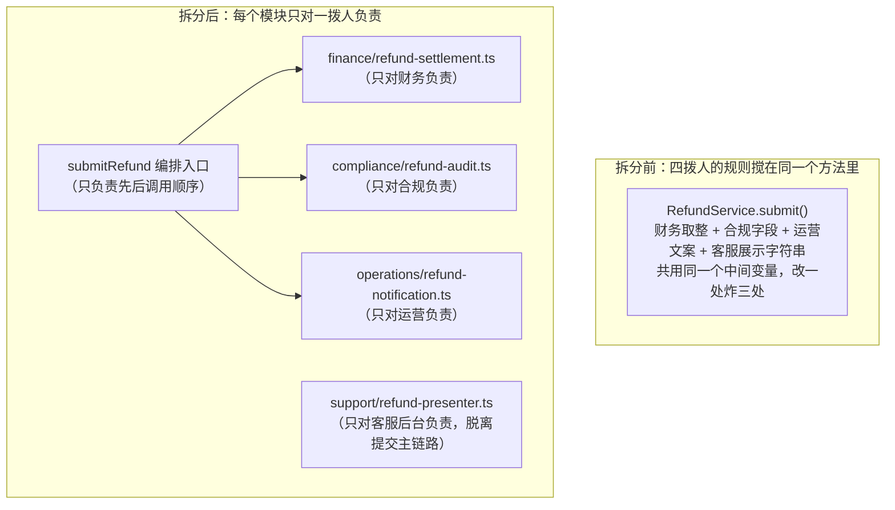

> 《编程思想》系列第 4/10 篇。这一季的立论在[序章](/zh/notes/programming-taste-in-the-agent-era/)。
>
> 代码越是容易生成，人对代码好坏的判断力就越值钱。这个系列是我把那些上了年纪的设计原则重新翻出来，逐条查清它们的出处、适用边界与失效场景的笔记。

在 SOLID 五大原则里，排在第一位的**单一职责原则（Single Responsibility Principle，SRP）**流传最广，口号也最响亮：“一个类（或函数）应该只做一件事。”

但这句口号一碰到真实代码就会失灵——因为**没人说得清到底多大才算“一件事”**。

从宏观上看，“处理退款”是一件事；往细了看，“计算可退金额”是一件事；再往细了看，“把浮点数向下取整到分”也是一件事。如果照着“只做一件事”无限拆下去，任何一个 30 行的正常函数都能被拆成十个只有 3 行的碎片类。

为什么这句口号这么难用？因为它在传抄的过程中，把原本最关键的主语给弄丢了。

翻回提出者 Robert C. Martin 的原文就会看到，单一职责里的“职责（Responsibility）”，指的从来不是代码里的某一个动作，而是**站在代码背后、会来向你提修改要求的那拨人（Actor）**[1]。

用一句话概括它的精髓：**一段代码只应该对一拨业务角色负责；数一数将来有几个不同的部门会来要求你改这段代码，比争论什么叫“一件事”准确十倍。**

我们先从退款系统里一次真实的线上事故看起。

---

## 一次“只改一行代码”引发的连环误伤

来看一段看着挺清爽的退款提交代码 `RefundService.submit`：

```ts
export class RefundService {
  async submit(req: RefundRequest): Promise<RefundResult> {
    // 1. 计算本次应退金额（按比例分摊优惠并取整）
    const amountCents = this.computeRefundAmount(req)

    // 2. 写入核心资金账本
    await this.ledger.record(req.orderId, amountCents)

    // 3. 记录合规审计流水
    await this.audit.log({ orderId: req.orderId, amountCents, operator: req.operator })

    // 4. 给用户发退款通知短信
    await this.notify.sendSms(req.userId, amountCents)

    // 5. 返回给客服工作台页面展示
    return {
      amountCents,
      status: 'settled',
      displayText: `已退还 ¥${(amountCents / 100).toFixed(2)}`,
    }
  }
}
```

这段代码总共不到 20 行，从上到下顺畅易读。

某天，**财务部门**提了一个小需求：“优惠券分摊遇到除不尽的尾差时，实退金额计算规则从四舍五入改为一律向下取整到分。”

开发同学一看，这太简单了！打开 `RefundService`，找到 `computeRefundAmount` 里面的 `Math.round`，改成 `Math.floor`，跑通单测，当天下午就上线了。

结果第二天一早，**合规部门**和**客服团队**同时找上门来了：

- **合规团队**发现：监管报送要求审计日志里记录的是“按原合同公式算出的理论应退金额”，结果昨天财务改了实退取整规则后，写进 `audit.log` 里的金额全部少了一分钱，触发了监管对账告警；
- **客服团队**也抱怨：客服后台弹窗原本展示的 `displayText` 被客服用来核对用户申诉原金额，数字一变，客服话术全对不上了。

明明只有财务提了需求，合规和客服连一个字都没让你改，为什么他们的业务却在上线当天被炸了？

因为在这个短短 20 行的 `submit` 方法里，**同时住着四拨互不通气、诉求完全不同的人**。

---

## 数一数这段代码里住着几拨人

我们把上面那个方法里的每一行拆开，看看将来谁会敲开你的工位要求改它：

| 代码片段 | 背后的业务角色（Actor） | 他们什么时候会来提需求？ |
|---|---|---|
| `computeRefundAmount(req)` | **财务部门（Finance）** | 调整尾差取整规则、跨期税率计算、优惠券分摊公式 |
| `audit.log(...)` | **法务与合规（Compliance）** | 监管要求新增留存字段、调整脱敏规则或审计金额口径 |
| `notify.sendSms(...)` | **用户运营（Operations）** | 更换短信文案模板、改发 App 推送、调整免打扰时段 |
| `displayText: ...` | **客服团队（Support）** | 客服工作台改版、要求同时展示原币种与折算币种符号 |

看这张表就明白了：财务、合规、运营、客服这四个部门，平时各自按自己的排期提需求，从来不会提前商量好。

当这四拨人的规则挤在同一个方法、甚至共用同一个中间变量 `amountCents` 时，就等于让四个部门的人共用同一间办公室的同一个电闸——财务进屋想把自己的台灯调暗一点，咔嚓一拉闸，隔壁合规室的电脑直接断电重启了。

Martin 在解释单一职责时打过一个非常传神的比方：**这就好比你把车送进修车厂修电动车窗，第二天去取车时，车窗修好了，发动机却打不着火了**[1]。车主之所以暴跳如雷，正是因为坏掉的地方是他压根没要求你碰的地方。

---

## 查回 2014 年的补充说明：为什么说“这条原则是关于人的”？

单一职责原则最常见的学术定义是：*“一个模块应该有且仅有一个引起它变化的原因（A module should have one, and only one, reason to change）。”*

但“变化的原因”依然太抽象——修 Bug 算不算一个原因？性能优化重构算不算一个原因？

为了彻底终结这种咬文嚼字的争论，Martin 在 2014 年专门写了一篇《The Single Responsibility Principle》博文[1]，用一句话把窗户纸捅破了：

> **This principle is about people.**
> （这条原则是关于人的。）

他在文章里给出了一个教科书级的反例——一个看起来再自然不过的 `Employee`（员工）类：

```java
public class Employee {
  public Money calculatePay();   // 算薪水
  public String reportHours();   // 出工时报表
  public void save();            // 存进数据库
}
```

表面上看，这三个方法全都是围绕“员工（Employee）”展开的，放在同一个类里似乎天经地义。但如果你问一句“这三个方法写错了，哪位高管会挨板子？”：

- `calculatePay()` 的发薪扣税算法归 **CFO（首席财务官）** 团队定；
- `reportHours()` 的工时统计格式归 **COO（首席运营官）** 团队定；
- `save()` 的表结构与存储引擎归 **CTO（首席技术官）** 团队定。

如果 `calculatePay` 和 `reportHours` 共用了同一个私有辅助函数 `regularHours()`，当 COO 团队为了运营报表需求让程序员微调了一下 `regularHours()` 的算法时，CFO 团队负责的发薪系统就会在毫不知情的情况下算错全公司的工资，造成数百万美元的事故[1]。

因此，在 बाद来的《架构整洁之道（Clean Architecture）》里，Martin 直接把单一职责原则的定义改写成了毫无歧义的最终版[2]：

> **A module should be responsible to one, and only one, actor.**
> （一个模块应该只对唯一一拨业务角色/利益相关方负责。）

顺着这条线往回看，你会发现它和我们在[第 2 篇（内聚）](/zh/notes/what-belongs-in-one-module/)提到的 1972 年 Parnas 论文一脉相承[3]：

- **内聚**问的是：哪些代码总是一起变？
- **单一职责**给出了背后的原因：**因为它们服务于同一拨人，而同一拨人的需求才会一起变！**

---

## 按“人”切开之后，代码长什么样？

回到我们开头的 `RefundService`。既然里面住着四拨人，我们就按这四拨人的边界，把各自专属的计算和格式规则拆回他们自己的领地：

```ts
// 1. 归财务管：finance/refund-settlement.ts
export function computeSettlementAmount(order: Order, items: RefundItem[]): Money

// 2. 归合规管：compliance/refund-audit.ts
export function buildAuditEntry(req: RefundRequest, settlementAmount: Money): AuditRecord

// 3. 归运营管：operations/refund-notification.ts
export function buildCustomerNotice(user: User, settlementAmount: Money): NotificationPayload

// 4. 归客服管：support/refund-presenter.ts
export function formatSupportSummary(record: RefundRecord): SupportViewDTO
```

把四拨人各自的规则请出去之后，原来的 `submitRefund` 只留下一层薄薄的**用例编排（Orchestration）**：

```ts
export async function submitRefund(req: RefundRequest): Promise<RefundReceipt> {
  const settlementAmount = computeSettlementAmount(req.order, req.items)
  const receipt = await ledger.record(req.orderId, settlementAmount)

  await auditRepo.save(buildAuditEntry(req, settlementAmount))
  await notifier.send(buildCustomerNotice(req.user, settlementAmount))

  return receipt
}
```

用图来看这次拆分前后的依赖结构：



现在，财务再怎么改 `computeSettlementAmount` 里的取整算法，合规的 `buildAuditEntry` 都拿原始请求 `req` 算自己的理论监管金额；客服后台的展示格式更是直接搬到了查询侧的 `formatSupportSummary` 里，连提交流程的门都不用进。

---

## 走进模糊地带：三个最容易犯错的边界陷阱

理解了“职责 = 会来提要求的人”，我们就能轻松解开日常开发里最让人纠结的三个模糊地带。

### 误区一：把“只做一件事”当教条，把同一拨人的逻辑拆得七零八落

这是 Coding Agent 和教条主义者最常犯的错。

当你让 Agent “按单一职责原则重构财务金额计算模块”时，它往往会照着字面意思把原本属于财务一拨人的连贯逻辑，硬生生拆成三个碎片类：

```ts
// 过度拆分的碎片：三个类其实只服务于「财务」同一拨人
class RefundBaseFetcher   { /* 第 1 步：读取原单实付金额 */ }
class RefundProrater      { /* 第 2 步：按商品比例分摊优惠 */ }
class RefundCentRounder   { /* 第 3 步：处理分位尾差取整 */ }
```

每个类确实都只剩一个方法、5 行代码，看着“只做了一件事”。

但仔细想一想：**将来谁会要求改这三个类？全都是财务那同一拨人！**

当财务修改分摊与尾差规则时，这三个类根本不可能独立变化——分摊算出来的尾数怎么进位，直接决定了取整怎么兜底。把它们拆进三个文件，并没有隔离任何不同部门的变更风险，反而逼着维护者在三个文件之间来回横跳才能看懂一条完整的财务公式。


记住这个判据：**如果几个函数背后站着的是同一拨人、服务的是同一条业务规则，把它们合在一个内聚的模块里，才是真正的单一职责。**

### 误区二：拆完之后，中间那个“编排函数”归谁管？

有人会问：既然把财务、合规、运营的规则都拆出去了，那剩下的那个 `submitRefund` 编排函数（先记账、再写审计、最后发通知），它又对谁负责？

答案是：**编排层对“业务流程的整体先后契约”负责。**

“必须等账本落库成功之后，才能写审计流水和发用户短信”——这不是某一个部门内部的局部细节，而是跨部门协同的全局时序不变量。

怎么判断一行代码该留在编排层，还是该赶进子模块？

**看这行代码是不是只有某一个特定部门才听得懂的“黑话”。**

- 如果编排函数里出现了 `Math.floor(amount * 0.98)`，这是财务黑话，赶去财务模块；
- 如果编排函数里出现了 `已退还 ¥${...}`，这是客服界面黑话，赶去展示层；
- 如果编排函数里只剩下清晰的步骤调用与事务边界控制，那它就待在了最合适的位置。

### 误区三：怎么界定“一拨人”？（小团队一人身兼多职怎么办？）

在創業公司或小团队里，产品经理往往只有一个人，既管财务对账、又管客服后台、还兼着运营。这时候是不是整个系统就只有“一个人”，所有代码都能写成一坨了？

当然不是。Martin 在定义 Actor 时特意补充过：这里的“人”，指的是**一种明确的业务职能角色（Business Function / Role）**[1]。

哪怕现实中是同一个产品经理坐在工位上给你提需求，当他上午说“帮我把客服后台的金额颜色改成红色”时，他戴的是**客服角色**的帽子；当他下午说“税务局要求对账单按不含税金额计算”时，他戴的是**财务角色**的帽子。这两顶帽子代表的变化原因是完全正交的——客服界面改版绝不会引起税务公式变化。

判断两个需求算“同一拨人”还是“两拨人”，最实用的测试办法是问：**当 A 规则发生变化的那一天，B 规则需要同一天跟着一起改吗？**

- 如果它们总是绑在一起同生共死，就算一拨；
- 如果它们各改各的、节奏完全独立，就算坐在同一张办公桌后面，在代码里也必须当成两拨人隔开。

---

## 小结：用单一职责审代码的三个问题

下次当你纠结一个类或函数是不是“管得太宽”、或者怀疑某次拆分是不是“过度设计”时，问自己三个问题：

1. **这段代码背后站着几拨不同诉求的人（业务角色）？** 如果财务改算钱公式、合规改日志字段、客服改展示文案都要打开同一个函数，立刻按角色把它们拆开。
2. **我准备拆开的这几个小函数，背后是不是其实只有同一拨人？** 如果它们服务的是同一个角色、共同维护同一条计算规则，留在同一个模块里，别为了凑“3 行小函数”而硬拆。
3. **编排层里有没有混进某个部门专属的细节黑话？** 让编排层只管步骤先后与成败边界，把具体怎么算、怎么拼字符串关进各自角色的模块里。

把不同角色的改动隔开之后，我们紧接着就会遇到一个更现实的挑战：**业务永远在长出新需求——今天加一个礼品卡退款渠道，明天加一个全渠道冲正操作。我们怎么设计模块，才能在新需求到来时尽量少翻旧账？为什么没有任何一套设计能对所有新需求都做到“免修改扩展”？**

这就是下一篇**开闭原则**要回答的核心问题。

---

## 系列目录

- 序 · [在 AI 时代重读编程原则](/zh/notes/programming-taste-in-the-agent-era/)
- 内聚 · [判断标准是修改代码时要一起改](/zh/notes/what-belongs-in-one-module/)
- 耦合 · [衡量的是两个模块互相了解多少](/zh/notes/three-invisible-couplings/)
- 单一职责 · 一个职责对应一拨会来提要求的人（本文）
- 开闭 · [先判断代码会往哪个方向变](/zh/notes/open-closed-only-the-guessed-axis/)
- 里氏替换 · [子类必须能无缝顶替父类](/zh/notes/liskov-what-the-signature-does-not-check/)
- 依赖倒置 · [倒置的是接口的归属](/zh/notes/dependency-inversion-who-owns-the-interface/)
- 接口隔离 · [接口是客户端视角的切片](/zh/notes/interface-segregation-client-perspective-slice/)
- 迪米特 · [在穿透调用与中间人之间找平衡](/zh/notes/law-of-demeter-the-middlemans-dilemma/)
- 合成复用 · [用对象组合替代类继承来保护不变量](/zh/notes/composite-reuse-inheritance-publishes-invariants/)

## 参考资料

1. [Robert C. Martin, "The Single Responsibility Principle", *The Clean Code Blog*, 2014-05-08](https://blog.cleancoder.com/uncle-bob/2014/05/08/SingleReponsibilityPrinciple.html) —— 明确指出“This principle is about people”，并用 `Employee` 类与 CFO/COO/CTO 三个高管角色的例子阐述职责与人的对应关系。
2. [Robert C. Martin, *Clean Architecture: A Craftsman's Guide to Software Structure and Design*, Prentice Hall, 2017](https://dl.acm.org/doi/book/10.5555/3175742) —— 第 7 章将 SRP 的定义正式重述为“A module should be responsible to one, and only one, actor”。
3. [D. L. Parnas, "On the Criteria To Be Used in Decomposing Systems into Modules", *Communications of the ACM* 15(12), 1972, 1053–1058](https://dl.acm.org/doi/10.1145/361598.361623) —— 信息隐藏原则的原始出处，Martin 在 2014 年博文中明确将 SRP 追溯至此文。
