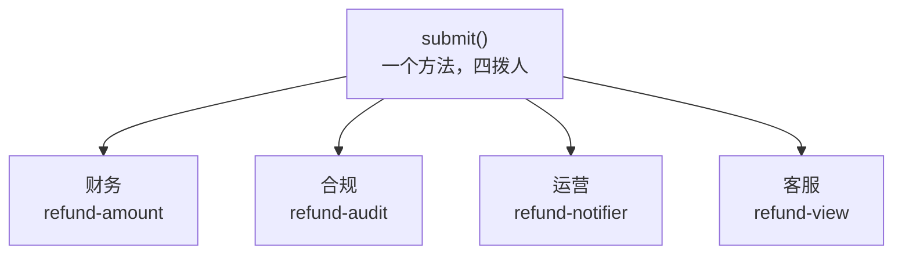
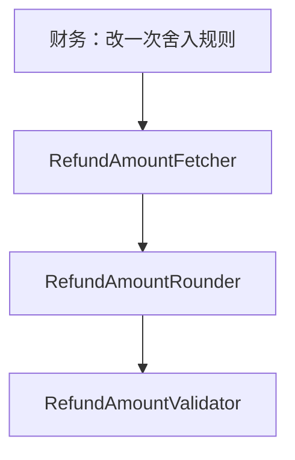

> 《编程思想》系列第 4/10 篇。这一季的立论在[序章](/zh/notes/programming-taste-in-the-agent-era/)。
>
> AI 能替我们写的代码越来越多，程序员自己攒下的经验和底层判断因此更值钱。这个系列是我把这些上了年纪的原则重新翻出来，一条条查它们的出处、边界和失效场景的记录。温故而知新。

单一职责原则流传最广的口号是「一个类只做一件事」。口号的问题出在「一件事」判不了：多大算一件？拆到哪步算完？判据得换成人：**职责是一个会来提要求的人**。数一数这段代码回应几拨人的要求，比争论什么叫一件事可靠得多。为什么数人管用？因为需求变化从人来，同一拨人提的要求才会一起变。先看一次真实的改动。

财务提了一个改动：退款金额一律向下取整到分，不再四舍五入。

改动落在 `computeAmount` 里那一行取整运算上，另外两行是跟着一起动的：审计日志记下来的那笔金额，客服后台拼出来的那行显示字符串。三行的值都来自 `computeAmount` 的返回值。上线当天，客服后台的退款金额显示多了两位小数，审计日志里那笔记录的金额格式也跟着变了。

三处代码谁都没写错，问题出在它们待的地方。下面是改动前的样子，省略了依赖的注入和字段声明：

```ts
class RefundService {
  async submit(req: RefundRequest): Promise<RefundResult> {
    const amount = this.computeAmount(req)
    await this.ledger.record(req.orderId, amount)
    await this.audit.log(req, amount)
    await this.notify.refunded(req.userId, amount)

    return {
      amount,
      status: 'done',
      display: `已退 ¥${(amount / 100).toFixed(2)}`,
    }
  }
}
```

**单一职责要回答的是：这段代码里住着几拨会来提要求的人？** 财务要改的是一行，另外两行归合规和客服管；三处挤在同一个方法里，一次改动就会从财务那间办公室走到另外两间去。

把人数当判据，好处是它不依赖你读懂代码在做什么。代价是它也没法从代码里读出来：同一段代码，谁在维护它、业务往哪边长，判断就不同。

## 一个方法里住着四拨人

把这个方法的每一行按「谁会来要求改它」拆开看：

| 这行在做的事 | 谁会来提要求 | 什么时候来提 |
|---|---|---|
| `computeAmount` | 财务 | 舍入规则、优惠分摊、币种换算变了 |
| `audit.log` | 合规 | 留存字段变了，或者监管要求加一条 |
| `notify.refunded` | 运营 | 文案、推送渠道、触达时机调整 |
| `display` 那一行 | 客服 | 后台表格换了列，或者要加个字段 |

表里分的是人，不是代码。四行代码的写法都很普通，差别只在于它们各自回应谁的问题。这张表也不负责告诉你该拆成几个文件，那要看改动实际从哪来。

这四拨人互不通气，也不会约好同一天提要求。财务调整舍入规则的那天，合规没有变需求，客服也没有。三行代码跟着一起动，是因为它们共用 `computeAmount` 的返回值，不是因为那两个部门提了什么。

Martin 用过一个比喻：把车送进修车厂修电动车窗，取车时窗户好了，车却打不着火。他后面还接了一句，那句才是比喻的落点：客户和经理发现坏掉的正是自己没要求改的地方，就是这个感受。

## Martin 把这句话落到人身上，是在 2014 年

这条原则的一个常见表述是「一个模块应该有且只有一个修改的理由」。Martin 在 2014 年那篇博文里的原话是 `each software module should have one and only one reason to change`[1]。他用的是 module，不是 class；中文里流传更广的「一个类只做一件事」，是这句话在传抄中口语化出来的说法。

「理由」这个词太空，落不到具体的代码上。修 bug 算不算一个理由？重构算不算？这两个问题都是读者提的，Martin 在 2014 年 5 月 8 日专门写了一篇来回答[1]。答案只有一句：

> This principle is about people.

> 这条原则是关于人的。

他的论证方式很具体：先问这个方法的规则归谁负责。例子是一个 `Employee` 类，方法名沿用原文的 Java 写法：

```java
public class Employee {
  public Money calculatePay();
  public void save();
  public String reportHours();
}
```

`calculatePay` 的算法归 CFO 定，`reportHours` 返回的报表格式归 COO 定，`save` 怎么写进企业库归 CTO 定。他用来判定归属的办法更直接：这个方法的规则要是被写错、后果足够严重，哪个高管会被解雇。发薪算法错了 CFO 走人，审计用的工时报表错了 COO 走人，库被写坏了 CTO 走人。他在脚注里自己承认这种「解雇」是夸张手法，C 级高管通常不会因为一次小错误离职。

于是这个类的问题就清楚了：CTO 要求改 `save` 的写法时，`calculatePay` 有可能被顺手改坏。CFO 不会关心 `save` 里面写了什么，他只会得出一个结论——以后别再动那个类了。

那篇文章里还有一句更好用的表述，Martin 自己标为 "Another wording"：

> Gather together the things that change for the same reasons. Separate those things that change for different reasons.

> 把因为同一个理由而变的东西放在一起，把因为不同理由而变的东西分开。

他在后面顺手列了几条推论：SQL 不该写进 JSP，算结果的模块不该生成 HTML，业务规则不该认识数据库表结构。三条推论的共同点是，一次需求变化不该惊动另一拨人的代码。

### 这条原则在 Martin 那里是从 Parnas 接过来的

那篇博文不是从 Employee 开始的，前面还有一半篇幅在讲 Parnas 1972 年的《On the Criteria To Be Used in Decomposing Systems into Modules》[3]。Martin 引了 Parnas 的结论：模块划分不该照着流程图来，该从「哪些设计决策可能变化」出发，让每个模块把这类决策藏起来。他接着写，SRP 看起来和 Parnas 的表述是一致的。

这句评语值得单独记一下。它说明「按人切开」是 Martin 在 2014 年给一个更老的判断补上的操作办法，思路上可以追到 Parnas：Parnas 说的是变化的决策要藏起来，Martin 说那些决策的来路是人。第 2 篇讲内聚时用的也是这一篇，两篇查到了同一个源头。

## 同一件事，内聚和耦合那两篇也说过

Martin 在文里直接写了：想一下就会发现，这只是内聚和耦合的另一种说法。

前两篇做的事和这里是同一件。[第 2 篇](/zh/notes/what-belongs-in-one-module/)判「这些元素会不会一起改」，落点是 1974 年那份内聚等级表[6]；[第 3 篇](/zh/notes/three-invisible-couplings/)判「一条连接改动时波及多远」。这一篇问的是同一个问题的另一面：会来提这个要求的人是谁。理由来自人，人按自己的节奏提要求，所以按人切开就顺带得到了内聚和耦合。

这也解释了为什么这条原则没法靠数代码来判断。一个四百行的类可能只服务于一拨人，一个二十行的类可能同时被三拨人惦记。这个对比找不到可引的出处，是我从前面几段例子里归纳的；它不是一个测得出来的数字，只说长度和职责之间没有对应关系。

## 名字可能是借来的

Martin 是在 1990 年代末把 Constantine 的耦合与内聚整合成一条原则的，顺势给这条原则起了现在的名字。就在讲这件事的那一段里，他插了一句括号，提到了 Bertrand Meyer[2]：

> I have this vague feeling that I stole the name of this principle from Bertrand Meyer, but I have not been able to confirm that.

> 我有种模糊的感觉，这个名字是我从 Bertrand Meyer 那里顺来的，但我一直没能确认。

这句话的语气是「模糊的感觉」和「没能确认」，不是一句声明。这条原则的思路有明确的来路，名字的来路连提出者本人都说不清。

这跟序章里查到的情况是一致的：七条原则出自六拨互不相干的人，被摆在一起是后人整理的结果。

SOLID 这个缩写的来历也一样模糊。它一般归于 Michael Feathers，时间大约在 2004 年，比原则本身晚了十几年[4]。这一条目前能找到的都是二手来源互相印证，没有他本人或 Martin 的一手确认，序章按「一般认为」处理，这里沿用。另外要分开的是两个出处：2014 那篇博文里没有提 SOLID 缩写，也没有提 Feathers，缩写那段来历只有上面这条二手记载。

## 按人切开之后

还是那套退款服务。拆完之后，每个文件只回答一拨人的问题，下面只保留函数签名：

```ts
// finance/refund-amount.ts
export function computeRefundAmount(order: Order, items: RefundItem[]): Money

// compliance/refund-audit.ts
export async function recordAuditTrail(entry: AuditEntry): Promise<void>

// notification/refund-notifier.ts
export async function notifyRefundIssued(user: User, amount: Money): Promise<void>

// support/refund-view.ts
export function renderRefundSummary(refund: Refund): RefundSummary
```

`submit` 自己留在编排的位置（下面写成函数 `submitRefund`，请求的字段也按拆分后的需要做了示意性调整），不再持有任何一拨人的规则，只负责按顺序调用。它的返回类型里也没有 `display` 那一行了，客服要的字符串由 `renderRefundSummary` 决定：

```ts
async function submitRefund(req: RefundRequest): Promise<RefundResult> {
  const amount = computeRefundAmount(req.order, req.items)

  await ledger.record(req.orderId, amount)
  await recordAuditTrail({ orderId: req.orderId, amount, actor: req.operator })
  await notifyRefundIssued(req.user, amount)

  return { amount, status: 'done' }
}
```

切法是从一个方法扇出到四个按人划分的文件，方向上是单向的：



这张图画的是调用方向，不是依赖强度：四个文件之间没有连线，说明它们不需要知道对方存在。它也不说明这次拆分划得对不对。如果其中两个文件总是一起改，那就是划错了，这要看实际改动记录才知道。

现在财务改舍入规则，动的是 `computeRefundAmount` 一个文件。合规要加留存字段，动的是 `recordAuditTrail`。客服后台长什么样由 `renderRefundSummary` 决定，它甚至不在提交流程里。

### 拆完之后，编排层还剩下什么

`submitRefund` 里仍然留着三行的顺序：记账、写审计、发通知。这个先后是一个业务决定，不是随手排的。合规通常要求记账落定之后再写审计，否则会留下一条指向不存在记录的日志；运营的推送如果排在记账前面，用户有可能先收到通知、再发现失败。

这个顺序归谁定？归提出这条约束的人：审计排在记账之后是合规的要求，通知排在记账之后是运营的要求。它不属于财务，也不属于客服，仍然住在编排层里。所以按人切开之后，剩下的那部分代码也有主人，只是主人不止一拨。判断一次拆分划得对不对，也可以顺着这一点看：编排层里如果出现一行只有某个部门才说得清为什么要写的代码，那一行多半放错了地方。

顺带说一句，编排层并没有越拆越薄。它从原来那个什么都干的方法里接管了「谁先谁后」这件事；这部分内容本来就存在，只是以前和另外四类规则混在一起，看不出来。

## 「只做一件事」这个说法错在哪

流传更广的版本是「一个类只做一件事」。这句话听着清楚，落到代码上先要回答一个问题：什么叫一件事？

照它拆到极致，会得到下面三个类。这里的代码是示意，只保留成员名字：

```ts
class RefundAmountFetcher   { /* 取原始金额 */ }
class RefundAmountRounder   { /* 取整 */ }
class RefundAmountValidator { /* 校验不超上限 */ }
```

三个类，每个一个方法，看上去比原来干净得多。但会来提要求的人只有一个，就是财务。他改一次舍入规则，改动本身落在 `RefundAmountRounder`，但要确认取整之后校验没被漏掉，得顺着这条链读三个文件：



图上只有一条链，「改一处」在这张图里看起来仍然是一条线。变化在于这条线跨了三个文件：改的人得先确认自己站在哪一环，再确认下游那两环会不会跟着变。

这正是[第 2 篇](/zh/notes/what-belongs-in-one-module/)那节「拆分也会破坏内聚」说过的情况：把总是一起变的东西拆散，内聚的档位反而往下掉。判据不是数方法，是数人。

## 硬套这句口号的代价是双倍的

把两个版本摆在一起，代价就清楚了。

拆之前，财务改一次舍入规则，是改一个方法里的一行。拆之后，改动仍然只落在取整那个类里，但要确认校验没有被绕过去，得读三个文件和两处原来不存在的调用。文件数从一变成三，跟他相关的人还是一个。

**照「只做一件事」拆到极致，代价是双倍的：一次改动本来就只碰一处，拆完没有换来任何好处，还多了两处间接调用。**

这跟序章那条立论是同一个形状。序章说，原则诞生时都有具体场景，传抄中场景会丢；丢了场景的口号会变成验收标准，而验收标准可以靠堆结构通过。这里就是它长什么样：验收标准是「一个类只做一件事」，最省力的通过方式是继续拆，拆到每个类都不能再拆。结构上无可挑剔，可修改性没有变好，理解成本还涨了。场景没有错，错在脱离场景去用口号。

### 什么样的拆分不算硬套

这么说不是说拆就是错的。同一段取整逻辑，如果在另一套代码里值得拆开，通常能看到一个具体的理由：几部分的依赖方向不同，失败处理的策略不同，或者调用它们的节奏差得远。

举一个能对上号的例子。校验那一步如果要去接口拿限额，它就多了一条网络依赖，测试得先造桩；取整是纯函数，测试不需要任何准备。这两件事的验证成本差得远，把它们分开之后，改取整规则的人不必跑一遍需要网络的测试。理由落在验证范围上，是具体的。

「一个类只做一件事」给的是一个可以照着做的动作，却判断不了这两段代码该不该分开。分不清的时候可以先问一句：拆开之后，谁会因此少看一个文件？答不上来的那次拆分，可以先放着。

## 什么时候算两个人

判据落到具体的人身上，还有一个绕不开的问题：两拨人算一拨还是两拨。

Martin 原文里给了方向。他写的是一个人，或者更准确地说，`a single tightly coupled group of people representing a single narrowly defined business function`，一个紧密协作、对应单一业务职能的人群。这条判据管的是「变化的请求从哪来」，与组织结构图上分几个部门无关。

落到财务身上还有一层分叉。会计关心这笔退款记在哪个科目，税务关心发票和申报口径。这两件事今天可能在同一次改动里一起变，也可能下季度只有税务口径调整。原文那句话要再往下走一步，才能用在具体的两拨人身上。我自己的问法是：如果其中一边调整，另一边会不会在同一天跟着改？会，算一拨；不会，算两拨。

这个问法是我加的，得说清它和原文的关系：原文给的是判据的方向，我加的是把方向落到一次具体改动上的操作办法。它会错，也只能靠判断。

会计和税务的分岔不取决于有几个人。即使 Martin 举的 CFO 和 COO 由同一个人兼任，会计口径和运营报表也不会因为坐在同一张桌子后面就变成一回事。

### 还可能冒出第五拨人

前面那套退款服务里只数出四拨人，这是这个例子的边界，不是通例。同一个方法再往边上走一步，还会多出一拨：渠道侧的对接人。银行换了接口，要求退款请求里带上一个渠道流水号，这个要求既不是财务提的，也不是合规、运营、客服提的。

按同样的判据过一遍：渠道接口变了那天，另外四拨人会不会跟着改？不会，他们各自身边那部分代码不需要动。所以它算独立的一拨，`submit` 里调用渠道适配器的那一行（上面的示例里没有画出来）也就有了主人。

这一点值得单独提，是因为「四拨」这个数字太容易被当成结论记下来。换个系统，数出来可能是三拨，也可能是六拨。`Employee` 那个例子里只有 CFO、COO、CTO 三个人，是因为他挑的那三个方法刚好对应三个职能。人数要现场数，它不是一个可以提前记住的规则。

### 判错一次会怎样

判错有两种方向，它们的代价并不对称。

把两拨人当成一拨，后果是继续共用一个文件：改动仍然会互相惊动，但至少还在一个地方，看得见。把一拨人当成两拨，会多出一次拆分和一层调用，而多出来的那部分没有对应任何真实需求，它只是为了让一个念错的判据成立。

代价差在这里，所以信号不清楚的时候，不拆的那一边更划算。这和第 2 篇[「拆分也会破坏内聚」](/zh/notes/what-belongs-in-one-module/)是同一个方向的提醒，只是那里的判据是元素会不会一起改，这里换成了人。

这个判断会错，也只能靠判断。序章引过一项研究：163 名学生给同一个中等规模 Fortran 程序里的模块标注内聚和耦合等级，结果分歧很大[5]。单一职责的判定属于同一类东西，它是判断量表，不是测量仪器。

## 我改了什么判断

我以前用「这个类是不是只做一件事」来审代码，审出来的结论经常自己都不信：一个服务类里十几个方法，说它只做一件事明显勉强，说它违反原则又觉得哪里不对。

换成「会来提要求的有几拨人」之后，判断才落得下来。上面那个 `RefundService` 里四拨人，拆成四个文件；`RefundAmountFetcher` 那一组有三个类，但只有财务一拨人，合起来反而更合理。

同一类代码，换一个问法，结论就从判不下来变成了能判。第 2 篇换问法时也是这样，那里问的是「会不会一起改」。

下一篇讲开闭原则。同样是新需求，加一个礼品卡渠道很轻松，加一个所有渠道都要提供的冲正操作却要动遍每个实现。为什么同一份设计会对一种变化敞开、对另一种变化关门，这是下一篇要查的边界。

## 参考资料

1. [Robert C. Martin, "The Single Responsibility Principle", Clean Coder Blog, 2014-05-08](https://blog.cleancoder.com/uncle-bob/2014/05/08/SingleReponsibilityPrinciple.html) —— 链接里的 slug 拼写是 `SingleReponsibility`。文中 `each software module should have one and only one reason to change`、`This principle is about people.`、`Gather together the things that change for the same reasons...`、`a single tightly coupled group of people representing a single narrowly defined business function`、Employee 与 CFO/COO/CTO 的例子、修车厂比喻及其落点、脚注 1 关于夸张的说明，以及关于 Bertrand Meyer 的括号自述，本次都逐句核对过原文。SOLID 缩写不在这一篇里。
2. [Bertrand Meyer, *Object-Oriented Software Construction*, Prentice Hall, 1988](https://dl.acm.org/doi/book/10.5555/534431) —— 保留原书出处。这是 Martin 那段自述里提到的名字来源；本次未直接核对原书，也没有证据表明这个名称在 Meyer 的书里出现过。
3. [D. L. Parnas, "On the Criteria To Be Used in Decomposing Systems into Modules", CACM 15(12), 1972, 1053–1058](https://dl.acm.org/doi/10.1145/361598.361623) —— Martin 那篇博文开篇讨论的就是这一篇，并说 SRP 与 Parnas 的表述一致。[第 2 篇](/zh/notes/what-belongs-in-one-module/)用的是同一份依据。
4. [SOLID — 缩写的来历](https://en.wikipedia.org/wiki/SOLID) —— 缩写归于 Michael Feathers、时间约 2004 年，可追溯到 Martin 2018 年《Clean Architecture》第 58 页。目前能找到的都是二手来源互相印证，没有一手确认，按「一般认为」处理。
5. [Difficulties using cohesion and coupling as quality indicators, *Software Quality Journal*](https://link.springer.com/article/10.1007/BF00590439) —— 163 名学生标注内聚与耦合等级、结果分歧很大的那项研究。序章参考资料第 6 条与[第 2 篇](/zh/notes/what-belongs-in-one-module/)用的是同一条；本次未读到论文全文，沿用的是那两处的记载。
6. [W. P. Stevens, G. J. Myers, L. L. Constantine, "Structured Design", IBM Systems Journal 13(2), 1974, 115–139](https://dl.acm.org/doi/10.1147/sj.132.0115) —— 内聚与耦合概念的出处。Martin 在 2014 那篇里说明他是在 1990 年代末把这两组概念整合成原则的；第 2 篇的六档等级表出自同一篇。
