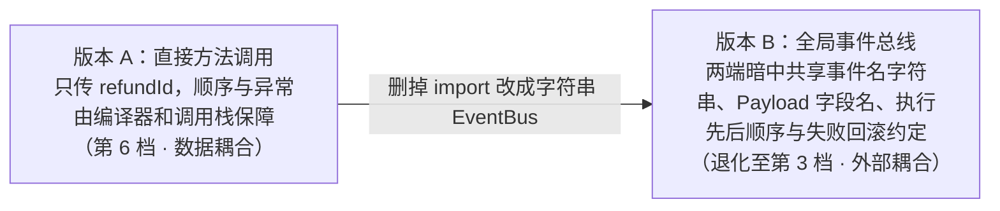
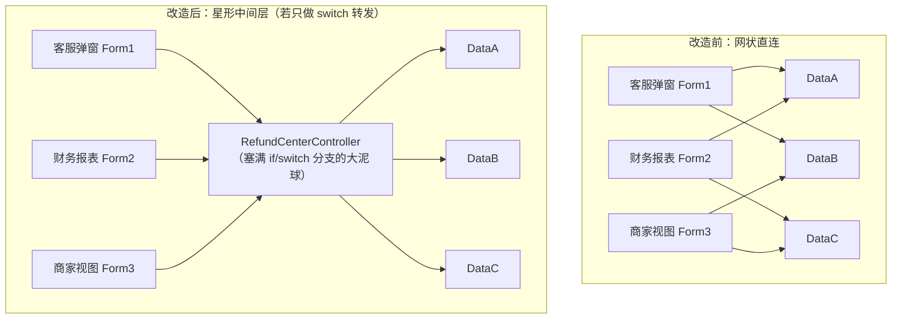

> 《编程思想》系列第 3/10 篇。这一季的立论在[序章](/zh/notes/programming-taste-in-the-agent-era/)。
>
> 代码越是容易生成，人对代码好坏的判断力就越值钱。这个系列是我把那些上了年纪的设计原则重新翻出来，逐条查清它们的出处、适用边界与失效场景的笔记。

[上一篇](/zh/notes/what-belongs-in-one-module/)讲了模块内部的内聚：只有修改代码时必须一起改的元素，才配住进同一个文件。

当把模块内部收拾干净之后，焦点就来到了模块与模块之间——也就是**耦合（Coupling）**。

到底什么叫耦合？用最通俗的话说，**耦合衡量的就是两个模块要想配合工作，到底得互相打听对方多少秘密。**

就像现实生活里两个人交接工作：

- **松耦合**就像去快递驿站寄件：你只管把打包好的箱子和收件地址递过去，拿到一张运单号就走人。至于驿站是用三轮车还是货车拉走、先分拣到哪个转运中心，你一概不知，他们换了货车也绝不会打电话通知你。
- **紧耦合**则像两个人在狭窄的厨房里共用一口锅炒菜：你必须时刻盯着对方什么时候放油、什么时候关火、盐罐子放在左边还是右边。对方稍微换个习惯，你手里的铲子就撞上去了。

很多人在审代码时，习惯拿一个省事的指标来代替耦合：**数文件顶部的 `import` 有几行**。以为删掉两行 `import`、把直接函数调用改成发事件或者读写公共缓存，就叫“解耦”成功了。

事实上，很多所谓的“解耦重构”，只是把原本摆在明面上、编译器能替你盯着的函数调用，变成了藏在暗处、靠人脑死记硬背的隐形契约。

我们还是从最直观的代码例子看起，一步步拆开那些看得见和看不见的耦合。

---

## 写在函数签名里的耦合：隔空指挥对方怎么干活

先看一个几乎每个项目都会写的参数设计：

```ts
// 退款提交入口：多带了一个布尔标志位 dryRun
async function submitRefund(req: RefundRequest, dryRun: boolean): Promise<RefundResult>

// 调用处
const res = await submitRefund(req, true)
```

调用处传进去的那个 `true` 看着不起眼，但它其实暴露了一个信号：**调用方非常清楚 `submitRefund` 肚子里的流程图长什么样**——它知道传 `true` 的时候，函数会走前半截算钱逻辑，然后跳过后半截真实的网关扣款和记账步骤。

更别扭的是返回值 `RefundResult`：当 `dryRun` 为 `true` 时，并没有真正发起退款，那返回结构里的 `status` 字段该填什么？`settledAt` 填什么？同一个返回类型被迫同时充当“预估试算结果”和“真实扣款回执”，调用方拿到返回值还得再结合自己刚才传的 `true` 或 `false` 猜一次语义。

这种“调用方传一个开关参数，隔空指挥被调方内部走哪条 `if/else` 分支”的做法，在软件工程里叫**控制耦合（Control Coupling）**。

怎么把它解开？直接把两个意图拆成两个边界清晰的函数：

```ts
// 试算预览：只传试算所需数据，返回明确的预览结构
async function previewRefund(req: RefundRequest): Promise<RefundPreview>

// 真实提交：只做真实扣款与记账，返回正式回执
async function submitRefund(req: RefundRequest): Promise<RefundResult>
```

拆开之后，调用方只需要说“我要预览”或者“我要提交”，再也不用替对方操心内部怎么跳步骤了。

> **顺手区分一个常见困惑**：不是所有布尔参数都叫控制耦合。比如 `formatAmount(money, { showCurrencySymbol: true })` 也有布尔值，但它描述的是“我期望返回的字符串长什么样（数据规格）”，而不是指挥对方跳过哪几步业务流程。**只有当参数迫使调用方去了解被调方的内部控制流时，才构成控制耦合。**

---

## 查回 1974 年的出处：耦合的六级标尺

和内聚一样，“控制耦合”这个概念同样出自 Constantine、Stevens 和 Myers 1974 年发表在《IBM Systems Journal》上的《Structured Design》[1]。

在 1974 年的原论文里，作者指出决定两个模块耦合松紧的核心因素有三个：

1. **接口有多复杂**（参数越多、结构越绕，越紧）；
2. **连向哪里**（连向模块公开的大门，还是直接把手伸进模块肚子里摸内部变量）；
3. **沿着连接传了什么**（只传纯数据最松，传控制开关次之，直接改对方代码最紧）。

后来的软件工程教材把这套标准整理成了从紧（差）到松（好）的六档耦合表[1]：

| 档位 | 名称 | 两个模块是怎么连上的？ | 退款系统里的典型例子 |
|---|---|---|---|
| **1（最紧/最差）** | **内容耦合**<br/>Content | 一个模块直接跨界读写另一个模块的私有内部状态或直接改其实现 | 客服模块绕过账本接口，直接修改 `WalletChannel` 内部的私有连接池状态 |
| **2** | **公共耦合**<br/>Common | 多个模块同时读写同一块全局可变状态（全局变量、公共内存表、无隔离共享表） | 对账任务和风控模块同时直接读写同一个全局 `refundCache` 字典 |
| **3** | **外部耦合**<br/>External | 共同依赖某个外部死板的报文格式、环境协议或全局事件字符串约定 | 发布方与订阅方共同依赖 `'refund.settled'` 事件名字符串、隐式 JSON 字段与触发顺序 |
| **4** | **控制耦合**<br/>Control | 调用方传 `flag` / `mode` 布尔开关，指挥被调方内部走哪条分支 | `submitRefund(req, dryRun: true)` |
| **5** | **标记耦合**<br/>Stamp | 对方只需要一个订单号和金额，你却把包含上百个字段的整张 `OrderEntity` 传了过去 | 计算手续费的函数签名写成 `calcFee(fullOrder: OrderEntity, fullUser: UserEntity)` |
| **6（最松/最好）** | **数据耦合**<br/>Data | 只通过显式参数传递对方完成工作所必需的最小纯数据 | `calcFee(amount: Money, channel: ChannelKind): Money` |

看懂这张表之后，再回头看很多项目里的“解耦操作”，就会发现一个惊人的反差：**很多为了减少 `import` 行数而做的重构，实际上是在把第 6 档（最松的数据耦合）往第 3 档甚至第 2 档（更紧的耦合）上推。**

---

## 藏在 `import` 之外的三种隐形耦合

函数签名里的控制耦合与标记耦合，至少还摆在明面上，TypeScript 编译器和 IDE 一眼就能看见。真正让人在生产环境里半夜惊醒的，是下面三种**抹掉了 `import`、却在运行时暗通款曲**的隐形耦合。

### 隐形耦合一：把直接调用换成字符串事件总线

先看一段最朴素的直接调用代码：

```ts
// 版本 A：显式直接调用（第 6 档 · 数据耦合）
class RefundService {
  constructor(
    private ledger: RefundLedger,
    private notifier: RefundNotifier,
  ) {}

  async settle(refundId: string): Promise<void> {
    await this.ledger.markSettled(refundId)
    await this.notifier.sendSettledNotice(refundId)
  }
}
```

在这段代码里，`RefundService` 顶部有两行 `import`，构造函数接收两个依赖，先记账、再发通知，清清楚楚。

某天有人觉得：“`RefundService` 认识两个外部类，耦合太高了！我们用事件总线（EventBus）解耦一下！”于是改成了版本 B：

```ts
// 版本 B：改成无类型事件总线（掉回第 3 档 · 外部耦合）
class RefundService {
  constructor(private bus: EventBus) {}

  async settle(refundId: string): Promise<void> {
    await this.bus.emit('refund.settled', { id: refundId })
  }
}
```

改完之后，文件顶部的两行 `import` 消失了，构造函数只剩一个 `bus`，表面上看清爽极了。

但耦合真的变松了吗？我们对照前面的等级表算一笔账：



- 在版本 A 里，`markSettled` 改个参数名，TypeScript 当场编译报错，IDE 一键就能跳过去；而且“必须等记账成功之后才能发用户通知”的先后顺序写在代码明面上。
- 在版本 B 里，如果有人把发布处的 `{ id: refundId }` 改成了 `{ refundId }`，编译期一片绿灯，直到上线后记账消费者读出 `undefined` 才炸锅；更要命的是，如果通知消费者跑得比记账消费者快，用户收到“退款已到账”短信点进页面一看，账本状态还是“处理中”。

**删掉两行 `import`，并没有消除业务上“结算必须记账”的强依赖，只是把编译器能检查的显式连接，藏进了编译器看不见的运行时字符串约定里。**

那什么时候才真的该用事件总线？判断标准很简单：**试着把订阅方直接拔掉，看发布方的主业务还能不能算成功。**

- 如果拔掉的是“发送营销积分”或“上报 BI 统计埋点”，主交易照样成立，用事件异步解耦非常合适；
- 如果拔掉的是“更新核心资金账本”，没记上账整个结算就算失败，那它们在业务上就是一根绳上的蚂蚱，老老实实显式调用远比发事件可靠。

### 隐形耦合二：通过共享可变状态“隔空传毒”

第二种连事件都不用发、就能让两个模块死死绑在一起的做法，是**共享可变状态（Shared Mutable State，第 2 档公共耦合）**：

```ts
// shared-cache.ts —— 全局共享的可变退款缓存
export const activeRefundCache = new Map<string, RefundRecord>()
```

假设系统里有两个完全不认识对方的模块：**风控拦截模块（RiskGuard）**和**异步对账任务（ReconciliationJob）**。它们谁也没有 `import` 谁，但都 `import` 了这个 `shared-cache.ts`。

灾难是怎么发生的？

1. 风控模块从 `activeRefundCache` 里取出订单 `ord_100` 的记录，看到状态还是 `Pending`，准备放行下一笔操作；
2. 就在风控做异步规则校验的这 20 毫秒里，后台对账任务并发跑了进来，直接原地修改了缓存里同一个对象的属性：`record.status = 'Settled'`，并顺手清空了临时校验字段；
3. 风控校验回来继续往下走，手里握着的同一个对象引用已经面目全非，当场算出错误的风控结论。

这种公共耦合最阴险的地方在于：**你用全局搜索能搜到谁引用了 `activeRefundCache`，但没有任何工具能告诉你“谁必须在谁之前写、谁假设哪个字段在读出后不会被别人偷偷篡改”。**

要拆掉这颗雷，要么传递不可变的数据快照（Immutable Snapshot），要么像我们在[第 7 篇（依赖倒置）](/zh/notes/dependency-inversion-who-owns-the-interface/)和第 8 篇（接口隔离）里讲的那样：收回裸露的全局 `Map`，只给风控暴露一个只读查询接口。

### 隐形耦合三：只会做“传声筒”的集散地中间层

很多人背过一句架构口诀：“计算机科学领域的任何问题，都可以通过增加一个间接的中间层来解决。”

于是看到三个前端页面（`Form1`、`Form2`、`Form3`）直接调用三个底层数据服务（`DataA`、`DataB`、`DataC`），觉得连线像蜘蛛网一样乱，就在中间插了一个 `RefundCenterController`：



从架构图上看，线确实变整齐了，从网状变成了漂亮的星形。

但如果打开那个 `RefundCenterController` 的代码一看，里面全写着 `if (caller === 'Form1') ... else if (caller === 'Form2') ...` 的透传逻辑——**那这个中间层根本没有解耦，它只是把原本分散在各处的耦合，集中搬到了同一个十字路口。**

- 以前 `Form1` 改个字段，只动 `Form1` 和 `DataA`；
- 现在不管是 `Form1` 加个按钮、`Form3` 改个筛选条件，还是底层 `DataC` 换个参数，所有人全都得排队去改 `RefundCenterController` 这同一个文件！

**判断一个中间层到底是“真解耦边界”还是“细节垃圾桶”，只需要看一件事：当它背后的底层实现发生变化时，这个中间层能不能自己把变化消化掉，不惊动上层调用方？** 如果底层每改一个字段，中间层都得原样改签名再传给上层，那它就是一层纯属多余的传声筒。

---

## 管住耦合的三条可检查准则

既然不能靠数 `import` 行数来判断耦合，在实际工程里我们靠什么把关？可以用下面三条能当场检验的准则：

### 1. 传递最小纯数据，别传整个大对象（标记耦合 → 数据耦合）

如果一个计算退款手续费的函数只需要知道“退款金额”和“渠道类型”，就千万不要把包含用户信息、收货地址、商品列表的整张 `Order` 大对象传进去：

```ts
// 糟糕（第 5 档 · 标记耦合）：为了一碟醋，传了一整桌满汉全席
function calculateRefundFee(order: Order, channel: ChannelConfig): Money

// 干净（第 6 档 · 数据耦合）：要什么传什么，写单测时连假 Order 都不用造
function calculateRefundFee(amount: Money, feeRateBps: number): Money
```

传得越少，函数对外部结构知道得越少，单元测试时构造入参的成本也越低。

### 2. 依赖绝对不能成环，且必须指向更稳定的一侧

- **破除循环依赖（No Cycles）**：如果模块 A 依赖 B、B 依赖 C、C 又反过来依赖 A，那这三者在修改成本上就已经焊死成了一个巨型模块——改其中任何一个，另外两个都得跟着重验。这种环可以用 `dependency-cruiser` 或 `madge` 在 CI 里直接拦截。
- **朝稳定方向依赖**：像 `Money`（金额与币种值对象）这种被全系统依赖、自身不依赖任何外部模块的底层基石，改动代价最高，也最稳定。业务流程应该单向依赖 `Money`，而绝不允许在 `Money` 里反过来 `import` 某个具体退款渠道的定义。

### 3. 宁要编译器能看见的显式耦合，不要藏在暗处的隐式耦合

把常见的连接方式按“改坏了之后谁能第一时间提醒你”排个序：

| 连接方式 | 当契约被改坏时，谁来报警？ | 维护成本与风险 |
|---|---|---|
| **显式函数参数 / 类型接口** | **编译器（TypeScript）** 在写代码当场直接画红线报错 | 最低（受影响的所有调用方一目了然） |
| **强类型事件总线** | 编译器能查事件名和 Payload 结构，但**查不出订阅顺序与失败回滚** | 中等（适合跨边界异步通知，不适合核心强事务） |
| **无类型字符串事件 / 消息** | 编译器完全失明，只能靠**全文搜索字符串 + 集成测试**撞大运 | 高（重构时极易漏改订阅方） |
| **共享全局可变状态（Map / 全局表）** | 全文搜索连**读写先后时序和并发竞态**都搜不出来，全靠线上故障报警 | 最高（极易引发偶发脏数据） |

在 AI 时代，这一点尤其关键：Coding Agent 最擅长的就是顺着编译器的类型报错一路自动修完所有受影响的调用点；但如果你把连接藏进了隐式的全局状态或无类型字符串事件里，连 Agent 也会在修改时漏掉远端的消费者。

---

## 小结：审视模块连接的三个问题

下次当你准备在两个模块之间搭桥、或者想做一次“解耦重构”时，先问自己三个问题：

1. **为了调用这个函数，我是不是被迫知道了它肚子里怎么写 `if/else`？** 如果是（比如得传 `dryRun` 或 `mode` 标志位），把它拆成两个语义明确的函数。
2. **我所谓的“解耦”，是真的减少了双方需要协商的知识，还是仅仅把编译期能查的 `import` 藏进了运行时的暗语里？** 如果两个步骤在业务上同生共死，显式调用远比发事件诚实。
3. **如果明天被调方改了约定，编译器能立刻把所有受影响的地方列出来吗？** 尽量让连接留在类型系统看得见的地方。

前两篇我们分别用“哪些代码必须一起改”和“两个模块互相了解多少”看清了内聚与耦合。但还有一个更根本的问题没有回答：**为什么有些代码总是要一起改？那些驱动代码发生变化的源头，到底是什么？**

这就是下一篇**单一职责原则**要揭示的答案：变化的源头不是代码，而是站在代码后面的人。

---

## 系列目录

- 序 · [在 AI 时代重读编程原则](/zh/notes/programming-taste-in-the-agent-era/)
- 内聚 · [判断标准是修改代码时要一起改](/zh/notes/what-belongs-in-one-module/)
- 耦合 · 衡量的是两个模块互相了解多少（本文）
- 单一职责 · [一个职责对应一拨会来提要求的人](/zh/notes/single-responsibility-is-an-actor/)
- 开闭 · [先判断代码会往哪个方向变](/zh/notes/open-closed-only-the-guessed-axis/)
- 里氏替换 · [子类必须能无缝顶替父类](/zh/notes/liskov-what-the-signature-does-not-check/)
- 依赖倒置 · [倒置的是接口的归属](/zh/notes/dependency-inversion-who-owns-the-interface/)
- 接口隔离 · 接口是客户端视角的切片
- 迪米特 · 得墨忒耳与中间人的两难
- 合成复用 · 继承会把不变量公开出去

## 参考资料

1. [W. P. Stevens, G. J. Myers, L. L. Constantine, "Structured Design", *IBM Systems Journal* 13(2), 1974, 115–139](https://dl.acm.org/doi/10.1147/sj.132.0115) —— 提出耦合强弱的三个决定因素（接口复杂度、连接目标、传递数据还是控制），并奠定了从内容耦合到数据耦合的分级体系。
