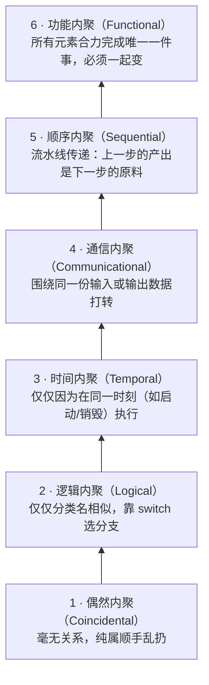
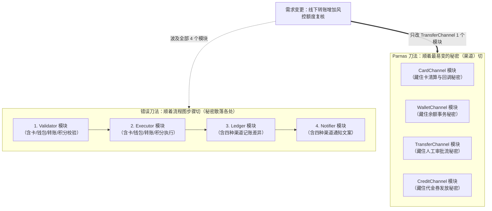

> 《编程思想》系列第 2/10 篇。这一季的立论在[序章](/zh/notes/programming-taste-in-the-agent-era/)。
>
> 代码越是容易生成，人对代码好坏的判断力就越值钱。这个系列是我把那些上了年纪的设计原则重新翻出来，逐条查清它们的出处、适用边界与失效场景的笔记。

写代码时，我们每天都在做同一个决定：眼前这几行函数、这几个数据结构，到底该塞进同一个文件里，还是拆到不同的模块去？

教科书给这个决定起了一个专门的名词，叫**内聚（Cohesion）**，还配了一句谁都会背的口号：“高内聚，低耦合。”

但一旦落到具体代码上，这句口号往往帮不上忙。比如：四个处理不同退款渠道的函数，名字都叫 `handleXxx`，参数和返回值也一模一样，把它们放进同一个类里，算不算高内聚？再比如：把一个 20 行的函数拆成两个 10 行的函数，分装进两个文件，内聚是变高了还是变低了？

如果用“代码长得像不像”或者“文件小不小”去回答上面两个问题，十有八九会掉进坑里。

用大白话讲，**内聚衡量的就是一个模块内部各个零件之间的“亲密度”——它们到底是凭什么理由住进同一个屋檐下的？**

你可以把模块想象成现实生活里的收纳盒：

- **低内聚**就像家里的“杂物抽屉”：指甲刀、五号电池、外卖优惠券、感冒冲剂全塞在一起，唯一的理由是“顺手没地方放”。
- **高内聚**则像外科医生的“手术缝合包”：持针钳、缝合线、镊子、组织剪——它们长相完全不同，但**少了一样，缝合这件事就干不完；而且只要手术规格变了，它们就得整套一起换**。

所以，判断内聚高低最可靠的标尺只有一条：**别看这几段代码表面上像不像，要看当需求变化时，它们是不是“必须一起改”**。

我们顺着退款子系统的代码，从最浅显的例子一步步往深处看。

---

## 一眼就能认出的反面教材：“杂物抽屉”式工具类

先看一段几乎每个项目里都能翻出来的代码：

```ts
// refund-utils.ts
export class RefundUtils {
  // 1. 把分转换成页面展示的金额字符串（给客服前端页面用）
  static formatCurrency(amountCents: number, currency: string): string {
    return `${currency} ${(amountCents / 100).toFixed(2)}`
  }

  // 2. 校验第三方支付网关的回调签名（给渠道接入层用）
  static verifyWebhookSignature(payload: string, signature: string, secret: string): boolean {
    // 调用加密库计算 HMAC...
    return true
  }

  // 3. 记录合规审计日志（给风控与合规模块用）
  static writeAuditLog(refundId: string, operatorId: string, action: string): Promise<void> {
    // 写入审计数据库...
    return Promise.resolve()
  }
}
```

这三个方法之间有任何关系吗？没有。

`formatCurrency` 伺候的是前端界面排版，`verifyWebhookSignature` 处理的是支付网关底层通信，`writeAuditLog` 应对的是合规审查。它们三个唯一共同的地方，就是写代码的人当时懒得想该放哪，顺手建了一个带 `Refund` 前缀的垃圾桶，把它们全扔了进去。

把不搭界的东西硬凑在一块，代价非常具体：

1. **无辜牵连的依赖**：前端展示组件本来只想调用 `formatCurrency` 把数字格式化成字符串，结果一 `import { RefundUtils }`，把底下验签用的加密库和写审计日志的数据库驱动全给连根拔起拽进了打包产物里。
2. **认知噪音**：任何想改网关验签逻辑的人，打开文件都得先越过一堆跟网络通信毫无关系的字符串格式化和日志代码。

怎么修也很直白：各回各家。`formatCurrency` 挪去展示层或 `Money` 值对象，`verifyWebhookSignature` 挪进支付网关适配器，`writeAuditLog` 挪去审计模块，然后把 `RefundUtils` 这个文件彻底删掉。

这种“杂物抽屉”在学术上叫**偶然内聚（Coincidental Cohesion）**——内聚程度最低的一档。不过在真实项目里，这种代码其实没那么可怕，因为它烂得太明显，稍微有点经验的程序员一眼就能看出来。

真正容易在代码评审里蒙混过关、甚至被当成“整洁代码”夸奖的，是下面这种。

---

## 最容易踩的隐形大坑：“按名词归类”的假内聚

来看这段专门处理退款分发的 `RefundHandler`：

```ts
type ChannelKind = 'card' | 'wallet' | 'transfer' | 'credit'

export class RefundHandler {
  async handle(channel: ChannelKind, req: RefundRequest): Promise<RefundResult> {
    switch (channel) {
      case 'card':
        return this.handleCard(req)
      case 'wallet':
        return this.handleWallet(req)
      case 'transfer':
        return this.handleTransfer(req)
      case 'credit':
        return this.handleCredit(req)
    }
  }

  private async handleCard(req: RefundRequest): Promise<RefundResult> {
    // 调卡组织网关，发起跨行清算，靠异步 Webhook 回调确认最终状态
  }

  private async handleWallet(req: RefundRequest): Promise<RefundResult> {
    // 在本地数据库事务里直接给用户钱包余额加钱，毫秒级同步完成
  }

  private async handleTransfer(req: RefundRequest): Promise<RefundResult> {
    // 生成线下打款工单，挂起等待财务人员人工网银转账并上传回单
  }

  private async handleCredit(req: RefundRequest): Promise<RefundResult> {
    // 调营销系统发一张补偿代金券，压根不发生任何真实资金流动
  }
}
```

第一次看这段代码，无论是人类的直觉还是 AI Agent，都会觉得它特别规整：

- 类名叫 `RefundHandler`（退款处理器）；
- 四个私有方法名字工整对称，全叫 `handleXxx`；
- 干的事情也全都是“退款”。

这不就是标准的高内聚吗？

**恰恰相反，它的内聚非常低。**

这就好比你把家里的**白糖、食盐、小苏打、洗衣粉**全装进同一个四格调料盒里，理由是“它们全都是白色粉末”。平时看着整整齐齐，一做饭就乱套。

仔细看注释里那四条路径的底细：

- **原路退银行卡**：跨公网调外部网关，耗时几秒到几天，靠异步回调推进状态，必须处理网络超时与幂等重放；
- **退钱包余额**：内部数据库事务，毫秒级同步成功，没有外部网络状态；
- **线下银行转账**：走财务人工审批流，周期以工作日计算；
- **积分/代金券补偿**：营销系统的权益发放，根本不碰资金账本。

发现了吗？这四件事的**外部依赖、耗时量级、失败模式、重试策略、修改原因，没有一条是一样的**。它们唯一共享的东西，仅仅是人类语言里“退款”这一个抽象分类词！

一旦业务需求找上门，这种“按名词归类”的脆弱性就会当场发作：

1. 下周风控部门提需求：“线下大额银行转账在人工审批前，必须多传一个风控复核员签名 `approverToken`。”
2. 为了满足线下转账这一个分支，你不得不打开 `RefundHandler`，修改公共入口 `handle(channel, req, approverToken?)` 的参数签名，或者往公共请求体里塞一个只有 `transfer` 才用得上的可选字段。
3. 银行卡、钱包、积分补偿明明一句话需求都没改，却因为跟线下转账住在同一个类里，被迫跟着重新编译、重新跑回归测试，甚至在合并代码时跟正在改银行卡逻辑的同事撞出 Git 冲突。

把“分类上属于同一种操作、靠 `switch` 或 `if` 参数选分支、但内部逻辑互不相干”的代码绑在一起，就叫**逻辑内聚（Logical Cohesion）**。

为什么说它是生产代码里最大的坑？因为 `RefundUtils` 一眼假，谁见了都知道要拆；而 `RefundHandler` **一眼真**，它用高度相似的方法名骗过了我们的眼睛，把四个未来会朝着完全不同方向演进的模块死死焊在了一起。

---

## 查回 1974 年的源头：内聚的六级台阶是怎么排的？

“偶然内聚”“逻辑内聚”这些词是从哪来的？

翻回历史源头，它们出自 Larry Constantine、Wayne Stevens 和 Glenford Myers 于 1974 年发表在《IBM Systems Journal》上的奠基论文《Structured Design》[1]。

当时他们研究了一大批程序，想弄清楚：**为什么有的系统改一行代码只动一个模块，有的系统改一行代码却像拔出萝卜带出泥？** 为此，他们根据“模块内部各个元素被放在一起的理由有多硬”，从低到高排出了六个台阶[1]（后来 Yourdon 和 Constantine 在专著里补了一档“过程内聚”变成七档，但核心逻辑没变）：

| 档位 | 名称 | 凑在一起的理由 | 生活中的比喻 | 退款系统里的代码实例 |
|---|---|---|---|---|
| **1（最低）** | **偶然内聚**<br/>Coincidental | 纯属巧合，毫无关系 | 家里的杂物抽屉 | `RefundUtils`（把格式化金额、网关验签、写审计日志塞一起） |
| **2** | **逻辑内聚**<br/>Logical | 名字/分类相似，靠参数 `switch` 选一条分支执行 | 把盐、糖、洗衣粉放一起，因为“都是白色粉末” | `RefundHandler`（用一个 `switch(channel)` 包揽卡、钱包、转账、积分四套完全不同的实现） |
| **3** | **时间内聚**<br/>Temporal | 必须在**同一个时间点**一起执行 | 早晨起床流程（关闹钟、拉开窗帘、烧水、刷牙） | `initRefundWorker()`（启动时同时执行：加载配置、连接账本库、预热汇率缓存、注册监控指标） |
| **4** | **通信内聚**<br/>Communicational | 虽然干不同的事，但都在读写**同一份数据** | 体检中心围绕同一份体检表做各项统计 | `summarizeOrderRefunds(order)`（拿着同一份订单快照，一边算剩余可退额度，一边生成客服端摘要） |
| **5** | **顺序内聚**<br/>Sequential | 流水线关系：**前一步的输出，正好是后一步的输入** | 洗菜 → 切菜 → 下锅炒 | `settleCardRefund()`（先解析网关原始回执 → 再换算成本币金额 → 最后写入结算账本） |
| **6（最高）** | **功能内聚**<br/>Functional | 所有代码紧密配合，**共同完成唯一一件完整的事**，少一行都完不成 | 外科手术缝合包 | 单独的 `WalletRefundChannel.submit()` 或 `Money.add()`（每一行都在为那一个明确目标服务） |

用一张图来看这六级台阶的跃迁：



这张表最精妙的地方，在于它戳破了一个直觉幻象：**第 2 档（逻辑内聚）和第 6 档（功能内聚）在代码表面上往往长得最像，但它们在维护成本上却隔着整整四个台阶。**

怎么把第 2 档的 `RefundHandler` 提上第 6 档？做法其实我们在[第 5 篇（开闭原则）](/zh/notes/open-closed-only-the-guessed-axis/)已经见过了：把四个渠道拆成四个独立的模块（`CardChannel`、`WalletChannel`、`TransferChannel`、`CreditChannel`），每个模块只管自己那个渠道的通信、重试与幂等。拆完之后，线下转账要加审批参数，你只需要打开 `TransferChannel` 这一个文件，其他三个渠道连文件都不会被碰一下。

---

## 走进模糊地带：三个最常见的边界误区

弄清了内聚的本质是“让必须一起变的东西待在一起”，我们再来看三个在实际写代码时最容易让人栽跟头的模糊地带。

### 误区一：以为“函数拆得越小、文件拆得越多，内聚就越高”

很多人背熟了“一个函数只做一件事”，在写代码或者用 AI 重构时，最喜欢干的事就是“把一个模块拆成两个更小的模块”，以为越碎就越内聚。

来看退款系统里的金额相加逻辑。[序章](/zh/notes/programming-taste-in-the-agent-era/)里我们立过第 4 条业务铁律：**不同币种的金额绝不能直接相加**。

原本这段逻辑写在一个函数里：

```ts
// money.ts —— 功能内聚（第 6 档）
export function addMoney(a: Money, b: Money): Money {
  if (a.currency !== b.currency) {
    throw new CurrencyMismatchError(a.currency, b.currency)
  }
  return { amount: a.amount + b.amount, currency: a.currency }
}
```

某天有位追求“极致拆分”的同事（或者一个被提示词要求“拆分职责”的 Agent）看它不顺眼：“这个函数里既做了参数校验，又做了算术加法，干了两件事！应该拆成两个独立模块！”

于是被拆成了这样：

```ts
// currency-guard.ts —— 只管校验币种
export function assertSameCurrency(a: Money, b: Money): void {
  if (a.currency !== b.currency) {
    throw new CurrencyMismatchError(a.currency, b.currency)
  }
}

// money-math.ts —— 只管把数字加起来
export function rawAddMoney(a: Money, b: Money): Money {
  return { amount: a.amount + b.amount, currency: a.currency }
}
```

拆完之后，每个函数确实只有两三行，看着“无比纯粹”。但内聚变高了吗？

**不仅没变高，反而从最高档（功能内聚）直接摔碎了！**

因为“检查币种一致”和“把金额数字加起来”根本不是两件独立的事——它们是**安全地把两笔钱加起来**这同一件事不可分割的前后两半：

1. **它们必须一起变**：哪天业务规则改成“允许传入汇率表自动折算后相加”，校验逻辑和计算逻辑必须同时修改；
2. **拆开破坏了不变量**：合在一起时，任何人调 `addMoney` 都绝对不可能绕过币种检查；拆成两个文件后，“必须先调 `assertSameCurrency` 再调 `rawAddMoney`”变成了一条靠人脑记忆的口头约定。只要有一个调用方忘了先调校验，100 日元和 100 美元就直接加成了 200 美元写进账本了。

记住一条铁律：**当两段代码共同守护着同一个业务不变量、或者一方改了另一方必改时，把它们拆开不是在提高内聚，而是在制造耦合与漏洞。**

### 误区二：面对新需求时，本能地顺着“处理流向”切模块

前面讲的都是怎么审视已经写出来的代码。更难的问题是：**当手里只有一个新需求、一行代码都还没写的时候，模块边界到底该画在哪？**

绝大多数人的第一反应，是在白板上画一张业务流程图：“处理一笔退款分四步——第一步校验参数，第二步调渠道扣款，第三步写账本流水，第四步发通知。”然后顺手就在项目里建了四个文件夹：

- `refund-validator/`（负责所有退款的校验）
- `refund-executor/`（负责所有退款的扣款执行）
- `refund-ledger/`（负责所有退款的记账）
- `refund-notifier/`（负责所有退款的通知）

这种顺着执行步骤切分模块的做法，早在 1972 年（比 Constantine 提出内聚等级表还早两年）就被软件工程先驱 David Parnas 明确点名批评过[2]。

Parnas 在那篇著名的《On the Criteria To Be Used in Decomposing Systems into Modules》里做了一个经典对比：

- 如果你**顺着流程图（执行步骤）切模块**，那么关于“某个退款渠道到底长什么样”的细节就会散落到全部四个步骤里——校验模块要知道线下转账有审批单号，执行模块要知道线下转账怎么生成工单，记账模块要知道线下转账处于待确认状态，通知模块要知道线下转账该发邮件给财务。
- 结果就是：每当“线下转账”的规则发生一点小变化，你就得同时打开四个文件夹、修改四个模块！

Parnas 给出的正确刀法叫做**信息隐藏（Information Hiding）**：**不要按执行步骤切模块，要先列出系统里“最难、最可能变化的设计决策（秘密）”，然后让每个模块各自包住一个秘密，对外死死藏住**[2]。

把两种切法放在一张图里对比，高下立判：



你看，Parnas 在 1972 年从“藏住变化的秘密”出发，Constantine 在 1974 年从“模块内部元素的亲密度”出发，两个人最终走到了同一个终点：**把因为同一个原因而变化的代码关进同一个笼子里。**

### 误区三：把“时间内聚”一刀切否定，或拿等级表当死板的验收标准

看完那张六档内聚表，很容易产生一种强迫症：“我的代码里绝对不能出现第 3 档（时间内聚）或第 4 档（通信内聚），必须全部改造成第 6 档！”

这也是教条主义。比如系统启动时的初始化函数：

```ts
// 典型的第 3 档：时间内聚（Temporal Cohesion）
export async function bootstrapRefundWorker(): Promise<void> {
  await loadChannelSecrets()
  await connectLedgerDatabase()
  await warmUpExchangeRateCache()
  startHealthCheckServer()
}
```

加载密钥、连数据库、预热汇率缓存、启动健康检查——这四件事在业务上毫无关联，凑在一起只是因为“服务启动这一刻必须做完”。按表查，它只有第 3 档。

但它需要被拆碎吗？**只要每个子步骤本身已经封装成了独立的函数（方便单测时单独调用），保留这个集中编排启动顺序的 `bootstrapRefundWorker` 不仅没毛病，反而是一目了然的好设计。** 把启动顺序拆得东一个钩子、西一个事件监听，出了启动死锁反而没人看得懂。

[序章](/zh/notes/programming-taste-in-the-agent-era/)里提到过一项实验：研究人员让 163 名软件工程专业的学生给同一个 Fortran 程序里的模块标注内聚等级，结果打分五花八门[3]。原因很简单——**代码静态文本里没有写着“未来什么需求会变”**。

如果一个系统未来三年绝不会新增支付渠道，但每个月都在调整统一的审计与通知步骤，那按步骤组织代码反而更顺手；反之，如果渠道规则三天两头变，按渠道切才是正道。六档内聚表不是游标卡尺，而是帮你审视“这段代码如果放一起，下次改需求时谁会陪绑”的思考清单。

---

## 小结：判断内聚的三个问题

下次当你纠结“这几个函数/类到底该合在一起还是拆开”时，不用去背那六个学术名词，直接问自己三个问题：

1. **它们是因为“长得像/名字像”才放一起，还是因为“共同完成同一件事”才放一起？** 如果只是名字里都带 `Refund` 或 `Util`、内部靠 `switch` 各干各的，果断拆开。
2. **当需求变化时，它们是不是总要一起改？** 如果改了 A 函数，B 函数必须跟着改才能保住业务铁律（比如币种校验与金额相加），那就把它们锁进同一个模块，绝不要为了追求“小文件”而硬拆。
3. **如果这是一个新模块，它替系统藏住了哪一个容易变化的秘密？** 顺着可能发生变化的业务决策画边界，而不是顺着流程图的步骤画边界。

当我们把每一个模块内部都收拾妥当、让该待在一起的代码紧密抱团之后，下一个问题自然就浮出来了：**模块与模块之间总得打交道；怎么判断两个模块之间是不是绑得太死？为什么有些模块明明一行 `import` 都没有，改一处却依然会把另一处搞崩？**

这就是下一篇**耦合**要拆解的主题。

---

## 系列目录

- 序 · [在 AI 时代重读编程原则](/zh/notes/programming-taste-in-the-agent-era/)
- 内聚 · 判断标准是修改代码时要一起改（本文）
- 耦合 · [衡量的是两个模块互相了解多少](/zh/notes/three-invisible-couplings/)
- 单一职责 · [一个职责对应一拨会来提要求的人](/zh/notes/single-responsibility-is-an-actor/)
- 开闭 · [先判断代码会往哪个方向变](/zh/notes/open-closed-only-the-guessed-axis/)
- 里氏替换 · [子类必须能无缝顶替父类](/zh/notes/liskov-what-the-signature-does-not-check/)
- 依赖倒置 · [倒置的是接口的归属](/zh/notes/dependency-inversion-who-owns-the-interface/)
- 接口隔离 · 接口是客户端视角的切片
- 迪米特 · 得墨忒耳与中间人的两难
- 合成复用 · 继承会把不变量公开出去

## 参考资料

1. [W. P. Stevens, G. J. Myers, L. L. Constantine, "Structured Design", *IBM Systems Journal* 13(2), 1974, 115–139](https://dl.acm.org/doi/10.1147/sj.132.0115) —— 首次系统提出内聚（Cohesion）与耦合（Coupling），并给出从偶然内聚到功能内聚的六档分级。
2. [D. L. Parnas, "On the Criteria To Be Used in Decomposing Systems into Modules", *Communications of the ACM* 15(12), 1972, 1053–1058](https://dl.acm.org/doi/10.1145/361598.361623)（[PDF 原文](https://wstomv.win.tue.nl/edu/2ip30/references/criteria_for_modularization.pdf)）—— 对比按流程图步骤切分模块与按信息隐藏（藏住易变设计决策）切分模块的维护代价。
3. [N. Fenton et al., "Difficulties using cohesion and coupling as quality indicators", *Software Quality Journal*, 1993](https://link.springer.com/article/10.1007/BF00590439) —— 记录 163 名评估者对同一程序模块标注内聚与耦合等级时的显著分歧。
