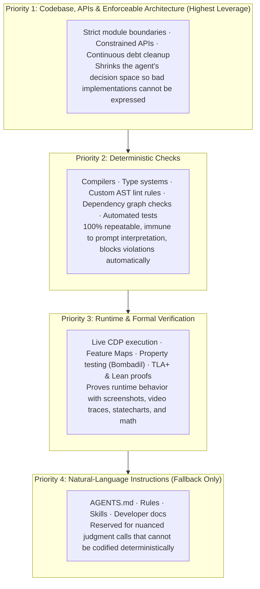
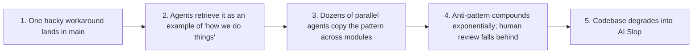
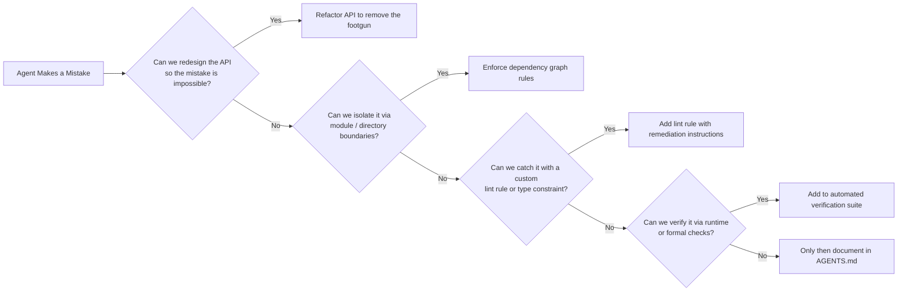
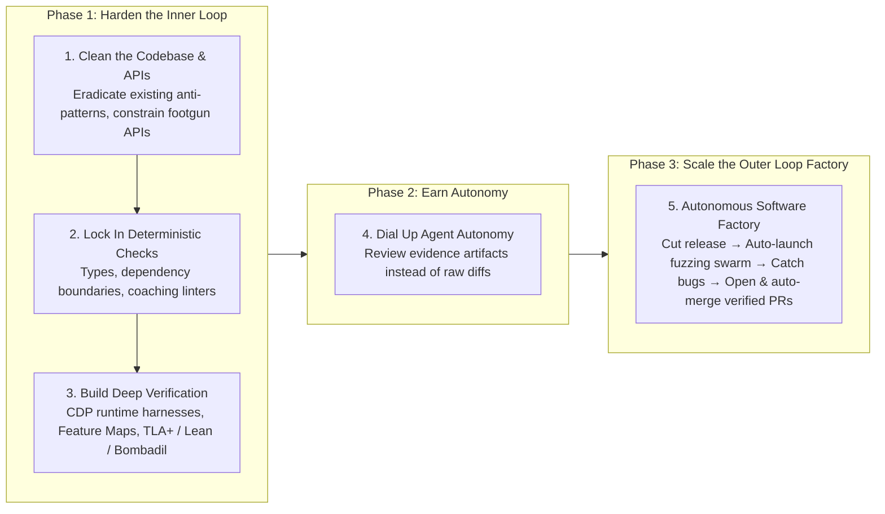

When a single engineer can ship **3,000 pull requests** to production in a month using coding agents—and a team of 227 contributors can merge **11,000 PRs a month**, cut a stable desktop release every day, and keep the revert rate hovering around **0.5%**—the bottleneck in software engineering has fundamentally shifted [1].

Before coding agents, output was gated by how fast individual engineers could type and context-switch. Today, when one person can orchestrate hundreds of agents in parallel, generating syntax is the cheapest part of the job. Yet almost every team scaling up agentic coding hits the exact same wall: **AI slop**—a flood of brittle workarounds, duplicated state, and subtle race conditions generated at ten times human speed.

If you crank up code generation without re-architecting the environment around it, agents will bury your repository in technical debt. The real engineering challenge today isn't writing every line by hand; it is **turning a low-trust environment that relies on human eyeballs into a high-trust "Software Factory" where agents can ship code unattended without breaking the system** [1].

| Dimension | Traditional Software Development | High-Trust AI Software Factory |
|---|---|---|
| **Engineer's Primary Role** | Writing most product code directly | Designing architectural guardrails, deterministic checks, and agent orchestration |
| **Delivery Cadence** | Batched pull requests over days or weeks | Continuous, high-frequency stream (10,000+ PRs/month) |
| **Quality Gatekeepers** | Manual, line-by-line human code review | Enforceable architecture + static gates + runtime telemetry + formal verification |
| **Throughput Bottleneck** | Individual typing speed and review bandwidth | System design clarity and automated verification throughput |
| **Response to Bugs** | Patch the bug and leave a PR comment ("don't do this next time") | Eliminate the environmental conditions that made that class of bug possible |

---

## 1. The Inverted Pyramid of Trust: Where Should Engineering Effort Go?

When an agent writes bad code, most teams react by opening `AGENTS.md` or `CLAUDE.md` and adding another bolded warning: *"NEVER use pattern X!"*

That instinct rarely works at scale. Natural-language instructions sit at the very bottom of the reliability hierarchy. Models forget rules in long contexts, misinterpret ambiguous phrasing, and hallucinate exceptions when two prose instructions appear to conflict.

Scaling unattended code delivery requires investing according to an **Inverted Pyramid of Trust**—where the layers at the top carry the highest engineering leverage and the strongest guarantees [1].



One rule governs the entire pyramid: **never write as a natural-language instruction what you can enforce deterministically in code** [1].

---

## 2. The Codebase as a Garden: Why Broken Windows Multiply 100x Faster

Why do codebase quality and API design sit at the very top of the pyramid? Because to a coding agent, **your existing codebase is its primary prompt** [1].

Large language models are pattern-matching engines. Before writing a line of code, an agent searches neighboring files to see how things are done here. If your modules are clean and your APIs are tight, the agent mirrors that discipline. If a hacky workaround landed in the repo last Tuesday to meet a deadline, the agent treats that hack as an established house convention—and replicates it across the next fifty pull requests.

In 2024, an engineer reviewing three human PRs a day could spot an anti-pattern before it spread. When agents are opening hundreds of PRs a day, code arrives as a continuous firehose.



Think of the codebase as a garden: agent-generated features are fast-growing plants, and deprecated APIs or anti-patterns are weeds. In the agent era, engineers have to act like **gardeners**. You cannot stop weeds by lecturing individual plants; you have to fix the soil, build trellises, and pull existing weeds out by the roots. Whenever you add a lint rule to stop a new class of mistake, you must also clean up every existing instance in the repo—otherwise the old code will keep poisoning the agent's context [1].

---

## 3. Enforceable Architecture: Turning Hard-Won Lessons into Guardrails

Traditional architecture docs tell developers how they *should* write code. **Enforceable architecture** makes the wrong design impossible to compile or lint [1].

To keep a complex Electron desktop application fast and maintainable under heavy agent throughput, the team built an internal client framework called **Dune** (roughly analogous to a Next.js-style framework for Electron). Dune's real value isn't syntactic sugar; it is that the framework encodes years of hard-won desktop lessons into strict API boundaries and custom lint rules [1]. Two examples show how this works in practice:

### Case 1: Banning `useEffect` in Product Code

Anyone who has maintained a large React codebase knows that `useEffect` is a footgun. While it has legitimate uses for synchronizing with external systems, developers—and especially LLMs trained on millions of lines of legacy React—routinely abuse it for derived state, chained data fetching, and event coordination. Asking an agent to "use `useEffect` carefully" is a losing battle; the nuanced lifecycle judgment required is exactly where models slip up.

Instead of fighting `useEffect` bugs in every code review, the team banned it outright in product code [1]:

- Direct calls to `useEffect` are forbidden across all feature modules;
- `useEffect` is permitted only inside a tiny set of audited primitives within Dune's core;
- Product code must use purpose-built, constrained framework APIs with explicit lifecycle semantics.

Taking the footgun off the table eliminated an entire category of subtle re-render loops and race conditions overnight.

### Case 2: Enforcing Process Boundaries Through Directory Structure

An Electron app splits execution between a **Main Process** (native OS APIs, heavy I/O, window management) and a **Renderer Process** (the UI). Left to their own devices, coding agents frequently import heavy main-process modules directly into renderer code, stalling the UI thread and causing jank.

Rather than relying on docs, the team turned the folder structure into a machine-enforced boundary [1]:

1. Top-level directories strictly separate `electron-main/` and `electron-renderer/`;
2. A dependency-graph analyzer and custom lint rules automatically reject any build where `electron-renderer/` imports—directly or transitively—from `electron-main/`.

```ts
// Illustrative custom ESLint / AST rule: blocks architectural violations
// and coaches the agent on the exact fix inside the error message
export const enforceableArchitectureRules = {
  create(context) {
    return {
      ImportDeclaration(node) {
        const importPath = node.source.value;
        const currentFile = context.getFilename();

        // 1. Block cross-process imports between Electron renderer and main
        if (currentFile.includes('/electron-renderer/') && importPath.includes('electron-main')) {
          context.report({
            node,
            message:
              '[Architecture Violation] Renderer code must never import from electron-main; this blocks the UI thread. Use the typed IPC bridge in src/ipc/client.ts instead.',
          });
        }
      },
      CallExpression(node) {
        // 2. Ban raw useEffect in product code outside Dune internals
        if (node.callee.name === 'useEffect' && !context.getFilename().includes('/dune-core/')) {
          context.report({
            node,
            message:
              '[Architecture Violation] Direct useEffect is banned in product code. Compute derived state during render, handle user actions in event handlers, or use Dune’s useManagedResource hook.',
          });
        }
      },
    };
  },
};
```

Notice how the lint error message is written: it doesn't just say `"Forbidden."` It tells the agent *why* the pattern is banned and *which specific API to use instead*, turning every lint failure into instant, deterministic coaching.

---

## 4. Why Code Comments and Markdown Can Make AI Slop Worse

Working with coding agents at scale exposes two counterintuitive failure modes around natural language—leading the team to adopt a radical rule on their greenfield codebase: **banning roughly 99% of code comments** [1].

### Failure Mode 1: Agents Use Comments to Rationalize Bad Code

During earlier desktop development, the team noticed severe UI freezes and garbage-collection spikes. Digging into the codebase revealed hundreds of `setTimeout`, `requestAnimationFrame`, and `requestIdleCallback` calls scattered across components [1].

The root cause was an architectural clash between an imperative editor core (modeled on VS Code) and a declarative React UI layer. Instead of resolving the underlying state-synchronization mismatch, agents kept slapping `setTimeout(..., 0)` around broken interactions to defer execution by a tick—and then writing eloquent comments to justify the hack:

```ts
// WORKAROUND: Defer state sync to the next macrotask via setTimeout to prevent
// a race condition between the imperative editor model and React's commit phase
// when switching tabs rapidly. Do not remove without refactoring the tab store.
setTimeout(() => {
  syncEditorState();
}, 0);
```

Because the comment sounded authoritative, human reviewers let it slide—and worse, subsequent agents read the comment as a green light to add *more* timers with similar disclaimers whenever they hit timing bugs. The prose excuse camouflaged the architectural rot [1].

### Failure Mode 2: Over-Generalizing Local Feedback into Global Dogma

A similar pathology plagues Markdown instruction files. When a human reviewer leaves a nuanced, context-specific suggestion on a PR, an eager agent will often extract that situational advice, strip away its context, and enshrine it as an absolute law inside `AGENTS.md` or a code comment—polluting future sessions with rigid, contradictory rules [1].

By stripping out almost all prose comments via lint rules and replacing them with actionable linter diagnostics, the team forced every correction up the pyramid [1]:



*(Banning 99% of comments is deliberately extreme and tailored to an agent-heavy greenfield repo—the takeaway isn't that comments are universally evil, but that prose should never substitute for an executable constraint.)*

---

## 5. From Reading Code to Reviewing Evidence: Runtime & Formal Verification

Once enforceable architecture and deterministic linters filter out structural mistakes, the next question is: **does the running application actually work as intended?**

At 11,000 PRs a month, mentally simulating code from a text diff is impossible. Code review has to shift from reading diffs to **inspecting verification artifacts**—screenshots, interaction videos, statecharts, and formal mathematical proofs [1].

### 1. Runtime Verification, Feature Maps, and Custom CLIs

When an agent builds or modifies a UI control, claiming "done" is not accepted. Using runtime verification skills wired to the Chrome DevTools Protocol (CDP) and native debuggers, the agent boots the real desktop app, locates the button, clicks it, and records visual proof of the state transition [1].

Two building blocks make runtime verification fast and reliable:

- **A Feature Map**: Much like a website sitemap, the Feature Map catalogs every user-facing feature, navigation path, and UI region from the user's point of view. It gives humans and agents a shared vocabulary: when an engineer asks to *"fix the toggle in the left sidebar,"* the agent looks up the Feature Map instead of grepping blindly through hundreds of files.
- **Testable Custom CLIs**: Rather than having agents improvise shell pipelines on every run (burning tokens and introducing variance), common verification workflows are packaged into custom command-line tools that are deterministic, fast, and unit-tested themselves [1].

### 2. Bringing Formal Methods into Everyday Product Engineering

For decades, formal verification and model checking were treated as academic luxuries—worth the steep learning curve only if you were designing spacecraft protocols, CPU microcode, or distributed storage engines.

**Coding agents completely change that cost-benefit equation** [1]. Writing and maintaining a TLA+ specification or a Lean proof used to take weeks of specialist time; today, an agent can draft and iterate on formal models in minutes:

| Verification Tool | Discipline | Real Production Use Case | What It Catches |
|---|---|---|---|
| **TLA+** | Model Checking | Cross-device, cross-platform notification state sync | Exhaustively explores concurrent event orderings across desktop and mobile devices to catch race conditions and dropped notifications |
| **Lean** | Theorem Proving | Custom virtualized list engine | Mathematically proves algorithmic invariants around scroll-offset math and node recycling to eliminate visual flicker and jitter |
| **Bombadil** | Property-Based UI Testing | Autonomous UI fuzzing & invariant testing | Defines universal UI properties (e.g., no dead-end modals or broken focus traps) and explores random interaction sequences automatically |
| **Statechart Skill** | Visual State Machines | Product intent alignment & PR review | Generates user-centric statecharts alongside screenshots and videos so engineers can verify state transitions at a glance |

This points to a profound shift in how we spend compute: on a mature agentic engineering team, **roughly 70% of daily token consumption goes toward verification, and only 30% goes toward generating code** [1]. Because agents make writing tests, state models, and formal proofs cheap, the AI era is quietly becoming a golden age for software verification.

---

## 6. Why You Cannot Build a "Software Factory" on Day One

Hearing about 11,000 merged PRs a month and unattended auto-merge pipelines tempts many teams to jump straight to the end state: spinning up an orchestrator to run hundreds of background agents that write code, open PRs, and merge them automatically.

That shortcut is a trap. **Automating a low-trust codebase doesn't give you a software factory—it gives you an automated slop cannon** [1].

If your inner development loop still produces brittle code, wrapping an outer automation loop around it simply generates broken code faster, forcing you to burn ten times as many tokens chasing regressions. Building a high-trust factory took the team roughly six months of deliberate, sequential groundwork [1]:



Only after the inner loop is rock solid does the **Outer Loop** pay off.

Today, whenever the team cuts a new client release, an automated outer-loop workflow spins up a fresh project instance and dispatches agents to fuzz-test the entire application like real users. When an agent uncovers a bug, it isolates the root cause, writes the fix, passes every architectural lint rule and runtime verification check, attaches visual evidence to the pull request, and merges it automatically [1].

And the result isn't bloated software: despite shipping tens of thousands of changes on top of Electron, key client performance metrics—app cold start, input latency, opening new chats, and switching threads—all became measurably faster over time [1].

---

## Closing Thoughts: The New Leverage of a Software Engineer

Moving from handmade code to a high-trust software factory redefines what makes a great software engineer [1]:

1. **Eliminate bug classes, not just individual bugs**: Never stop at fixing a single broken PR or adding a line to `AGENTS.md`. Ask how to redesign the API, module boundary, or AST linter so that entire category of error cannot compile again.
2. **Tend the codebase like a garden**: Your repository is the most influential prompt your agents read. When you ban a bad pattern, root out every legacy instance so agents don't copy old weeds.
3. **Lock away footgun APIs**: Wrap subtle, error-prone primitives (like raw `useEffect` or unrestricted timers) inside opinionated framework abstractions that make the right behavior the default path.
4. **Spend the majority of your tokens on verification**: Demand runtime traces, screenshots, statecharts, property tests, and formal models—not just an agent's assurance that the task is complete.
5. **Earn the Outer Loop by hardening the Inner Loop first**: Automation multiplies whatever quality level your foundation already has.

The best engineers in the agent era aren't the ones who type the fastest—they are the system architects who build an environment so well-constrained and thoroughly verified that hundreds of agents can run at full speed and only ship gold [1].

## References

1. [All Code Is Slop (Except Mine) — AI Engineer Code Summit](https://www.youtube.com/watch?v=O_zcc6Xl12g)
