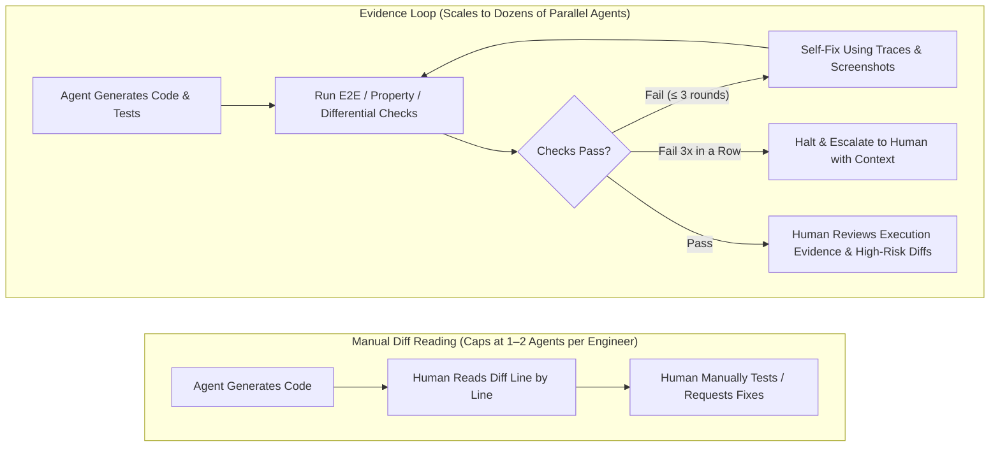
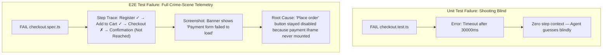
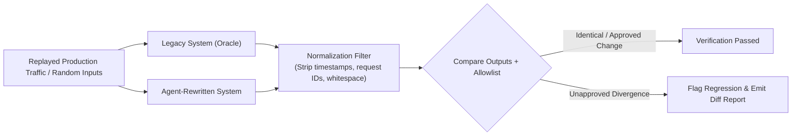
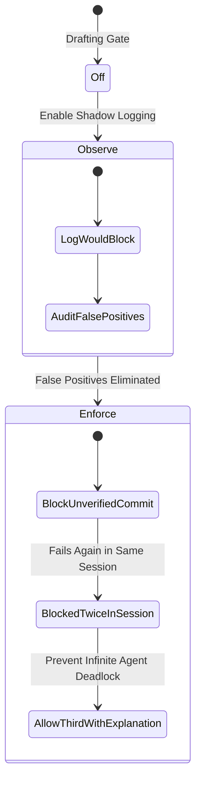

On the Claude Code team, roughly 90% of the codebase is now written—and initially reviewed—by AI. When code generation reaches that velocity, the first thing to break isn't the model's ability to write syntax. It's human attention.

Without automated verification, a single engineer can realistically babysit only one or two coding agents at a time, because every diff still has to pass through human eyeballs. Once you close the loop with automated, evidence-generating verification, that same engineer can run dozens or even hundreds of agents in parallel.

Internal benchmarks back this up: on structured file generation tasks, simply having a separate grader check the agent's output against an explicit rubric boosted task success rates by up to 10 percentage points over a standard prompting loop, with the biggest gains showing up on the hardest problems [1].

Historically, writing comprehensive end-to-end suites, property-based tests, benchmarks, and technical specs was expensive enough that teams routinely cut corners under deadline pressure. Agents flip that economics on its head. Asking an agent to generate a test harness or benchmark takes seconds. And once generated, those tests run deterministically as ordinary software—executing thousands of times a day without burning additional LLM tokens.

When code becomes cheap to produce, the engineer's job shifts from writing and reading every line of code to **defining what "done" looks like and building a verification layer that an agent cannot game**.



---

## Why "Ask the Agent to Write Unit Tests" Isn't Enough

The first instinct on most teams adopting coding agents is to tell the model: *"Write the feature, and write unit tests for it."* In practice, that habit creates a dangerous illusion of safety.

The culprit is **shared blind spots (collusion and happy-path bias)**. When the same agent in the same context window writes both the implementation and example-based unit tests, the tests naturally mirror the implementation's assumptions.

Suppose you ask an agent to write a function that splits an order discount across line items. If the agent uses floating-point arithmetic, it will almost certainly write happy-path test cases like `expect(split(100, 2)).toEqual([50, 50])`. The test suite turns solid green, and the bug only surfaces in production when a customer splits `100` across `3` items and a penny vanishes into a rounding error. The agent and its unit test didn't verify the requirement—they agreed on the same misunderstanding.

Even beyond shared blind spots, any test suite used to steer an agent has to avoid two classic failure modes [1]:

1. **Flaky tests**: If a test fails intermittently, you are effectively training the agent via reinforcement learning to "reward hack"—blindly re-running the test suite until it turns green instead of diagnosing the underlying bug.
2. **Slow tests**: If a verification run takes twenty minutes, the agent will run checks less frequently and batch larger changes together, making it far harder to isolate which edit broke the build.

Avoiding those traps requires leaning on three high-leverage testing strategies that are much harder for an agent to fool [1].

| Test Type | Core Mechanism | What It Catches Best | Ideal Use Cases |
|---|---|---|---|
| **End-to-End (E2E)** | Drives the real running application through complete user journeys | Broken integration seams, stuck UI states, false positives from over-mocking | Core user flows, UI workflows, full-stack smoke testing |
| **Property-Based** | Asserts mathematical/business invariants across thousands of randomized inputs | Unforeseen edge cases, serialization data loss, rounding & idempotency bugs | Parsers, financial math, state machines, legacy rewrites |
| **Differential** | Runs the old system and the new system side by side as a behavioral oracle | Subtle behavioral regressions introduced during refactoring or migration | Large-scale migrations, language ports, performance rewrites |

---

## Three Verification Strategies Worth Investing In

### 1. End-to-End (E2E) Tests: Giving the Agent Hands and Eyes

If you can only invest in one kind of verification, make it **end-to-end testing**.

Unit tests are fast, but because they mock out the surrounding system, it is painfully common for every unit test to pass while the actual application fails to render. E2E tests walk through real user journeys—adding an item to a cart, filling out payment details, clicking checkout, and landing on the confirmation screen. They are notoriously difficult to fake: either the whole feature works end to end, or it doesn't [1].

Just as importantly, E2E tests produce vastly richer **evidence** when they fail.



A timed-out unit test hands the agent a cryptic `Error: Timeout after 30 seconds` with no clue where execution stalled. An E2E runner captures the step-by-step execution trace, a screenshot of the exact failure state, and the DOM snapshot—telling the agent directly that *"Checkout failed because the 'Place order' button remained disabled after the payment form failed to load."*

To make this work in practice, give the agent direct access to the running environment [1]:

- **Web applications**: Connect the agent via the Chrome DevTools Protocol (CDP) or a browser extension so it can boot the app, click through flows, inspect network calls, and take screenshots.
- **Mobile & desktop apps**: Wire up iOS/Android simulators or desktop computer-use harnesses.
- **Backend services**: Let the agent spin up the local service and fire real requests against live endpoints.

Maintaining a **Feature Map**—a structured catalog of user flows, keyboard shortcuts, DOM selectors, and expected outcomes written from the user's perspective—doubles as both an implementation guide and an automated grading rubric for the agent [1].

### 2. Property-Based Testing: Catching Shared Blind Spots with Invariants

Example-based tests only check the scenarios you thought of. **Property-based tests** hunt down the edge cases that neither the human nor the agent anticipated [1].

Instead of asserting specific input-output pairs, you state a **property (an invariant that must hold true for all valid inputs)** and let a library (`fast-check` in TypeScript/JavaScript, `Hypothesis` in Python, `proptest` in Rust) bombard the code with thousands of generated inputs—empty strings, zero values, extreme integers, nested Unicode, and pathological arrays. When an input breaks the invariant, the framework automatically **shrinks** it down to the smallest possible counterexample and hands that minimal reproducer straight to the agent.

Four universal properties show up across almost every codebase [1]:

1. **Round-trip encoding**: Encoding `X` and decoding it back (or serializing/deserializing, parsing/formatting) must always return `X` intact.
2. **Domain invariants**: Rules that can never be violated regardless of state transitions—such as *"an account balance can never drop below zero"* or *"allocated line-item discounts must sum to the exact total discount."*
3. **Idempotency**: Running a migration, normalization pass, or retry handler twice must produce the exact same state as running it once.
4. **Equivalence**: A complex, performance-optimized algorithm must produce the exact same output as a naive, obviously correct reference implementation across all inputs.

Here is a concrete TypeScript example using `fast-check` to verify an order discount allocation function written by an agent:

```ts
import fc from 'fast-check';

// Function under test: proportionally distributes `discount` across `items`
function allocateDiscount(items: number[], discount: number): number[] {
  // Agent-generated implementation...
}

test('discount allocation preserves financial invariants across all inputs', () => {
  fc.assert(
    fc.property(
      fc.array(fc.integer({ min: 1, max: 1_000_000 }), { minLength: 1, maxLength: 50 }),
      fc.integer({ min: 0, max: 1_000_000 }),
      (items, rawDiscount) => {
        const total = items.reduce((a, b) => a + b, 0);
        const discount = Math.min(rawDiscount, total);
        const allocated = allocateDiscount(items, discount);

        // Invariant 1: Output length must match input line items
        expect(allocated.length).toBe(items.length);

        // Invariant 2: No item discount can be negative or exceed the item's price
        allocated.forEach((amount, i) => {
          expect(amount).toBeGreaterThanOrEqual(0);
          expect(amount).toBeLessThanOrEqual(items[i]);
        });

        // Invariant 3: Allocated amounts must sum to the exact discount (no lost pennies)
        const allocatedSum = allocated.reduce((a, b) => a + b, 0);
        expect(allocatedSum).toBe(discount);
      }
    ),
    { numRuns: 5000 }
  );
});
```

Because `fast-check` generates inputs without the LLM's training biases, off-by-one rounding bugs and division-by-zero edge cases surface in milliseconds. Property tests are also invaluable when refactoring legacy modules whose written specs drifted away from production reality years ago [1].

### 3. Differential Testing: Using the Old System as the Oracle

During large-scale migrations, framework upgrades, or language rewrites, the primary specification is simple: **don't change existing behavior**.

Rather than writing thousands of assertions by hand, **differential testing** uses the legacy system itself as the ground-truth oracle. You feed identical fuzzed inputs—or replayed slices of real production traffic—into both the old implementation and the new agent-written implementation, and flag any divergence [1].



Two practical details make differential testing work in production [1]:

1. **Output normalization**: Strip nondeterministic noise—such as timestamps, generated UUIDs, formatting whitespace, or unordered map keys—before comparing outputs.
2. **An explicit allowlist**: When the new system intentionally fixes a legacy bug or updates a schema field, record that expected divergence in an allowlist so the harness only alerts on unintended regressions.

---

## Keeping the Verifiers Honest: 8 Engineering Guardrails

Writing strong tests is only half the battle. If an autonomous agent has write access to the repository, it can easily "pass" a failing check by weakening the test assertion or editing the review rules. Here are eight operational practices the Claude Code team uses to keep its verification pipeline honest [1].

### 1. Verification Means Running the Change (`verify` Skills)

Static types and unit tests are never a substitute for booting the application. Just as you wouldn't ship an iOS change without launching the simulator, an agent shouldn't commit code without running the app end to end.

The team codifies how to launch the app and run smoke checks inside a `verify` skill placed in `.claude/skills/`, as close as possible to the relevant module. Before committing, the agent automatically invokes `verify` to drive the live system. Engineers also task agents with stress-testing and speeding up the `verify` skill itself so the smoke-test harness stays rock solid [1].

### 2. A Three-Round Circuit Breaker Routes Human Attention

When nobody can read every line of generated code, **test failures become the routing mechanism for human attention**.

When a check fails, the agent reads the error trace and attempts a fix. However, **if a check is still failing after three repair rounds, the agent stops immediately and escalates to a human** [1]. Capping self-repair at three rounds prevents agents from spiraling into destructive patch loops when the real issue is an architectural dead end.

### 3. Code Owners Author Their Own Checks

The engineers who own a subsystem write and tune the automated checks for it until the checks flag the exact issues the owners would flag in a manual review. And whenever a check pulls a human into the loop, **it must state plainly why it fired**, sparing the reviewer from having to reverse-engineer the problem from a raw diff [1].

### 4. Diff-Triggered Reliability Checklists

Every mature engineering team accumulates post-mortem lessons, but nobody can memorize dozens of past outages—and dumping fifty rules into every prompt dilutes the model's attention.

The Claude Code team maintains a **39-item reliability checklist** where every item pairs three things:

- **A diff trigger** that can be matched mechanically against changed files or symbols
- **A specific verification check**
- **Links to the historical incidents or PRs that motivated it**

For example, one item checks that `--resume loads old transcripts`. Whenever a diff touches session storage or message schemas, that trigger fires and asks the reviewer to verify that newly added fields degrade gracefully when loading older transcripts that lack them.

On any given change, the agent scans the diff and **activates only the 3 to 10 checklist items whose triggers match**—preserving institutional memory without bloating context [1].

### 5. One Tuned Reviewer Over Multi-Round Context

Stacking multiple expensive AI reviewers on top of each other rarely pays off; tuning a single primary reviewer via a concise `REVIEW.md` file works better and costs less.

Crucially, verification rounds aren't stateless. **Each pass inherits the context and failure history from earlier rounds**, focusing on incremental changes and unresolved issues rather than re-auditing the entire diff from scratch [1].

### 6. Changes Cannot Modify the Rules That Judge Them

If a pull request can edit the check that grades it, the check is broken. The team enforces strict separation between the code under review and the referee [1]:

- **Base-branch rule isolation**: The review runner always reads `REVIEW.md` and gating scripts from the base/default branch—**never from the pull request's own branch**.
- **Commit-bound reviews**: Reviews attach to a specific commit SHA. Pushing new commits while a review is in flight invalidates the review immediately.
- **Cheap checks run locally first**: Local hooks and `/goal` constraints force the agent to pass local builds, linters, and unit tests before opening a PR and consuming shared CI capacity.

### 7. Roll Out New Gates in Observe Mode—with a Deadlock Escape Hatch

Every commit in the repository is stamped with how it was verified (including `"none"`, making unverified commits trivial to query). When rolling out a new commit gate, the team moves through three stages [1]:



1. **Off**: Disabled during initial development.
2. **Observe mode**: Logs which commits *would* have been blocked without actually stopping anyone, allowing the team to hunt down false positives safely.
3. **Enforce mode**: Actively blocks unverified commits. Crucially, **if a commit is blocked twice within the same session, the third attempt is allowed through** (provided the commit message explains why verification was bypassed). Because no tooling is flawless, that escape hatch prevents an agent from getting permanently wedged [1].

### 8. Grade the Reviewers and Turn Misses into Rules

A verification layer is software, which means it needs its own evaluation suite and garbage collection [1]:

- **Evaluating reviewers against real incidents**: Beyond tracking post-merge revert rates and maintainer rejection rates, the team benchmarks its review system by replaying historical incident PRs. Each test case restores the repository to its exact pre-incident state and grades the reviewer against a one-sentence answer key describing the true bug—paired with a control group of clean, stable commits to penalize false alarms. Recall is measured separately across raw findings, post-verification filtering, and final comments to ensure valid bugs aren't being filtered out mid-pipeline. Findings are tagged as `Important` (must-fix), `Nit`, or `Pre-existing` (so authors aren't blamed for legacy debt).
- **Two pipelines from missed bugs to permanent rules**:
  1. When a bug pattern appears across at least two PRs or reverts and is identifiable from a diff, it becomes a candidate rule. **Three independent agents attempt to disprove the rule**; if it survives, a human approves and merges it.
  2. Three bug-finder agents are replayed against small diffs that caused past incidents. If at least two catch the bug, the gap is codified into `REVIEW.md`.
- **Zero tolerance for flaky tests, plus routine pruning**: Agents are forbidden from skipping flaky tests, adding `sleep()` calls, or retrying until green. If an agent cannot fix the root cause of a flaky test, it must delete the test and document why. And because `.md` rule files and test suites only grow if left unchecked, the team prunes outdated rules and redundant checks on a regular cadence [1].

---

## Closing Thoughts

The underlying lesson from the Claude Code team is straightforward: **treat your verification layer with the same engineering rigor as your production code**.

Give agents E2E harnesses to drive the real application, property tests to enforce invariants across thousands of random inputs, and differential harnesses to benchmark against legacy behavior. Lock the grading rules on the base branch where the PR cannot tamper with them, benchmark your reviewers against real historical outages, codify missed bugs into diff-triggered rules, and prune what no longer pulls its weight.

Once that loop is in place, your job stops being a human linter reading thousands of lines of AI-generated diffs—and becomes defining what "done" means and reviewing the evidence [1].

## References

1. [How the Claude Code team thinks about verification](https://claude.dev/blog/how-the-claude-code-team-thinks-about-verification/)
