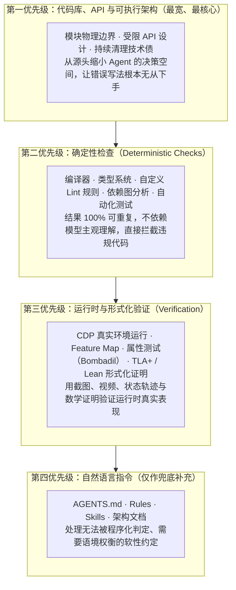
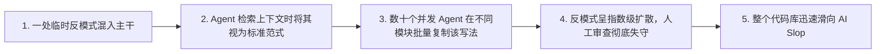
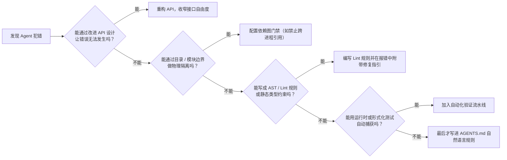
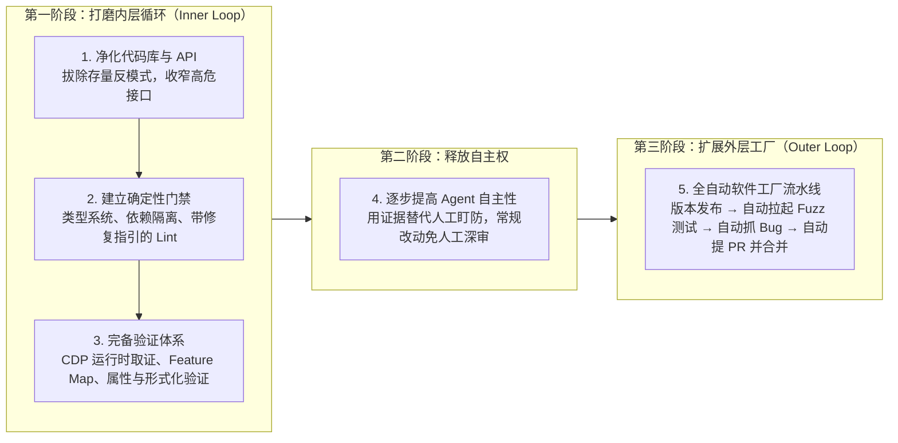

当一个工程师借助 Coding Agent 可以在一个月内向生产环境交付 **3,000 个 PR**，整个团队单月合并 **11,000 个 PR**、227 名贡献者每天发布一个客户端稳定版，而回滚率却依然维持在 **0.5% 左右**时，软件工程的瓶颈就已经彻底转移了[1]。

在 AI Agent 普及之前，个人编码速度决定了产能上限；而在一个工程师可以同时编排几百个 Agent 的今天，写代码本身成了最便宜的环节。但与此同时，几乎所有团队都撞上了同一个问题：**AI Slop（AI 批量生产的低质垃圾代码）**。

如果只追求生成速度而不改造工程底座，Agent 就会以十倍的速度往代码库里倾倒临时补丁、冗余分支和互相打架的副作用。软件工程师今天真正的考题，不再是“怎么亲手写好每一行代码”，而是**如何把一个需要人眼步步设防的“低信任环境”，改造成一套哪怕在无人值守时也能持续产出可靠代码的“高信任软件工厂（Software Factory）”**[1]。

| 维度 | 传统软件开发模式 | 高信任 AI 软件工厂模式 |
|---|---|---|
| **工程师核心职责** | 亲手编写绝大多数业务代码 | 设计架构边界、制定确定性约束、编排 Agent 集群 |
| **代码交付节奏** | 按周或按天分批提交 | 近乎连续、高频流式产生（单月万级 PR） |
| **质量守门员** | 依赖人工逐行 Code Review | 架构隔离 + 静态门禁 + 运行时取证 + 形式化验证 |
| **产能限制因素** | 个人敲键盘速度与上下文切换成本 | 系统架构设计质量与自动化验证吞吐量 |
| **面对错误的姿态** | 逐个修复具体 Bug，在评论区叮嘱“下次注意” | 消除某类错误得以存在的环境条件，让正确行为成为唯一默认路径 |

---

## 一、信任倒金字塔：工程资源到底该投向哪里？

很多团队在遇到 Agent 写烂代码时，第一反应是去改 `AGENTS.md` 或 `CLAUDE.md`，在里面加一行加粗的警告：“严禁使用某某写法！”

这种做法往往收效甚微。原因很简单：自然语言指令位于信任链条的最底层——模型会遗忘、会产生歧义、会在长上下文里丢失注意力，甚至会在两条冲突的文字规则之间随机摇摆。

真正能撑起大规模无人值守交付的，是一座**“信任倒金字塔”**——越靠上的层级，工程投入的回报率越高，对 Agent 的约束力也越强[1]。



这条优先级背后只有一条核心铁律：**凡是能用代码和架构强制执行的规则，就绝不要只写成自然语言指令**[1]。

---

## 二、代码库是一座花园：破窗效应的百倍放大

为什么把“代码库与架构”放在倒金字塔的第一层？因为对于 Coding Agent 来说，**现有代码库就是它最重要的输入上下文**[1]。

大模型天生是一台超级模仿机。当它接手一个任务时，首先会检索仓库里的既有代码，照葫芦画瓢。如果代码库里结构清晰、API 边界干净，Agent 写出来的新代码也会整整齐齐；反过来，如果某个角落里躺着一段为了赶进度硬塞进去的脏补丁，Agent 就会把它当成项目的“官方惯例”，在接下来的几十个 PR 里到处复制。

在手工编码时代，一个工程师一天可能只审三个 PR，看到坏味道还能及时喊停；而在 Agent 时代，一天可能涌入几百个 PR，代码变成了一条永不停歇的流水线。



如果把代码库比作一座花园，Agent 生成的代码就是疯狂生长的植物，而过时的 API、坏模式和技术债就是杂草与害虫。在 AI 时代，工程师的角色越来越像一名**园丁**——你的工作不是亲手去捏每一片叶子，而是翻土、修剪围栏、拔除杂草。一旦发现某类错误，不能只修当前这一个 PR，必须同时把代码库里现存的所有同类坏示范连根拔掉，否则它们还会继续毒害后续 Agent 的上下文[1]。

---

## 三、可执行架构（Enforceable Architecture）：把经验变成围栏

普通的架构文档告诉开发者“你应该怎么写”；而**可执行架构（Enforceable Architecture）**直接从机制上让错误的写法无法通过编译或静态检查[1]。

为了管理复杂的 Electron 客户端应用，团队内部构建了一套类似 Next.js 风格的客户端框架 **Dune**。Dune 的核心价值不在于发明了什么炫酷的新语法，而在于它把团队多年踩过的桌面端大坑，全部固化成了框架约束和自定义 Lint 规则[1]。其中有两个非常典型的工程案例：

### 案例一：在业务代码里全面封杀 `useEffect`

写过 React 的人都知道，`useEffect` 虽然有合法用途，但极其容易被滥用——开发者常拿它来同步派生状态、串联异步请求，稍不留神就会写出死循环、竞态条件或幽灵重渲染。因为开源社区的训练数据里充斥着大量滥用 `useEffect` 的代码，AI Agent 对它更是情有独钟，一遇到状态同步问题就无脑往上套，而且极难靠微调提示词改掉这个习惯。

与其在每次 Code Review 时苦口婆心地跟 Agent 解释生命周期，团队直接在 Dune 框架里做了一个决定：**在所有产品业务代码中全面禁止直接调用 `useEffect`**[1]。

- `useEffect` 只被允许存在于 Dune 框架底层的极少数受控封装内部；
- 业务层只能调用框架暴露出来的、语义明确的高层受限接口（例如声明式的数据订阅或受控生命周期钩子）。

通过直接收缴这把容易走火的武器，团队从根源上消灭了一整类由副作用引发的隐蔽 Bug，也省去了 Agent 在复杂生命周期上做微操判断的认知负担。

### 案例二：用目录结构与依赖门禁锁死 Electron 进程边界

Electron 应用包含主进程（Main Process，负责系统底层 I/O 与窗口管理）和渲染进程（Renderer Process，负责 UI 界面）。在实际开发中，Agent 经常为了图省事，在渲染进程的文件里顺手 `import` 主进程的重度模块，结果导致耗时任务阻塞渲染线程，界面频繁掉帧卡死。

为了治住这个问题，团队把目录结构直接变成了机器可执行的上下文边界[1]：

1. 在顶层目录严格切分 `electron-main/` 与 `electron-renderer/`；
2. 接入静态依赖图分析器与自定义 Lint 规则，一旦检测到 `electron-renderer/` 下的任何文件直接或间接引入了 `electron-main/` 的模块，构建当场报错拒绝。

```ts
// 自定义 ESLint / AST 门禁示意：不仅拦截错误，还在报错信息中直接告诉 Agent 正确改法
export const noDirectUseEffectAndCrossProcessImport = {
  create(context) {
    return {
      ImportDeclaration(node) {
        const importPath = node.source.value;
        const currentFile = context.getFilename();

        // 1. 拦截渲染进程越界引入主进程模块
        if (currentFile.includes('/electron-renderer/') && importPath.includes('electron-main')) {
          context.report({
            node,
            message:
              '[架构违规] 渲染进程严禁直接引入 electron-main 模块，这会阻塞 UI 线程。请改为通过 src/ipc/client.ts 中定义的强类型 IPC 通道通信。',
          });
        }
      },
      CallExpression(node) {
        // 2. 拦截业务代码直接调用 useEffect
        if (node.callee.name === 'useEffect' && !context.getFilename().includes('/dune-core/')) {
          context.report({
            node,
            message:
              '[架构违规] 业务组件禁止直接使用 useEffect。派生状态请直接在渲染期计算；事件响应请移入事件处理函数；跨组件同步请使用 Dune 提供的 useManagedResource 接口。',
          });
        }
      },
    };
  },
};
```

注意上面报错信息的写法：它不仅冷酷地拦下了违规代码，还**在报错信息里直接给出了具体的替代 API 和修复路径**。这就相当于在编译器层面给 Agent 做了一次精准的即时辅导。

---

## 四、为什么代码注释和 Markdown 反而会加剧 AI Slop？

在日常和 Agent 协作的过程中，有两个反直觉却极其普遍的现象，让团队最终做出了一个激进的决定——**在新项目里禁止 99% 的代码注释**[1]。

### 现象一：Agent 会用长篇大论的注释替烂代码“洗白”

在早期开发客户端时，团队发现界面偶发卡顿，内存回收压力很大。排查后发现，代码库里被 Agent 塞满了成百上千个 `setTimeout`、`requestAnimationFrame` 和 `requestIdleCallback`[1]。

为什么会这样？因为底层编辑器内核（类似 VS Code 的命令式架构）和上层 UI（React 的声明式架构）之间存在状态同步摩擦。Agent 在遇到时序冲突时，没有去解开底层的架构死结，而是走捷径套了一个 `setTimeout(..., 0)` 把问题糊弄过去。更要命的是，Agent 还会在定时器旁边写一段极其诚恳、滴水不漏的英文注释：

```ts
// WORKAROUND: Defer state update to the next tick via setTimeout to avoid
// a synchronous race condition between the imperative editor model and React's
// render phase during rapid tab switching. Do not remove without refactoring X.
setTimeout(() => {
  syncEditorState();
}, 0);
```

这段注释看起来太像资深工程师深思熟虑后的妥协了。结果就是：不仅人类审查员容易被它唬住放行，后续进来的其他 Agent 读到这段注释后，也会恍然大悟——“原来在这个项目里，遇到时序竞争只要加个 `setTimeout` 再配一段免责注释就行了！”于是定时器像野草一样长满了整个仓库，直到把界面卡死[1]。

### 现象二：把人类的局部纠偏“过度泛化”成死教条

另一个坑出在 Markdown 规则文件上。有时人类工程师在某个具体 PR 里随口提了一句针对当前场景的修改意见，Agent 听进去了，转身就把这句有前提的局部建议当成放之四海而皆准的宇宙真理，写进了 `AGENTS.md` 或代码注释里。久而久之，规则文件里塞满了互相矛盾、脱离上下文的死教条[1]。

因此，团队在新项目里直接通过 Lint 禁掉了绝大多数普通注释：

- 注释不会报错，写得再漂亮也无法阻止腐化；
- 如果一段逻辑非得靠大段注释才能解释为什么这么扭曲，说明架构本身就该重构了；
- 把原本想写进注释或 Markdown 的叮嘱，按优先级顺次往上提：**先看能不能改 API 设计 → 不能就加架构边界 → 再不能就写进带修复提示的 Lint 规则或类型系统 → 最后实在没法做确定性检查的，才留给自然语言文档**[1]。

（当然，禁止 99% 注释是该团队针对高并发 Agent 采取的极端工程手段，核心目的在于逼迫团队把约束代码化，而非普遍适用的教条。）



---

## 五、从审代码到审证据：运行时验证与形式化验证的复兴

当 99% 的低级错误被可执行架构和静态门禁挡在门外后，剩下的核心问题就是：**怎么证明这段代码在真实运行的时候真的对？**

在月产上万个 PR 的节奏下，靠人眼看代码文本来脑补运行效果已经彻底行不通了。团队把代码审查的重心从“读 Diff 文本”转到了**“审阅验证产物（Verification Artifacts）”**——截图、操作录屏、状态转换图，以及形式化数学证明[1]。

### 1. 运行时验证（Runtime Verification）与 Feature Map

Agent 改完一个界面按钮，决不允许说完“我已经改好了”就交差。它必须通过 Chrome DevTools Protocol（CDP）或调试接口亲自把客户端跑起来，找到那个按钮，点下去，截屏或录屏验证界面反馈是否符合预期[1]。

为了让 Agent 不在复杂的 UI 树里迷路，团队在验证技能里引入了两件利器：

- **功能地图（Feature Map）**：就像网站的 Sitemap 一样，从用户视角把整个应用的所有功能路径、区域名称、交互入口整理成一份结构化目录。当人类说“修一下左边栏那个折叠功能”时，Agent 不需要靠猜去翻几百个组件文件，直接查 Feature Map 就能对齐命名、找到对应页面并执行验证脚本。
- **可测试的自定义 CLI**：把启动环境、注入状态、截图比对等常用验证动作封装成独立的命令行工具（CLI）。这样 Agent 每次验证只需调一行命令，既大幅节省了每次重新生成脚本的 Token，又能保证验证动作本身高度一致且可被独立测试[1]。

### 2. 把“学院派”武器平民化：TLA+、Lean 与 Bombadil

过去几十年里，形式化验证（Formal Verification）和模型检查（Model Checking）一直被视作阳春白雪——虽然大家都知道它严密，但写一套规格说明的学习曲线极陡、耗时极长，除了造火箭、写数据库内核或芯片设计，普通业务团队根本用不起。

**AI Agent 彻底改变了这笔经济账**[1]。因为让大模型去编写和维护形式化模型、定理证明或性质测试的成本，比人类手写低了几个数量级：

| 验证工具 / 方法 | 所属领域 | 在团队中的真实应用场景 | 解决的核心痛点 |
|---|---|---|---|
| **TLA+** | 模型检查（Model Checking） | 跨设备、跨平台通知同步系统 | 穷举多台设备、多个平台在不同网络时序下的状态组合，提前揪出普通测试极难复现的并发死锁与状态不一致 |
| **Lean** | 定理证明（Theorem Proving） | 自研虚拟化长列表（Virtualized List）核心算法 | 从数学上严格证明滚动高度计算与回收算法满足特定性质，根治列表快速滚动时的界面闪烁与抖动（Jitter） |
| **Bombadil** | 基于性质的 UI 测试（Property-Based UI Testing） | 客户端全界面交互压力测试 | 定义通用 UI 不变量（如“任何弹窗打开后必须有可关闭路径”），自动在界面上随机探索组合操作并捕获异常 |
| **Statechart Skill** | 状态机可视化（Statecharts） | 产品交互逻辑对齐与 PR 联合审查 | 从用户体验视角把代码里的状态流转画成状态图，与操作视频、截图并排展示，一眼看出 Agent 是否误解了产品意图 |

这是一个极具启发性的信号：在一个高信任的 AI 工程体系里，团队成员日常消耗的 Token 中有 **70% 左右花在验证与证明上，只有 30% 花在生成代码上**[1]。正因为 AI 让编写高阶验证工具变得极其便宜，软件工程正在迎来一个属于测试与形式化验证的黄金时代。

---

## 六、演进路线图：为什么不能一上来就搞“全自动软件工厂”？

看到“单月 11,000 个 PR、无人值守自动合并”的成绩单，很多团队会忍不住想直接跳到最后一步：先搭一套多 Agent 编排流水线，让几百个 Agent 日夜不停地自动跑任务、自动提 PR、自动合并。

演讲中专门对这种做法泼了冷水：**如果你的底层代码库和内层循环（Inner Loop）还产出一堆低质量代码，给它套上全自动外层循环（Outer Loop），只会让你以百倍的速度破产**[1]。

自动化本身不会提升代码质量，它只是一个放大器。在一个缺乏约束的脏代码库上跑全自动工厂，Agent 会先生成一堆烂代码，然后再消耗十倍的 Token 去排查和修补这堆烂代码制造出来的新 Bug，最终陷入高成本、低质量的死循环。

真正走得通的建设顺序，必须老老实实分五步走，花几个月时间把底座垫牢[1]：



当且仅当前面四步都已经扎稳，第五步的“全自动外层循环”才会真正展现出威力。

在他们现在的流水线里，每当客户端发布一个新版本，系统就会自动在云端拉起一个新的项目实例，派出一群 Agent 像真实用户一样对整个应用做全方位的模糊测试（Fuzz Testing）和探索性点击；一旦发现异常，Agent 会自动定位根因、编写修复代码、跑通全套静态门禁与运行时验证、生成附带完整证据的 PR，并在满足所有确定性条件后自动合并入库[1]。

哪怕是在这样每天高频迭代的 Electron 应用上，应用启动耗时、输入响应延迟、新建与切换会话的速度不仅没有因为代码量暴涨而劣化，反而比上线初期更快[1]。

---

## 结语：软件工程师的新坐标

把视野拉远来看，从“手写每一行代码”到“经营一座软件工厂”，软件工程师的核心竞争力正在经历一次彻底的重写[1]：

1. **消灭错误的类别，而不是修补单个错误**：每次 Agent 犯错，不要急着在评论区骂它或往提示词里塞警告，先问能不能改 API、加模块隔离或写一条 AST Lint 规则，让这类错误从此在物理上无法发生。
2. **像照料花园一样照料代码库**：代码库是你喂给 Agent 最核心的 Prompt。发现新错误时，必须同步清理掉仓库里残留的旧反模式，绝不给 Agent 留下错误的模仿样本。
3. **收缴需要微妙判断的高危 API**：像封杀业务层 `useEffect` 一样，把那些容易写出时序漏洞和副作用的底层能力关进框架笼子里，给 Agent 提供默认安全的受限接口。
4. **把 Token 预算向验证倾斜**：不轻信 Agent 嘴上的“已完成”，要求它交出运行截图、录屏、状态图和数学不变量证明。
5. **先筑牢内层循环，再放大外层并发**：没有确定性约束和验证闭环的自动化，只是在加速制造技术债。

未来的顶尖工程师，不再是那个单枪匹马手敲代码最快的人，而是那个能够设计出最严密的架构围栏、构建出最诚实的验证体系，从而让成百上千个 Agent 在轨道内安全狂奔的系统建筑师[1]。

## 参考资料

1. [All Code Is Slop (Except Mine) — AI Engineer Code Summit](https://www.youtube.com/watch?v=O_zcc6Xl12g)
