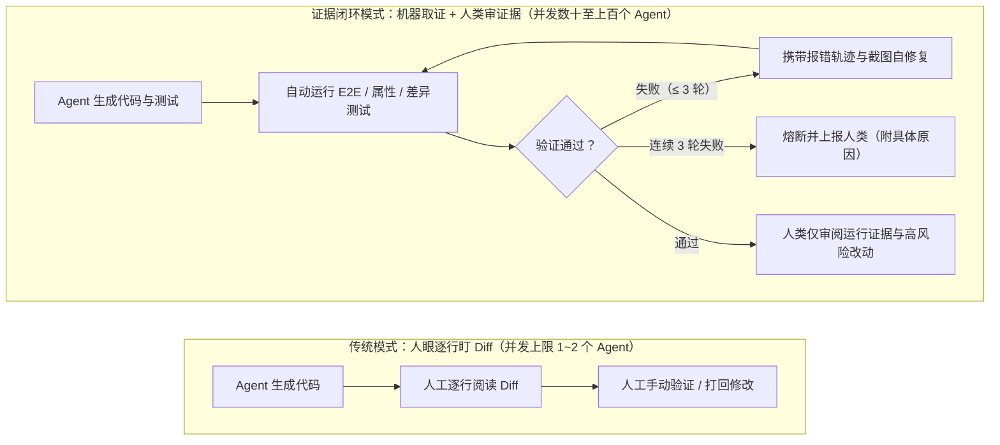
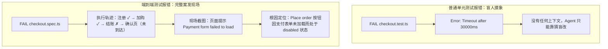
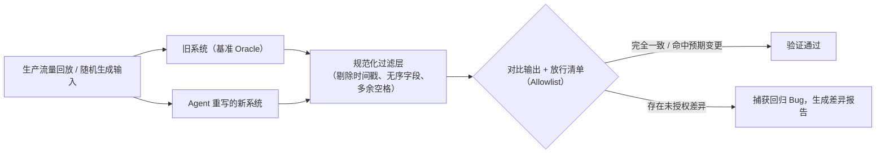
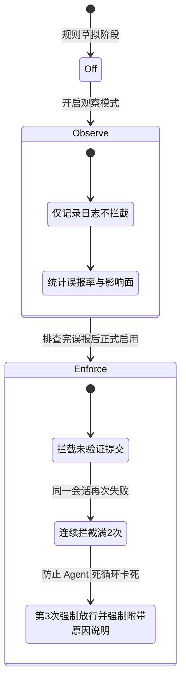

在 Claude Code 团队内部，目前约有 90% 的代码由 AI 自己编写并完成初步审查。当代码生成的速度被推到这个量级时，研发流程里最先崩掉的不是模型的编码能力，而是人类的注意力。

如果没有一套可靠的自动验证机制，一个工程师顶多只能同时盯一两个 Agent——因为每一行改动最终都得靠人眼去读 Diff。而一旦建立起自动化的“证据闭环（Verification Loop）”，同一个工程师就能同时指挥几十甚至上百个 Agent 并行推进任务。

内部测试数据印证了这一点：在结构化文件生成等任务中，仅仅是引入一个独立的判分程序对照评分标准（Rubric）去核验模型产出，任务成功率就能直接提升最多 10 个百分点；任务本身越复杂，这种核验带来的提升越显著[1]。

过去，编写端到端测试、性能基准、属性测试和技术规范是一件极其昂贵的事，团队往往因为赶进度而省掉这些步骤。现在这笔账彻底翻过来了：让 Agent 生成一套测试或基准脚本只需要几秒钟；而这些测试一旦生成，就变成了确定性的普通软件，哪怕每天反复跑上千次，也不会额外消耗多少大模型 Token。

当写代码变得足够便宜，工程师的核心工作就从“逐行写代码、逐行看代码”，变成了**定义什么叫“完成”，以及打造一套连 AI 都糊弄不过去的验证系统**。



---

## 为什么“让 AI 顺手写个单测”往往不管用？

很多团队在引入 Coding Agent 后，第一反应是要求它“写完代码顺手补一套单元测试”。但在实际工程里，这种做法很容易制造虚假的安全感。

原因在于**同源偏见（Collusion & Happy-Path Bias）**：当同一个 Agent 在同一个上下文窗口里既写业务代码、又写示例式单元测试（Example-based Unit Tests）时，测试代码会天然顺着业务代码的思维盲区走。

比如你让 Agent 写一个订单金额分摊函数，它用浮点数写了实现，又顺手写了两个整除的测试用例 `expect(split(100, 2)).toEqual([50, 50])`。测试 100% 绿灯通过，但一上生产遇到 `100` 除以 `3`，就因为精度丢失少了一分钱。Agent 和它写的单元测试达成了某种“自我合谋”——它们对需求的误解是一模一样的。

除此之外，给 Agent 用的测试套件还必须避开两种常见的“死法”：

1. **测试不稳定（Flaky Tests）**：如果一个测试时过时不过，等于在用强化学习训练一个坏习惯——Agent 会迅速学会“只要无脑重试就能刷绿”，而不是去真正排查代码里的缺陷。
2. **测试太慢（Slow Tests）**：如果跑一次验证要等半小时，Agent 就会减少运行测试的频次，攒一大批改动才跑一次。一旦报错，改动面太大，连 AI 也很难定位到底是哪一步改坏了。

要在避开这两个坑的前提下真正管住 Agent，有三种投入产出比最高的测试手段[1]。

| 测试类型 | 核心原理 | 最擅长抓什么问题 | 典型适用场景 |
|---|---|---|---|
| **端到端测试（E2E）** | 驱动真实运行环境走完完整用户路径 | 组件衔接断裂、UI 状态卡死、虚假 Mock 通过 | 核心用户流程、前后端联调、客户端交互 |
| **属性测试（Property-Based）** | 定义不可违反的不变量，用成千上万组随机输入狂轰滥炸 | 极端边界条件、序列化/反序列化丢数据、精度与幂等性漏洞 | 解析器、账务计算、状态机、无规范老代码重写 |
| **差异测试（Differential）** | 将旧系统作为基准（Oracle），新旧系统并排跑相同输入比对结果 | 重构或迁移中悄然引入的行为偏差与隐性破坏 | 大规模架构迁移、语言重写、性能优化 |

---

## 三种最值得投入的验证武器

### 一、端到端测试（E2E Tests）：给 Agent 装上“手和眼”

如果团队精力有限，只能重点投入一种测试，首选一定是**端到端测试**。

单元测试虽然跑得快，但因为 Mock 掉了太多外部依赖，经常出现“单测全绿、页面白屏”的尴尬。端到端测试直接从用户视角描述完整链路——比如“把商品加入购物车 → 点击去结账 → 填写支付信息 → 跳转到支付成功页”。这种测试极难被投机取巧糊弄过去：整个功能要么走得通，要么走不通[1]。

更重要的是，端到端测试在失败时提供的**证据密度**完全不同。



如上图所示，当单元测试超时，终端里往往只留下一行冷冰冰的 `Error: Timeout after 30s`，Agent 根本不知道卡在哪一步，只能瞎猜乱改。而端到端测试可以直接把每一步的执行轨迹、报错瞬间的页面截图、DOM 节点状态全部抓出来，明确告诉 Agent：“结账按钮一直处于禁用状态，因为支付表单组件加载失败了。”

在实践中，最有效的做法是直接给 Agent 配齐操作真实环境的工具：

- **Web 端**：通过 Chrome DevTools Protocol（CDP）或浏览器插件，让 Agent 自己拉起无头浏览器点击、填表、截屏并检查控制台报错；
- **移动端与桌面端**：接入 iOS / Android 模拟器或桌面控制接口；
- **后端服务**：让 Agent 在本地沙箱直接启动服务实例，用真实请求打穿接口。

如果项目里维护了一份“功能地图（Feature Map）”——按用户视角列出核心路径、快捷键、关键选择器（Selectors）和预期结果——这份文档就能直接兼任 Agent 的施工图纸和验收评分表[1]。

### 二、属性测试（Property Tests）：用数学不变量抓出共同盲区

常规测试测的都是“人类事先想得到的异常”；而属性测试（Property-Based Testing）专门用来抓**人类和 AI 都没想到的极端边缘情况**[1]。

属性测试的思路刚好反过来：你不需要手写具体的输入输出对，而是先写下一条**无论如何都绝对不能被打破的铁律（Property）**，然后交给测试框架（如 TypeScript 的 `fast-check`、Python 的 `Hypothesis`、Rust 的 `proptest`）自动生成成千上万组包含空字符串、超长字符、特殊 Unicode、极值数字、乱序数组在内的随机输入，全力尝试把你的代码测崩。一旦测崩，框架还会自动做“反例缩减（Shrinking）”，把复杂的随机输入简化成能复现 Bug 的最小输入，直接喂回给 Agent 修复。

几乎所有软件工程里都有四类天然适合写成属性测试的规则[1]：

1. **往返一致性（Round-trip）**：把任意合法数据编码后再解码（或序列化后再反序列化、解析后再格式化），必须一字不差地还原回原始数据。
2. **业务不变量（Invariants）**：无论经历什么操作，系统都必须守住的底线——例如“账户余额永远不能变成负数”“分摊后的子订单金额之和必须严格等于总金额”。
3. **幂等性（Idempotency）**：同一套数据清洗、结构迁移或重试逻辑，执行一次和连续执行两次，最终状态必须完全一致。
4. **等价性（Equivalence）**：经过复杂性能优化的新算法，在面对任何输入时，算出来的结果都必须和那个虽然慢但绝对正确的朴素实现完全一致。

下面是一段使用 TypeScript 和 `fast-check` 验证“订单折扣分摊”的实例代码。假如 Agent 写了一个按比例分摊优惠券的函数 `allocateDiscount`，我们可以用几行属性测试瞬间封死它的漏洞：

```ts
import fc from 'fast-check';

// 待测函数：将 discount 金额按比例分摊到 items 各商品上
function allocateDiscount(items: number[], discount: number): number[] {
  // Agent 生成的实现代码...
}

test('优惠分摊必须守住三条核心不变量', () => {
  fc.assert(
    fc.property(
      fc.array(fc.integer({ min: 1, max: 1_000_000 }), { minLength: 1, maxLength: 50 }),
      fc.integer({ min: 0, max: 1_000_000 }),
      (items, rawDiscount) => {
        const total = items.reduce((a, b) => a + b, 0);
        const discount = Math.min(rawDiscount, total);
        const allocated = allocateDiscount(items, discount);

        // 不变量 1：分摊后的数组长度必须与原商品数量一致
        expect(allocated.length).toBe(items.length);

        // 不变量 2：每件商品分摊到的优惠不能为负数，也不能超过该商品自身价格
        allocated.forEach((amount, i) => {
          expect(amount).toBeGreaterThanOrEqual(0);
          expect(amount).toBeLessThanOrEqual(items[i]);
        });

        // 不变量 3：所有商品分摊到的优惠总和，必须严格等于总优惠额（不能因为四舍五入多一分或少一分）
        const allocatedSum = allocated.reduce((a, b) => a + b, 0);
        expect(allocatedSum).toBe(discount);
      }
    ),
    { numRuns: 5000 } // 自动生成 5000 组随机极端数据
  );
});
```

由于这 5000 组随机输入完全不带大模型的训练偏见，任何尾差处理不当、整数溢出或除零错误都会在几百毫秒内被抓出来。在对那些文档早已过期、没人说得清历史细节的老代码进行重构时，属性测试尤其管用[1]。

### 三、差异测试（Differential Tests）：拿老系统当“神谕”

在做大规模系统重构、框架升级或跨语言迁移时，最核心的要求往往只有四个字：**行为不变**。

这时候最省力也最严密的办法是**差异测试**——不需要从头编写复杂的业务断言，直接把老系统当成标准答案（Oracle）。把老系统和新系统并排跑起来，同时喂给它们随机生成的输入或者录制下来的真实生产流量切片，直接比对两边的输出[1]。



要把差异测试真正用起来，有两个工程细节很关键[1]：

1. **输出规范化（Normalization）**：新旧系统的返回里常带有动态生成的时间戳、请求 ID、空白符差异或 JSON 无序键，比对前要先过一层清洗函数，把这些无关噪音抹平。
2. **预期差异白名单（Allowlist）**：如果新系统刻意修掉了老系统的某个历史 Bug，或者升级了某个字段格式，就把它明确登记进白名单，避免比对器反复误报。

---

## Claude Code 团队如何管住“验证系统”本身？

有了上面三类测试，还不算完。在高度依赖 Agent 的团队里，如果只管写测试而不管验证流程的治理，Agent 很快就会找到规则的漏洞（比如顺手把报错的测试改掉）。以下是 Claude Code 团队在日常研发中沉淀下来的八条实战铁律[1]。

### 1. 验证意味着真正把改动跑起来（`verify` 技能）

任何代码改动，光靠静态分析和单测是不够的，必须在真实运行环境里跑通。就像人类工程师改完 iOS 代码一定会拉起模拟器点一遍一样，Agent 也必须这么做。

团队的做法是在代码仓库的 `.claude/skills/` 目录下就近放置名为 `verify` 的技能（Skill），把“如何启动本地服务、如何拉起模拟器、如何执行冒烟测试”写成标准脚本。Agent 在每次提交代码前，都会自动调用对应的 `verify` 技能完成端到端冒烟验证。团队还会专门花精力让 Agent 对 `verify` 技能本身做压测和提速，确保这层冒烟测试既快又稳[1]。

### 2. 三轮不过立刻停手，用失败来分配人类注意力

既然没人看得完所有代码，那就**用测试失败作为触发人工介入的信号**。

当检查报错时，Agent 会自动根据报错信息尝试修复。但如果**连续修了三轮还是通不过**，Agent 就会立刻停手，把问题连同前几轮的排查记录一起转交给人类工程师[1]。设这个“三轮熔断”上限非常关键——如果连改三次都没修好，通常说明方向错了或者遇到了底层架构冲突，继续让 Agent 盲目打补丁只会把代码越改越乱。

### 3. 谁负责的代码，谁写检查规则

模块的代码所有者（Code Owners）负责为自己的领地编写检查逻辑，并不断打磨，直到自动检查抓出来的问题跟人类专家审查时会指出的问题高度一致。更重要的是，当某条检查决定呼叫人类介入时，**必须直接用人话说清楚为什么要叫人来**，而不是甩一个红叉让人自己去几百行 Diff 里大海捞针[1]。

### 4. 按 Diff 按需触发的 39 项可靠性核对表

每个经历过线上故障的团队都会攒下一堆“血泪教训”，但没人能背下几十次历史事故的细节；如果把所有历史教训全塞进每次审查的 Prompt 里，又会导致上下文膨胀、注意力分散。

Claude Code 团队维护了一份包含 **39 项可靠性指标的核对表（Checklist）**，每一项都包含三个要素：

- **可从 Diff 中识别的触发条件（Trigger）**
- **具体的核查动作（Check）**
- **背后的历史故障或 PR 编号**

例如其中一条规则叫 `--resume 能够正常加载旧版会话记录`。只有当某次提交的 Diff 改动了会话存储结构或消息类型定义时，这条规则才会被触发，要求重点检查“新增字段在读取没有该字段的老版本记录时是否做了兼容处理”。

每次代码变动时，Agent 会先扫一遍 Diff，**只激活匹配上触发条件的 3 到 10 条规则**。这样既保证了历史坑点绝不重蹈覆辙，又让每次审查保持极高的专注度[1]。

### 5. 单一审查员 + 多轮上下文继承

在 AI 代码审查上，有些团队喜欢同时叠好几个不同模型的审查员一起看。但实践下来，在主审查员之上再叠加第二个更昂贵的审查员，往往既费钱效果又不好，远不如集中精力把主审查员调教好。

团队通过在仓库里维护 `REVIEW.md` 来明确告知审查员当前模块最在乎什么。同时，多轮审查和验证之间不是割裂的——**每一轮新的检查都会直接继承前几轮的上下文和失败记录**，只盯增量变化和未决问题，而不是每次都从头再审一遍。这样不仅大幅省下了 Token 成本，抓出的深层问题反而更多[1]。

### 6. 绝对底线：被审查的代码不能修改裁判规则

如果允许一次代码提交顺手修改负责评判它的测试或规则，那整套防线就形同虚设——Agent 为了让检查通过，完全可能去把 `REVIEW.md` 里的限制删掉。

因此团队立下了几条硬规矩[1]：

- **规则物理隔离**：代码审查工具读取的 `REVIEW.md` 和门禁规则，永远强制从基础分支（Base / Default Branch）拉取，**绝不读取当前 PR 分支里的改动**。
- **审查绑定具体 Commit**：审查只针对已经生成的静态 Commit。如果审查还在进行中，有人又往分支推了新代码，之前的审查结果立刻作废。
- **便宜的检查先跑**：在真正发起 PR、消耗公共 CI 和审查资源之前，通过本地 Hook 或完成目标（`/goal`）强制 Agent 先在本地跑完单元测试、构建和 Linter。

### 7. 新门禁先走“观察模式”，并留出防卡死逃生阀

在仓库里，每一个 Commit 都会被打上验证方式印记（Stamp）——哪怕某次提交没做验证，也会明确标上 `none`，方便事后随时检索审计。

当团队引入一道新的提交拦截门禁（比如未运行 `/verify` 或 `/code-review` 禁止提交）时，会分三档推进[1]：



1. **关闭模式（Off）**：仅作开发调试。
2. **观察模式（Observe）**：上线初期绝不直接拦人，只静默记录“如果启用拦截，哪些提交会被拦下”，用来排查误报（False Positives）。
3. **强制模式（Enforce）**：确认误报可控后正式拦截。但这里有一个非常务实的工程设计：**如果同一个会话里提交已经被连续拦截了两次，第三次系统会允许放行**（前提是在 Commit Message 里写明未通过验证的原因）。因为没有任何工具是绝对完美的，必须留一道逃生阀，防止 Agent 在极端情况下彻底死锁[1]。

### 8. 考核审查器本身，把漏网之鱼变成新规则

验证系统本身也是软件，同样需要持续考核与新陈代谢[1]。

**第一，用真实历史故障给审查系统打分。**
团队不仅日常盯紧“合并后被回滚（Revert）的比例”和“维护者在合并前打回的比例”，还专门搭了一套基于历史事故的评测集（Eval）：把代码库状态还原到当年事故 PR 发起审查的那一刻，并配上一句话的“标准答案”（指明当时真正的 Bug 是什么）。只有当审查系统准确指出这个具体 Bug 时才算得分；同时混入一批长期稳定运行的正常改动作为对照组，防止审查系统为了刷高召回率而乱报一气。团队还会把“原始发现率”“二次核验后留存率”和“最终呈现率”拆开统计，看看是不是中间某道过滤环节把本来已经抓到的真 Bug 给误筛掉了。审查意见也会被明确打上 `Important`（必须修）、`Nit`（细枝末节）或 `Pre-existing`（历史遗留问题，不扣在本次提交者头上）的标签。

**第二，两条路径把漏掉的 Bug 变成新规则。**
一旦有 Bug 漏过防线，团队会通过两种方式把它转化为 `REVIEW.md` 里的规则：
- **从人工评论和回滚记录里提炼**：只要同一类问题在至少两个不同的 PR 里重复出现，并且能直接从 Diff 特征里看出来，就会被立为候选规则。接着系统会派出**三个独立的 Agent 扮演反方，全力尝试推翻或证伪这条规则**；只有扛住反驳的规则，才会提交 PR 由人类批准合入主分支。
- **在历史事故 PR 上重放找茬工具**：拿三个不同的 Bug 扫描工具去重跑那些曾引发线上故障的小型 PR。如果有至少两个工具能抓出问题，说明这类 Bug 完全是可检测的，只是现有规则库漏了，必须补进 `REVIEW.md`。

**第三，严禁纵容不稳定测试，定期给规则库做减法。**
对待偶发失败的 Flaky 测试，团队给 Agent 立了死规矩：**不准跳过（Skip）、不准塞 `sleep` 强行等待、不准靠盲目重试混过关**。如果 Agent 实在查不出偶发失败的根因，它必须直接删掉这个测试，并在提交说明里老老实实写清楚为什么删。与此同时，因为规则文件、测试套件和验证脚本如果只增不减，迟早会拖慢整个系统，团队会定期做清理修剪，删掉那些已经过时或不再产生价值的条目[1]。

---

## 结语

回顾这套体系，最核心的转变在于：**把验证层当成一套与业务系统同等重要的独立软件工程来建设**。

给 Agent 配上能操作真实环境的端到端测试、不带主观偏见的属性测试、以旧系统为基准的差异测试；把裁判规则锁在被测代码改不到的分支上；用真实历史事故去考核审查器；每次漏掉问题就沉淀成规则，并定期修剪过期条目。

当这整套闭环跑顺之后，工程师就不再是那个跟在 AI 屁股后面逐行擦地的苦力，而是制定验收标准、审阅运行证据的系统指挥官[1]。

## 参考资料

1. [How the Claude Code team thinks about verification](https://claude.dev/blog/how-the-claude-code-team-thinks-about-verification/)
